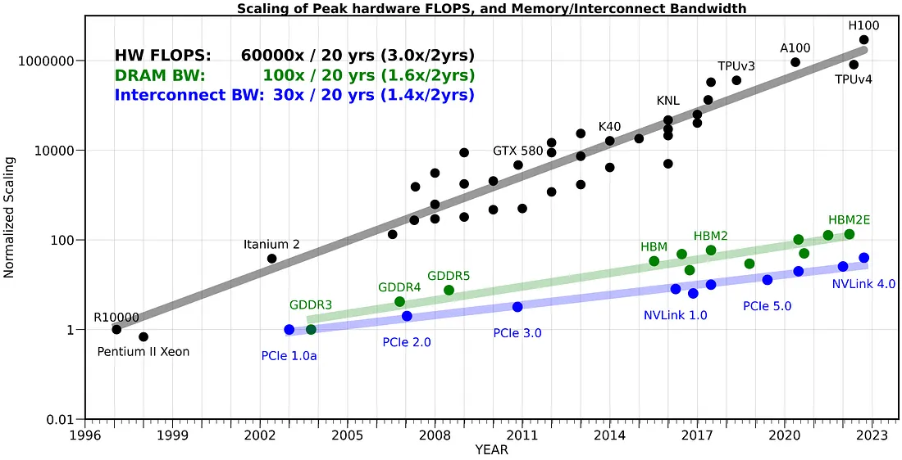

这个系列讲怎么让 Transformer 训练在 GPU 上跑得更快。这一篇先打基础：[第 1 节](#hardware)介绍 GPU 的硬件，包括数据存在哪几层、一个 SM 里有什么、CUDA 的执行层级怎么对应到硬件；[第 2 节](#triton)用四个例子介绍 Triton，后面两篇的 kernel 都用它写。[第 3 节](#tune)看写好的 kernel 在 SM 上怎么跑、怎么调：`num_warps` 和 `num_stages` 改了什么，一个 SM 放几个 program，warp 怎么藏住访存延迟，program 怎么分批，matmul 的 block 大小怎么选。几代 NVIDIA GPU 的规格对比放在 [Appendix A](#specs)，TPU 和 GPU 的对照放在 [Appendix B](#tpu)。

下一篇[谁偷走了 5090 的算力和显存](/blog/gpu-training-analysis/)用这些知识在 RTX 5090 上拆解一步训练的时间和显存，第三篇 [FlashAttention 1–4](/blog/flashattention-1-to-4/) 讲 attention 的 IO-aware kernel。

> 环境：RTX 5090 32 GB，torch 2.11.0+cu130，Triton 3.6.0。文中的 KB、MB、GB 都按 1024 进位。

---

## 1 GPU 硬件 {#hardware}

做性能分析时最常用的两个数是峰值算力和显存带宽，一个 kernel 受哪个限制，取决于它要搬多少数据、在哪一层读写。这一节先看数据存在哪几层（[1.1](#hw-memory)）和 SM 里有什么（[1.2](#hw-sm)），再看 CUDA 的 thread、warp、block 怎么落到这些硬件上（[1.3](#hw-model)）。

### 1.1 存储层级 {#hw-memory}

处理器的频率早就不怎么涨了，算力的增长主要来自并行：更多的 SM、更宽的 Tensor core。显存带宽涨得慢得多：过去 20 年，峰值算力涨了约 6 万倍（每两年 3.0 倍），DRAM 带宽只涨了约 100 倍（每两年 1.6 倍），芯片之间的互联带宽约 30 倍（[图 1-1](#fig-memwall)）。带宽跟不上，越来越多的 op 受显存带宽限制（memory-bound），只能少搬：让读进来的数据留在离计算单元近的地方，多用几次。

<figure id="fig-memwall" class="fg-fig">

<figcaption><strong>图 1-1</strong> 峰值算力与 DRAM、互联带宽 20 年来的增长，纵轴是相对 1997 年的倍数（对数轴）。图来自 Gholami 等人的 <a href="https://arxiv.org/abs/2403.14123">AI and Memory Wall</a>（IEEE Micro，2024）。</figcaption>
</figure>

数据离计算单元越近，读写越快，容量也越小（[图 1-2](#fig-h-1)）。每个 SM 里有 register 和 L1 / shared memory，所有 SM 共享芯片上的 L2，显存在芯片外面。L1 和 L2 由硬件当作 cache 自动管理，kernel 能自己安排的只有 shared memory 和 register。所以 kernel 优化的套路都一样：把要反复用的数据读进 shared memory 或 register，在片上多算几次，再写回显存。[第 2 节](#triton)的 block 矩阵乘、[下一篇](/blog/gpu-training-analysis/)的算子融合和 [FlashAttention](/blog/flashattention-1-to-4/) 都是这个思路。

<figure id="fig-h-1" class="fg-fig">
<svg class="fg" viewBox="0 0 640 300" width="100%" role="img" aria-label="RTX 5090 的存储层级：每个 SM 里有 256 KB register 和 128 KB L1/shared memory，170 个 SM 共享芯片上的 96 MB L2，芯片外是 32 GB GDDR7 显存，带宽 1.79e12 B/s">
  <style>
    .fg .grid { stroke: currentColor; stroke-opacity: .1; }
    .fg .axis { stroke: currentColor; stroke-opacity: .35; }
    .fg .ref { stroke: currentColor; stroke-opacity: .45; stroke-dasharray: 4 4; }
    .fg .tick { font-size: 11px; fill: currentColor; opacity: .65; }
    .fg .lab { font-size: 12px; fill: currentColor; }
    .fg .lab2 { font-size: 11px; fill: currentColor; opacity: .65; }
    .fg .ttl { font-size: 12px; font-weight: 600; fill: currentColor; }
    .fg .val { font-size: 11px; fill: currentColor; }
    .fg .t { font-size: 12.5px; fill: currentColor; }
    .fg .tb { font-size: 12.5px; font-weight: 600; fill: currentColor; }
    .fg .s { font-size: 10.5px; fill: currentColor; opacity: .7; }
    .fg .op { fill: var(--fig-bg); stroke: currentColor; stroke-opacity: .45; stroke-width: 1.2; }
    .fg .band { fill: currentColor; fill-opacity: .045; }
    .fg .ring { stroke: var(--nv-bg, #fff); stroke-width: 2; }
    .fg .halo { fill: none; stroke: var(--nv-bg, #fff); stroke-width: 6px; stroke-linejoin: round; opacity: 1; }
    .fg g.m:hover > :not(title) { opacity: .85; }
    @media (max-width: 640px) { .fg-fig { overflow-x: auto; } .fg-fig > svg { min-width: var(--fg-minw, 540px); } }
  </style>
  <defs><marker id="fig-h-1-m0" viewBox="0 0 8 8" markerUnits="userSpaceOnUse" markerWidth="9" markerHeight="9" refX="7" refY="4" orient="auto"><path d="M0,0 L8,4 L0,8 Z" style="fill: var(--fig-mute)"/></marker></defs>
  <rect x="10" y="22" width="452" height="250" rx="12" style="fill: none; stroke: currentColor" stroke-opacity=".35" stroke-dasharray="6 4"/>
  <text class="lab2" x="22" y="40">GPU 芯片（die），共 170 个 SM</text>
  <rect x="20" y="52" width="92" height="108" rx="8" style="fill: color-mix(in srgb, var(--fig-1) 10%, transparent); stroke: var(--fig-1)" stroke-width="1.4"/>
  <text class="tb" x="66" y="70" text-anchor="middle">SM</text>
  <rect x="28" y="80" width="76" height="32" rx="5" style="fill: color-mix(in srgb, var(--fig-hi) 16%, transparent); stroke: var(--fig-hi)" stroke-width="1.4"/>
  <text class="s" x="66" y="94" text-anchor="middle">register</text><text class="s" x="66" y="107" text-anchor="middle">256 KB</text>
  <rect x="28" y="118" width="76" height="34" rx="5" style="fill: color-mix(in srgb, var(--fig-2) 22%, transparent); stroke: var(--fig-2)" stroke-width="1.4"/>
  <text class="s" x="66" y="132" text-anchor="middle">L1 / shared</text><text class="s" x="66" y="146" text-anchor="middle">128 KB</text>
  <line x1="66.0" y1="160.0" x2="66.0" y2="194.0" stroke="currentColor" stroke-opacity=".6" stroke-width="1.2"/>
  <rect x="120" y="52" width="92" height="108" rx="8" style="fill: color-mix(in srgb, var(--fig-1) 10%, transparent); stroke: var(--fig-1)" stroke-width="1.4"/>
  <text class="tb" x="166" y="70" text-anchor="middle">SM</text>
  <rect x="128" y="80" width="76" height="32" rx="5" style="fill: color-mix(in srgb, var(--fig-hi) 16%, transparent); stroke: var(--fig-hi)" stroke-width="1.4"/>
  <text class="s" x="166" y="94" text-anchor="middle">register</text><text class="s" x="166" y="107" text-anchor="middle">256 KB</text>
  <rect x="128" y="118" width="76" height="34" rx="5" style="fill: color-mix(in srgb, var(--fig-2) 22%, transparent); stroke: var(--fig-2)" stroke-width="1.4"/>
  <text class="s" x="166" y="132" text-anchor="middle">L1 / shared</text><text class="s" x="166" y="146" text-anchor="middle">128 KB</text>
  <line x1="166.0" y1="160.0" x2="166.0" y2="194.0" stroke="currentColor" stroke-opacity=".6" stroke-width="1.2"/>
  <rect x="220" y="52" width="92" height="108" rx="8" style="fill: color-mix(in srgb, var(--fig-1) 10%, transparent); stroke: var(--fig-1)" stroke-width="1.4"/>
  <text class="tb" x="266" y="70" text-anchor="middle">SM</text>
  <rect x="228" y="80" width="76" height="32" rx="5" style="fill: color-mix(in srgb, var(--fig-hi) 16%, transparent); stroke: var(--fig-hi)" stroke-width="1.4"/>
  <text class="s" x="266" y="94" text-anchor="middle">register</text><text class="s" x="266" y="107" text-anchor="middle">256 KB</text>
  <rect x="228" y="118" width="76" height="34" rx="5" style="fill: color-mix(in srgb, var(--fig-2) 22%, transparent); stroke: var(--fig-2)" stroke-width="1.4"/>
  <text class="s" x="266" y="132" text-anchor="middle">L1 / shared</text><text class="s" x="266" y="146" text-anchor="middle">128 KB</text>
  <line x1="266.0" y1="160.0" x2="266.0" y2="194.0" stroke="currentColor" stroke-opacity=".6" stroke-width="1.2"/>
  <text class="t" x="339" y="110" text-anchor="middle">⋯</text>
  <rect x="360" y="52" width="92" height="108" rx="8" style="fill: color-mix(in srgb, var(--fig-1) 10%, transparent); stroke: var(--fig-1)" stroke-width="1.4"/>
  <text class="tb" x="406" y="70" text-anchor="middle">SM</text>
  <rect x="368" y="80" width="76" height="32" rx="5" style="fill: color-mix(in srgb, var(--fig-hi) 16%, transparent); stroke: var(--fig-hi)" stroke-width="1.4"/>
  <text class="s" x="406" y="94" text-anchor="middle">register</text><text class="s" x="406" y="107" text-anchor="middle">256 KB</text>
  <rect x="368" y="118" width="76" height="34" rx="5" style="fill: color-mix(in srgb, var(--fig-2) 22%, transparent); stroke: var(--fig-2)" stroke-width="1.4"/>
  <text class="s" x="406" y="132" text-anchor="middle">L1 / shared</text><text class="s" x="406" y="146" text-anchor="middle">128 KB</text>
  <line x1="406.0" y1="160.0" x2="406.0" y2="194.0" stroke="currentColor" stroke-opacity=".6" stroke-width="1.2"/>
  <rect x="24" y="194" width="426" height="40" rx="8" style="fill: color-mix(in srgb, var(--fig-3) 45%, transparent); stroke: var(--fig-2)" stroke-width="1.4"/>
  <text class="t" x="237" y="219" text-anchor="middle">L2 cache 96 MB，所有 SM 共享</text>
  <text class="lab2" x="237" y="258" text-anchor="middle">片上</text>
  <rect x="504" y="70" width="124" height="150" rx="10" style="fill: color-mix(in srgb, var(--fig-mute) 14%, transparent); stroke: var(--fig-mute)" stroke-width="1.4"/>
  <text class="tb" x="566" y="124" text-anchor="middle">GDDR7 显存</text><text class="t" x="566" y="144" text-anchor="middle">32 GB</text><text class="s" x="566" y="168" text-anchor="middle">带宽 β</text><text class="s" x="566" y="182" text-anchor="middle">1.79e12 B/s</text>
  <text class="lab2" x="566" y="238" text-anchor="middle">片外</text>
  <line x1="452.0" y1="214.0" x2="500.0" y2="214.0" style="stroke: var(--fig-mute)" stroke-width="1.8" marker-end="url(#fig-h-1-m0)"/>
  <line x1="500.0" y1="200.0" x2="452.0" y2="200.0" style="stroke: var(--fig-mute)" stroke-width="1.8" marker-end="url(#fig-h-1-m0)"/>
  <text class="lab2" x="10" y="292">越靠近 SM 越快、越小：register > L1 / shared > L2 > 显存</text>
</svg>
<figcaption><strong>图 1-2</strong> RTX 5090 的存储层级示意。规格来自 <a href="https://images.nvidia.com/aem-dam/Solutions/geforce/blackwell/nvidia-rtx-blackwell-gpu-architecture.pdf">NVIDIA RTX Blackwell 白皮书</a>，官方的整芯片和 SM 结构图也在白皮书里。</figcaption>
</figure>

5090 是消费级显卡，显存用的是 GDDR7（32 GB，512-bit，28 Gbps，带宽 1.79e12 B/s），不是数据中心卡上的 HBM，也没有 ECC 和 NVLink。

register 和 L1 / shared memory 都在 SM 里面，下面看 SM 本身的结构。

### 1.2 SM 的结构 {#hw-sm}

每个 SM 分成 4 个 SMSP（SM sub-partition），每个 SMSP 有自己的 warp 调度器、register、32 个 CUDA core（做 FP32 和 INT32 运算）和一个 Tensor core，4 个 SMSP 共享 L1 / shared memory（[图 1-3](#fig-h-2)）。L1 和 shared memory 是同一块 128 KB 的片上存储，按几种固定的比例切开用，shared memory 最多切到 100 KB，这时 L1 cache 只剩 28 KB。NVIDIA 在 [GA102（RTX 30 系列）白皮书](https://www.nvidia.com/content/PDF/nvidia-ampere-ga-102-gpu-architecture-whitepaper-v2.pdf)里列出了这几种切法，5090 能选的 shared memory 档位和它一样：0、8、16、32、64、100 KB。两者的区别在谁来管：L1 是硬件自动管理的 cache，shared memory 由 kernel 按地址读写，按 program 分配。

<figure id="fig-h-2" class="fg-fig">
<svg class="fg" viewBox="0 0 640 236" width="100%" role="img" aria-label="RTX 5090 的一个 SM：4 个 SMSP，每个有 1 个 warp 调度器、64 KB register、32 个 CUDA core 和 1 个 Tensor core；4 个 SMSP 共享 128 KB 的 L1/shared memory">
  <style>
    .fg .grid { stroke: currentColor; stroke-opacity: .1; }
    .fg .axis { stroke: currentColor; stroke-opacity: .35; }
    .fg .ref { stroke: currentColor; stroke-opacity: .45; stroke-dasharray: 4 4; }
    .fg .tick { font-size: 11px; fill: currentColor; opacity: .65; }
    .fg .lab { font-size: 12px; fill: currentColor; }
    .fg .lab2 { font-size: 11px; fill: currentColor; opacity: .65; }
    .fg .ttl { font-size: 12px; font-weight: 600; fill: currentColor; }
    .fg .val { font-size: 11px; fill: currentColor; }
    .fg .t { font-size: 12.5px; fill: currentColor; }
    .fg .tb { font-size: 12.5px; font-weight: 600; fill: currentColor; }
    .fg .s { font-size: 10.5px; fill: currentColor; opacity: .7; }
    .fg .op { fill: var(--fig-bg); stroke: currentColor; stroke-opacity: .45; stroke-width: 1.2; }
    .fg .band { fill: currentColor; fill-opacity: .045; }
    .fg .ring { stroke: var(--nv-bg, #fff); stroke-width: 2; }
    .fg .halo { fill: none; stroke: var(--nv-bg, #fff); stroke-width: 6px; stroke-linejoin: round; opacity: 1; }
    .fg g.m:hover > :not(title) { opacity: .85; }
    @media (max-width: 640px) { .fg-fig { overflow-x: auto; } .fg-fig > svg { min-width: var(--fg-minw, 540px); } }
  </style>
  <rect x="10" y="10" width="620" height="216" rx="12" style="fill: color-mix(in srgb, var(--fig-1) 6%, transparent); stroke: var(--fig-1)" stroke-width="1.4"/>
  <text class="tb" x="24" y="32">SM（每颗 5090 有 170 个）</text>
  <rect x="24" y="44" width="141" height="124" rx="8" class="op"/>
  <text class="tb" x="94" y="62" text-anchor="middle">SMSP 0</text>
  <rect x="34" y="70" width="121" height="20" rx="4" style="fill: color-mix(in srgb, var(--fig-1) 10%, transparent); stroke: var(--fig-1)" stroke-width="1.4"/>
  <text class="s" x="94" y="84" text-anchor="middle">warp 调度器</text>
  <rect x="34" y="94" width="121" height="20" rx="4" style="fill: color-mix(in srgb, var(--fig-hi) 16%, transparent); stroke: var(--fig-hi)" stroke-width="1.4"/>
  <text class="s" x="94" y="108" text-anchor="middle">register 64 KB</text>
  <rect x="34" y="118" width="121" height="20" rx="4" style="fill: color-mix(in srgb, var(--fig-2) 22%, transparent); stroke: var(--fig-2)" stroke-width="1.4"/>
  <text class="s" x="94" y="132" text-anchor="middle">CUDA core ×32</text>
  <rect x="34" y="142" width="121" height="20" rx="4" style="fill: color-mix(in srgb, var(--fig-1) 22%, transparent); stroke: var(--fig-1)" stroke-width="1.4"/>
  <text class="s" x="94" y="156" text-anchor="middle">Tensor core ×1</text>
  <rect x="175" y="44" width="141" height="124" rx="8" class="op"/>
  <text class="tb" x="245" y="62" text-anchor="middle">SMSP 1</text>
  <rect x="185" y="70" width="121" height="20" rx="4" style="fill: color-mix(in srgb, var(--fig-1) 10%, transparent); stroke: var(--fig-1)" stroke-width="1.4"/>
  <text class="s" x="245" y="84" text-anchor="middle">warp 调度器</text>
  <rect x="185" y="94" width="121" height="20" rx="4" style="fill: color-mix(in srgb, var(--fig-hi) 16%, transparent); stroke: var(--fig-hi)" stroke-width="1.4"/>
  <text class="s" x="245" y="108" text-anchor="middle">register 64 KB</text>
  <rect x="185" y="118" width="121" height="20" rx="4" style="fill: color-mix(in srgb, var(--fig-2) 22%, transparent); stroke: var(--fig-2)" stroke-width="1.4"/>
  <text class="s" x="245" y="132" text-anchor="middle">CUDA core ×32</text>
  <rect x="185" y="142" width="121" height="20" rx="4" style="fill: color-mix(in srgb, var(--fig-1) 22%, transparent); stroke: var(--fig-1)" stroke-width="1.4"/>
  <text class="s" x="245" y="156" text-anchor="middle">Tensor core ×1</text>
  <rect x="326" y="44" width="141" height="124" rx="8" class="op"/>
  <text class="tb" x="396" y="62" text-anchor="middle">SMSP 2</text>
  <rect x="336" y="70" width="121" height="20" rx="4" style="fill: color-mix(in srgb, var(--fig-1) 10%, transparent); stroke: var(--fig-1)" stroke-width="1.4"/>
  <text class="s" x="396" y="84" text-anchor="middle">warp 调度器</text>
  <rect x="336" y="94" width="121" height="20" rx="4" style="fill: color-mix(in srgb, var(--fig-hi) 16%, transparent); stroke: var(--fig-hi)" stroke-width="1.4"/>
  <text class="s" x="396" y="108" text-anchor="middle">register 64 KB</text>
  <rect x="336" y="118" width="121" height="20" rx="4" style="fill: color-mix(in srgb, var(--fig-2) 22%, transparent); stroke: var(--fig-2)" stroke-width="1.4"/>
  <text class="s" x="396" y="132" text-anchor="middle">CUDA core ×32</text>
  <rect x="336" y="142" width="121" height="20" rx="4" style="fill: color-mix(in srgb, var(--fig-1) 22%, transparent); stroke: var(--fig-1)" stroke-width="1.4"/>
  <text class="s" x="396" y="156" text-anchor="middle">Tensor core ×1</text>
  <rect x="477" y="44" width="141" height="124" rx="8" class="op"/>
  <text class="tb" x="547" y="62" text-anchor="middle">SMSP 3</text>
  <rect x="487" y="70" width="121" height="20" rx="4" style="fill: color-mix(in srgb, var(--fig-1) 10%, transparent); stroke: var(--fig-1)" stroke-width="1.4"/>
  <text class="s" x="547" y="84" text-anchor="middle">warp 调度器</text>
  <rect x="487" y="94" width="121" height="20" rx="4" style="fill: color-mix(in srgb, var(--fig-hi) 16%, transparent); stroke: var(--fig-hi)" stroke-width="1.4"/>
  <text class="s" x="547" y="108" text-anchor="middle">register 64 KB</text>
  <rect x="487" y="118" width="121" height="20" rx="4" style="fill: color-mix(in srgb, var(--fig-2) 22%, transparent); stroke: var(--fig-2)" stroke-width="1.4"/>
  <text class="s" x="547" y="132" text-anchor="middle">CUDA core ×32</text>
  <rect x="487" y="142" width="121" height="20" rx="4" style="fill: color-mix(in srgb, var(--fig-1) 22%, transparent); stroke: var(--fig-1)" stroke-width="1.4"/>
  <text class="s" x="547" y="156" text-anchor="middle">Tensor core ×1</text>
  <rect x="24" y="178" width="594" height="38" rx="8" style="fill: color-mix(in srgb, var(--fig-2) 22%, transparent); stroke: var(--fig-2)" stroke-width="1.4"/>
  <text class="t" x="321" y="202" text-anchor="middle">L1 cache / shared memory 128 KB（4 个 SMSP 共享）</text>
</svg>
<figcaption><strong>图 1-3</strong> RTX 5090 一个 SM 的结构示意（SMSP 即 SM sub-partition）。每个 SMSP 有自己的 warp 调度器、register、32 个 CUDA core 和 1 个 Tensor core，4 个 SMSP 共享 L1 / shared memory。</figcaption>
</figure>

<details class="fold doc aside">
<summary>为什么 shared memory 最多 100 KB</summary>

两者是同一块 SRAM，区别在谁来管、给谁用。L1 是 cache：从显存读进来的数据经过它，硬件按 128 B 的 cache line 自动放进去、自动换出，kernel 指定不了哪些数据留下。shared memory 是 kernel 按地址读写的一块空间，数据什么时候放进去、什么时候被覆盖都由 kernel 决定；写 Triton 时这件事由编译器替你做，比如 [2.4 节](#triton-matmul) `tl.dot` 的 A、B block 和 `num_stages` 的两个 slot。shared memory 按 program 分配，只有这个 program 的 thread 能读写，program 跑完才释放，所以它算在驻留上限里（[表 3-2](#tab-3-2)）。L1 由 SM 上所有 program 共用，不占名额，但里面的数据随时可能被别的 program 挤掉。

GA102 白皮书列出的切法见[表 1-1](#tab-1-1)。跑 kernel 时（compute 模式）有 6 档，跑图形时固定一种，另外留 16 KB 给图形管线。

| 模式 | L1 | shared memory | 图形管线 |
|:--|--:|--:|--:|
| compute | 128 KB | 0 KB | — |
| compute | 120 KB | 8 KB | — |
| compute | 112 KB | 16 KB | — |
| compute | 96 KB | 32 KB | — |
| compute | 64 KB | 64 KB | — |
| compute | 28 KB | 100 KB | — |
| graphics | 64 KB | 48 KB | 16 KB |
{#tab-1-1 caption="**表 1-1** 每个 SM 的 128 KB 怎么切（GA102 白皮书）" note="5090 能选的 shared memory 档位和 GA102 一样。"}

一个 kernel 用哪一档由驱动在启动时决定，kernel 可以通过 carveout 属性表达偏好，驱动不一定照办。

白皮书只列了切法，没有说为什么 shared memory 最多 100 KB、至少留 28 KB 给 L1，CUDA 文档里也没有说明。能验证的是这 28 KB 确实还在当 L1 用。在 5090 上让一个 thread 在一段数据里按随机顺序跳着读，每次读的地址取决于上一次读到的值（pointer chase），这样每次读的耗时就是一次访存的延迟。shared memory 切到最大时，数据在 20 KB 以内每次读约 22 ns，都在 L1 命中；超过 24 KB 开始变慢，到 48 KB 约 140 ns，基本都要去 L2 读。切成 L1 优先时，64 KB 以内都还在 30 ns 以内。

</details>

[图 1-4](#fig-h-9) 是一个 SMSP 的结构，放在这里作参考。后文要用到其中两件事。

第一件是 CUDA core 和 Tensor core 的分工。CUDA core 一次算一个数：一条 FMA 指令里 warp 的 32 个 thread 各用一个 CUDA core，各做一次乘加（2 FLOPs）。5090 一共 170 × 128 个 CUDA core，fp32 峰值 1.05e14 FLOPS。Tensor core 一次算一个小矩阵乘：一条指令由整个 warp 一起发出，算一小块 A × B 再加到累加器上。它只吃 bf16、fp16、tf32、fp8 这类低精度输入，bf16 的峰值是 2.1e14 FLOPS（fp32 累加），fp8 更高。第 2 节的 `tl.dot` 默认走 Tensor core，加减乘除在 CUDA core 上算，exp 这类函数在 SFU 上算。

第二件是 thread 和 register 的关系。register 按 thread 分配：每个 thread 用几个 register 在编译时就定了，最多 255 个；block 放上 SM 时，它的每个 thread 从所在 SMSP 的 register file 里分到这么多个，只归自己读写，block 跑完才还回去。所以每个 thread 用的 register 越多，一个 SM 能同时驻留的 thread 就越少，算法是：

- 每个 SMSP 有 16384 个 32-bit register（64 KB），一个 SM 共 4 × 16384 = 65536 个。
- 每个 thread 占的 register 数按 8 的倍数取整。
- 一个 SM 能驻留的 thread 数 = 65536 / 每个 thread 占的 register 数，但不能超过硬件上限 1536 个（48 个 warp，见[表 3-2](#tab-3-2)）。

三个例子：

- 每个 thread 用 40 个：65536 / 40 = 1638，超过上限，1536 个都放得下。
- 第 2 节的 softmax 每个 thread 用 55 个，按 56 算：一个 program 有 128 个 thread，占 56 × 128 = 7168 个；65536 / 7168 = 9.1，一个 SM 只放得下 9 个 program（[图 3-3](#fig-t-8)）。
- 每个 thread 用满 255 个，按 256 算：65536 / 256 = 256 个 thread，即 8 个 warp，是上限 1536 个的六分之一。

<figure id="fig-h-9" class="fg-fig">
<svg class="fg" viewBox="0 0 640 322" width="100%" role="img" aria-label="RTX 5090 一个 SMSP 的结构：L0 指令 cache、warp scheduler 和 dispatch，64 KB register file，32 个 CUDA core（FP32/INT32）和 1 个 Tensor core，4 个 LD/ST 和 SFU；下面接 SM 共享的 128 KB L1 / shared memory">
  <style>
    .fg .grid { stroke: currentColor; stroke-opacity: .1; }
    .fg .axis { stroke: currentColor; stroke-opacity: .35; }
    .fg .ref { stroke: currentColor; stroke-opacity: .45; stroke-dasharray: 4 4; }
    .fg .tick { font-size: 11px; fill: currentColor; opacity: .65; }
    .fg .lab { font-size: 12px; fill: currentColor; }
    .fg .lab2 { font-size: 11px; fill: currentColor; opacity: .65; }
    .fg .ttl { font-size: 12px; font-weight: 600; fill: currentColor; }
    .fg .val { font-size: 11px; fill: currentColor; }
    .fg .t { font-size: 12.5px; fill: currentColor; }
    .fg .tb { font-size: 12.5px; font-weight: 600; fill: currentColor; }
    .fg .s { font-size: 10.5px; fill: currentColor; opacity: .7; }
    .fg .op { fill: var(--fig-bg); stroke: currentColor; stroke-opacity: .45; stroke-width: 1.2; }
    .fg .band { fill: currentColor; fill-opacity: .045; }
    .fg .ring { stroke: var(--nv-bg, #fff); stroke-width: 2; }
    .fg .halo { fill: none; stroke: var(--nv-bg, #fff); stroke-width: 6px; stroke-linejoin: round; opacity: 1; }
    .fg g.m:hover > :not(title) { opacity: .85; }
    @media (max-width: 640px) { .fg-fig { overflow-x: auto; } .fg-fig > svg { min-width: var(--fg-minw, 540px); } }
  </style>
  <rect x="12" y="12" width="356" height="248" rx="12" style="fill: color-mix(in srgb, var(--fig-1) 6%, transparent); stroke: var(--fig-1)" stroke-width="1.4"/>
  <text class="tb" x="30" y="33">一个 SMSP（每个 SM 4 个）</text>
  <rect x="30" y="42" width="96" height="24" rx="4" style="fill: color-mix(in srgb, var(--fig-1) 10%, transparent); stroke: var(--fig-1)" stroke-width="1.4"/>
  <text class="s" x="78.0" y="58.0" text-anchor="middle">L0 i-cache</text>
  <rect x="132" y="42" width="112" height="24" rx="4" style="fill: color-mix(in srgb, var(--fig-1) 18%, transparent); stroke: var(--fig-1)" stroke-width="1.4"/>
  <text class="s" x="188.0" y="58.0" text-anchor="middle">① warp scheduler</text>
  <rect x="250" y="42" width="104" height="24" rx="4" style="fill: color-mix(in srgb, var(--fig-1) 10%, transparent); stroke: var(--fig-1)" stroke-width="1.4"/>
  <text class="s" x="302.0" y="58.0" text-anchor="middle">dispatch</text>
  <rect x="30" y="72" width="324" height="24" rx="4" style="fill: color-mix(in srgb, var(--fig-hi) 14%, transparent); stroke: var(--fig-hi)" stroke-width="1.4"/>
  <text class="s" x="192.0" y="88.0" text-anchor="middle">② register file：16,384 × 32-bit = 64 KB</text>
  <rect x="30.0" y="102" width="22.5" height="23" rx="3" style="fill: color-mix(in srgb, var(--fig-2) 26%, transparent); stroke: var(--fig-2)" stroke-width="1"/>
  <rect x="55.5" y="102" width="22.5" height="23" rx="3" style="fill: color-mix(in srgb, var(--fig-2) 26%, transparent); stroke: var(--fig-2)" stroke-width="1"/>
  <rect x="81.0" y="102" width="22.5" height="23" rx="3" style="fill: color-mix(in srgb, var(--fig-2) 26%, transparent); stroke: var(--fig-2)" stroke-width="1"/>
  <rect x="106.5" y="102" width="22.5" height="23" rx="3" style="fill: color-mix(in srgb, var(--fig-2) 26%, transparent); stroke: var(--fig-2)" stroke-width="1"/>
  <rect x="132.0" y="102" width="22.5" height="23" rx="3" style="fill: color-mix(in srgb, var(--fig-2) 26%, transparent); stroke: var(--fig-2)" stroke-width="1"/>
  <rect x="157.5" y="102" width="22.5" height="23" rx="3" style="fill: color-mix(in srgb, var(--fig-2) 26%, transparent); stroke: var(--fig-2)" stroke-width="1"/>
  <rect x="183.0" y="102" width="22.5" height="23" rx="3" style="fill: color-mix(in srgb, var(--fig-2) 26%, transparent); stroke: var(--fig-2)" stroke-width="1"/>
  <rect x="208.5" y="102" width="22.5" height="23" rx="3" style="fill: color-mix(in srgb, var(--fig-2) 26%, transparent); stroke: var(--fig-2)" stroke-width="1"/>
  <rect x="30.0" y="128" width="22.5" height="23" rx="3" style="fill: color-mix(in srgb, var(--fig-2) 26%, transparent); stroke: var(--fig-2)" stroke-width="1"/>
  <rect x="55.5" y="128" width="22.5" height="23" rx="3" style="fill: color-mix(in srgb, var(--fig-2) 26%, transparent); stroke: var(--fig-2)" stroke-width="1"/>
  <rect x="81.0" y="128" width="22.5" height="23" rx="3" style="fill: color-mix(in srgb, var(--fig-2) 26%, transparent); stroke: var(--fig-2)" stroke-width="1"/>
  <rect x="106.5" y="128" width="22.5" height="23" rx="3" style="fill: color-mix(in srgb, var(--fig-2) 26%, transparent); stroke: var(--fig-2)" stroke-width="1"/>
  <rect x="132.0" y="128" width="22.5" height="23" rx="3" style="fill: color-mix(in srgb, var(--fig-2) 26%, transparent); stroke: var(--fig-2)" stroke-width="1"/>
  <rect x="157.5" y="128" width="22.5" height="23" rx="3" style="fill: color-mix(in srgb, var(--fig-2) 26%, transparent); stroke: var(--fig-2)" stroke-width="1"/>
  <rect x="183.0" y="128" width="22.5" height="23" rx="3" style="fill: color-mix(in srgb, var(--fig-2) 26%, transparent); stroke: var(--fig-2)" stroke-width="1"/>
  <rect x="208.5" y="128" width="22.5" height="23" rx="3" style="fill: color-mix(in srgb, var(--fig-2) 26%, transparent); stroke: var(--fig-2)" stroke-width="1"/>
  <rect x="30.0" y="154" width="22.5" height="23" rx="3" style="fill: color-mix(in srgb, var(--fig-2) 26%, transparent); stroke: var(--fig-2)" stroke-width="1"/>
  <rect x="55.5" y="154" width="22.5" height="23" rx="3" style="fill: color-mix(in srgb, var(--fig-2) 26%, transparent); stroke: var(--fig-2)" stroke-width="1"/>
  <rect x="81.0" y="154" width="22.5" height="23" rx="3" style="fill: color-mix(in srgb, var(--fig-2) 26%, transparent); stroke: var(--fig-2)" stroke-width="1"/>
  <rect x="106.5" y="154" width="22.5" height="23" rx="3" style="fill: color-mix(in srgb, var(--fig-2) 26%, transparent); stroke: var(--fig-2)" stroke-width="1"/>
  <rect x="132.0" y="154" width="22.5" height="23" rx="3" style="fill: color-mix(in srgb, var(--fig-2) 26%, transparent); stroke: var(--fig-2)" stroke-width="1"/>
  <rect x="157.5" y="154" width="22.5" height="23" rx="3" style="fill: color-mix(in srgb, var(--fig-2) 26%, transparent); stroke: var(--fig-2)" stroke-width="1"/>
  <rect x="183.0" y="154" width="22.5" height="23" rx="3" style="fill: color-mix(in srgb, var(--fig-2) 26%, transparent); stroke: var(--fig-2)" stroke-width="1"/>
  <rect x="208.5" y="154" width="22.5" height="23" rx="3" style="fill: color-mix(in srgb, var(--fig-2) 26%, transparent); stroke: var(--fig-2)" stroke-width="1"/>
  <rect x="30.0" y="180" width="22.5" height="23" rx="3" style="fill: color-mix(in srgb, var(--fig-2) 26%, transparent); stroke: var(--fig-2)" stroke-width="1"/>
  <rect x="55.5" y="180" width="22.5" height="23" rx="3" style="fill: color-mix(in srgb, var(--fig-2) 26%, transparent); stroke: var(--fig-2)" stroke-width="1"/>
  <rect x="81.0" y="180" width="22.5" height="23" rx="3" style="fill: color-mix(in srgb, var(--fig-2) 26%, transparent); stroke: var(--fig-2)" stroke-width="1"/>
  <rect x="106.5" y="180" width="22.5" height="23" rx="3" style="fill: color-mix(in srgb, var(--fig-2) 26%, transparent); stroke: var(--fig-2)" stroke-width="1"/>
  <rect x="132.0" y="180" width="22.5" height="23" rx="3" style="fill: color-mix(in srgb, var(--fig-2) 26%, transparent); stroke: var(--fig-2)" stroke-width="1"/>
  <rect x="157.5" y="180" width="22.5" height="23" rx="3" style="fill: color-mix(in srgb, var(--fig-2) 26%, transparent); stroke: var(--fig-2)" stroke-width="1"/>
  <rect x="183.0" y="180" width="22.5" height="23" rx="3" style="fill: color-mix(in srgb, var(--fig-2) 26%, transparent); stroke: var(--fig-2)" stroke-width="1"/>
  <rect x="208.5" y="180" width="22.5" height="23" rx="3" style="fill: color-mix(in srgb, var(--fig-2) 26%, transparent); stroke: var(--fig-2)" stroke-width="1"/>
  <rect x="66" y="137" width="132" height="34" rx="5" style="fill: var(--fig-bg); stroke: var(--fig-2)"/>
  <text class="tb" x="132" y="152" text-anchor="middle">③ CUDA core</text><text class="s" x="132" y="166" text-anchor="middle">FP32 / INT32 × 32</text>
  <rect x="238" y="102" width="116" height="101" rx="4" style="fill: color-mix(in srgb, var(--fig-1) 24%, transparent); stroke: var(--fig-1)" stroke-width="1.4"/>
  <text class="tb" x="296" y="148" text-anchor="middle">④ Tensor core</text><text class="s" x="296" y="165" text-anchor="middle">第 5 代，× 1</text>
  <text class="s" x="16" y="225" text-anchor="start" style="fill: var(--fig-hi)">⑤</text>
  <rect x="30.0" y="210" width="47" height="22" rx="4" style="fill: color-mix(in srgb, var(--fig-mute) 22%, transparent); stroke: var(--fig-mute)" stroke-width="1.4"/>
  <text class="s" x="53.5" y="225.0" text-anchor="middle">LD/ST</text>
  <rect x="82.5" y="210" width="47" height="22" rx="4" style="fill: color-mix(in srgb, var(--fig-mute) 22%, transparent); stroke: var(--fig-mute)" stroke-width="1.4"/>
  <text class="s" x="106.0" y="225.0" text-anchor="middle">LD/ST</text>
  <rect x="135.0" y="210" width="47" height="22" rx="4" style="fill: color-mix(in srgb, var(--fig-mute) 22%, transparent); stroke: var(--fig-mute)" stroke-width="1.4"/>
  <text class="s" x="158.5" y="225.0" text-anchor="middle">LD/ST</text>
  <rect x="187.5" y="210" width="47" height="22" rx="4" style="fill: color-mix(in srgb, var(--fig-mute) 22%, transparent); stroke: var(--fig-mute)" stroke-width="1.4"/>
  <text class="s" x="211.0" y="225.0" text-anchor="middle">LD/ST</text>
  <rect x="250" y="210" width="104" height="22" rx="4" style="fill: color-mix(in srgb, var(--fig-3) 45%, transparent); stroke: var(--fig-3)" stroke-width="1.4"/>
  <text class="s" x="302.0" y="225.0" text-anchor="middle">⑥ SFU</text>
  <text class="lab2" x="190" y="251" text-anchor="middle">↓ 4 个 SMSP 共享 128 KB L1 / shared memory（图 1-3）</text>
  <text class="s" x="384" y="34" text-anchor="start" style="fill: var(--fig-hi)">①</text>
  <text class="lab2" x="400" y="34">warp scheduler：每拍从驻留的</text>
  <text class="lab2" x="400" y="49">warp 里挑一个就绪的；dispatch</text>
  <text class="lab2" x="400" y="64">把它的一条指令发给 32 个 thread</text>
  <text class="s" x="384" y="87" text-anchor="start" style="fill: var(--fig-hi)">②</text>
  <text class="lab2" x="400" y="87">register：按 thread 切给驻留的 thread，</text>
  <text class="lab2" x="400" y="102">每个 thread 最多 255 个，只归自己用</text>
  <text class="s" x="384" y="125" text-anchor="start" style="fill: var(--fig-hi)">③</text>
  <text class="lab2" x="400" y="125">CUDA core：一条加法、乘法或</text>
  <text class="lab2" x="400" y="140">FMA，32 个 thread 各用一个；</text>
  <text class="lab2" x="400" y="155">同一拍只能做 FP32 或 INT32</text>
  <text class="s" x="384" y="178" text-anchor="start" style="fill: var(--fig-hi)">④</text>
  <text class="lab2" x="400" y="178">Tensor core：一条指令算一个</text>
  <text class="lab2" x="400" y="193">小矩阵乘，tl.dot 默认走它</text>
  <text class="s" x="384" y="216" text-anchor="start" style="fill: var(--fig-hi)">⑤</text>
  <text class="lab2" x="400" y="216">LD/ST：load / store，在 register</text>
  <text class="lab2" x="400" y="231">和 L1 / shared memory、显存之间</text>
  <text class="lab2" x="400" y="246">搬数据</text>
  <text class="s" x="384" y="269" text-anchor="start" style="fill: var(--fig-hi)">⑥</text>
  <text class="lab2" x="400" y="269">SFU：exp、rsqrt、sin 这类特殊函数</text>
</svg>
<figcaption><strong>图 1-4</strong> RTX 5090 一个 SMSP 的结构示意，按 <a href="https://images.nvidia.com/aem-dam/Solutions/geforce/blackwell/nvidia-rtx-blackwell-gpu-architecture.pdf">NVIDIA RTX Blackwell 白皮书</a>的图 5 画。Blackwell 的 CUDA core 既做 FP32 也做 INT32，同一拍只能做其中一种。</figcaption>
</figure>

[第 2 节](#triton) kernel 图里的「register」就是这块 register file，「计算单元」指其中的 CUDA core 和 Tensor core。几代 GPU 的规格对比见 [Appendix A](#specs)。

这些是硬件提供的资源。register 按 thread 分配，shared memory 按 block 分配，要知道一个 kernel 怎么用这些资源，得先看 CUDA 怎么把 thread 组织起来。

### 1.3 编程模型 {#hw-model}

CUDA 的执行模型叫 SIMT（single instruction, multiple threads）：一个 warp 的 32 个 thread 同一时刻执行同一条指令。thread 往上分四层：thread、warp（32 个 thread）、block（也叫 CTA，若干个 warp）、grid（一次 kernel 启动的全部 block），每层跑在哪个硬件上见[图 1-5](#fig-h-5)。

<figure id="fig-h-5" class="fg-fig">
<svg class="fg" viewBox="0 0 640 352" width="100%" role="img" aria-label="CUDA 的执行层级：grid 由 block 组成，block 由 warp 组成，warp 由 32 个 thread 组成；分别跑在整张 GPU、一个 SM、一个 SMSP 和一条 lane 上">
  <style>
    .fg .grid { stroke: currentColor; stroke-opacity: .1; }
    .fg .axis { stroke: currentColor; stroke-opacity: .35; }
    .fg .ref { stroke: currentColor; stroke-opacity: .45; stroke-dasharray: 4 4; }
    .fg .tick { font-size: 11px; fill: currentColor; opacity: .65; }
    .fg .lab { font-size: 12px; fill: currentColor; }
    .fg .lab2 { font-size: 11px; fill: currentColor; opacity: .65; }
    .fg .ttl { font-size: 12px; font-weight: 600; fill: currentColor; }
    .fg .val { font-size: 11px; fill: currentColor; }
    .fg .t { font-size: 12.5px; fill: currentColor; }
    .fg .tb { font-size: 12.5px; font-weight: 600; fill: currentColor; }
    .fg .s { font-size: 10.5px; fill: currentColor; opacity: .7; }
    .fg .op { fill: var(--fig-bg); stroke: currentColor; stroke-opacity: .45; stroke-width: 1.2; }
    .fg .band { fill: currentColor; fill-opacity: .045; }
    .fg .ring { stroke: var(--nv-bg, #fff); stroke-width: 2; }
    .fg .halo { fill: none; stroke: var(--nv-bg, #fff); stroke-width: 6px; stroke-linejoin: round; opacity: 1; }
    .fg g.m:hover > :not(title) { opacity: .85; }
    @media (max-width: 640px) { .fg-fig { overflow-x: auto; } .fg-fig > svg { min-width: var(--fg-minw, 540px); } }
  </style>
  <defs><marker id="fig-h-5-m0" viewBox="0 0 8 8" markerUnits="userSpaceOnUse" markerWidth="9" markerHeight="9" refX="7" refY="4" orient="auto"><path d="M0,0 L8,4 L0,8 Z" fill="currentColor" fill-opacity=".65"/></marker></defs>
  <text class="ttl" x="20" y="18">软件：一次 kernel 启动</text><text class="ttl" x="432" y="18">硬件：跑在哪里（RTX 5090）</text>
  <rect x="20" y="30" width="350" height="66" rx="8" style="fill: color-mix(in srgb, var(--fig-mute) 12%, transparent); stroke: var(--fig-mute)" stroke-width="1.4"/>
  <rect x="432" y="30" width="196" height="66" rx="8" style="fill: color-mix(in srgb, var(--fig-mute) 12%, transparent); stroke: var(--fig-mute)" stroke-width="1.4"/>
  <text class="tb" x="530" y="60.0" text-anchor="middle">整张 GPU</text><text class="s" x="530" y="75.0" text-anchor="middle">block 由硬件分到 170 个 SM</text>
  <line x1="374.0" y1="63.0" x2="428.0" y2="63.0" stroke="currentColor" stroke-opacity=".6" stroke-width="1.5" marker-end="url(#fig-h-5-m0)"/>
  <rect x="20" y="126" width="350" height="66" rx="8" style="fill: color-mix(in srgb, var(--fig-1) 12%, transparent); stroke: var(--fig-1)" stroke-width="1.4"/>
  <rect x="432" y="126" width="196" height="66" rx="8" style="fill: color-mix(in srgb, var(--fig-1) 12%, transparent); stroke: var(--fig-1)" stroke-width="1.4"/>
  <text class="tb" x="530" y="156.0" text-anchor="middle">一个 SM</text><text class="s" x="530" y="171.0" text-anchor="middle">block 整个驻留，不跨 SM</text>
  <line x1="374.0" y1="159.0" x2="428.0" y2="159.0" stroke="currentColor" stroke-opacity=".6" stroke-width="1.5" marker-end="url(#fig-h-5-m0)"/>
  <rect x="20" y="222" width="350" height="50" rx="8" style="fill: color-mix(in srgb, var(--fig-2) 16%, transparent); stroke: var(--fig-2)" stroke-width="1.4"/>
  <rect x="432" y="222" width="196" height="50" rx="8" style="fill: color-mix(in srgb, var(--fig-2) 16%, transparent); stroke: var(--fig-2)" stroke-width="1.4"/>
  <text class="tb" x="530" y="244.0" text-anchor="middle">一个 SMSP</text><text class="s" x="530" y="259.0" text-anchor="middle">调度器每拍发一条指令</text>
  <line x1="374.0" y1="247.0" x2="428.0" y2="247.0" stroke="currentColor" stroke-opacity=".6" stroke-width="1.5" marker-end="url(#fig-h-5-m0)"/>
  <rect x="20" y="302" width="350" height="42" rx="8" style="fill: color-mix(in srgb, var(--fig-hi) 14%, transparent); stroke: var(--fig-hi)" stroke-width="1.4"/>
  <rect x="432" y="302" width="196" height="42" rx="8" style="fill: color-mix(in srgb, var(--fig-hi) 14%, transparent); stroke: var(--fig-hi)" stroke-width="1.4"/>
  <text class="tb" x="530" y="320.0" text-anchor="middle">一条 lane</text><text class="s" x="530" y="335.0" text-anchor="middle">CUDA core，自己的 register</text>
  <line x1="374.0" y1="323.0" x2="428.0" y2="323.0" stroke="currentColor" stroke-opacity=".6" stroke-width="1.5" marker-end="url(#fig-h-5-m0)"/>
  <text class="lab" x="32" y="47">grid：所有 block，互相独立</text>
  <rect x="32" y="58" width="34" height="28" rx="4" style="fill: color-mix(in srgb, var(--fig-1) 14%, transparent); stroke: var(--fig-1)" stroke-width="1.4"/>
  <text class="s" x="49" y="76" text-anchor="middle">B0</text>
  <rect x="74" y="58" width="34" height="28" rx="4" style="fill: color-mix(in srgb, var(--fig-1) 40%, transparent); stroke: var(--fig-1)" stroke-width="1.4"/>
  <text class="s" x="91" y="76" text-anchor="middle">B1</text>
  <rect x="116" y="58" width="34" height="28" rx="4" style="fill: color-mix(in srgb, var(--fig-1) 14%, transparent); stroke: var(--fig-1)" stroke-width="1.4"/>
  <text class="s" x="133" y="76" text-anchor="middle">B2</text>
  <rect x="158" y="58" width="34" height="28" rx="4" style="fill: color-mix(in srgb, var(--fig-1) 14%, transparent); stroke: var(--fig-1)" stroke-width="1.4"/>
  <text class="s" x="175" y="76" text-anchor="middle">B3</text>
  <rect x="200" y="58" width="34" height="28" rx="4" style="fill: color-mix(in srgb, var(--fig-1) 14%, transparent); stroke: var(--fig-1)" stroke-width="1.4"/>
  <text class="s" x="217" y="76" text-anchor="middle">B4</text>
  <rect x="242" y="58" width="34" height="28" rx="4" style="fill: color-mix(in srgb, var(--fig-1) 14%, transparent); stroke: var(--fig-1)" stroke-width="1.4"/>
  <text class="s" x="259" y="76" text-anchor="middle">B5</text>
  <rect x="284" y="58" width="34" height="28" rx="4" style="fill: color-mix(in srgb, var(--fig-1) 14%, transparent); stroke: var(--fig-1)" stroke-width="1.4"/>
  <text class="s" x="301" y="76" text-anchor="middle">B6</text>
  <text class="t" x="340" y="77">⋯</text>
  <path d="M74 86 L20 126 M108 86 L370 126" stroke="currentColor" stroke-opacity=".3" stroke-dasharray="3 3" fill="none"/>
  <text class="lab" x="32" y="143">block（Triton 的 program）</text>
  <rect x="32" y="150" width="326" height="16" rx="3" style="fill: color-mix(in srgb, var(--fig-3) 45%, transparent); stroke: var(--fig-2)" stroke-width="1.4"/>
  <text class="s" x="195" y="162" text-anchor="middle">shared memory：block 内共享，可以同步</text>
  <rect x="32" y="172" width="76" height="16" rx="3" style="fill: color-mix(in srgb, var(--fig-2) 45%, transparent); stroke: var(--fig-2)" stroke-width="1.4"/>
  <text class="s" x="70" y="184" text-anchor="middle">warp 0</text>
  <rect x="115" y="172" width="76" height="16" rx="3" style="fill: color-mix(in srgb, var(--fig-2) 18%, transparent); stroke: var(--fig-2)" stroke-width="1.4"/>
  <text class="s" x="153" y="184" text-anchor="middle">warp 1</text>
  <rect x="198" y="172" width="76" height="16" rx="3" style="fill: color-mix(in srgb, var(--fig-2) 18%, transparent); stroke: var(--fig-2)" stroke-width="1.4"/>
  <text class="s" x="236" y="184" text-anchor="middle">warp 2</text>
  <rect x="281" y="172" width="76" height="16" rx="3" style="fill: color-mix(in srgb, var(--fig-2) 18%, transparent); stroke: var(--fig-2)" stroke-width="1.4"/>
  <text class="s" x="319" y="184" text-anchor="middle">warp 3</text>
  <path d="M32 188 L20 222 M108 188 L370 222" stroke="currentColor" stroke-opacity=".3" stroke-dasharray="3 3" fill="none"/>
  <text class="lab" x="32" y="239">warp：32 个 thread，同一时刻执行同一条指令</text>
  <rect x="32" y="248" width="8" height="16" rx="1.5" style="fill: color-mix(in srgb, var(--fig-hi) 60%, transparent); stroke: var(--fig-hi)" stroke-width="1.4"/>
  <rect x="42" y="248" width="8" height="16" rx="1.5" style="fill: color-mix(in srgb, var(--fig-hi) 20%, transparent); stroke: var(--fig-hi)" stroke-width="1.4"/>
  <rect x="52" y="248" width="8" height="16" rx="1.5" style="fill: color-mix(in srgb, var(--fig-hi) 20%, transparent); stroke: var(--fig-hi)" stroke-width="1.4"/>
  <rect x="62" y="248" width="8" height="16" rx="1.5" style="fill: color-mix(in srgb, var(--fig-hi) 20%, transparent); stroke: var(--fig-hi)" stroke-width="1.4"/>
  <rect x="72" y="248" width="8" height="16" rx="1.5" style="fill: color-mix(in srgb, var(--fig-hi) 20%, transparent); stroke: var(--fig-hi)" stroke-width="1.4"/>
  <rect x="82" y="248" width="8" height="16" rx="1.5" style="fill: color-mix(in srgb, var(--fig-hi) 20%, transparent); stroke: var(--fig-hi)" stroke-width="1.4"/>
  <rect x="92" y="248" width="8" height="16" rx="1.5" style="fill: color-mix(in srgb, var(--fig-hi) 20%, transparent); stroke: var(--fig-hi)" stroke-width="1.4"/>
  <rect x="102" y="248" width="8" height="16" rx="1.5" style="fill: color-mix(in srgb, var(--fig-hi) 20%, transparent); stroke: var(--fig-hi)" stroke-width="1.4"/>
  <rect x="112" y="248" width="8" height="16" rx="1.5" style="fill: color-mix(in srgb, var(--fig-hi) 20%, transparent); stroke: var(--fig-hi)" stroke-width="1.4"/>
  <rect x="122" y="248" width="8" height="16" rx="1.5" style="fill: color-mix(in srgb, var(--fig-hi) 20%, transparent); stroke: var(--fig-hi)" stroke-width="1.4"/>
  <rect x="132" y="248" width="8" height="16" rx="1.5" style="fill: color-mix(in srgb, var(--fig-hi) 20%, transparent); stroke: var(--fig-hi)" stroke-width="1.4"/>
  <rect x="142" y="248" width="8" height="16" rx="1.5" style="fill: color-mix(in srgb, var(--fig-hi) 20%, transparent); stroke: var(--fig-hi)" stroke-width="1.4"/>
  <rect x="152" y="248" width="8" height="16" rx="1.5" style="fill: color-mix(in srgb, var(--fig-hi) 20%, transparent); stroke: var(--fig-hi)" stroke-width="1.4"/>
  <rect x="162" y="248" width="8" height="16" rx="1.5" style="fill: color-mix(in srgb, var(--fig-hi) 20%, transparent); stroke: var(--fig-hi)" stroke-width="1.4"/>
  <rect x="172" y="248" width="8" height="16" rx="1.5" style="fill: color-mix(in srgb, var(--fig-hi) 20%, transparent); stroke: var(--fig-hi)" stroke-width="1.4"/>
  <rect x="182" y="248" width="8" height="16" rx="1.5" style="fill: color-mix(in srgb, var(--fig-hi) 20%, transparent); stroke: var(--fig-hi)" stroke-width="1.4"/>
  <rect x="192" y="248" width="8" height="16" rx="1.5" style="fill: color-mix(in srgb, var(--fig-hi) 20%, transparent); stroke: var(--fig-hi)" stroke-width="1.4"/>
  <rect x="202" y="248" width="8" height="16" rx="1.5" style="fill: color-mix(in srgb, var(--fig-hi) 20%, transparent); stroke: var(--fig-hi)" stroke-width="1.4"/>
  <rect x="212" y="248" width="8" height="16" rx="1.5" style="fill: color-mix(in srgb, var(--fig-hi) 20%, transparent); stroke: var(--fig-hi)" stroke-width="1.4"/>
  <rect x="222" y="248" width="8" height="16" rx="1.5" style="fill: color-mix(in srgb, var(--fig-hi) 20%, transparent); stroke: var(--fig-hi)" stroke-width="1.4"/>
  <rect x="232" y="248" width="8" height="16" rx="1.5" style="fill: color-mix(in srgb, var(--fig-hi) 20%, transparent); stroke: var(--fig-hi)" stroke-width="1.4"/>
  <rect x="242" y="248" width="8" height="16" rx="1.5" style="fill: color-mix(in srgb, var(--fig-hi) 20%, transparent); stroke: var(--fig-hi)" stroke-width="1.4"/>
  <rect x="252" y="248" width="8" height="16" rx="1.5" style="fill: color-mix(in srgb, var(--fig-hi) 20%, transparent); stroke: var(--fig-hi)" stroke-width="1.4"/>
  <rect x="262" y="248" width="8" height="16" rx="1.5" style="fill: color-mix(in srgb, var(--fig-hi) 20%, transparent); stroke: var(--fig-hi)" stroke-width="1.4"/>
  <rect x="272" y="248" width="8" height="16" rx="1.5" style="fill: color-mix(in srgb, var(--fig-hi) 20%, transparent); stroke: var(--fig-hi)" stroke-width="1.4"/>
  <rect x="282" y="248" width="8" height="16" rx="1.5" style="fill: color-mix(in srgb, var(--fig-hi) 20%, transparent); stroke: var(--fig-hi)" stroke-width="1.4"/>
  <rect x="292" y="248" width="8" height="16" rx="1.5" style="fill: color-mix(in srgb, var(--fig-hi) 20%, transparent); stroke: var(--fig-hi)" stroke-width="1.4"/>
  <rect x="302" y="248" width="8" height="16" rx="1.5" style="fill: color-mix(in srgb, var(--fig-hi) 20%, transparent); stroke: var(--fig-hi)" stroke-width="1.4"/>
  <rect x="312" y="248" width="8" height="16" rx="1.5" style="fill: color-mix(in srgb, var(--fig-hi) 20%, transparent); stroke: var(--fig-hi)" stroke-width="1.4"/>
  <rect x="322" y="248" width="8" height="16" rx="1.5" style="fill: color-mix(in srgb, var(--fig-hi) 20%, transparent); stroke: var(--fig-hi)" stroke-width="1.4"/>
  <rect x="332" y="248" width="8" height="16" rx="1.5" style="fill: color-mix(in srgb, var(--fig-hi) 20%, transparent); stroke: var(--fig-hi)" stroke-width="1.4"/>
  <rect x="342" y="248" width="8" height="16" rx="1.5" style="fill: color-mix(in srgb, var(--fig-hi) 20%, transparent); stroke: var(--fig-hi)" stroke-width="1.4"/>
  <path d="M32 264 L20 302 M40 264 L370 302" stroke="currentColor" stroke-opacity=".3" stroke-dasharray="3 3" fill="none"/>
  <text class="lab" x="32" y="328">thread：自己的 register，按编号算出读哪个数</text>
</svg>
<figcaption><strong>图 1-5</strong> CUDA 的执行层级。左边从上到下逐层放大：grid 里的一个 block、block 里的一个 warp、warp 里的一个 thread；右边是每一层跑在哪个硬件上，对应<a href="#fig-h-2">图 1-3</a>。</figcaption>
</figure>

block 放到 SM 上以后一直驻留到跑完。一个 SM 同时驻留多个 block，每个 SMSP 的调度器每拍从驻留的 warp 里挑一个就绪的发射；一个 warp 等显存数据要几百个周期，这段时间里调度器就发别的 warp，所以同时驻留的 warp 越多，访存延迟越容易藏住。一个 SM 能放几个 block、block 多于全卡的名额时怎么分批跑，见[第 3 节](#tune)。

block 之间不能直接共享数据，只能通过显存交换，而这正是最慢的一层。所以要尽量把会重复读的数据放进同一个 block 里处理，这就是 tiling。在 CUDA 里做 tiling 要自己管 shared memory 和 thread 同步，[第 2 节](#triton)的 Triton 把这部分交给编译器。

---

## 2 Triton 入门 {#triton}

先看用 Triton 写能换来什么。[表 2-1](#tab-2-1) 把这一节的四个例子各写三遍：用 PyTorch 的张量运算直接写（eager），同一份代码包一层 `torch.compile`，以及用 Triton 手写一个 kernel。

| | [GELU](#triton-gelu) | [softmax](#triton-softmax) | [row sum](#triton-rowsum) | [matmul + ReLU](#triton-matmul) |
|:--|--:|--:|--:|--:|
| eager | 204.6 | 268.6 | 53.8 | 173.4 |
| torch.compile | 47.5（4.3×） | 99.2（2.7×） | 54.1（1.0×） | 171.6（1.0×） |
| Triton | 47.9（4.3×） | 98.1（2.7×） | 57.4（0.9×） | 211.7（0.8×） |
{#tab-2-1 caption="**表 2-1** 同一个 op 的三种写法（µs，括号里是相对 eager 的加速）" note="RTX 5090，fp32，形状和各小节一样：GELU n = 8388608，softmax 和 row sum 4096 × 4096，matmul A 4096 × 2048、B 2048 × 512。eager 分别是按 tanh 公式逐个运算、<code>softmax_naive</code>、<code>x.sum(1)</code>、<code>torch.relu(A @ B)</code>，matmul 关掉了 tf32。<code>triton.testing.do_bench</code> 跑 5 次取中位数。换一张卡数字会变，三行之间的对比关系一般不变。"}

GELU 和 softmax 的 eager 写法里，每个运算都单独跑一遍，中间结果要写回显存、下一个运算再读回来。`torch.compile` 和 Triton 都把这些运算合成一个 kernel，中间结果留在 register 里，显存只读写一次，所以都快了 4.3 倍和 2.7 倍左右。两者差不多快并不奇怪：`torch.compile` 在 GPU 上生成的也是 Triton kernel，这一节自己写一遍，看清楚它做了什么。

row sum 本来就只有一步求和，没有中间结果可省，三种写法都受显存带宽限制，都在 54 到 57 µs。Triton 版稍慢一点，把每轮读的数从 1024 个换成 2048 个、`num_warps` 从 4 换成 16，就是 54.5 µs，和另外两种一样；这两个参数在[第 3 节](#tune)讲。

matmul + ReLU 的 eager 版和 `torch.compile` 版跑的是同一个 cuBLAS kernel，ReLU 都在后面单独跑一个约 4 µs 的 kernel，矩阵乘本身约 151 µs，所以融合 ReLU 省不了多少。Triton 版把 ReLU 融了进去，但矩阵乘本身慢，整体慢 22%，原因也在第 3 节。

Triton 按 block 写 kernel，正好对应 [1.3 节](#hw-model)说的 tiling。CUDA 要写清楚每个 thread 做什么，shared memory 和同步都要自己管；Triton 只写一个 block 做什么：把它负责的数据读进来，在片上算完，再写回显存，block 内怎么分给 thread、要不要经过 shared memory 由编译器决定。Triton 把一个 block 叫作一个 program（[表 2-2](#tab-2-2)）。

| CUDA | Triton | 写法 | 能否直接控制 |
|:--|:--|:--|:--|
| thread | 不暴露 | 写不到 `threadIdx` | 不能 |
| warp | 只给数量 | 启动时传 `num_warps=N`，默认 4 | 只能调数量 |
| block（CTA） | program | `triton.jit` 函数体就是一个 program 的代码；`tl.program_id(axis)` ≈ `blockIdx`，`tl.num_programs(axis)` ≈ `gridDim` | 主要的编程层 |
| grid | grid | `kernel[grid](...)`，例如 `grid = (triton.cdiv(n, BLOCK),)` | 自己定 |
| shared memory | 由编译器分配 | 没有对应语句 | 不能 |
{#tab-2-2 caption="**表 2-2** CUDA 概念在 Triton 里的对应"}

下文 program 就是 CUDA 的 block；单说 block 时指一块数据，比如 A 的 block、C 的 block；代码里的 `BLOCK`、`TILE` 是一段数据的长度。

换句话说，program 之间怎么分工由你定，program 内部从 thread 到 shared memory 都交给编译器。你决定 grid 怎么切、每个 program 读哪块数据（指针和 mask）、`BLOCK` 多大、循环怎么写；`num_warps`、`num_stages` 只是给编译器的提示（[3.1 节](#knobs)）。编译器决定一个 block 的数怎么分给 128 个 thread（[GELU](#triton-gelu) 每个 thread 8 个数），要不要经过 shared memory、用多少（softmax 的 16 B，matmul 的 32 KB），什么时候同步，跨 warp 的归约怎么做（`tl.sum` 只写一行），搬数据和计算怎么重叠（[matmul](#triton-matmul) 的两个 slot）。program 之间不能同步，需要配合时只能拆成几个 kernel 或者用 atomic。编译器替你做的这些事在源码里看不见，也不能直接改，想知道它怎么做的，要看编译出的 TTGIR 和 PTX，下面几个例子会顺带看一看。

下面四个例子由浅入深。grid 怎么切，看一个输出依赖哪些输入；program 里要不要循环，看这些输入能不能一次装进 register，装不下就要一个 block 一个 block 地读，用一个累加器（accumulator）存中间结果：

| op | 类型 | 一个输出依赖 | grid 怎么切 | program 里 |
|:--|:--|:--|:--|:--|
| GELU | 逐元素 | 同位置的一个输入 | 展平成一维，按 BLOCK 切段 | 不循环 |
| softmax | 按行归约 | 整行（max 和 sum） | 一行一个 program | 不循环，整行一次读进来 |
| row sum | 按行归约 | 整行（sum） | 一行一个 program | 沿行循环，累加器存部分和 |
| matmul | block 乘加 | A 的一行、B 的一列 | 二维，C 的一个 block 一个 program | 沿 K 循环，累加器存 C 的一个 block |
{#tab-2-3 caption="**表 2-3** 四个例子的 op 类型"}

代码都在 RTX 5090 上和 PyTorch 对照过。每个例子配一张数据流图：左边是 grid，右边从上到下是计算单元、register、shared memory 和显存（芯片外的 GDDR7）。`tl.load` 和 `tl.store` 在显存和 register 或 shared memory 之间直接搬数据，计算单元只读写 register。中间经过的 L2 和 L1 cache 由硬件自动管理，图里不画。计算单元那一行从左往右是执行顺序；register 和 shared memory 里的一块存储只画一次，横向跨过它存在的那段时间，每一步在自己那一列读写它，块上标的是它的大小。

### 2.1 GELU {#triton-gelu}

GELU 对每个元素单独算，$\Phi$ 是标准正态分布的累积分布函数，实际用 tanh 近似：

<p align="center">$y_i = \mathrm{GELU}(x_i) = x_i\,\Phi(x_i) \approx \tfrac{1}{2}\,x_i\left(1 + \tanh\left(\sqrt{2/\pi}\,(x_i + 0.044715\,x_i^3)\right)\right)$</p>

<figure id="fig-t-1" class="fg-fig">
<svg class="fg" viewBox="0 0 640 356" width="100%" role="img" aria-label="GELU kernel：数组展平成一维按 BLOCK 切段，一段一个 program；tl.load 把一段从显存直接读进 register，计算单元算 GELU，tl.store 从 register 直接写回显存">
  <style>
    .fg .grid { stroke: currentColor; stroke-opacity: .1; }
    .fg .axis { stroke: currentColor; stroke-opacity: .35; }
    .fg .ref { stroke: currentColor; stroke-opacity: .45; stroke-dasharray: 4 4; }
    .fg .tick { font-size: 11px; fill: currentColor; opacity: .65; }
    .fg .lab { font-size: 12px; fill: currentColor; }
    .fg .lab2 { font-size: 11px; fill: currentColor; opacity: .65; }
    .fg .ttl { font-size: 12px; font-weight: 600; fill: currentColor; }
    .fg .val { font-size: 11px; fill: currentColor; }
    .fg .t { font-size: 12.5px; fill: currentColor; }
    .fg .tb { font-size: 12.5px; font-weight: 600; fill: currentColor; }
    .fg .s { font-size: 10.5px; fill: currentColor; opacity: .7; }
    .fg .op { fill: var(--fig-bg); stroke: currentColor; stroke-opacity: .45; stroke-width: 1.2; }
    .fg .band { fill: currentColor; fill-opacity: .045; }
    .fg .ring { stroke: var(--nv-bg, #fff); stroke-width: 2; }
    .fg .halo { fill: none; stroke: var(--nv-bg, #fff); stroke-width: 6px; stroke-linejoin: round; opacity: 1; }
    .fg g.m:hover > :not(title) { opacity: .85; }
    @media (max-width: 640px) { .fg-fig { overflow-x: auto; } .fg-fig > svg { min-width: var(--fg-minw, 540px); } }
  </style>
  <defs><marker id="fig-t-1-m0" viewBox="0 0 8 8" markerUnits="userSpaceOnUse" markerWidth="9" markerHeight="9" refX="7" refY="4" orient="auto"><path d="M0,0 L8,4 L0,8 Z" fill="currentColor" fill-opacity=".65"/></marker><marker id="fig-t-1-m1" viewBox="0 0 8 8" markerUnits="userSpaceOnUse" markerWidth="9" markerHeight="9" refX="7" refY="4" orient="auto"><path d="M0,0 L8,4 L0,8 Z" style="fill: var(--fig-2)"/></marker><marker id="fig-t-1-m2" viewBox="0 0 8 8" markerUnits="userSpaceOnUse" markerWidth="9" markerHeight="9" refX="7" refY="4" orient="auto"><path d="M0,0 L8,4 L0,8 Z" style="fill: var(--fig-1)"/></marker></defs>
  <text class="ttl" x="10" y="16">grid</text>
  <text class="ttl" x="162" y="16">一个 program（pid = 1）</text>
  <text class="tb" x="630" y="16" text-anchor="end" style="fill: var(--fig-hi)">逐元素：y[i] 只依赖 x[i]</text>
  <text class="lab2" x="10" y="48">x 展平成一维</text>
  <rect x="10.0" y="60" width="27.5" height="26" rx="3" style="fill: color-mix(in srgb, var(--fig-mute) 12%, transparent); stroke: var(--fig-mute)" stroke-width="1.4"/>
  <text class="s" x="23.8" y="77" text-anchor="middle">0</text>
  <rect x="39.5" y="60" width="27.5" height="26" rx="3" style="fill: color-mix(in srgb, var(--fig-1) 30%, transparent); stroke: var(--fig-1)" stroke-width="1.4"/>
  <text class="s" x="53.2" y="77" text-anchor="middle">1</text>
  <rect x="69.0" y="60" width="27.5" height="26" rx="3" style="fill: color-mix(in srgb, var(--fig-mute) 12%, transparent); stroke: var(--fig-mute)" stroke-width="1.4"/>
  <text class="s" x="82.8" y="77" text-anchor="middle">2</text>
  <rect x="98.5" y="60" width="27.5" height="26" rx="3" style="fill: color-mix(in srgb, var(--fig-mute) 12%, transparent); stroke: var(--fig-mute)" stroke-width="1.4"/>
  <text class="s" x="112.2" y="77" text-anchor="middle">⋯</text>
  <text class="s" x="53.2" y="100" text-anchor="middle">pid=1</text>
  <text class="lab2" x="10" y="168">grid = (cdiv(n, BLOCK),)</text>
  <text class="lab2" x="10" y="183">n = 8388608</text>
  <text class="lab2" x="10" y="198">8192 个 program</text>
  <rect class="band" x="146" y="26" width="490" height="66" rx="8"/>
  <text class="lab2" x="152" y="56.5">计算</text>
  <text class="lab2" x="152" y="69.5">单元</text>
  <rect class="band" x="146" y="100" width="490" height="76" rx="8"/>
  <text class="lab2" x="152" y="142.0">register</text>
  <rect class="band" x="146" y="184" width="490" height="32" rx="8"/>
  <text class="lab2" x="152" y="197.5">shared</text>
  <text class="lab2" x="152" y="210.5">memory</text>
  <text class="s" x="204" y="204.0" style="fill: var(--fig-1); opacity: 1; font-weight: 600">用 0 B</text>
  <rect class="band" x="146" y="224" width="490" height="84" rx="8"/>
  <text class="lab2" x="152" y="270.0">显存</text>
  <text class="s" x="152" y="284.0">GDDR7</text>
  <line x1="130.0" y1="73.0" x2="144.0" y2="73.0" stroke="currentColor" stroke-opacity=".6" stroke-width="1.5" marker-end="url(#fig-t-1-m0)"/>
  <rect class="op" x="281.0" y="46" width="84.0" height="38" rx="6"/>
  <text class="tb" x="323.0" y="62" text-anchor="middle">offsets</text><text class="s" x="323.0" y="77" text-anchor="middle">tl.arange</text>
  <rect class="op" x="425.0" y="46" width="84.0" height="38" rx="6"/>
  <text class="tb" x="467.0" y="62" text-anchor="middle">gelu</text><text class="s" x="467.0" y="77" text-anchor="middle">tl.exp</text>
  <text class="lab2" x="152" y="324">每个 program 1024 个元素，每个 thread 8 个，都在 register 里，不用 shared memory；</text>
  <text class="lab2" x="152" y="339">offsets 是 load、store 的地址。显存只读 x 一次、写 y 一次。</text>
  <rect x="298.0" y="110" width="50" height="28" rx="4" style="fill: color-mix(in srgb, var(--fig-2) 26%, transparent); stroke: var(--fig-2)" stroke-width="1.4"/>
  <text class="s" x="323.0" y="122" text-anchor="middle">offsets</text>
  <text class="s" x="323.0" y="134" text-anchor="middle" style="font-size: 9.5px; fill: var(--fig-1); opacity: 1">4 KB</text>
  <line x1="323.0" y1="86.0" x2="323.0" y2="108.0" style="stroke: var(--fig-2)" stroke-width="1.4" marker-end="url(#fig-t-1-m1)"/>
  <rect x="373.0" y="110" width="44" height="28" rx="4" style="fill: color-mix(in srgb, var(--fig-2) 26%, transparent); stroke: var(--fig-2)" stroke-width="1.4"/>
  <text class="s" x="395.0" y="122" text-anchor="middle">x 段</text>
  <text class="s" x="395.0" y="134" text-anchor="middle" style="font-size: 9.5px; fill: var(--fig-1); opacity: 1">4 KB</text>
  <line x1="395.0" y1="250.0" x2="395.0" y2="140.0" style="stroke: var(--fig-1)" stroke-width="1.6" marker-end="url(#fig-t-1-m2)"/>
  <text class="s" x="399.0" y="199.0" text-anchor="start" style="fill: var(--fig-1)">tl.load</text>
  <line x1="409.0" y1="108.0" x2="451.0" y2="86.0" style="stroke: var(--fig-2)" stroke-width="1.4" marker-end="url(#fig-t-1-m1)"/>
  <rect x="517.0" y="110" width="44" height="28" rx="4" style="fill: color-mix(in srgb, var(--fig-2) 26%, transparent); stroke: var(--fig-2)" stroke-width="1.4"/>
  <text class="s" x="539.0" y="122" text-anchor="middle">y 段</text>
  <text class="s" x="539.0" y="134" text-anchor="middle" style="font-size: 9.5px; fill: var(--fig-1); opacity: 1">4 KB</text>
  <line x1="483.0" y1="86.0" x2="525.0" y2="108.0" style="stroke: var(--fig-2)" stroke-width="1.4" marker-end="url(#fig-t-1-m1)"/>
  <line x1="539.0" y1="140.0" x2="539.0" y2="250.0" style="stroke: var(--fig-1)" stroke-width="1.6" marker-end="url(#fig-t-1-m2)"/>
  <text class="s" x="543.0" y="199.0" text-anchor="start" style="fill: var(--fig-1)">tl.store</text>
  <text class="s" x="390.0" y="247" text-anchor="end" style="fill: var(--fig-1); opacity: 1">读 4 KB</text>
  <rect x="355.0" y="252" width="80.0" height="28" rx="4" style="fill: color-mix(in srgb, var(--fig-1) 10%, transparent); stroke: var(--fig-1)" stroke-width="1.4"/>
  <rect x="385.0" y="252.0" width="20.0" height="28.0" style="fill: var(--fig-1)" fill-opacity=".55"/>
  <text class="s" x="395.0" y="293" text-anchor="middle">整个 x：32 MB</text>
  <text class="s" x="534.0" y="247" text-anchor="end" style="fill: var(--fig-1); opacity: 1">写 4 KB</text>
  <rect x="499.0" y="252" width="80.0" height="28" rx="4" style="fill: color-mix(in srgb, var(--fig-1) 10%, transparent); stroke: var(--fig-1)" stroke-width="1.4"/>
  <rect x="529.0" y="252.0" width="20.0" height="28.0" style="fill: var(--fig-1)" fill-opacity=".55"/>
  <text class="s" x="539.0" y="293" text-anchor="middle">整个 y：32 MB</text>
</svg>
<figcaption><strong>图 2-1</strong> GELU kernel（n = 8388608，fp32）。左边是 grid，数组按 BLOCK = 1024 切段，一段一个 program。右边是 program 1 的数据流，泳道和箭头的含义见正文。显存泳道里的整条是整个 x、y（各 8388608 个 fp32，32 MB），深色一段是 program 1 读写的 1024 个（4 KB）；按比例只有整条的 1/8192，图里放大了。</figcaption>
</figure>

逐元素 op 最简单，每个元素各算各的，program 之间不需要配合。把 n 个元素切成每段 BLOCK 个，一段交给一个 program（[图 2-1](#fig-t-1)）。kernel 里先用 `tl.program_id` 算出自己负责的下标，读进来，算完写回：

```python {role="program" tag="处理第 pid 段的 BLOCK 个元素"}
@triton.jit
def gelu_kernel(x_ptr, y_ptr, n, BLOCK: tl.constexpr):
    pid = tl.program_id(axis=0)               # 第几个 program（≈ CUDA 的 blockIdx.x）
    offsets = pid * BLOCK + tl.arange(0, BLOCK)  # 这个 program 负责的 BLOCK 个下标
    mask = offsets < n                        # 最后一个 program 可能越界
    x = tl.load(x_ptr + offsets, mask=mask)   # 从显存读到 register
    # tanh 近似：0.5·x·(1 + tanh(√(2/π)·(x + 0.044715·x³)))；tanh(a) = 1 − 2/(e^{2a} + 1)，e^{2a} 溢出成 inf 时仍得 1
    a = 0.79788456 * (x + 0.044715 * x * x * x)
    e = tl.exp(2 * a)
    t = 1 - 2 / (e + 1)                       # tanh(a)
    y = 0.5 * x * (1 + t)
    tl.store(y_ptr + offsets, y, mask=mask)   # 写回显存
```

启动时只要定 grid，也就是 program 的个数，它和 SM 的个数无关。

```python {role="grid" tag="一段一个 program"}
def gelu(x):
    y = torch.empty_like(x)
    n, BLOCK = x.numel(), 1024                # 每个 program 处理 1024 个元素
    grid = (triton.cdiv(n, BLOCK),)           # program 个数，不是 SM 个数
    gelu_kernel[grid](x, y, n, BLOCK=BLOCK)
    return y
```

program 编译后就是 CUDA 的一个 block。8192 个 program 远多于 170 个 SM，GPU 会把它们一批一批地排到 SM 上，每个 SM 同时跑 12 个（为什么是 12 个见 [图 3-3](#fig-t-8)，怎么分批见 [3.5 节](#sched-wave)）。

<details class="fold doc aside">
<summary>GELU 编译成的 PTX</summary>

Triton 把 kernel 编译成 PTX，PTX 描述的是单个 thread 的指令。n = 8388608 时的节选：

```
mov.u32          %r17, %ctaid.x;                                // program 编号，即 blockIdx.x
mov.u32          %r20, %tid.x;                                  // thread 编号
%p1 ld.global.v4.b32 { %r1, %r2, %r3, %r4 }, [ %rd1 + 0 ];     // 一条读 4 个 fp32（16 B），共 2 条
ex2.approx.f32   %r66, %r65;                                    // tl.exp 编成以 2 为底的指数
div.full.f32     %r90, %r89, %r81;                              // 2 / (e + 1)
%p1 st.global.v4.b32 [ %rd3 + 0 ], { %r9, %r10, %r11, %r12 };  // 一条写 4 个，共 2 条
```

一个 program 处理 1024 个元素、128 个 thread，每个 thread 分到 8 个。n 是 16 的倍数，Triton 知道地址按 16 B 对齐，把 8 次 4 B 的读合并成 2 条 `ld.global.v4`，写也一样；n 不是 16 的倍数时（比如 n + 7），PTX 里就是 8 条 4 B 的 `ld.global`。

</details>

GELU 的每个元素互不依赖，怎么切都可以。softmax 的每个元素都要用到整行的最大值和总和，切分就得按行来。

### 2.2 Softmax {#triton-softmax}

softmax 对 `[M, N]` 的输入按行算，先减去每行的最大值 $m_i$ 防止 exp 溢出：

<p align="center">$m_i = \max_k x_{ik}, \qquad y_{ij} = \dfrac{e^{x_{ij} - m_i}}{\sum_{k} e^{x_{ik} - m_i}}$</p>

$y_{ij}$ 要用到第 $i$ 行全部 N 个数。eager 下 softmax 要 5 个 kernel（和[下一篇](/blog/gpu-training-analysis/#attention)里 attention 的 softmax 一样），一共读 5MN + 2M 个数，写 3MN + 2M 个：

```python
def softmax_naive(x):                         # x: [M, N]，按行
    m = x.max(dim=1, keepdim=True).values     # 读 MN，写 M
    z = x - m                                 # 读 MN + M，写 MN
    e = torch.exp(z)                          # 读 MN，写 MN
    s = e.sum(dim=1, keepdim=True)            # 读 MN，写 M
    return e / s                              # 读 MN + M，写 MN
```

<figure id="fig-t-2" class="fg-fig">
<svg class="fg" viewBox="0 0 640 371" width="100%" role="img" aria-label="softmax kernel：一行一个 program；tl.load 把一整行从显存直接读进 register，计算单元减最大值、exp、求和、归一化，中间结果都在 register 里，跨 warp 的归约经 shared memory，最后 tl.store 写回">
  <style>
    .fg .grid { stroke: currentColor; stroke-opacity: .1; }
    .fg .axis { stroke: currentColor; stroke-opacity: .35; }
    .fg .ref { stroke: currentColor; stroke-opacity: .45; stroke-dasharray: 4 4; }
    .fg .tick { font-size: 11px; fill: currentColor; opacity: .65; }
    .fg .lab { font-size: 12px; fill: currentColor; }
    .fg .lab2 { font-size: 11px; fill: currentColor; opacity: .65; }
    .fg .ttl { font-size: 12px; font-weight: 600; fill: currentColor; }
    .fg .val { font-size: 11px; fill: currentColor; }
    .fg .t { font-size: 12.5px; fill: currentColor; }
    .fg .tb { font-size: 12.5px; font-weight: 600; fill: currentColor; }
    .fg .s { font-size: 10.5px; fill: currentColor; opacity: .7; }
    .fg .op { fill: var(--fig-bg); stroke: currentColor; stroke-opacity: .45; stroke-width: 1.2; }
    .fg .band { fill: currentColor; fill-opacity: .045; }
    .fg .ring { stroke: var(--nv-bg, #fff); stroke-width: 2; }
    .fg .halo { fill: none; stroke: var(--nv-bg, #fff); stroke-width: 6px; stroke-linejoin: round; opacity: 1; }
    .fg g.m:hover > :not(title) { opacity: .85; }
    @media (max-width: 640px) { .fg-fig { overflow-x: auto; } .fg-fig > svg { min-width: var(--fg-minw, 540px); } }
  </style>
  <defs><marker id="fig-t-2-m0" viewBox="0 0 8 8" markerUnits="userSpaceOnUse" markerWidth="9" markerHeight="9" refX="7" refY="4" orient="auto"><path d="M0,0 L8,4 L0,8 Z" fill="currentColor" fill-opacity=".65"/></marker><marker id="fig-t-2-m1" viewBox="0 0 8 8" markerUnits="userSpaceOnUse" markerWidth="9" markerHeight="9" refX="7" refY="4" orient="auto"><path d="M0,0 L8,4 L0,8 Z" style="fill: var(--fig-1)"/></marker><marker id="fig-t-2-m2" viewBox="0 0 8 8" markerUnits="userSpaceOnUse" markerWidth="9" markerHeight="9" refX="7" refY="4" orient="auto"><path d="M0,0 L8,4 L0,8 Z" style="fill: var(--fig-2)"/></marker></defs>
  <text class="ttl" x="10" y="16">grid</text>
  <text class="ttl" x="162" y="16">一个 program（pid = 1）</text>
  <text class="tb" x="630" y="16" text-anchor="end" style="fill: var(--fig-hi)">按行归约：y[i, j] 依赖整行 x[i, :]</text>
  <rect x="10" y="28" width="118" height="26" rx="5" style="fill: color-mix(in srgb, var(--fig-mute) 12%, transparent); stroke: var(--fig-mute)" stroke-width="1.4"/>
  <text class="t" x="69" y="46" text-anchor="middle">行 0</text>
  <rect x="10" y="60" width="118" height="26" rx="5" style="fill: color-mix(in srgb, var(--fig-1) 30%, transparent); stroke: var(--fig-1)" stroke-width="1.4"/>
  <text class="t" x="69" y="78" text-anchor="middle">行 1 ← pid=1</text>
  <rect x="10" y="92" width="118" height="26" rx="5" style="fill: color-mix(in srgb, var(--fig-mute) 12%, transparent); stroke: var(--fig-mute)" stroke-width="1.4"/>
  <text class="t" x="69" y="110" text-anchor="middle">行 2</text>
  <rect x="10" y="124" width="118" height="26" rx="5" style="fill: color-mix(in srgb, var(--fig-mute) 12%, transparent); stroke: var(--fig-mute)" stroke-width="1.4"/>
  <text class="t" x="69" y="142" text-anchor="middle">⋯</text>
  <text class="lab2" x="10" y="168">grid = (M,)</text>
  <text class="lab2" x="10" y="183">M = 4096 个 program</text>
  <rect class="band" x="146" y="26" width="490" height="66" rx="8"/>
  <text class="lab2" x="152" y="56.5">计算</text>
  <text class="lab2" x="152" y="69.5">单元</text>
  <rect class="band" x="146" y="100" width="490" height="76" rx="8"/>
  <text class="lab2" x="152" y="142.0">register</text>
  <rect class="band" x="146" y="184" width="490" height="32" rx="8"/>
  <text class="lab2" x="152" y="197.5">shared</text>
  <text class="lab2" x="152" y="210.5">memory</text>
  <rect class="band" x="146" y="224" width="490" height="84" rx="8"/>
  <text class="lab2" x="152" y="270.0">显存</text>
  <text class="s" x="152" y="284.0">GDDR7</text>
  <line x1="130.0" y1="73.0" x2="144.0" y2="73.0" stroke="currentColor" stroke-opacity=".6" stroke-width="1.5" marker-end="url(#fig-t-2-m0)"/>
  <rect class="op" x="284.0" y="46" width="84.0" height="38" rx="6"/>
  <text class="tb" x="326.0" y="62" text-anchor="middle">sub max</text><text class="s" x="326.0" y="77" text-anchor="middle">tl.max</text>
  <rect class="op" x="378.0" y="46" width="84.0" height="38" rx="6"/>
  <text class="tb" x="420.0" y="62" text-anchor="middle">exp</text><text class="s" x="420.0" y="77" text-anchor="middle">tl.exp</text>
  <rect class="op" x="472.0" y="46" width="84.0" height="38" rx="6"/>
  <text class="tb" x="514.0" y="62" text-anchor="middle">div sum</text><text class="s" x="514.0" y="77" text-anchor="middle">tl.sum</text>
  <text class="lab2" x="152" y="324">x、x − m、e、y 是这一行在不同时刻的值，都在同一块 register 里，每个 thread 存 32 个数；</text>
  <text class="lab2" x="152" y="339">tl.max、tl.sum 先在 warp 内归约，各 warp 的部分结果经 shared memory 交换（同一块 16 B）；</text>
  <text class="lab2" x="152" y="354">显存只读 x 一次、写 y 一次。</text>
  <rect x="224.0" y="112" width="392.0" height="32" rx="5" style="fill: color-mix(in srgb, var(--fig-2) 14%, transparent); stroke: var(--fig-2)" stroke-width="1.2"/>
  <line x1="326.0" y1="115" x2="326.0" y2="129" style="stroke: var(--fig-2)" stroke-dasharray="2 2"/>
  <line x1="420.0" y1="115" x2="420.0" y2="129" style="stroke: var(--fig-2)" stroke-dasharray="2 2"/>
  <line x1="514.0" y1="115" x2="514.0" y2="129" style="stroke: var(--fig-2)" stroke-dasharray="2 2"/>
  <text class="s" x="290.0" y="125" text-anchor="middle">x</text>
  <text class="s" x="373.0" y="125" text-anchor="middle">x − m</text>
  <text class="s" x="467.0" y="125" text-anchor="middle">e</text>
  <text class="s" x="550.0" y="125" text-anchor="middle">y</text>
  <text class="s" x="420.0" y="139" text-anchor="middle" style="font-size: 9.5px; fill: var(--fig-1); opacity: 1">整行，16 KB</text>
  <line x1="254.0" y1="250.0" x2="254.0" y2="146.0" style="stroke: var(--fig-1)" stroke-width="1.6" marker-end="url(#fig-t-2-m1)"/>
  <text class="s" x="250.0" y="202.0" text-anchor="end" style="fill: var(--fig-1)">tl.load</text>
  <line x1="304.0" y1="110.0" x2="304.0" y2="86.0" style="stroke: var(--fig-2)" stroke-width="1.4" marker-end="url(#fig-t-2-m2)"/>
  <line x1="348.0" y1="86.0" x2="348.0" y2="110.0" style="stroke: var(--fig-2)" stroke-width="1.4" marker-end="url(#fig-t-2-m2)"/>
  <line x1="398.0" y1="110.0" x2="398.0" y2="86.0" style="stroke: var(--fig-2)" stroke-width="1.4" marker-end="url(#fig-t-2-m2)"/>
  <line x1="442.0" y1="86.0" x2="442.0" y2="110.0" style="stroke: var(--fig-2)" stroke-width="1.4" marker-end="url(#fig-t-2-m2)"/>
  <line x1="492.0" y1="110.0" x2="492.0" y2="86.0" style="stroke: var(--fig-2)" stroke-width="1.4" marker-end="url(#fig-t-2-m2)"/>
  <line x1="536.0" y1="86.0" x2="536.0" y2="110.0" style="stroke: var(--fig-2)" stroke-width="1.4" marker-end="url(#fig-t-2-m2)"/>
  <line x1="586.0" y1="146.0" x2="586.0" y2="250.0" style="stroke: var(--fig-1)" stroke-width="1.6" marker-end="url(#fig-t-2-m1)"/>
  <text class="s" x="590.0" y="202.0" text-anchor="start" style="fill: var(--fig-1)">tl.store</text>
  <text class="s" x="249.0" y="247" text-anchor="end" style="fill: var(--fig-1); opacity: 1">读 1 行，16 KB</text>
  <rect x="218.0" y="252" width="72.0" height="28" rx="4" style="fill: color-mix(in srgb, var(--fig-1) 10%, transparent); stroke: var(--fig-1)" stroke-width="1.4"/>
  <rect x="218.0" y="260.4" width="72.0" height="7.0" style="fill: var(--fig-1)" fill-opacity=".55"/>
  <text class="s" x="254.0" y="293" text-anchor="middle">整个 x：64 MB</text>
  <text class="s" x="581.0" y="247" text-anchor="end" style="fill: var(--fig-1); opacity: 1">写 1 行，16 KB</text>
  <rect x="550.0" y="252" width="72.0" height="28" rx="4" style="fill: color-mix(in srgb, var(--fig-1) 10%, transparent); stroke: var(--fig-1)" stroke-width="1.4"/>
  <rect x="550.0" y="260.4" width="72.0" height="7.0" style="fill: var(--fig-1)" fill-opacity=".55"/>
  <text class="s" x="586.0" y="293" text-anchor="middle">整个 y：64 MB</text>
  <rect x="286.0" y="191" width="80" height="18" rx="4" style="fill: color-mix(in srgb, var(--fig-3) 40%, transparent); stroke: var(--fig-3)" stroke-width="1.4"/><text class="s" x="326.0" y="204" text-anchor="middle">warp max，16 B</text>
  <line x1="321.0" y1="86.0" x2="321.0" y2="189.0" style="stroke: var(--nv-bg, #fff)" stroke-width="5"/>
  <line x1="321.0" y1="86.0" x2="321.0" y2="189.0" style="stroke: var(--fig-2)" stroke-width="1.3" marker-end="url(#fig-t-2-m2)"/>
  <line x1="331.0" y1="189.0" x2="331.0" y2="86.0" style="stroke: var(--nv-bg, #fff)" stroke-width="5"/>
  <line x1="331.0" y1="189.0" x2="331.0" y2="86.0" style="stroke: var(--fig-2)" stroke-width="1.3" marker-end="url(#fig-t-2-m2)"/>
  <rect x="474.0" y="191" width="80" height="18" rx="4" style="fill: color-mix(in srgb, var(--fig-3) 40%, transparent); stroke: var(--fig-3)" stroke-width="1.4"/><text class="s" x="514.0" y="204" text-anchor="middle">warp sum，16 B</text>
  <line x1="509.0" y1="86.0" x2="509.0" y2="189.0" style="stroke: var(--nv-bg, #fff)" stroke-width="5"/>
  <line x1="509.0" y1="86.0" x2="509.0" y2="189.0" style="stroke: var(--fig-2)" stroke-width="1.3" marker-end="url(#fig-t-2-m2)"/>
  <line x1="519.0" y1="189.0" x2="519.0" y2="86.0" style="stroke: var(--nv-bg, #fff)" stroke-width="5"/>
  <line x1="519.0" y1="189.0" x2="519.0" y2="86.0" style="stroke: var(--fig-2)" stroke-width="1.3" marker-end="url(#fig-t-2-m2)"/>
</svg>
<figcaption><strong>图 2-2</strong> softmax kernel（4096 × 4096，fp32），画法同<a href="#fig-t-1">图 2-1</a>。一行一个 program，中间结果都留在 register 里，显存只读写各一次。显存泳道里的方块是整个 x、y（各 64 MB），深色一条是 program 1 读写的那一行（4096 个 fp32，16 KB），按比例只有 1/4096，图里放大了。</figcaption>
</figure>

如果一个 program 处理一整行（[图 2-2](#fig-t-2)），max、exp、求和、除都可以在 register 里做完，只读 MN、写 MN，读写量是原来的 1/4：

```python {role="program" tag="处理第 row 行"}
@triton.jit
def softmax_kernel(x_ptr, y_ptr, stride, N, BLOCK: tl.constexpr):
    row = tl.program_id(0)                    # 一个 program 处理一整行
    cols = tl.arange(0, BLOCK)                # BLOCK ≥ N，一次装下整行
    x = tl.load(x_ptr + row * stride + cols, mask=cols < N, other=float("-inf"))
    x = x - tl.max(x, axis=0)                 # 以下全在 register 里
    e = tl.exp(x)
    y = e / tl.sum(e, axis=0)
    tl.store(y_ptr + row * stride + cols, y, mask=cols < N)
```

启动时一行一个 program：

```python {role="grid" tag="一行一个 program"}
def softmax(x):
    M, N = x.shape
    y = torch.empty_like(x)
    softmax_kernel[(M,)](x, y, x.stride(0), N, BLOCK=triton.next_power_of_2(N))
    return y
```

[图 2-2](#fig-t-2) 里的 warp max、warp sum 是 shared memory 在这个 kernel 里唯一的用处：`tl.max`、`tl.sum` 先在每个 warp 内用 shuffle 归约，4 个 warp 的部分结果再经 shared memory 交换，一共 16 B。把一整个 block 的数据放进 shared memory 什么时候值得，[2.4 节](#triton-matmul)再讲。

这个写法要求 BLOCK ≥ N，也就是一行能一次装进一个 program。行再长，program 就只能沿行一个 block 一个 block 地读，读过的 block 要留下一个中间结果。下一节先看最简单的按行归约：求和。

### 2.3 Row sum {#triton-rowsum}

row sum 对 `[M, N]` 的输入每行求和：

<p align="center">$s_i = \sum_{j=1}^{N} x_{ij} = \sum_{T} \ \sum_{j \in \mathcal{J}_T} x_{ij}$</p>

$\mathcal{J}_T$ 是第 $T$ 个 block 的 TILE 个列下标，代码里 TILE 取 1024。加法满足结合律，先把每个 block 加起来再相加，和一次加完是同一个数（浮点数下只差舍入误差），所以 program 可以沿行一个 block 一个 block 地读，每读一个 block 就加到累加器上（[图 2-3](#fig-t-3)）。

<figure id="fig-t-3" class="fg-fig">
<svg class="fg" viewBox="0 0 640 395" width="100%" role="img" aria-label="row sum kernel：一行一个 program；tl.load 一轮把一个 block 从显存直接读进 register，计算单元把它加到 acc 上，颜色深浅是 for 循环的顺序；acc 一直留在 register 里，最后归约成一个数，tl.store 写回">
  <style>
    .fg .grid { stroke: currentColor; stroke-opacity: .1; }
    .fg .axis { stroke: currentColor; stroke-opacity: .35; }
    .fg .ref { stroke: currentColor; stroke-opacity: .45; stroke-dasharray: 4 4; }
    .fg .tick { font-size: 11px; fill: currentColor; opacity: .65; }
    .fg .lab { font-size: 12px; fill: currentColor; }
    .fg .lab2 { font-size: 11px; fill: currentColor; opacity: .65; }
    .fg .ttl { font-size: 12px; font-weight: 600; fill: currentColor; }
    .fg .val { font-size: 11px; fill: currentColor; }
    .fg .t { font-size: 12.5px; fill: currentColor; }
    .fg .tb { font-size: 12.5px; font-weight: 600; fill: currentColor; }
    .fg .s { font-size: 10.5px; fill: currentColor; opacity: .7; }
    .fg .op { fill: var(--fig-bg); stroke: currentColor; stroke-opacity: .45; stroke-width: 1.2; }
    .fg .band { fill: currentColor; fill-opacity: .045; }
    .fg .ring { stroke: var(--nv-bg, #fff); stroke-width: 2; }
    .fg .halo { fill: none; stroke: var(--nv-bg, #fff); stroke-width: 6px; stroke-linejoin: round; opacity: 1; }
    .fg g.m:hover > :not(title) { opacity: .85; }
    @media (max-width: 640px) { .fg-fig { overflow-x: auto; } .fg-fig > svg { min-width: var(--fg-minw, 540px); } }
  </style>
  <defs><marker id="fig-t-3-m0" viewBox="0 0 8 8" markerUnits="userSpaceOnUse" markerWidth="9" markerHeight="9" refX="7" refY="4" orient="auto"><path d="M0,0 L8,4 L0,8 Z" fill="currentColor" fill-opacity=".65"/></marker><marker id="fig-t-3-m1" viewBox="0 0 8 8" markerUnits="userSpaceOnUse" markerWidth="9" markerHeight="9" refX="7" refY="4" orient="auto"><path d="M0,0 L8,4 L0,8 Z" style="fill: var(--fig-1)"/></marker><marker id="fig-t-3-m2" viewBox="0 0 8 8" markerUnits="userSpaceOnUse" markerWidth="9" markerHeight="9" refX="7" refY="4" orient="auto"><path d="M0,0 L8,4 L0,8 Z" style="fill: var(--fig-2)"/></marker><marker id="fig-t-3-m3" viewBox="0 0 8 8" markerUnits="userSpaceOnUse" markerWidth="9" markerHeight="9" refX="7" refY="4" orient="auto"><path d="M0,0 L8,4 L0,8 Z" style="fill: var(--fig-hi)"/></marker></defs>
  <text class="ttl" x="10" y="16">grid</text>
  <text class="ttl" x="162" y="16">一个 program（pid = 1）</text>
  <text class="tb" x="630" y="16" text-anchor="end" style="fill: var(--fig-hi)">按行归约，按 block 累加</text>
  <rect x="10" y="28" width="118" height="26" rx="5" style="fill: color-mix(in srgb, var(--fig-mute) 12%, transparent); stroke: var(--fig-mute)" stroke-width="1.4"/>
  <text class="t" x="69" y="46" text-anchor="middle">行 0</text>
  <rect x="10" y="60" width="118" height="26" rx="5" style="fill: color-mix(in srgb, var(--fig-1) 30%, transparent); stroke: var(--fig-1)" stroke-width="1.4"/>
  <text class="t" x="69" y="78" text-anchor="middle">行 1 ← pid=1</text>
  <rect x="10" y="92" width="118" height="26" rx="5" style="fill: color-mix(in srgb, var(--fig-mute) 12%, transparent); stroke: var(--fig-mute)" stroke-width="1.4"/>
  <text class="t" x="69" y="110" text-anchor="middle">行 2</text>
  <rect x="10" y="124" width="118" height="26" rx="5" style="fill: color-mix(in srgb, var(--fig-mute) 12%, transparent); stroke: var(--fig-mute)" stroke-width="1.4"/>
  <text class="t" x="69" y="142" text-anchor="middle">⋯</text>
  <text class="lab2" x="10" y="168">grid = (M,)</text>
  <text class="lab2" x="10" y="183">M = 4096 个 program</text>
  <rect class="band" x="146" y="26" width="490" height="66" rx="8"/>
  <text class="lab2" x="152" y="56.5">计算</text>
  <text class="lab2" x="152" y="69.5">单元</text>
  <rect class="band" x="146" y="100" width="490" height="76" rx="8"/>
  <text class="lab2" x="152" y="142.0">register</text>
  <rect class="band" x="146" y="184" width="490" height="32" rx="8"/>
  <text class="lab2" x="152" y="197.5">shared</text>
  <text class="lab2" x="152" y="210.5">memory</text>
  <rect class="band" x="146" y="224" width="490" height="108" rx="8"/>
  <text class="lab2" x="152" y="282.0">显存</text>
  <text class="s" x="152" y="296.0">GDDR7</text>
  <line x1="130.0" y1="73.0" x2="144.0" y2="73.0" stroke="currentColor" stroke-opacity=".6" stroke-width="1.5" marker-end="url(#fig-t-3-m0)"/>
  <rect class="op" x="262.0" y="46" width="71.3" height="38" rx="6"/>
  <text class="tb" x="297.7" y="62" text-anchor="middle">add</text><text class="s" x="297.7" y="77" text-anchor="middle">acc += x</text>
  <text class="tb" x="354.3" y="69.0" text-anchor="middle">⋯</text>
  <rect class="op" x="425.3" y="46" width="71.3" height="38" rx="6"/>
  <text class="tb" x="461.0" y="62" text-anchor="middle">add</text><text class="s" x="461.0" y="77" text-anchor="middle">acc += x</text>
  <rect class="op" x="506.7" y="46" width="71.3" height="38" rx="6"/>
  <text class="tb" x="542.3" y="62" text-anchor="middle">reduce</text><text class="s" x="542.3" y="77" text-anchor="middle">tl.sum</text>
  <text class="lab2" x="152" y="348">图里 TILE = 4（代码里 1024，标的大小按 1024 算），一行 16 个数分 4 个 block；</text>
  <text class="lab2" x="152" y="363">x、acc 各是一块 register，横向是时间：每轮 tl.load 把新的 block 覆盖进 x，acc 原地累加；</text>
  <text class="lab2" x="152" y="378">最后的 tl.sum 跨 4 个 warp，经 shared memory 交换。</text>
  <defs><linearGradient id="fig-t-3-acc" x1="0" x2="1" y1="0" y2="0"><stop offset="0.00" style="stop-color: var(--fig-1)" stop-opacity="0.12"/><stop offset="0.33" style="stop-color: var(--fig-1)" stop-opacity="0.34"/><stop offset="0.67" style="stop-color: var(--fig-1)" stop-opacity="0.56"/><stop offset="1.00" style="stop-color: var(--fig-1)" stop-opacity="0.78"/></linearGradient></defs>
  <rect x="279.7" y="102" width="250.7" height="32" rx="5" style="fill: color-mix(in srgb, var(--fig-2) 14%, transparent); stroke: var(--fig-2)" stroke-width="1.2"/>
  <rect x="198.0" y="140" width="231.3" height="32" rx="5" style="fill: color-mix(in srgb, var(--fig-2) 14%, transparent); stroke: var(--fig-2)" stroke-width="1.2"/>
  <text class="s" x="342.3" y="113" style="font-size: 9.5px; fill: var(--fig-1); opacity: 1">acc，4 KB</text><text class="s" x="260.0" y="151" style="font-size: 9.5px; fill: var(--fig-1); opacity: 1">x，4 KB</text>
  <rect x="210.0" y="154" width="11" height="16" style="fill: var(--fig-1)" fill-opacity="0.12"/>
  <rect x="210.0" y="154" width="11" height="16" style="fill: none; stroke: var(--fig-1)" stroke-opacity=".45" stroke-width=".6"/>
  <text class="s" x="215.5" y="165.5" text-anchor="middle" style="opacity: .9">1</text>
  <rect x="221.0" y="154" width="11" height="16" style="fill: var(--fig-1)" fill-opacity="0.12"/>
  <rect x="221.0" y="154" width="11" height="16" style="fill: none; stroke: var(--fig-1)" stroke-opacity=".45" stroke-width=".6"/>
  <text class="s" x="226.5" y="165.5" text-anchor="middle" style="opacity: .9">2</text>
  <rect x="232.0" y="154" width="11" height="16" style="fill: var(--fig-1)" fill-opacity="0.12"/>
  <rect x="232.0" y="154" width="11" height="16" style="fill: none; stroke: var(--fig-1)" stroke-opacity=".45" stroke-width=".6"/>
  <text class="s" x="237.5" y="165.5" text-anchor="middle" style="opacity: .9">0</text>
  <rect x="243.0" y="154" width="11" height="16" style="fill: var(--fig-1)" fill-opacity="0.12"/>
  <rect x="243.0" y="154" width="11" height="16" style="fill: none; stroke: var(--fig-1)" stroke-opacity=".45" stroke-width=".6"/>
  <text class="s" x="248.5" y="165.5" text-anchor="middle" style="opacity: .9">3</text>
  <line x1="232.0" y1="254.0" x2="232.0" y2="174.0" style="stroke: var(--fig-1)" stroke-width="1.6" marker-end="url(#fig-t-3-m1)"/>
  <text class="s" x="236.0" y="218.0" text-anchor="start" style="fill: var(--fig-1)">tl.load</text>
  <rect x="373.3" y="154" width="11" height="16" style="fill: var(--fig-1)" fill-opacity="0.78"/>
  <rect x="373.3" y="154" width="11" height="16" style="fill: none; stroke: var(--fig-1)" stroke-opacity=".45" stroke-width=".6"/>
  <text class="s" x="378.8" y="165.5" text-anchor="middle" style="fill: var(--fig-on-1)">0</text>
  <rect x="384.3" y="154" width="11" height="16" style="fill: var(--fig-1)" fill-opacity="0.78"/>
  <rect x="384.3" y="154" width="11" height="16" style="fill: none; stroke: var(--fig-1)" stroke-opacity=".45" stroke-width=".6"/>
  <text class="s" x="389.8" y="165.5" text-anchor="middle" style="fill: var(--fig-on-1)">3</text>
  <rect x="395.3" y="154" width="11" height="16" style="fill: var(--fig-1)" fill-opacity="0.78"/>
  <rect x="395.3" y="154" width="11" height="16" style="fill: none; stroke: var(--fig-1)" stroke-opacity=".45" stroke-width=".6"/>
  <text class="s" x="400.8" y="165.5" text-anchor="middle" style="fill: var(--fig-on-1)">1</text>
  <rect x="406.3" y="154" width="11" height="16" style="fill: var(--fig-1)" fill-opacity="0.78"/>
  <rect x="406.3" y="154" width="11" height="16" style="fill: none; stroke: var(--fig-1)" stroke-opacity=".45" stroke-width=".6"/>
  <text class="s" x="411.8" y="165.5" text-anchor="middle" style="fill: var(--fig-on-1)">2</text>
  <line x1="395.3" y1="254.0" x2="395.3" y2="174.0" style="stroke: var(--fig-1)" stroke-width="1.6" marker-end="url(#fig-t-3-m1)"/>
  <text class="s" x="399.3" y="218.0" text-anchor="start" style="fill: var(--fig-1)">tl.load</text>
  <text class="tb" x="354.3" y="167" text-anchor="middle">⋯</text><text class="tb" x="360.3" y="129" text-anchor="middle">⋯</text>
  <line x1="238.0" y1="138.0" x2="281.7" y2="86.0" style="stroke: var(--fig-2)" stroke-width="1.4" marker-end="url(#fig-t-3-m2)"/>
  <line x1="409.3" y1="138.0" x2="445.0" y2="86.0" style="stroke: var(--nv-bg, #fff)" stroke-width="5"/>
  <line x1="409.3" y1="138.0" x2="445.0" y2="86.0" style="stroke: var(--fig-2)" stroke-width="1.4" marker-end="url(#fig-t-3-m2)"/>
  <rect x="297.7" y="116" width="11" height="16" style="fill: var(--fig-1)" fill-opacity="0.12"/>
  <rect x="297.7" y="116" width="11" height="16" style="fill: none; stroke: var(--fig-1)" stroke-opacity=".45" stroke-width=".6"/>
  <text class="s" x="303.2" y="127.5" text-anchor="middle" style="opacity: .9">1</text>
  <rect x="308.7" y="116" width="11" height="16" style="fill: var(--fig-1)" fill-opacity="0.12"/>
  <rect x="308.7" y="116" width="11" height="16" style="fill: none; stroke: var(--fig-1)" stroke-opacity=".45" stroke-width=".6"/>
  <text class="s" x="314.2" y="127.5" text-anchor="middle" style="opacity: .9">2</text>
  <rect x="319.7" y="116" width="11" height="16" style="fill: var(--fig-1)" fill-opacity="0.12"/>
  <rect x="319.7" y="116" width="11" height="16" style="fill: none; stroke: var(--fig-1)" stroke-opacity=".45" stroke-width=".6"/>
  <text class="s" x="325.2" y="127.5" text-anchor="middle" style="opacity: .9">0</text>
  <rect x="330.7" y="116" width="11" height="16" style="fill: var(--fig-1)" fill-opacity="0.12"/>
  <rect x="330.7" y="116" width="11" height="16" style="fill: none; stroke: var(--fig-1)" stroke-opacity=".45" stroke-width=".6"/>
  <text class="s" x="336.2" y="127.5" text-anchor="middle" style="opacity: .9">3</text>
  <rect x="461.0" y="116" width="44" height="16" fill="url(#fig-t-3-acc)"/>
  <rect x="461.0" y="116" width="11" height="16" style="fill: none; stroke: var(--fig-1)" stroke-opacity=".45" stroke-width=".6"/>
  <text class="s" x="466.5" y="127.5" text-anchor="middle" style="opacity: .9">7</text>
  <rect x="472.0" y="116" width="11" height="16" style="fill: none; stroke: var(--fig-1)" stroke-opacity=".45" stroke-width=".6"/>
  <text class="s" x="477.5" y="127.5" text-anchor="middle" style="opacity: .9">8</text>
  <rect x="483.0" y="116" width="11" height="16" style="fill: none; stroke: var(--fig-1)" stroke-opacity=".45" stroke-width=".6"/>
  <text class="s" x="488.5" y="127.5" text-anchor="middle" style="fill: var(--fig-on-1)">4</text>
  <rect x="494.0" y="116" width="11" height="16" style="fill: none; stroke: var(--fig-1)" stroke-opacity=".45" stroke-width=".6"/>
  <text class="s" x="499.5" y="127.5" text-anchor="middle" style="fill: var(--fig-on-1)">6</text>
  <line x1="305.7" y1="86.0" x2="309.7" y2="100.0" style="stroke: var(--fig-2)" stroke-width="1.4" marker-end="url(#fig-t-3-m2)"/>
  <line x1="469.0" y1="86.0" x2="473.0" y2="100.0" style="stroke: var(--fig-2)" stroke-width="1.4" marker-end="url(#fig-t-3-m2)"/>
  <line x1="520.3" y1="100.0" x2="520.3" y2="86.0" style="stroke: var(--fig-2)" stroke-width="1.4" marker-end="url(#fig-t-3-m2)"/>
  <path d="M297.7,44 L297.7,30 L461.0,30 L461.0,43" fill="none" style="stroke: var(--fig-hi)" stroke-width="1.5" marker-end="url(#fig-t-3-m3)"/>
  <text class="s halo" x="379.3" y="34" text-anchor="middle">acc 带到下一轮</text>
  <text class="s" x="379.3" y="34" text-anchor="middle" style="fill: var(--fig-hi)">acc 带到下一轮</text>
  <rect x="596.0" y="112" width="24" height="16" style="fill: var(--fig-1)" fill-opacity=".78"/><text class="s" x="608.0" y="123.5" text-anchor="middle" style="fill: var(--fig-on-1)">25</text>
  <line x1="564.3" y1="86.0" x2="598.0" y2="108.0" style="stroke: var(--fig-2)" stroke-width="1.4" marker-end="url(#fig-t-3-m2)"/>
  <rect x="502.3" y="191" width="80" height="18" rx="4" style="fill: color-mix(in srgb, var(--fig-3) 40%, transparent); stroke: var(--fig-3)" stroke-width="1.4"/><text class="s" x="542.3" y="204" text-anchor="middle">warp sum，16 B</text>
  <line x1="540.3" y1="86.0" x2="540.3" y2="189.0" style="stroke: var(--fig-2)" stroke-width="1.3" marker-end="url(#fig-t-3-m2)"/>
  <line x1="550.3" y1="189.0" x2="550.3" y2="86.0" style="stroke: var(--fig-2)" stroke-width="1.3" marker-end="url(#fig-t-3-m2)"/>
  <rect x="204.8" y="238" width="13.6" height="16" style="fill: none; stroke: var(--fig-1)" stroke-opacity="0.18" stroke-width=".6"/>
  <rect x="218.4" y="238" width="13.6" height="16" style="fill: none; stroke: var(--fig-1)" stroke-opacity="0.18" stroke-width=".6"/>
  <rect x="232.0" y="238" width="13.6" height="16" style="fill: none; stroke: var(--fig-1)" stroke-opacity="0.18" stroke-width=".6"/>
  <rect x="245.6" y="238" width="13.6" height="16" style="fill: none; stroke: var(--fig-1)" stroke-opacity="0.18" stroke-width=".6"/>
  <rect x="259.2" y="238" width="13.6" height="16" style="fill: none; stroke: var(--fig-1)" stroke-opacity="0.18" stroke-width=".6"/>
  <rect x="272.8" y="238" width="13.6" height="16" style="fill: none; stroke: var(--fig-1)" stroke-opacity="0.18" stroke-width=".6"/>
  <rect x="286.4" y="238" width="13.6" height="16" style="fill: none; stroke: var(--fig-1)" stroke-opacity="0.18" stroke-width=".6"/>
  <rect x="300.1" y="238" width="13.6" height="16" style="fill: none; stroke: var(--fig-1)" stroke-opacity="0.18" stroke-width=".6"/>
  <rect x="313.7" y="238" width="13.6" height="16" style="fill: none; stroke: var(--fig-1)" stroke-opacity="0.18" stroke-width=".6"/>
  <rect x="327.3" y="238" width="13.6" height="16" style="fill: none; stroke: var(--fig-1)" stroke-opacity="0.18" stroke-width=".6"/>
  <rect x="340.9" y="238" width="13.6" height="16" style="fill: none; stroke: var(--fig-1)" stroke-opacity="0.18" stroke-width=".6"/>
  <rect x="354.5" y="238" width="13.6" height="16" style="fill: none; stroke: var(--fig-1)" stroke-opacity="0.18" stroke-width=".6"/>
  <rect x="368.1" y="238" width="13.6" height="16" style="fill: none; stroke: var(--fig-1)" stroke-opacity="0.18" stroke-width=".6"/>
  <rect x="381.7" y="238" width="13.6" height="16" style="fill: none; stroke: var(--fig-1)" stroke-opacity="0.18" stroke-width=".6"/>
  <rect x="395.3" y="238" width="13.6" height="16" style="fill: none; stroke: var(--fig-1)" stroke-opacity="0.18" stroke-width=".6"/>
  <rect x="408.9" y="238" width="13.6" height="16" style="fill: none; stroke: var(--fig-1)" stroke-opacity="0.18" stroke-width=".6"/>
  <rect x="204.8" y="254" width="13.6" height="16" style="fill: var(--fig-1)" fill-opacity="0.12"/>
  <text class="s" x="211.6" y="265.5" text-anchor="middle" style="opacity: .9">1</text>
  <rect x="204.8" y="254" width="13.6" height="16" style="fill: none; stroke: var(--fig-1)" stroke-opacity="0.45" stroke-width=".6"/>
  <rect x="218.4" y="254" width="13.6" height="16" style="fill: var(--fig-1)" fill-opacity="0.12"/>
  <text class="s" x="225.2" y="265.5" text-anchor="middle" style="opacity: .9">2</text>
  <rect x="218.4" y="254" width="13.6" height="16" style="fill: none; stroke: var(--fig-1)" stroke-opacity="0.45" stroke-width=".6"/>
  <rect x="232.0" y="254" width="13.6" height="16" style="fill: var(--fig-1)" fill-opacity="0.12"/>
  <text class="s" x="238.8" y="265.5" text-anchor="middle" style="opacity: .9">0</text>
  <rect x="232.0" y="254" width="13.6" height="16" style="fill: none; stroke: var(--fig-1)" stroke-opacity="0.45" stroke-width=".6"/>
  <rect x="245.6" y="254" width="13.6" height="16" style="fill: var(--fig-1)" fill-opacity="0.12"/>
  <text class="s" x="252.4" y="265.5" text-anchor="middle" style="opacity: .9">3</text>
  <rect x="245.6" y="254" width="13.6" height="16" style="fill: none; stroke: var(--fig-1)" stroke-opacity="0.45" stroke-width=".6"/>
  <rect x="259.2" y="254" width="13.6" height="16" style="fill: var(--fig-1)" fill-opacity="0.34"/>
  <text class="s" x="266.0" y="265.5" text-anchor="middle" style="opacity: .9">4</text>
  <rect x="259.2" y="254" width="13.6" height="16" style="fill: none; stroke: var(--fig-1)" stroke-opacity="0.45" stroke-width=".6"/>
  <rect x="272.8" y="254" width="13.6" height="16" style="fill: var(--fig-1)" fill-opacity="0.34"/>
  <text class="s" x="279.6" y="265.5" text-anchor="middle" style="opacity: .9">1</text>
  <rect x="272.8" y="254" width="13.6" height="16" style="fill: none; stroke: var(--fig-1)" stroke-opacity="0.45" stroke-width=".6"/>
  <rect x="286.4" y="254" width="13.6" height="16" style="fill: var(--fig-1)" fill-opacity="0.34"/>
  <text class="s" x="293.2" y="265.5" text-anchor="middle" style="opacity: .9">2</text>
  <rect x="286.4" y="254" width="13.6" height="16" style="fill: none; stroke: var(--fig-1)" stroke-opacity="0.45" stroke-width=".6"/>
  <rect x="300.1" y="254" width="13.6" height="16" style="fill: var(--fig-1)" fill-opacity="0.34"/>
  <text class="s" x="306.9" y="265.5" text-anchor="middle" style="opacity: .9">0</text>
  <rect x="300.1" y="254" width="13.6" height="16" style="fill: none; stroke: var(--fig-1)" stroke-opacity="0.45" stroke-width=".6"/>
  <rect x="313.7" y="254" width="13.6" height="16" style="fill: var(--fig-1)" fill-opacity="0.56"/>
  <text class="s" x="320.5" y="265.5" text-anchor="middle" style="fill: var(--fig-on-1)">2</text>
  <rect x="313.7" y="254" width="13.6" height="16" style="fill: none; stroke: var(--fig-1)" stroke-opacity="0.45" stroke-width=".6"/>
  <rect x="327.3" y="254" width="13.6" height="16" style="fill: var(--fig-1)" fill-opacity="0.56"/>
  <text class="s" x="334.1" y="265.5" text-anchor="middle" style="fill: var(--fig-on-1)">2</text>
  <rect x="327.3" y="254" width="13.6" height="16" style="fill: none; stroke: var(--fig-1)" stroke-opacity="0.45" stroke-width=".6"/>
  <rect x="340.9" y="254" width="13.6" height="16" style="fill: var(--fig-1)" fill-opacity="0.56"/>
  <text class="s" x="347.7" y="265.5" text-anchor="middle" style="fill: var(--fig-on-1)">1</text>
  <rect x="340.9" y="254" width="13.6" height="16" style="fill: none; stroke: var(--fig-1)" stroke-opacity="0.45" stroke-width=".6"/>
  <rect x="354.5" y="254" width="13.6" height="16" style="fill: var(--fig-1)" fill-opacity="0.56"/>
  <text class="s" x="361.3" y="265.5" text-anchor="middle" style="fill: var(--fig-on-1)">1</text>
  <rect x="354.5" y="254" width="13.6" height="16" style="fill: none; stroke: var(--fig-1)" stroke-opacity="0.45" stroke-width=".6"/>
  <rect x="368.1" y="254" width="13.6" height="16" style="fill: var(--fig-1)" fill-opacity="0.78"/>
  <text class="s" x="374.9" y="265.5" text-anchor="middle" style="fill: var(--fig-on-1)">0</text>
  <rect x="368.1" y="254" width="13.6" height="16" style="fill: none; stroke: var(--fig-1)" stroke-opacity="0.45" stroke-width=".6"/>
  <rect x="381.7" y="254" width="13.6" height="16" style="fill: var(--fig-1)" fill-opacity="0.78"/>
  <text class="s" x="388.5" y="265.5" text-anchor="middle" style="fill: var(--fig-on-1)">3</text>
  <rect x="381.7" y="254" width="13.6" height="16" style="fill: none; stroke: var(--fig-1)" stroke-opacity="0.45" stroke-width=".6"/>
  <rect x="395.3" y="254" width="13.6" height="16" style="fill: var(--fig-1)" fill-opacity="0.78"/>
  <text class="s" x="402.1" y="265.5" text-anchor="middle" style="fill: var(--fig-on-1)">1</text>
  <rect x="395.3" y="254" width="13.6" height="16" style="fill: none; stroke: var(--fig-1)" stroke-opacity="0.45" stroke-width=".6"/>
  <rect x="408.9" y="254" width="13.6" height="16" style="fill: var(--fig-1)" fill-opacity="0.78"/>
  <text class="s" x="415.7" y="265.5" text-anchor="middle" style="fill: var(--fig-on-1)">2</text>
  <rect x="408.9" y="254" width="13.6" height="16" style="fill: none; stroke: var(--fig-1)" stroke-opacity="0.45" stroke-width=".6"/>
  <rect x="204.8" y="270" width="13.6" height="16" style="fill: none; stroke: var(--fig-1)" stroke-opacity="0.18" stroke-width=".6"/>
  <rect x="218.4" y="270" width="13.6" height="16" style="fill: none; stroke: var(--fig-1)" stroke-opacity="0.18" stroke-width=".6"/>
  <rect x="232.0" y="270" width="13.6" height="16" style="fill: none; stroke: var(--fig-1)" stroke-opacity="0.18" stroke-width=".6"/>
  <rect x="245.6" y="270" width="13.6" height="16" style="fill: none; stroke: var(--fig-1)" stroke-opacity="0.18" stroke-width=".6"/>
  <rect x="259.2" y="270" width="13.6" height="16" style="fill: none; stroke: var(--fig-1)" stroke-opacity="0.18" stroke-width=".6"/>
  <rect x="272.8" y="270" width="13.6" height="16" style="fill: none; stroke: var(--fig-1)" stroke-opacity="0.18" stroke-width=".6"/>
  <rect x="286.4" y="270" width="13.6" height="16" style="fill: none; stroke: var(--fig-1)" stroke-opacity="0.18" stroke-width=".6"/>
  <rect x="300.1" y="270" width="13.6" height="16" style="fill: none; stroke: var(--fig-1)" stroke-opacity="0.18" stroke-width=".6"/>
  <rect x="313.7" y="270" width="13.6" height="16" style="fill: none; stroke: var(--fig-1)" stroke-opacity="0.18" stroke-width=".6"/>
  <rect x="327.3" y="270" width="13.6" height="16" style="fill: none; stroke: var(--fig-1)" stroke-opacity="0.18" stroke-width=".6"/>
  <rect x="340.9" y="270" width="13.6" height="16" style="fill: none; stroke: var(--fig-1)" stroke-opacity="0.18" stroke-width=".6"/>
  <rect x="354.5" y="270" width="13.6" height="16" style="fill: none; stroke: var(--fig-1)" stroke-opacity="0.18" stroke-width=".6"/>
  <rect x="368.1" y="270" width="13.6" height="16" style="fill: none; stroke: var(--fig-1)" stroke-opacity="0.18" stroke-width=".6"/>
  <rect x="381.7" y="270" width="13.6" height="16" style="fill: none; stroke: var(--fig-1)" stroke-opacity="0.18" stroke-width=".6"/>
  <rect x="395.3" y="270" width="13.6" height="16" style="fill: none; stroke: var(--fig-1)" stroke-opacity="0.18" stroke-width=".6"/>
  <rect x="408.9" y="270" width="13.6" height="16" style="fill: none; stroke: var(--fig-1)" stroke-opacity="0.18" stroke-width=".6"/>
  <rect x="204.8" y="238" width="217.8" height="48" style="fill: none; stroke: var(--fig-1)" stroke-width="1.2"/>
  <line x1="259.2" y1="238" x2="259.2" y2="286" style="stroke: var(--fig-1)" stroke-width="1.2"/>
  <line x1="313.7" y1="238" x2="313.7" y2="286" style="stroke: var(--fig-1)" stroke-width="1.2"/>
  <line x1="368.1" y1="238" x2="368.1" y2="286" style="stroke: var(--fig-1)" stroke-width="1.2"/>
  <text class="s" x="426.6" y="265.5">行 1</text>
  <text class="s" x="232.0" y="298" text-anchor="middle">block 0</text>
  <text class="s" x="286.4" y="298" text-anchor="middle">block 1</text>
  <text class="s" x="340.9" y="298" text-anchor="middle">block 2</text>
  <text class="s" x="395.3" y="298" text-anchor="middle">block 3</text>
  <text class="s" x="313.7" y="312" text-anchor="middle">整个 x [4096, 4096]：64 MB；program 1 只读行 1，16 KB</text>
  <rect x="600.0" y="238" width="16" height="16" fill="none"/><rect x="600.0" y="238" width="16" height="16" style="fill: none; stroke: var(--fig-1)" stroke-opacity=".45" stroke-width=".6"/>
  <rect x="600.0" y="254" width="16" height="16" style="fill: var(--fig-1)" fill-opacity=".78"/><rect x="600.0" y="254" width="16" height="16" style="fill: none; stroke: var(--fig-1)" stroke-opacity=".45" stroke-width=".6"/>
  <rect x="600.0" y="270" width="16" height="16" fill="none"/><rect x="600.0" y="270" width="16" height="16" style="fill: none; stroke: var(--fig-1)" stroke-opacity=".45" stroke-width=".6"/>
  <text class="s" x="608.0" y="265.5" text-anchor="middle" style="fill: var(--fig-on-1)">25</text>
  <rect x="600.0" y="238" width="16" height="48" style="fill: none; stroke: var(--fig-1)" stroke-width="1.2"/>
  <text class="s" x="608.0" y="299" text-anchor="middle">out</text>
  <line x1="608.0" y1="130.0" x2="608.0" y2="253.0" style="stroke: var(--fig-1)" stroke-width="1.6" marker-end="url(#fig-t-3-m1)"/>
  <text class="s" x="604.0" y="152.0" text-anchor="end" style="fill: var(--fig-1)">tl.store</text>
</svg>
<figcaption><strong>图 2-3</strong> row sum kernel（4096 × 4096，fp32），画法同<a href="#fig-t-1">图 2-1</a>。图里 TILE = 4，一行 16 个数分 4 个 block，代码里 TILE = 1024。颜色由淡到浓是 for 循环读 block 的顺序：第 0 轮后 acc 只有 block 0 的数，最后的 acc 是 4 个 block 逐位相加 [7, 8, 4, 6]，铺满整条渐变；中间两轮用 ⋯ 省略，最后 <code>tl.sum</code> 加成 25 写回。</figcaption>
</figure>

累加器 `acc` 是一个长度为 TILE 的向量，不是一个数：循环里每个 thread 只加自己负责的几个位置，thread 之间不需要通信；循环结束后，`tl.sum` 再做一次跨 thread 归约，把 TILE 个部分和加成一个数。

```python {role="program" tag="沿第 row 行循环累加"}
@triton.jit
def row_sum_kernel(x_ptr, out_ptr, N, TILE: tl.constexpr):
    row = tl.program_id(0)
    acc = tl.zeros([TILE], dtype=tl.float32)  # TILE 路部分和，不是一个标量
    for start in range(0, N, TILE):           # 行比 TILE 长：一个 block 一个 block 串行读
        cols = start + tl.arange(0, TILE)
        acc += tl.load(x_ptr + row * N + cols, mask=cols < N, other=0.0)
    tl.store(out_ptr + row, tl.sum(acc, axis=0))  # 最后只做一次跨 thread 归约
```

grid 和 softmax 一样，一行一个 program：

```python {role="grid" tag="一行一个 program"}
def row_sum(x, TILE=1024):
    M, N = x.shape
    out = torch.empty(M, device=x.device, dtype=x.dtype)
    row_sum_kernel[(M,)](x, out, N, TILE=TILE)
    return out
```

softmax 不能直接这样按 block 读。$e^{x_{ij} - m_i}$ 要先知道整行的最大值 $m_i$，读完整行才知道。按 block 读时，累加器里要同时存目前的最大值和部分和，最大值变大时把已有的部分和乘上 $e^{m_{\text{old}} - m_{\text{new}}}$ 修正，这就是 online softmax，[FlashAttention](/blog/flashattention-1-to-4/) 那篇会讲。

前面三个例子里每个数只读一次，切 block 只是为了把工作分给不同的 program。矩阵乘不同：A 的每个元素要和 B 的一整列相乘，切 block 是为了让读进片上的数据被多次使用。它也要沿 K 循环，累加器是 C 的一个 block。

### 2.4 Matmul + ReLU {#triton-matmul}

`[M, K] × [K, N]` 的矩阵乘再接 ReLU：

<p align="center">$C_{ij} = \max\left(0,\ \sum_{k=1}^{K} A_{ik} B_{kj}\right)$</p>

把 M、N、K 分别按 BM、BN、BK 切成 block，记 $A_{IT}$ 是 A 的第 $I$ 个 row block 和第 $T$ 个 column block 交叉处的 block（BM × BK），$B_{TJ}$、$C_{IJ}$ 同理。$C_{IJ}$ 只用到 A 的第 $I$ 个 row block 和 B 的第 $J$ 个 column block，不同的 $C_{IJ}$ 可以交给不同的 program。对 $k$ 的求和再按 BK 分段，$\mathcal{K}_T$ 是第 $T$ 段的 BK 个下标：

<p align="center">$\sum_{k=1}^{K} A_{ik} B_{kj} = \sum_{T=1}^{K/\mathrm{BK}} \ \sum_{k \in \mathcal{K}_T} A_{ik} B_{kj}, \qquad C_{IJ} = \max\left(0,\ \sum_{T} A_{IT}\, B_{TJ}\right)$</p>

和 row sum 一样，分段加完再相加等于一次加完，所以每轮只读 $A_{IT}$、$B_{TJ}$ 两个 block，乘完累加，最后就是完整的 $C_{IJ}$。ReLU 逐元素作用在累加完的结果上，放在最后做。

<figure id="fig-t-4" class="fg-fig">
<svg class="fg" viewBox="0 0 640 447" width="100%" role="img" aria-label="matmul kernel（A 4096 × 2048，B 2048 × 512）：C 的每个 block 一个 program；program (1, 1) 沿 K 一轮用 cp.async 把 A、B 各一个 block 从显存直接搬进 shared memory，tl.dot 从 shared memory 读一小片进 register 做乘加，acc 留在 register 里，中间几轮用 ⋯ 省略，最后 ReLU 后 tl.store 写回 C 的 block (1, 1)">
  <style>
    .fg .grid { stroke: currentColor; stroke-opacity: .1; }
    .fg .axis { stroke: currentColor; stroke-opacity: .35; }
    .fg .ref { stroke: currentColor; stroke-opacity: .45; stroke-dasharray: 4 4; }
    .fg .tick { font-size: 11px; fill: currentColor; opacity: .65; }
    .fg .lab { font-size: 12px; fill: currentColor; }
    .fg .lab2 { font-size: 11px; fill: currentColor; opacity: .65; }
    .fg .ttl { font-size: 12px; font-weight: 600; fill: currentColor; }
    .fg .val { font-size: 11px; fill: currentColor; }
    .fg .t { font-size: 12.5px; fill: currentColor; }
    .fg .tb { font-size: 12.5px; font-weight: 600; fill: currentColor; }
    .fg .s { font-size: 10.5px; fill: currentColor; opacity: .7; }
    .fg .op { fill: var(--fig-bg); stroke: currentColor; stroke-opacity: .45; stroke-width: 1.2; }
    .fg .band { fill: currentColor; fill-opacity: .045; }
    .fg .ring { stroke: var(--nv-bg, #fff); stroke-width: 2; }
    .fg .halo { fill: none; stroke: var(--nv-bg, #fff); stroke-width: 6px; stroke-linejoin: round; opacity: 1; }
    .fg g.m:hover > :not(title) { opacity: .85; }
    @media (max-width: 640px) { .fg-fig { overflow-x: auto; } .fg-fig > svg { min-width: var(--fg-minw, 540px); } }
  </style>
  <defs><marker id="fig-t-4-m0" viewBox="0 0 8 8" markerUnits="userSpaceOnUse" markerWidth="9" markerHeight="9" refX="7" refY="4" orient="auto"><path d="M0,0 L8,4 L0,8 Z" fill="currentColor" fill-opacity=".65"/></marker><marker id="fig-t-4-m1" viewBox="0 0 8 8" markerUnits="userSpaceOnUse" markerWidth="9" markerHeight="9" refX="7" refY="4" orient="auto"><path d="M0,0 L8,4 L0,8 Z" style="fill: var(--fig-2)"/></marker><marker id="fig-t-4-m2" viewBox="0 0 8 8" markerUnits="userSpaceOnUse" markerWidth="9" markerHeight="9" refX="7" refY="4" orient="auto"><path d="M0,0 L8,4 L0,8 Z" style="fill: var(--fig-hi)"/></marker><marker id="fig-t-4-m3" viewBox="0 0 8 8" markerUnits="userSpaceOnUse" markerWidth="9" markerHeight="9" refX="7" refY="4" orient="auto"><path d="M0,0 L8,4 L0,8 Z" style="fill: var(--fig-1)"/></marker></defs>
  <text class="ttl" x="10" y="16">grid</text>
  <text class="ttl" x="162" y="16">一个 program（pid_m = 1，pid_n = 1）</text>
  <text class="tb" x="630" y="16" text-anchor="end" style="fill: var(--fig-hi)">block 乘加</text>
  <rect x="10" y="28" width="36" height="23" rx="4" style="fill: color-mix(in srgb, var(--fig-mute) 12%, transparent); stroke: var(--fig-mute)" stroke-width="1.4"/>
  <rect x="50" y="28" width="36" height="23" rx="4" style="fill: color-mix(in srgb, var(--fig-mute) 12%, transparent); stroke: var(--fig-mute)" stroke-width="1.4"/>
  <rect x="10" y="55" width="36" height="23" rx="4" style="fill: color-mix(in srgb, var(--fig-mute) 12%, transparent); stroke: var(--fig-mute)" stroke-width="1.4"/>
  <rect x="50" y="55" width="36" height="23" rx="4" style="fill: color-mix(in srgb, var(--fig-1) 30%, transparent); stroke: var(--fig-1)" stroke-width="1.4"/>
  <text class="s" x="68" y="70" text-anchor="middle">(1,1)</text>
  <rect x="10" y="82" width="36" height="23" rx="4" style="fill: color-mix(in srgb, var(--fig-mute) 12%, transparent); stroke: var(--fig-mute)" stroke-width="1.4"/>
  <rect x="50" y="82" width="36" height="23" rx="4" style="fill: color-mix(in srgb, var(--fig-mute) 12%, transparent); stroke: var(--fig-mute)" stroke-width="1.4"/>
  <rect x="10" y="109" width="36" height="23" rx="4" style="fill: color-mix(in srgb, var(--fig-mute) 12%, transparent); stroke: var(--fig-mute)" stroke-width="1.4"/>
  <rect x="50" y="109" width="36" height="23" rx="4" style="fill: color-mix(in srgb, var(--fig-mute) 12%, transparent); stroke: var(--fig-mute)" stroke-width="1.4"/>
  <text class="lab2" x="10" y="148">每个 C block 一个 program</text>
  <text class="lab2" x="10" y="168">grid = (M / BM, N / BN)</text>
  <text class="lab2" x="10" y="183">64 × 8 = 512 个 program</text>
  <rect class="band" x="146" y="26" width="490" height="66" rx="8"/>
  <text class="lab2" x="152" y="56.5">计算</text>
  <text class="lab2" x="152" y="69.5">单元</text>
  <rect class="band" x="146" y="100" width="490" height="52" rx="8"/>
  <text class="lab2" x="152" y="130.0">register</text>
  <rect class="band" x="146" y="160" width="490" height="76" rx="8"/>
  <text class="lab2" x="152" y="195.5">shared</text>
  <text class="lab2" x="152" y="208.5">memory</text>
  <text class="s" x="152" y="228.0" style="fill: var(--fig-1); opacity: 1; font-weight: 600">用 32 KB</text>
  <rect class="band" x="146" y="244" width="490" height="140" rx="8"/>
  <text class="lab2" x="152" y="318.0">显存</text>
  <text class="s" x="152" y="332.0">GDDR7</text>
  <line x1="90.0" y1="66.0" x2="144.0" y2="66.0" stroke="currentColor" stroke-opacity=".6" stroke-width="1.5" marker-end="url(#fig-t-4-m0)"/>
  <rect class="op" x="262.0" y="46" width="71.3" height="38" rx="6"/>
  <text class="tb" x="297.7" y="62" text-anchor="middle">dot</text><text class="s" x="297.7" y="77" text-anchor="middle">tl.dot</text>
  <text class="tb" x="354.3" y="69.0" text-anchor="middle">⋯</text>
  <rect class="op" x="425.3" y="46" width="71.3" height="38" rx="6"/>
  <text class="tb" x="461.0" y="62" text-anchor="middle">dot</text><text class="s" x="461.0" y="77" text-anchor="middle">tl.dot</text>
  <rect class="op" x="506.7" y="46" width="71.3" height="38" rx="6"/>
  <text class="tb" x="542.3" y="62" text-anchor="middle">relu</text><text class="s" x="542.3" y="77" text-anchor="middle">tl.maximum</text>
  <text class="lab2" x="152" y="400">cp.async 把 A、B 的 block 从显存直接搬进 shared memory，tl.dot 从中读 a、b 到 register 做 FMA；</text>
  <text class="lab2" x="152" y="415">K 按 BK = 32 切成 64 轮，只画 T = 0 和 63；两个 slot 轮流用，算第 T 轮时第 T + 1 轮在搬；</text>
  <text class="lab2" x="152" y="430">tl.store 先把 C block 经 shared memory 换一次排布（A、B 已用完，复用同一块），再写回显存。</text>
  <defs><linearGradient id="fig-t-4-acc" x1="0" x2="1" y1="0" y2="0"><stop offset="0.00" style="stop-color: var(--fig-1)" stop-opacity="0.12"/><stop offset="0.14" style="stop-color: var(--fig-1)" stop-opacity="0.21"/><stop offset="0.29" style="stop-color: var(--fig-1)" stop-opacity="0.31"/><stop offset="0.43" style="stop-color: var(--fig-1)" stop-opacity="0.40"/><stop offset="0.57" style="stop-color: var(--fig-1)" stop-opacity="0.50"/><stop offset="0.71" style="stop-color: var(--fig-1)" stop-opacity="0.59"/><stop offset="0.86" style="stop-color: var(--fig-1)" stop-opacity="0.69"/><stop offset="1.00" style="stop-color: var(--fig-1)" stop-opacity="0.78"/></linearGradient></defs>
  <rect x="285.7" y="103" width="344.3" height="21" rx="5" style="fill: color-mix(in srgb, var(--fig-2) 14%, transparent); stroke: var(--fig-2)" stroke-width="1.2"/>
  <rect x="226.0" y="128" width="223.0" height="21" rx="5" style="fill: color-mix(in srgb, var(--fig-2) 14%, transparent); stroke: var(--fig-2)" stroke-width="1.2"/>
  <rect x="542.3" y="103" width="87.7" height="21" rx="5" style="fill: color-mix(in srgb, var(--fig-2) 45%, transparent); stroke: var(--fig-2)" stroke-width="1.2"/>
  <text class="s" x="354.3" y="117" text-anchor="middle">acc <tspan style="font-size: 9.5px; fill: var(--fig-1); opacity: 1">16 KB</tspan></text>
  <text class="s" x="586.2" y="117" text-anchor="middle">C block <tspan style="font-size: 9.5px; fill: var(--fig-1); opacity: 1">16 KB</tspan></text>
  <text class="s" x="346.3" y="142" text-anchor="middle">a、b <tspan style="font-size: 9.5px; fill: var(--fig-1); opacity: 1">各 8 KB</tspan></text>
  <line x1="275.7" y1="126.0" x2="275.7" y2="86.0" style="stroke: var(--fig-2)" stroke-width="1.4" marker-end="url(#fig-t-4-m1)"/>
  <line x1="311.7" y1="86.0" x2="311.7" y2="101.0" style="stroke: var(--fig-2)" stroke-width="1.4" marker-end="url(#fig-t-4-m1)"/>
  <line x1="439.0" y1="126.0" x2="439.0" y2="86.0" style="stroke: var(--nv-bg, #fff)" stroke-width="5"/>
  <line x1="439.0" y1="126.0" x2="439.0" y2="86.0" style="stroke: var(--fig-2)" stroke-width="1.4" marker-end="url(#fig-t-4-m1)"/>
  <line x1="475.0" y1="86.0" x2="475.0" y2="101.0" style="stroke: var(--fig-2)" stroke-width="1.4" marker-end="url(#fig-t-4-m1)"/>
  <line x1="528.3" y1="101.0" x2="528.3" y2="86.0" style="stroke: var(--fig-2)" stroke-width="1.4" marker-end="url(#fig-t-4-m1)"/>
  <line x1="556.3" y1="86.0" x2="556.3" y2="101.0" style="stroke: var(--fig-2)" stroke-width="1.4" marker-end="url(#fig-t-4-m1)"/>
  <path d="M297.7,44 L297.7,30 L461.0,30 L461.0,43" fill="none" style="stroke: var(--fig-hi)" stroke-width="1.5" marker-end="url(#fig-t-4-m2)"/>
  <text class="s halo" x="379.3" y="34" text-anchor="middle">acc 带到下一轮</text>
  <text class="s" x="379.3" y="34" text-anchor="middle" style="fill: var(--fig-hi)">acc 带到下一轮</text>
  <text class="s" x="289.7" y="34" text-anchor="end" style="fill: var(--fig-hi)">T = 0</text><text class="s" x="471.0" y="34" style="fill: var(--fig-hi)">T = 63</text>
  <rect x="210.0" y="166" width="396.0" height="66" rx="5" style="fill: color-mix(in srgb, var(--fig-2) 14%, transparent); stroke: var(--fig-2)" stroke-width="1.2"/>
  <rect x="216.0" y="202" width="34" height="26" rx="3" style="fill: var(--fig-1)" fill-opacity="0.12"/><rect x="216.0" y="202" width="34" height="26" rx="3" style="fill: none; stroke: var(--fig-1)" stroke-opacity=".7"/>
  <text class="s" x="233.0" y="213" text-anchor="middle" >A</text><text class="s" x="233.0" y="224" text-anchor="middle" style="font-size: 9.5px" >8 KB</text>
  <rect x="250.0" y="202" width="34" height="26" rx="3" style="fill: var(--fig-1)" fill-opacity="0.12"/><rect x="250.0" y="202" width="34" height="26" rx="3" style="fill: none; stroke: var(--fig-1)" stroke-opacity=".7"/>
  <text class="s" x="267.0" y="213" text-anchor="middle" >B</text><text class="s" x="267.0" y="224" text-anchor="middle" style="font-size: 9.5px" >8 KB</text>
  <rect x="373.3" y="170" width="34" height="26" rx="3" style="fill: var(--fig-1)" fill-opacity="0.78"/><rect x="373.3" y="170" width="34" height="26" rx="3" style="fill: none; stroke: var(--fig-1)" stroke-opacity=".7"/>
  <text class="s" x="390.3" y="181" text-anchor="middle" style="fill: var(--fig-on-1)">A</text><text class="s" x="390.3" y="192" text-anchor="middle" style="font-size: 9.5px" style="fill: var(--fig-on-1)">8 KB</text>
  <rect x="407.3" y="170" width="34" height="26" rx="3" style="fill: var(--fig-1)" fill-opacity="0.78"/><rect x="407.3" y="170" width="34" height="26" rx="3" style="fill: none; stroke: var(--fig-1)" stroke-opacity=".7"/>
  <text class="s" x="424.3" y="181" text-anchor="middle" style="fill: var(--fig-on-1)">B</text><text class="s" x="424.3" y="192" text-anchor="middle" style="font-size: 9.5px" style="fill: var(--fig-on-1)">8 KB</text>
  <rect x="294.0" y="170" width="68" height="26" rx="3" style="fill: none; stroke: var(--fig-1)" stroke-opacity=".7" stroke-dasharray="3 2"/>
  <text class="s" x="328.0" y="181" text-anchor="middle" style="font-size: 9.5px">T = 1，16 KB</text><text class="s" x="328.0" y="192" text-anchor="middle" style="font-size: 9.5px">正在搬</text>
  <text class="s" x="465.0" y="186">slot 1</text><text class="s" x="465.0" y="218">slot 0</text>
  <line x1="250.0" y1="200.0" x2="250.0" y2="151.0" style="stroke: var(--nv-bg, #fff)" stroke-width="5"/>
  <line x1="250.0" y1="200.0" x2="250.0" y2="151.0" style="stroke: var(--fig-2)" stroke-width="1.4" marker-end="url(#fig-t-4-m1)"/>
  <line x1="407.3" y1="168.0" x2="407.3" y2="151.0" style="stroke: var(--fig-2)" stroke-width="1.4" marker-end="url(#fig-t-4-m1)"/>
  <rect x="538.3" y="170" width="39.7" height="58" rx="3" style="fill: var(--fig-1)" fill-opacity="0.78"/>
  <text class="s" x="558.2" y="194" text-anchor="middle" style="fill: var(--fig-on-1)">tl.store</text><text class="s" x="558.2" y="208" text-anchor="middle" style="fill: var(--fig-on-1)">换排布</text>
  <line x1="556.0" y1="126.0" x2="556.0" y2="168.0" style="stroke: var(--fig-2)" stroke-width="1.4" marker-end="url(#fig-t-4-m1)"/>
  <line x1="568.0" y1="168.0" x2="568.0" y2="126.0" style="stroke: var(--fig-2)" stroke-width="1.4" marker-end="url(#fig-t-4-m1)"/>
  <rect x="202.0" y="256" width="6" height="6" fill="none"/>
  <rect x="202.0" y="256" width="6" height="6" style="fill: none; stroke: var(--fig-1)" stroke-opacity=".22" stroke-width=".5"/>
  <rect x="208.0" y="256" width="6" height="6" fill="none"/>
  <rect x="208.0" y="256" width="6" height="6" style="fill: none; stroke: var(--fig-1)" stroke-opacity=".22" stroke-width=".5"/>
  <rect x="214.0" y="256" width="6" height="6" fill="none"/>
  <rect x="214.0" y="256" width="6" height="6" style="fill: none; stroke: var(--fig-1)" stroke-opacity=".22" stroke-width=".5"/>
  <rect x="220.0" y="256" width="6" height="6" fill="none"/>
  <rect x="220.0" y="256" width="6" height="6" style="fill: none; stroke: var(--fig-1)" stroke-opacity=".22" stroke-width=".5"/>
  <rect x="226.0" y="256" width="6" height="6" fill="none"/>
  <rect x="226.0" y="256" width="6" height="6" style="fill: none; stroke: var(--fig-1)" stroke-opacity=".22" stroke-width=".5"/>
  <rect x="232.0" y="256" width="6" height="6" fill="none"/>
  <rect x="232.0" y="256" width="6" height="6" style="fill: none; stroke: var(--fig-1)" stroke-opacity=".22" stroke-width=".5"/>
  <rect x="238.0" y="256" width="6" height="6" fill="none"/>
  <rect x="238.0" y="256" width="6" height="6" style="fill: none; stroke: var(--fig-1)" stroke-opacity=".22" stroke-width=".5"/>
  <rect x="244.0" y="256" width="6" height="6" fill="none"/>
  <rect x="244.0" y="256" width="6" height="6" style="fill: none; stroke: var(--fig-1)" stroke-opacity=".22" stroke-width=".5"/>
  <rect x="202.0" y="262" width="6" height="6" style="fill: var(--fig-1)" fill-opacity="0.12"/>
  <rect x="202.0" y="262" width="6" height="6" style="fill: none; stroke: var(--fig-1)" stroke-opacity=".22" stroke-width=".5"/>
  <rect x="208.0" y="262" width="6" height="6" style="fill: var(--fig-1)" fill-opacity="0.2142857142857143"/>
  <rect x="208.0" y="262" width="6" height="6" style="fill: none; stroke: var(--fig-1)" stroke-opacity=".22" stroke-width=".5"/>
  <rect x="214.0" y="262" width="6" height="6" style="fill: var(--fig-1)" fill-opacity="0.3085714285714286"/>
  <rect x="214.0" y="262" width="6" height="6" style="fill: none; stroke: var(--fig-1)" stroke-opacity=".22" stroke-width=".5"/>
  <rect x="220.0" y="262" width="6" height="6" style="fill: var(--fig-1)" fill-opacity="0.40285714285714286"/>
  <rect x="220.0" y="262" width="6" height="6" style="fill: none; stroke: var(--fig-1)" stroke-opacity=".22" stroke-width=".5"/>
  <rect x="226.0" y="262" width="6" height="6" style="fill: var(--fig-1)" fill-opacity="0.49714285714285716"/>
  <rect x="226.0" y="262" width="6" height="6" style="fill: none; stroke: var(--fig-1)" stroke-opacity=".22" stroke-width=".5"/>
  <rect x="232.0" y="262" width="6" height="6" style="fill: var(--fig-1)" fill-opacity="0.5914285714285714"/>
  <rect x="232.0" y="262" width="6" height="6" style="fill: none; stroke: var(--fig-1)" stroke-opacity=".22" stroke-width=".5"/>
  <rect x="238.0" y="262" width="6" height="6" style="fill: var(--fig-1)" fill-opacity="0.6857142857142857"/>
  <rect x="238.0" y="262" width="6" height="6" style="fill: none; stroke: var(--fig-1)" stroke-opacity=".22" stroke-width=".5"/>
  <rect x="244.0" y="262" width="6" height="6" style="fill: var(--fig-1)" fill-opacity="0.78"/>
  <rect x="244.0" y="262" width="6" height="6" style="fill: none; stroke: var(--fig-1)" stroke-opacity=".22" stroke-width=".5"/>
  <rect x="202.0" y="268" width="6" height="6" fill="none"/>
  <rect x="202.0" y="268" width="6" height="6" style="fill: none; stroke: var(--fig-1)" stroke-opacity=".22" stroke-width=".5"/>
  <rect x="208.0" y="268" width="6" height="6" fill="none"/>
  <rect x="208.0" y="268" width="6" height="6" style="fill: none; stroke: var(--fig-1)" stroke-opacity=".22" stroke-width=".5"/>
  <rect x="214.0" y="268" width="6" height="6" fill="none"/>
  <rect x="214.0" y="268" width="6" height="6" style="fill: none; stroke: var(--fig-1)" stroke-opacity=".22" stroke-width=".5"/>
  <rect x="220.0" y="268" width="6" height="6" fill="none"/>
  <rect x="220.0" y="268" width="6" height="6" style="fill: none; stroke: var(--fig-1)" stroke-opacity=".22" stroke-width=".5"/>
  <rect x="226.0" y="268" width="6" height="6" fill="none"/>
  <rect x="226.0" y="268" width="6" height="6" style="fill: none; stroke: var(--fig-1)" stroke-opacity=".22" stroke-width=".5"/>
  <rect x="232.0" y="268" width="6" height="6" fill="none"/>
  <rect x="232.0" y="268" width="6" height="6" style="fill: none; stroke: var(--fig-1)" stroke-opacity=".22" stroke-width=".5"/>
  <rect x="238.0" y="268" width="6" height="6" fill="none"/>
  <rect x="238.0" y="268" width="6" height="6" style="fill: none; stroke: var(--fig-1)" stroke-opacity=".22" stroke-width=".5"/>
  <rect x="244.0" y="268" width="6" height="6" fill="none"/>
  <rect x="244.0" y="268" width="6" height="6" style="fill: none; stroke: var(--fig-1)" stroke-opacity=".22" stroke-width=".5"/>
  <rect x="202.0" y="274" width="6" height="6" fill="none"/>
  <rect x="202.0" y="274" width="6" height="6" style="fill: none; stroke: var(--fig-1)" stroke-opacity=".22" stroke-width=".5"/>
  <rect x="208.0" y="274" width="6" height="6" fill="none"/>
  <rect x="208.0" y="274" width="6" height="6" style="fill: none; stroke: var(--fig-1)" stroke-opacity=".22" stroke-width=".5"/>
  <rect x="214.0" y="274" width="6" height="6" fill="none"/>
  <rect x="214.0" y="274" width="6" height="6" style="fill: none; stroke: var(--fig-1)" stroke-opacity=".22" stroke-width=".5"/>
  <rect x="220.0" y="274" width="6" height="6" fill="none"/>
  <rect x="220.0" y="274" width="6" height="6" style="fill: none; stroke: var(--fig-1)" stroke-opacity=".22" stroke-width=".5"/>
  <rect x="226.0" y="274" width="6" height="6" fill="none"/>
  <rect x="226.0" y="274" width="6" height="6" style="fill: none; stroke: var(--fig-1)" stroke-opacity=".22" stroke-width=".5"/>
  <rect x="232.0" y="274" width="6" height="6" fill="none"/>
  <rect x="232.0" y="274" width="6" height="6" style="fill: none; stroke: var(--fig-1)" stroke-opacity=".22" stroke-width=".5"/>
  <rect x="238.0" y="274" width="6" height="6" fill="none"/>
  <rect x="238.0" y="274" width="6" height="6" style="fill: none; stroke: var(--fig-1)" stroke-opacity=".22" stroke-width=".5"/>
  <rect x="244.0" y="274" width="6" height="6" fill="none"/>
  <rect x="244.0" y="274" width="6" height="6" style="fill: none; stroke: var(--fig-1)" stroke-opacity=".22" stroke-width=".5"/>
  <rect x="202.0" y="280" width="6" height="6" fill="none"/>
  <rect x="202.0" y="280" width="6" height="6" style="fill: none; stroke: var(--fig-1)" stroke-opacity=".22" stroke-width=".5"/>
  <rect x="208.0" y="280" width="6" height="6" fill="none"/>
  <rect x="208.0" y="280" width="6" height="6" style="fill: none; stroke: var(--fig-1)" stroke-opacity=".22" stroke-width=".5"/>
  <rect x="214.0" y="280" width="6" height="6" fill="none"/>
  <rect x="214.0" y="280" width="6" height="6" style="fill: none; stroke: var(--fig-1)" stroke-opacity=".22" stroke-width=".5"/>
  <rect x="220.0" y="280" width="6" height="6" fill="none"/>
  <rect x="220.0" y="280" width="6" height="6" style="fill: none; stroke: var(--fig-1)" stroke-opacity=".22" stroke-width=".5"/>
  <rect x="226.0" y="280" width="6" height="6" fill="none"/>
  <rect x="226.0" y="280" width="6" height="6" style="fill: none; stroke: var(--fig-1)" stroke-opacity=".22" stroke-width=".5"/>
  <rect x="232.0" y="280" width="6" height="6" fill="none"/>
  <rect x="232.0" y="280" width="6" height="6" style="fill: none; stroke: var(--fig-1)" stroke-opacity=".22" stroke-width=".5"/>
  <rect x="238.0" y="280" width="6" height="6" fill="none"/>
  <rect x="238.0" y="280" width="6" height="6" style="fill: none; stroke: var(--fig-1)" stroke-opacity=".22" stroke-width=".5"/>
  <rect x="244.0" y="280" width="6" height="6" fill="none"/>
  <rect x="244.0" y="280" width="6" height="6" style="fill: none; stroke: var(--fig-1)" stroke-opacity=".22" stroke-width=".5"/>
  <rect x="202.0" y="286" width="6" height="6" fill="none"/>
  <rect x="202.0" y="286" width="6" height="6" style="fill: none; stroke: var(--fig-1)" stroke-opacity=".22" stroke-width=".5"/>
  <rect x="208.0" y="286" width="6" height="6" fill="none"/>
  <rect x="208.0" y="286" width="6" height="6" style="fill: none; stroke: var(--fig-1)" stroke-opacity=".22" stroke-width=".5"/>
  <rect x="214.0" y="286" width="6" height="6" fill="none"/>
  <rect x="214.0" y="286" width="6" height="6" style="fill: none; stroke: var(--fig-1)" stroke-opacity=".22" stroke-width=".5"/>
  <rect x="220.0" y="286" width="6" height="6" fill="none"/>
  <rect x="220.0" y="286" width="6" height="6" style="fill: none; stroke: var(--fig-1)" stroke-opacity=".22" stroke-width=".5"/>
  <rect x="226.0" y="286" width="6" height="6" fill="none"/>
  <rect x="226.0" y="286" width="6" height="6" style="fill: none; stroke: var(--fig-1)" stroke-opacity=".22" stroke-width=".5"/>
  <rect x="232.0" y="286" width="6" height="6" fill="none"/>
  <rect x="232.0" y="286" width="6" height="6" style="fill: none; stroke: var(--fig-1)" stroke-opacity=".22" stroke-width=".5"/>
  <rect x="238.0" y="286" width="6" height="6" fill="none"/>
  <rect x="238.0" y="286" width="6" height="6" style="fill: none; stroke: var(--fig-1)" stroke-opacity=".22" stroke-width=".5"/>
  <rect x="244.0" y="286" width="6" height="6" fill="none"/>
  <rect x="244.0" y="286" width="6" height="6" style="fill: none; stroke: var(--fig-1)" stroke-opacity=".22" stroke-width=".5"/>
  <rect x="202.0" y="292" width="6" height="6" fill="none"/>
  <rect x="202.0" y="292" width="6" height="6" style="fill: none; stroke: var(--fig-1)" stroke-opacity=".22" stroke-width=".5"/>
  <rect x="208.0" y="292" width="6" height="6" fill="none"/>
  <rect x="208.0" y="292" width="6" height="6" style="fill: none; stroke: var(--fig-1)" stroke-opacity=".22" stroke-width=".5"/>
  <rect x="214.0" y="292" width="6" height="6" fill="none"/>
  <rect x="214.0" y="292" width="6" height="6" style="fill: none; stroke: var(--fig-1)" stroke-opacity=".22" stroke-width=".5"/>
  <rect x="220.0" y="292" width="6" height="6" fill="none"/>
  <rect x="220.0" y="292" width="6" height="6" style="fill: none; stroke: var(--fig-1)" stroke-opacity=".22" stroke-width=".5"/>
  <rect x="226.0" y="292" width="6" height="6" fill="none"/>
  <rect x="226.0" y="292" width="6" height="6" style="fill: none; stroke: var(--fig-1)" stroke-opacity=".22" stroke-width=".5"/>
  <rect x="232.0" y="292" width="6" height="6" fill="none"/>
  <rect x="232.0" y="292" width="6" height="6" style="fill: none; stroke: var(--fig-1)" stroke-opacity=".22" stroke-width=".5"/>
  <rect x="238.0" y="292" width="6" height="6" fill="none"/>
  <rect x="238.0" y="292" width="6" height="6" style="fill: none; stroke: var(--fig-1)" stroke-opacity=".22" stroke-width=".5"/>
  <rect x="244.0" y="292" width="6" height="6" fill="none"/>
  <rect x="244.0" y="292" width="6" height="6" style="fill: none; stroke: var(--fig-1)" stroke-opacity=".22" stroke-width=".5"/>
  <rect x="202.0" y="298" width="6" height="6" fill="none"/>
  <rect x="202.0" y="298" width="6" height="6" style="fill: none; stroke: var(--fig-1)" stroke-opacity=".22" stroke-width=".5"/>
  <rect x="208.0" y="298" width="6" height="6" fill="none"/>
  <rect x="208.0" y="298" width="6" height="6" style="fill: none; stroke: var(--fig-1)" stroke-opacity=".22" stroke-width=".5"/>
  <rect x="214.0" y="298" width="6" height="6" fill="none"/>
  <rect x="214.0" y="298" width="6" height="6" style="fill: none; stroke: var(--fig-1)" stroke-opacity=".22" stroke-width=".5"/>
  <rect x="220.0" y="298" width="6" height="6" fill="none"/>
  <rect x="220.0" y="298" width="6" height="6" style="fill: none; stroke: var(--fig-1)" stroke-opacity=".22" stroke-width=".5"/>
  <rect x="226.0" y="298" width="6" height="6" fill="none"/>
  <rect x="226.0" y="298" width="6" height="6" style="fill: none; stroke: var(--fig-1)" stroke-opacity=".22" stroke-width=".5"/>
  <rect x="232.0" y="298" width="6" height="6" fill="none"/>
  <rect x="232.0" y="298" width="6" height="6" style="fill: none; stroke: var(--fig-1)" stroke-opacity=".22" stroke-width=".5"/>
  <rect x="238.0" y="298" width="6" height="6" fill="none"/>
  <rect x="238.0" y="298" width="6" height="6" style="fill: none; stroke: var(--fig-1)" stroke-opacity=".22" stroke-width=".5"/>
  <rect x="244.0" y="298" width="6" height="6" fill="none"/>
  <rect x="244.0" y="298" width="6" height="6" style="fill: none; stroke: var(--fig-1)" stroke-opacity=".22" stroke-width=".5"/>
  <rect x="202.0" y="304" width="6" height="6" fill="none"/>
  <rect x="202.0" y="304" width="6" height="6" style="fill: none; stroke: var(--fig-1)" stroke-opacity=".22" stroke-width=".5"/>
  <rect x="208.0" y="304" width="6" height="6" fill="none"/>
  <rect x="208.0" y="304" width="6" height="6" style="fill: none; stroke: var(--fig-1)" stroke-opacity=".22" stroke-width=".5"/>
  <rect x="214.0" y="304" width="6" height="6" fill="none"/>
  <rect x="214.0" y="304" width="6" height="6" style="fill: none; stroke: var(--fig-1)" stroke-opacity=".22" stroke-width=".5"/>
  <rect x="220.0" y="304" width="6" height="6" fill="none"/>
  <rect x="220.0" y="304" width="6" height="6" style="fill: none; stroke: var(--fig-1)" stroke-opacity=".22" stroke-width=".5"/>
  <rect x="226.0" y="304" width="6" height="6" fill="none"/>
  <rect x="226.0" y="304" width="6" height="6" style="fill: none; stroke: var(--fig-1)" stroke-opacity=".22" stroke-width=".5"/>
  <rect x="232.0" y="304" width="6" height="6" fill="none"/>
  <rect x="232.0" y="304" width="6" height="6" style="fill: none; stroke: var(--fig-1)" stroke-opacity=".22" stroke-width=".5"/>
  <rect x="238.0" y="304" width="6" height="6" fill="none"/>
  <rect x="238.0" y="304" width="6" height="6" style="fill: none; stroke: var(--fig-1)" stroke-opacity=".22" stroke-width=".5"/>
  <rect x="244.0" y="304" width="6" height="6" fill="none"/>
  <rect x="244.0" y="304" width="6" height="6" style="fill: none; stroke: var(--fig-1)" stroke-opacity=".22" stroke-width=".5"/>
  <rect x="202.0" y="310" width="6" height="6" fill="none"/>
  <rect x="202.0" y="310" width="6" height="6" style="fill: none; stroke: var(--fig-1)" stroke-opacity=".22" stroke-width=".5"/>
  <rect x="208.0" y="310" width="6" height="6" fill="none"/>
  <rect x="208.0" y="310" width="6" height="6" style="fill: none; stroke: var(--fig-1)" stroke-opacity=".22" stroke-width=".5"/>
  <rect x="214.0" y="310" width="6" height="6" fill="none"/>
  <rect x="214.0" y="310" width="6" height="6" style="fill: none; stroke: var(--fig-1)" stroke-opacity=".22" stroke-width=".5"/>
  <rect x="220.0" y="310" width="6" height="6" fill="none"/>
  <rect x="220.0" y="310" width="6" height="6" style="fill: none; stroke: var(--fig-1)" stroke-opacity=".22" stroke-width=".5"/>
  <rect x="226.0" y="310" width="6" height="6" fill="none"/>
  <rect x="226.0" y="310" width="6" height="6" style="fill: none; stroke: var(--fig-1)" stroke-opacity=".22" stroke-width=".5"/>
  <rect x="232.0" y="310" width="6" height="6" fill="none"/>
  <rect x="232.0" y="310" width="6" height="6" style="fill: none; stroke: var(--fig-1)" stroke-opacity=".22" stroke-width=".5"/>
  <rect x="238.0" y="310" width="6" height="6" fill="none"/>
  <rect x="238.0" y="310" width="6" height="6" style="fill: none; stroke: var(--fig-1)" stroke-opacity=".22" stroke-width=".5"/>
  <rect x="244.0" y="310" width="6" height="6" fill="none"/>
  <rect x="244.0" y="310" width="6" height="6" style="fill: none; stroke: var(--fig-1)" stroke-opacity=".22" stroke-width=".5"/>
  <rect x="202.0" y="316" width="6" height="6" fill="none"/>
  <rect x="202.0" y="316" width="6" height="6" style="fill: none; stroke: var(--fig-1)" stroke-opacity=".22" stroke-width=".5"/>
  <rect x="208.0" y="316" width="6" height="6" fill="none"/>
  <rect x="208.0" y="316" width="6" height="6" style="fill: none; stroke: var(--fig-1)" stroke-opacity=".22" stroke-width=".5"/>
  <rect x="214.0" y="316" width="6" height="6" fill="none"/>
  <rect x="214.0" y="316" width="6" height="6" style="fill: none; stroke: var(--fig-1)" stroke-opacity=".22" stroke-width=".5"/>
  <rect x="220.0" y="316" width="6" height="6" fill="none"/>
  <rect x="220.0" y="316" width="6" height="6" style="fill: none; stroke: var(--fig-1)" stroke-opacity=".22" stroke-width=".5"/>
  <rect x="226.0" y="316" width="6" height="6" fill="none"/>
  <rect x="226.0" y="316" width="6" height="6" style="fill: none; stroke: var(--fig-1)" stroke-opacity=".22" stroke-width=".5"/>
  <rect x="232.0" y="316" width="6" height="6" fill="none"/>
  <rect x="232.0" y="316" width="6" height="6" style="fill: none; stroke: var(--fig-1)" stroke-opacity=".22" stroke-width=".5"/>
  <rect x="238.0" y="316" width="6" height="6" fill="none"/>
  <rect x="238.0" y="316" width="6" height="6" style="fill: none; stroke: var(--fig-1)" stroke-opacity=".22" stroke-width=".5"/>
  <rect x="244.0" y="316" width="6" height="6" fill="none"/>
  <rect x="244.0" y="316" width="6" height="6" style="fill: none; stroke: var(--fig-1)" stroke-opacity=".22" stroke-width=".5"/>
  <rect x="202.0" y="322" width="6" height="6" fill="none"/>
  <rect x="202.0" y="322" width="6" height="6" style="fill: none; stroke: var(--fig-1)" stroke-opacity=".22" stroke-width=".5"/>
  <rect x="208.0" y="322" width="6" height="6" fill="none"/>
  <rect x="208.0" y="322" width="6" height="6" style="fill: none; stroke: var(--fig-1)" stroke-opacity=".22" stroke-width=".5"/>
  <rect x="214.0" y="322" width="6" height="6" fill="none"/>
  <rect x="214.0" y="322" width="6" height="6" style="fill: none; stroke: var(--fig-1)" stroke-opacity=".22" stroke-width=".5"/>
  <rect x="220.0" y="322" width="6" height="6" fill="none"/>
  <rect x="220.0" y="322" width="6" height="6" style="fill: none; stroke: var(--fig-1)" stroke-opacity=".22" stroke-width=".5"/>
  <rect x="226.0" y="322" width="6" height="6" fill="none"/>
  <rect x="226.0" y="322" width="6" height="6" style="fill: none; stroke: var(--fig-1)" stroke-opacity=".22" stroke-width=".5"/>
  <rect x="232.0" y="322" width="6" height="6" fill="none"/>
  <rect x="232.0" y="322" width="6" height="6" style="fill: none; stroke: var(--fig-1)" stroke-opacity=".22" stroke-width=".5"/>
  <rect x="238.0" y="322" width="6" height="6" fill="none"/>
  <rect x="238.0" y="322" width="6" height="6" style="fill: none; stroke: var(--fig-1)" stroke-opacity=".22" stroke-width=".5"/>
  <rect x="244.0" y="322" width="6" height="6" fill="none"/>
  <rect x="244.0" y="322" width="6" height="6" style="fill: none; stroke: var(--fig-1)" stroke-opacity=".22" stroke-width=".5"/>
  <rect x="202.0" y="328" width="6" height="6" fill="none"/>
  <rect x="202.0" y="328" width="6" height="6" style="fill: none; stroke: var(--fig-1)" stroke-opacity=".22" stroke-width=".5"/>
  <rect x="208.0" y="328" width="6" height="6" fill="none"/>
  <rect x="208.0" y="328" width="6" height="6" style="fill: none; stroke: var(--fig-1)" stroke-opacity=".22" stroke-width=".5"/>
  <rect x="214.0" y="328" width="6" height="6" fill="none"/>
  <rect x="214.0" y="328" width="6" height="6" style="fill: none; stroke: var(--fig-1)" stroke-opacity=".22" stroke-width=".5"/>
  <rect x="220.0" y="328" width="6" height="6" fill="none"/>
  <rect x="220.0" y="328" width="6" height="6" style="fill: none; stroke: var(--fig-1)" stroke-opacity=".22" stroke-width=".5"/>
  <rect x="226.0" y="328" width="6" height="6" fill="none"/>
  <rect x="226.0" y="328" width="6" height="6" style="fill: none; stroke: var(--fig-1)" stroke-opacity=".22" stroke-width=".5"/>
  <rect x="232.0" y="328" width="6" height="6" fill="none"/>
  <rect x="232.0" y="328" width="6" height="6" style="fill: none; stroke: var(--fig-1)" stroke-opacity=".22" stroke-width=".5"/>
  <rect x="238.0" y="328" width="6" height="6" fill="none"/>
  <rect x="238.0" y="328" width="6" height="6" style="fill: none; stroke: var(--fig-1)" stroke-opacity=".22" stroke-width=".5"/>
  <rect x="244.0" y="328" width="6" height="6" fill="none"/>
  <rect x="244.0" y="328" width="6" height="6" style="fill: none; stroke: var(--fig-1)" stroke-opacity=".22" stroke-width=".5"/>
  <rect x="202.0" y="334" width="6" height="6" fill="none"/>
  <rect x="202.0" y="334" width="6" height="6" style="fill: none; stroke: var(--fig-1)" stroke-opacity=".22" stroke-width=".5"/>
  <rect x="208.0" y="334" width="6" height="6" fill="none"/>
  <rect x="208.0" y="334" width="6" height="6" style="fill: none; stroke: var(--fig-1)" stroke-opacity=".22" stroke-width=".5"/>
  <rect x="214.0" y="334" width="6" height="6" fill="none"/>
  <rect x="214.0" y="334" width="6" height="6" style="fill: none; stroke: var(--fig-1)" stroke-opacity=".22" stroke-width=".5"/>
  <rect x="220.0" y="334" width="6" height="6" fill="none"/>
  <rect x="220.0" y="334" width="6" height="6" style="fill: none; stroke: var(--fig-1)" stroke-opacity=".22" stroke-width=".5"/>
  <rect x="226.0" y="334" width="6" height="6" fill="none"/>
  <rect x="226.0" y="334" width="6" height="6" style="fill: none; stroke: var(--fig-1)" stroke-opacity=".22" stroke-width=".5"/>
  <rect x="232.0" y="334" width="6" height="6" fill="none"/>
  <rect x="232.0" y="334" width="6" height="6" style="fill: none; stroke: var(--fig-1)" stroke-opacity=".22" stroke-width=".5"/>
  <rect x="238.0" y="334" width="6" height="6" fill="none"/>
  <rect x="238.0" y="334" width="6" height="6" style="fill: none; stroke: var(--fig-1)" stroke-opacity=".22" stroke-width=".5"/>
  <rect x="244.0" y="334" width="6" height="6" fill="none"/>
  <rect x="244.0" y="334" width="6" height="6" style="fill: none; stroke: var(--fig-1)" stroke-opacity=".22" stroke-width=".5"/>
  <rect x="202.0" y="340" width="6" height="6" fill="none"/>
  <rect x="202.0" y="340" width="6" height="6" style="fill: none; stroke: var(--fig-1)" stroke-opacity=".22" stroke-width=".5"/>
  <rect x="208.0" y="340" width="6" height="6" fill="none"/>
  <rect x="208.0" y="340" width="6" height="6" style="fill: none; stroke: var(--fig-1)" stroke-opacity=".22" stroke-width=".5"/>
  <rect x="214.0" y="340" width="6" height="6" fill="none"/>
  <rect x="214.0" y="340" width="6" height="6" style="fill: none; stroke: var(--fig-1)" stroke-opacity=".22" stroke-width=".5"/>
  <rect x="220.0" y="340" width="6" height="6" fill="none"/>
  <rect x="220.0" y="340" width="6" height="6" style="fill: none; stroke: var(--fig-1)" stroke-opacity=".22" stroke-width=".5"/>
  <rect x="226.0" y="340" width="6" height="6" fill="none"/>
  <rect x="226.0" y="340" width="6" height="6" style="fill: none; stroke: var(--fig-1)" stroke-opacity=".22" stroke-width=".5"/>
  <rect x="232.0" y="340" width="6" height="6" fill="none"/>
  <rect x="232.0" y="340" width="6" height="6" style="fill: none; stroke: var(--fig-1)" stroke-opacity=".22" stroke-width=".5"/>
  <rect x="238.0" y="340" width="6" height="6" fill="none"/>
  <rect x="238.0" y="340" width="6" height="6" style="fill: none; stroke: var(--fig-1)" stroke-opacity=".22" stroke-width=".5"/>
  <rect x="244.0" y="340" width="6" height="6" fill="none"/>
  <rect x="244.0" y="340" width="6" height="6" style="fill: none; stroke: var(--fig-1)" stroke-opacity=".22" stroke-width=".5"/>
  <rect x="202.0" y="346" width="6" height="6" fill="none"/>
  <rect x="202.0" y="346" width="6" height="6" style="fill: none; stroke: var(--fig-1)" stroke-opacity=".22" stroke-width=".5"/>
  <rect x="208.0" y="346" width="6" height="6" fill="none"/>
  <rect x="208.0" y="346" width="6" height="6" style="fill: none; stroke: var(--fig-1)" stroke-opacity=".22" stroke-width=".5"/>
  <rect x="214.0" y="346" width="6" height="6" fill="none"/>
  <rect x="214.0" y="346" width="6" height="6" style="fill: none; stroke: var(--fig-1)" stroke-opacity=".22" stroke-width=".5"/>
  <rect x="220.0" y="346" width="6" height="6" fill="none"/>
  <rect x="220.0" y="346" width="6" height="6" style="fill: none; stroke: var(--fig-1)" stroke-opacity=".22" stroke-width=".5"/>
  <rect x="226.0" y="346" width="6" height="6" fill="none"/>
  <rect x="226.0" y="346" width="6" height="6" style="fill: none; stroke: var(--fig-1)" stroke-opacity=".22" stroke-width=".5"/>
  <rect x="232.0" y="346" width="6" height="6" fill="none"/>
  <rect x="232.0" y="346" width="6" height="6" style="fill: none; stroke: var(--fig-1)" stroke-opacity=".22" stroke-width=".5"/>
  <rect x="238.0" y="346" width="6" height="6" fill="none"/>
  <rect x="238.0" y="346" width="6" height="6" style="fill: none; stroke: var(--fig-1)" stroke-opacity=".22" stroke-width=".5"/>
  <rect x="244.0" y="346" width="6" height="6" fill="none"/>
  <rect x="244.0" y="346" width="6" height="6" style="fill: none; stroke: var(--fig-1)" stroke-opacity=".22" stroke-width=".5"/>
  <rect x="202.0" y="256" width="48" height="96" style="fill: none; stroke: var(--fig-1)" stroke-width="1.2"/>
  <text class="s" x="226.0" y="365.0" text-anchor="middle">A [4096, 2048]</text>
  <text class="s" x="226.0" y="378.0" text-anchor="middle">整个 32 MB</text>
  <rect x="258.0" y="256" width="6" height="6" fill="none"/>
  <rect x="258.0" y="256" width="6" height="6" style="fill: none; stroke: var(--fig-1)" stroke-opacity=".22" stroke-width=".5"/>
  <rect x="264.0" y="256" width="6" height="6" style="fill: var(--fig-1)" fill-opacity="0.12"/>
  <rect x="264.0" y="256" width="6" height="6" style="fill: none; stroke: var(--fig-1)" stroke-opacity=".22" stroke-width=".5"/>
  <rect x="258.0" y="262" width="6" height="6" fill="none"/>
  <rect x="258.0" y="262" width="6" height="6" style="fill: none; stroke: var(--fig-1)" stroke-opacity=".22" stroke-width=".5"/>
  <rect x="264.0" y="262" width="6" height="6" style="fill: var(--fig-1)" fill-opacity="0.2142857142857143"/>
  <rect x="264.0" y="262" width="6" height="6" style="fill: none; stroke: var(--fig-1)" stroke-opacity=".22" stroke-width=".5"/>
  <rect x="258.0" y="268" width="6" height="6" fill="none"/>
  <rect x="258.0" y="268" width="6" height="6" style="fill: none; stroke: var(--fig-1)" stroke-opacity=".22" stroke-width=".5"/>
  <rect x="264.0" y="268" width="6" height="6" style="fill: var(--fig-1)" fill-opacity="0.3085714285714286"/>
  <rect x="264.0" y="268" width="6" height="6" style="fill: none; stroke: var(--fig-1)" stroke-opacity=".22" stroke-width=".5"/>
  <rect x="258.0" y="274" width="6" height="6" fill="none"/>
  <rect x="258.0" y="274" width="6" height="6" style="fill: none; stroke: var(--fig-1)" stroke-opacity=".22" stroke-width=".5"/>
  <rect x="264.0" y="274" width="6" height="6" style="fill: var(--fig-1)" fill-opacity="0.40285714285714286"/>
  <rect x="264.0" y="274" width="6" height="6" style="fill: none; stroke: var(--fig-1)" stroke-opacity=".22" stroke-width=".5"/>
  <rect x="258.0" y="280" width="6" height="6" fill="none"/>
  <rect x="258.0" y="280" width="6" height="6" style="fill: none; stroke: var(--fig-1)" stroke-opacity=".22" stroke-width=".5"/>
  <rect x="264.0" y="280" width="6" height="6" style="fill: var(--fig-1)" fill-opacity="0.49714285714285716"/>
  <rect x="264.0" y="280" width="6" height="6" style="fill: none; stroke: var(--fig-1)" stroke-opacity=".22" stroke-width=".5"/>
  <rect x="258.0" y="286" width="6" height="6" fill="none"/>
  <rect x="258.0" y="286" width="6" height="6" style="fill: none; stroke: var(--fig-1)" stroke-opacity=".22" stroke-width=".5"/>
  <rect x="264.0" y="286" width="6" height="6" style="fill: var(--fig-1)" fill-opacity="0.5914285714285714"/>
  <rect x="264.0" y="286" width="6" height="6" style="fill: none; stroke: var(--fig-1)" stroke-opacity=".22" stroke-width=".5"/>
  <rect x="258.0" y="292" width="6" height="6" fill="none"/>
  <rect x="258.0" y="292" width="6" height="6" style="fill: none; stroke: var(--fig-1)" stroke-opacity=".22" stroke-width=".5"/>
  <rect x="264.0" y="292" width="6" height="6" style="fill: var(--fig-1)" fill-opacity="0.6857142857142857"/>
  <rect x="264.0" y="292" width="6" height="6" style="fill: none; stroke: var(--fig-1)" stroke-opacity=".22" stroke-width=".5"/>
  <rect x="258.0" y="298" width="6" height="6" fill="none"/>
  <rect x="258.0" y="298" width="6" height="6" style="fill: none; stroke: var(--fig-1)" stroke-opacity=".22" stroke-width=".5"/>
  <rect x="264.0" y="298" width="6" height="6" style="fill: var(--fig-1)" fill-opacity="0.78"/>
  <rect x="264.0" y="298" width="6" height="6" style="fill: none; stroke: var(--fig-1)" stroke-opacity=".22" stroke-width=".5"/>
  <rect x="258.0" y="256" width="12" height="48" style="fill: none; stroke: var(--fig-1)" stroke-width="1.2"/>
  <text class="s" x="276.0" y="270.0" text-anchor="start">B [2048, 512]</text>
  <text class="s" x="276.0" y="283.0" text-anchor="start">整个 4 MB</text>
  <line x1="205.0" y1="262.0" x2="233.0" y2="230.0" style="stroke: var(--fig-1)" stroke-width="1.6" marker-end="url(#fig-t-4-m3)"/>
  <line x1="267.0" y1="256.0" x2="267.0" y2="230.0" style="stroke: var(--fig-1)" stroke-width="1.6" marker-end="url(#fig-t-4-m3)"/>
  <text class="s" x="271.0" y="248.0" text-anchor="start" style="fill: var(--fig-1)">cp.async</text>
  <rect x="599.0" y="256" width="6" height="6" fill="none"/>
  <rect x="599.0" y="256" width="6" height="6" style="fill: none; stroke: var(--fig-1)" stroke-opacity=".22" stroke-width=".5"/>
  <rect x="605.0" y="256" width="6" height="6" fill="none"/>
  <rect x="605.0" y="256" width="6" height="6" style="fill: none; stroke: var(--fig-1)" stroke-opacity=".22" stroke-width=".5"/>
  <rect x="599.0" y="262" width="6" height="6" fill="none"/>
  <rect x="599.0" y="262" width="6" height="6" style="fill: none; stroke: var(--fig-1)" stroke-opacity=".22" stroke-width=".5"/>
  <rect x="605.0" y="262" width="6" height="6" style="fill: var(--fig-1)" fill-opacity="0.78"/>
  <rect x="605.0" y="262" width="6" height="6" style="fill: none; stroke: var(--fig-1)" stroke-opacity=".22" stroke-width=".5"/>
  <rect x="599.0" y="268" width="6" height="6" fill="none"/>
  <rect x="599.0" y="268" width="6" height="6" style="fill: none; stroke: var(--fig-1)" stroke-opacity=".22" stroke-width=".5"/>
  <rect x="605.0" y="268" width="6" height="6" fill="none"/>
  <rect x="605.0" y="268" width="6" height="6" style="fill: none; stroke: var(--fig-1)" stroke-opacity=".22" stroke-width=".5"/>
  <rect x="599.0" y="274" width="6" height="6" fill="none"/>
  <rect x="599.0" y="274" width="6" height="6" style="fill: none; stroke: var(--fig-1)" stroke-opacity=".22" stroke-width=".5"/>
  <rect x="605.0" y="274" width="6" height="6" fill="none"/>
  <rect x="605.0" y="274" width="6" height="6" style="fill: none; stroke: var(--fig-1)" stroke-opacity=".22" stroke-width=".5"/>
  <rect x="599.0" y="280" width="6" height="6" fill="none"/>
  <rect x="599.0" y="280" width="6" height="6" style="fill: none; stroke: var(--fig-1)" stroke-opacity=".22" stroke-width=".5"/>
  <rect x="605.0" y="280" width="6" height="6" fill="none"/>
  <rect x="605.0" y="280" width="6" height="6" style="fill: none; stroke: var(--fig-1)" stroke-opacity=".22" stroke-width=".5"/>
  <rect x="599.0" y="286" width="6" height="6" fill="none"/>
  <rect x="599.0" y="286" width="6" height="6" style="fill: none; stroke: var(--fig-1)" stroke-opacity=".22" stroke-width=".5"/>
  <rect x="605.0" y="286" width="6" height="6" fill="none"/>
  <rect x="605.0" y="286" width="6" height="6" style="fill: none; stroke: var(--fig-1)" stroke-opacity=".22" stroke-width=".5"/>
  <rect x="599.0" y="292" width="6" height="6" fill="none"/>
  <rect x="599.0" y="292" width="6" height="6" style="fill: none; stroke: var(--fig-1)" stroke-opacity=".22" stroke-width=".5"/>
  <rect x="605.0" y="292" width="6" height="6" fill="none"/>
  <rect x="605.0" y="292" width="6" height="6" style="fill: none; stroke: var(--fig-1)" stroke-opacity=".22" stroke-width=".5"/>
  <rect x="599.0" y="298" width="6" height="6" fill="none"/>
  <rect x="599.0" y="298" width="6" height="6" style="fill: none; stroke: var(--fig-1)" stroke-opacity=".22" stroke-width=".5"/>
  <rect x="605.0" y="298" width="6" height="6" fill="none"/>
  <rect x="605.0" y="298" width="6" height="6" style="fill: none; stroke: var(--fig-1)" stroke-opacity=".22" stroke-width=".5"/>
  <rect x="599.0" y="304" width="6" height="6" fill="none"/>
  <rect x="599.0" y="304" width="6" height="6" style="fill: none; stroke: var(--fig-1)" stroke-opacity=".22" stroke-width=".5"/>
  <rect x="605.0" y="304" width="6" height="6" fill="none"/>
  <rect x="605.0" y="304" width="6" height="6" style="fill: none; stroke: var(--fig-1)" stroke-opacity=".22" stroke-width=".5"/>
  <rect x="599.0" y="310" width="6" height="6" fill="none"/>
  <rect x="599.0" y="310" width="6" height="6" style="fill: none; stroke: var(--fig-1)" stroke-opacity=".22" stroke-width=".5"/>
  <rect x="605.0" y="310" width="6" height="6" fill="none"/>
  <rect x="605.0" y="310" width="6" height="6" style="fill: none; stroke: var(--fig-1)" stroke-opacity=".22" stroke-width=".5"/>
  <rect x="599.0" y="316" width="6" height="6" fill="none"/>
  <rect x="599.0" y="316" width="6" height="6" style="fill: none; stroke: var(--fig-1)" stroke-opacity=".22" stroke-width=".5"/>
  <rect x="605.0" y="316" width="6" height="6" fill="none"/>
  <rect x="605.0" y="316" width="6" height="6" style="fill: none; stroke: var(--fig-1)" stroke-opacity=".22" stroke-width=".5"/>
  <rect x="599.0" y="322" width="6" height="6" fill="none"/>
  <rect x="599.0" y="322" width="6" height="6" style="fill: none; stroke: var(--fig-1)" stroke-opacity=".22" stroke-width=".5"/>
  <rect x="605.0" y="322" width="6" height="6" fill="none"/>
  <rect x="605.0" y="322" width="6" height="6" style="fill: none; stroke: var(--fig-1)" stroke-opacity=".22" stroke-width=".5"/>
  <rect x="599.0" y="328" width="6" height="6" fill="none"/>
  <rect x="599.0" y="328" width="6" height="6" style="fill: none; stroke: var(--fig-1)" stroke-opacity=".22" stroke-width=".5"/>
  <rect x="605.0" y="328" width="6" height="6" fill="none"/>
  <rect x="605.0" y="328" width="6" height="6" style="fill: none; stroke: var(--fig-1)" stroke-opacity=".22" stroke-width=".5"/>
  <rect x="599.0" y="334" width="6" height="6" fill="none"/>
  <rect x="599.0" y="334" width="6" height="6" style="fill: none; stroke: var(--fig-1)" stroke-opacity=".22" stroke-width=".5"/>
  <rect x="605.0" y="334" width="6" height="6" fill="none"/>
  <rect x="605.0" y="334" width="6" height="6" style="fill: none; stroke: var(--fig-1)" stroke-opacity=".22" stroke-width=".5"/>
  <rect x="599.0" y="340" width="6" height="6" fill="none"/>
  <rect x="599.0" y="340" width="6" height="6" style="fill: none; stroke: var(--fig-1)" stroke-opacity=".22" stroke-width=".5"/>
  <rect x="605.0" y="340" width="6" height="6" fill="none"/>
  <rect x="605.0" y="340" width="6" height="6" style="fill: none; stroke: var(--fig-1)" stroke-opacity=".22" stroke-width=".5"/>
  <rect x="599.0" y="346" width="6" height="6" fill="none"/>
  <rect x="599.0" y="346" width="6" height="6" style="fill: none; stroke: var(--fig-1)" stroke-opacity=".22" stroke-width=".5"/>
  <rect x="605.0" y="346" width="6" height="6" fill="none"/>
  <rect x="605.0" y="346" width="6" height="6" style="fill: none; stroke: var(--fig-1)" stroke-opacity=".22" stroke-width=".5"/>
  <rect x="599.0" y="256" width="12" height="96" style="fill: none; stroke: var(--fig-1)" stroke-width="1.2"/>
  <text class="s" x="630.0" y="365.0" text-anchor="end">C [4096, 512]</text>
  <text class="s" x="630.0" y="378.0" text-anchor="end">整个 8 MB</text>
  <line x1="618.0" y1="126.0" x2="608.0" y2="261.0" style="stroke: var(--fig-1)" stroke-width="1.6" marker-end="url(#fig-t-4-m3)"/>
  <text class="s" x="606.0" y="248" text-anchor="end" style="fill: var(--fig-1)">tl.store：写 16 KB</text>
  <text class="s" x="276.0" y="308">沿 K 第 T 轮读的 block：T = 0 … 63</text>
  <rect x="276.0" y="314" width="12" height="10" style="fill: var(--fig-1); stroke: var(--fig-1)" fill-opacity="0.12" stroke-opacity=".4" stroke-width=".6"/>
  <rect x="288.0" y="314" width="12" height="10" style="fill: var(--fig-1); stroke: var(--fig-1)" fill-opacity="0.21" stroke-opacity=".4" stroke-width=".6"/>
  <rect x="300.0" y="314" width="12" height="10" style="fill: var(--fig-1); stroke: var(--fig-1)" fill-opacity="0.31" stroke-opacity=".4" stroke-width=".6"/>
  <rect x="312.0" y="314" width="12" height="10" style="fill: var(--fig-1); stroke: var(--fig-1)" fill-opacity="0.40" stroke-opacity=".4" stroke-width=".6"/>
  <rect x="324.0" y="314" width="12" height="10" style="fill: var(--fig-1); stroke: var(--fig-1)" fill-opacity="0.50" stroke-opacity=".4" stroke-width=".6"/>
  <rect x="336.0" y="314" width="12" height="10" style="fill: var(--fig-1); stroke: var(--fig-1)" fill-opacity="0.59" stroke-opacity=".4" stroke-width=".6"/>
  <rect x="348.0" y="314" width="12" height="10" style="fill: var(--fig-1); stroke: var(--fig-1)" fill-opacity="0.69" stroke-opacity=".4" stroke-width=".6"/>
  <rect x="360.0" y="314" width="12" height="10" style="fill: var(--fig-1); stroke: var(--fig-1)" fill-opacity="0.78" stroke-opacity=".4" stroke-width=".6"/>
  <text class="s" x="276.0" y="337">T = 0</text><text class="s" x="372.0" y="337" text-anchor="end">T = 63</text>
  <text class="s" x="276.0" y="354">每轮读 A 的 64 × 32、B 的 32 × 64，各 8 KB；</text><text class="s" x="276.0" y="368">图里一格 256 列，是 8 轮</text>
</svg>
<figcaption><strong>图 2-4</strong> matmul kernel（A 4096 × 2048，B 2048 × 512，fp32，BM = BN = 64，BK = 32），画法同<a href="#fig-t-1">图 2-1</a>。显存里的矩阵按比例画全，一格是 256 × 256 个元素。program (1, 1) 读 A 的第 1 个 row block 和 B 的第 1 个 column block，颜色由淡到浓是沿 K 读 block 的顺序。acc 就是 C 的 block (1, 1)，64 轮 dot 在它上面一轮轮累加，ReLU 之后就是要写回的值，图里 ReLU 后的那段叫 C block。shared memory 里 A、B 各有 2 个 slot，因为默认 <code>num_stages=3</code>：第 T 轮的 block 在第 T − 2 轮算完时开始搬，第 T − 1 轮期间在路上，第 T 轮被读出来算；算完 slot 就空出来，接着搬第 T + 2 轮。所以偶数轮用 slot 0、奇数轮用 slot 1，算第 T 轮时另一个 slot 里是第 T + 1 轮，见 <a href="#stages">3.2 节</a>。</figcaption>
</figure>

一个 program 负责一个 $C_{IJ}$（[图 2-4](#fig-t-4)），沿 K 循环，第 $T$ 轮读 $A_{IT}$ 和 $B_{TJ}$，用 `tl.dot` 乘加到累加器上；写回前在 register 里做 ReLU，激活函数不用再单独一个 kernel 读写一遍 C：

```python {role="program" tag="算 C 的第 (pid_m, pid_n) 个 block"}
@triton.jit
def matmul_relu_kernel(a_ptr, b_ptr, c_ptr, M, N, K,
                       sam, sak, sbk, sbn, scm, scn,
                       BM: tl.constexpr, BN: tl.constexpr, BK: tl.constexpr):
    pid_m, pid_n = tl.program_id(0), tl.program_id(1)   # 负责 C 的第 (pid_m, pid_n) 个 block
    rm = pid_m * BM + tl.arange(0, BM)
    rn = pid_n * BN + tl.arange(0, BN)
    rk = tl.arange(0, BK)
    a_ptrs = a_ptr + rm[:, None] * sam + rk[None, :] * sak  # [BM, BK] 的指针
    b_ptrs = b_ptr + rk[:, None] * sbk + rn[None, :] * sbn  # [BK, BN] 的指针
    acc = tl.zeros([BM, BN], dtype=tl.float32)
    for k in range(0, K, BK):                 # 沿 K 一个 block 一个 block 乘加
        a = tl.load(a_ptrs, mask=(rm[:, None] < M) & (rk[None, :] + k < K), other=0.0)
        b = tl.load(b_ptrs, mask=(rk[:, None] + k < K) & (rn[None, :] < N), other=0.0)
        acc += tl.dot(a, b, input_precision="ieee")  # fp32 默认会走 tf32，这里要求精确的 fp32
        a_ptrs += BK * sak
        b_ptrs += BK * sbk
    acc = tl.maximum(acc, 0.0)                # ReLU 在 register 里做完，不多一次读写
    c_ptrs = c_ptr + rm[:, None] * scm + rn[None, :] * scn
    tl.store(c_ptrs, acc, mask=(rm[:, None] < M) & (rn[None, :] < N))
```

grid 是二维的：

```python {role="grid" tag="C 的每个 block 一个 program，二维"}
def matmul_relu(a, b, BM=64, BN=64, BK=32):
    M, K = a.shape
    _, N = b.shape
    c = torch.empty((M, N), device=a.device, dtype=torch.float32)
    grid = (triton.cdiv(M, BM), triton.cdiv(N, BN))
    matmul_relu_kernel[grid](a, b, c, M, N, K, *a.stride(), *b.stride(), *c.stride(), BM=BM, BN=BN, BK=BK)
    return c
```

<div class="nv-key">

**shared memory 什么时候值得用**：看一个数读进来以后有几个 thread 要用。register 只归一个 thread，要给别的 thread 用就得经过 shared memory。

- **只有自己用**：放在 register 里就够。GELU、softmax、row sum 的每个数都只被读它的那个 thread 用。
- **只交换几个数**：softmax、row sum 最后合并整行的最大值或和，warp 内用 shuffle 直接传，4 个 warp 之间才经过 shared memory，一共 16 B。
- **整块数据给多个 thread 用**：matmul 里 $A_{ik}$ 要送到存着 C 第 $i$ 行的 16 个 thread，$B_{kj}$ 要送到 8 个，所以 A、B 的 block 整块放进 shared memory。

代价是 shared memory 用得越多，一个 SM 放的 program 越少：matmul 每个 program 占 32 KB（两个 slot，见 [3.2 节](#stages)），加上保留的 1 KB，100 KB 只放得下 3 个（[图 3-3](#fig-t-8)）。

</div>

<details class="fold doc aside">
<summary>matmul 编译出来什么样</summary>

从编译出的 TTGIR 和 PTX 里能数清楚 A、B 的 block 怎么进出 shared memory，流水线本身见 [3.2 节](#stages)。A、B 各搬 64 次，每次 8 KB，一个 program 一共 1 MB；512 个 program 加起来 512 MB，而 A、B 本身只有 36 MB，所以 L2 命中率有 91%，大部分读不用到显存。每轮从 shared memory 读进 register 的是 192 KB，同一个数平均被读 12 次，这就是前面说的复用。写回之前 acc 还要经 shared memory 换一次排布：`tl.dot` 输出时每个 thread 拿两个 4 × 4 的小方块，编译器给 `tl.store` 选的排布是每个 thread 拿 8 段、每段一行里连续的 4 个数，同一个数换到了别的 thread 甚至别的 warp 手里，而 register 是每个 thread 私有的，只能先写进 shared memory、同步一次再按新排布读出来。两种排布写显存时都是一个 warp 一次写两整行，并不是为了合并写入；这一步是两种排布对不上留下的。代码里加了 `input_precision="ieee"`，所以 `tl.dot` 编译成 CUDA core 上的 `fma.rn.f32x2`；不加的话 fp32 输入默认走 tf32 的 Tensor core，和 fp32 矩阵乘的结果差 0.1 左右。

</details>

第 2 节的四个例子是同一个模式：program 把一个 block 的数据读进 register，在片上做完能做的计算，再写回显存。代码只决定 program 做什么；它在 SM 上怎么排、能不能把 SM 用满，还取决于启动参数和 block 的大小，这是第 3 节的内容。

---

## 3 调度和调参 {#tune}

[表 2-2](#tab-2-2) 之后说过，program 内部从 thread 到 shared memory 都交给编译器，能直接调的只有启动参数 `num_warps`、`num_stages` 和 block 的大小。这一节先说两个参数是什么（[3.1](#knobs)），再看 `num_stages` 怎么用预取藏住 load（[3.2](#stages)）、一个 SM 能放几个 program（[3.3](#sched-limits)）、驻留的 warp 怎么藏住访存延迟（[3.4](#sched-warp)）、program 放不下时怎么分批（[3.5](#sched-wave)），最后用 matmul 扫一遍 block 大小（[3.6](#tile)）。

### 3.1 num_warps 和 num_stages {#knobs}

两个参数都在启动 kernel 时传：`kernel[grid](..., num_warps=4, num_stages=3)`，这是 Triton 的默认值。也可以写成 `triton.Config`，列一组候选交给 `@triton.autotune` 去试（[3.6 节](#tile)）。`triton.Config` 里还有 `maxnreg`，限制每个 thread 最多用几个 register，对应 PTX 的 `.maxnreg`；`num_ctas` 只在 SM90 以上有用，5090 用不上。

`num_warps` 决定一个 program 有几个 thread：32 × `num_warps` 个。block 的大小写在代码里，thread 多了，每个 thread 分到的就少：[GELU](#triton-gelu) 一个 program 1024 个数，默认 128 个 thread，每个 thread 8 个；[matmul](#triton-matmul) 的 64 × 64 个 acc，每个 thread 32 个。一个 program 占几个 warp 名额也由它定，这会影响一个 SM 放几个 program（[3.3 节](#sched-limits)）。

`num_stages` 决定循环里的 load 提前几轮发出，管的是 shared memory 里的 slot，[3.2 节](#stages)专门讲。

### 3.2 num_stages：用预取藏住 load {#stages}

matmul 的循环每轮做两件事：把 $A_{IT}$、$B_{TJ}$ 从显存搬进 shared memory 里的 slot（图表里标作 shmem），一共 16 KB；再从 slot 里读进 register 做乘加。`num_stages=1` 时这两件事一轮接一轮：编出来的 PTX 先用 ld.global 把数据读进 register，再 st.shared 写进 slot，同步之后才读出来算，每轮都要先等数据到齐（[图 3-1](#fig-t-9) 上半）。

`num_stages` 取 S > 1 时，编译器把循环改写成流水线：load 改用 cp.async，从显存直接搬进 slot，不经过 register；第 $k$ 轮的 load 在第 $k-(S-1)$ 轮算完以后就发出。默认 S = 3，第 $k$ 轮的数据从发出 load 到被用完跨三轮：第 $k-2$ 轮算完后发出，第 $k-1$ 轮期间在路上，第 $k$ 轮被读出来算，所以叫 3 级。它从发出到第 $k$ 轮算完一直占着一个 slot，算完 slot 才空出来，接着搬第 $k+2$ 轮。任何时刻占着 slot 的只有两轮，正在算的这一轮和下一轮，所以 A、B 各 2 个 slot 就够（[图 3-1](#fig-t-9) 下半）。一般地，S 级要 A、B 各 S − 1 个 slot，每多一级多 16 KB shared memory（[表 3-1](#tab-3-1)）；`num_stages=1` 也有 1 个 slot，因为 `tl.dot` 的输入总要先经过 shared memory。

<figure id="fig-t-9" class="fg-fig">
<svg class="fg" viewBox="0 0 640 300" width="100%" role="img" aria-label="matmul 循环按 shared memory slot 画的甘特图。num_stages = 1 只有 1 个 slot：每轮先搬数据、等 852 拍，再从 slot 里读出来算，一轮接一轮。num_stages = 3 有 2 个 slot：第 k 轮的 load 在第 k − 2 轮算完后发出，第 k − 1 轮期间在路上，第 k 轮被读出来算，偶数轮用 slot 0、奇数轮用 slot 1；算第 k 轮时，第 k + 1 轮已经在另一个 slot 里">
  <style>
    .fg .grid { stroke: currentColor; stroke-opacity: .1; }
    .fg .axis { stroke: currentColor; stroke-opacity: .35; }
    .fg .ref { stroke: currentColor; stroke-opacity: .45; stroke-dasharray: 4 4; }
    .fg .tick { font-size: 11px; fill: currentColor; opacity: .65; }
    .fg .lab { font-size: 12px; fill: currentColor; }
    .fg .lab2 { font-size: 11px; fill: currentColor; opacity: .65; }
    .fg .ttl { font-size: 12px; font-weight: 600; fill: currentColor; }
    .fg .val { font-size: 11px; fill: currentColor; }
    .fg .t { font-size: 12.5px; fill: currentColor; }
    .fg .tb { font-size: 12.5px; font-weight: 600; fill: currentColor; }
    .fg .s { font-size: 10.5px; fill: currentColor; opacity: .7; }
    .fg .op { fill: var(--fig-bg); stroke: currentColor; stroke-opacity: .45; stroke-width: 1.2; }
    .fg .band { fill: currentColor; fill-opacity: .045; }
    .fg .ring { stroke: var(--nv-bg, #fff); stroke-width: 2; }
    .fg .halo { fill: none; stroke: var(--nv-bg, #fff); stroke-width: 6px; stroke-linejoin: round; opacity: 1; }
    .fg g.m:hover > :not(title) { opacity: .85; }
    @media (max-width: 640px) { .fg-fig { overflow-x: auto; } .fg-fig > svg { min-width: var(--fg-minw, 540px); } }
  </style>
  <text class="tb" x="8" y="30">num_stages = 1</text><text class="lab2" x="184" y="30">1 个 slot，不预取：每轮 5601 拍</text>
  <text class="lab" x="8" y="55.0">slot (shmem)</text>
  <text class="lab" x="8" y="77.0">warp</text>
  <line class="grid" x1="120.0" y1="40" x2="120.0" y2="84"/>
  <line class="grid" x1="230.9" y1="40" x2="230.9" y2="84"/>
  <line class="grid" x1="341.7" y1="40" x2="341.7" y2="84"/>
  <line class="grid" x1="452.6" y1="40" x2="452.6" y2="84"/>
  <line class="grid" x1="563.5" y1="40" x2="563.5" y2="84"/>
  <g class="m"><title>第 0 轮：load 在路上，852 拍</title><rect x="120.0" y="43" width="18.9" height="16" rx="2" style="fill: none; stroke: var(--fig-1)" stroke-opacity=".85" stroke-dasharray="3 2"/></g>
  <g class="m"><title>第 0 轮：在 slot 里被读</title><rect x="138.9" y="43" width="105.3" height="16" rx="2" style="fill: var(--fig-1)" fill-opacity="0.22"/></g>
  <text class="s" x="191.6" y="55.0" text-anchor="middle">第 0 轮</text>
  <g class="m"><title>第 0 轮：等数据 852 拍</title><rect x="120.0" y="65" width="18.9" height="16" rx="2" style="fill: var(--fig-hi)" fill-opacity="1"/></g>
  <g class="m"><title>第 0 轮：ld.shared 和乘加 4749 拍</title><rect x="138.9" y="65" width="105.3" height="16" rx="2" style="fill: var(--fig-1)" fill-opacity="0.6"/></g>
  <text class="s" x="191.6" y="77.0" text-anchor="middle">算第 0 轮</text>
  <g class="m"><title>第 1 轮：load 在路上，852 拍</title><rect x="244.2" y="43" width="18.9" height="16" rx="2" style="fill: none; stroke: var(--fig-1)" stroke-opacity=".85" stroke-dasharray="3 2"/></g>
  <g class="m"><title>第 1 轮：在 slot 里被读</title><rect x="263.1" y="43" width="105.3" height="16" rx="2" style="fill: var(--fig-1)" fill-opacity="0.22"/></g>
  <text class="s" x="315.8" y="55.0" text-anchor="middle">第 1 轮</text>
  <g class="m"><title>第 1 轮：等数据 852 拍</title><rect x="244.2" y="65" width="18.9" height="16" rx="2" style="fill: var(--fig-hi)" fill-opacity="1"/></g>
  <g class="m"><title>第 1 轮：ld.shared 和乘加 4749 拍</title><rect x="263.1" y="65" width="105.3" height="16" rx="2" style="fill: var(--fig-1)" fill-opacity="0.6"/></g>
  <text class="s" x="315.8" y="77.0" text-anchor="middle">算第 1 轮</text>
  <g class="m"><title>第 2 轮：load 在路上，852 拍</title><rect x="368.4" y="43" width="18.9" height="16" rx="2" style="fill: none; stroke: var(--fig-1)" stroke-opacity=".85" stroke-dasharray="3 2"/></g>
  <g class="m"><title>第 2 轮：在 slot 里被读</title><rect x="387.3" y="43" width="105.3" height="16" rx="2" style="fill: var(--fig-1)" fill-opacity="0.22"/></g>
  <text class="s" x="440.0" y="55.0" text-anchor="middle">第 2 轮</text>
  <g class="m"><title>第 2 轮：等数据 852 拍</title><rect x="368.4" y="65" width="18.9" height="16" rx="2" style="fill: var(--fig-hi)" fill-opacity="1"/></g>
  <g class="m"><title>第 2 轮：ld.shared 和乘加 4749 拍</title><rect x="387.3" y="65" width="105.3" height="16" rx="2" style="fill: var(--fig-1)" fill-opacity="0.6"/></g>
  <text class="s" x="440.0" y="77.0" text-anchor="middle">算第 2 轮</text>
  <g class="m"><title>第 3 轮：load 在路上，852 拍</title><rect x="492.6" y="43" width="18.9" height="16" rx="2" style="fill: none; stroke: var(--fig-1)" stroke-opacity=".85" stroke-dasharray="3 2"/></g>
  <g class="m"><title>第 3 轮：在 slot 里被读</title><rect x="511.5" y="43" width="105.3" height="16" rx="2" style="fill: var(--fig-1)" fill-opacity="0.22"/></g>
  <text class="s" x="564.2" y="55.0" text-anchor="middle">第 3 轮</text>
  <g class="m"><title>第 3 轮：等数据 852 拍</title><rect x="492.6" y="65" width="18.9" height="16" rx="2" style="fill: var(--fig-hi)" fill-opacity="1"/></g>
  <g class="m"><title>第 3 轮：ld.shared 和乘加 4749 拍</title><rect x="511.5" y="65" width="105.3" height="16" rx="2" style="fill: var(--fig-1)" fill-opacity="0.6"/></g>
  <text class="s" x="564.2" y="77.0" text-anchor="middle">算第 3 轮</text>
  <g class="m"><title>第 4 轮：load 在路上，852 拍</title><rect x="616.8" y="43" width="13.2" height="16" rx="2" style="fill: none; stroke: var(--fig-1)" stroke-opacity=".85" stroke-dasharray="3 2"/></g>
  <g class="m"><title>第 4 轮：等数据 852 拍</title><rect x="616.8" y="65" width="13.2" height="16" rx="2" style="fill: var(--fig-hi)" fill-opacity="1"/></g>
  <text class="tb" x="8" y="124">num_stages = 3</text><text class="lab2" x="184" y="124">2 个 slot，提前一整轮发 load：每轮 4901 拍</text>
  <text class="lab" x="8" y="149.0">slot 0 (shmem)</text>
  <text class="lab" x="8" y="171.0">slot 1 (shmem)</text>
  <text class="lab" x="8" y="193.0">warp</text>
  <line class="grid" x1="120.0" y1="134" x2="120.0" y2="200"/>
  <line class="grid" x1="230.9" y1="134" x2="230.9" y2="200"/>
  <line class="grid" x1="341.7" y1="134" x2="341.7" y2="200"/>
  <line class="grid" x1="452.6" y1="134" x2="452.6" y2="200"/>
  <line class="grid" x1="563.5" y1="134" x2="563.5" y2="200"/>
  <g class="m"><title>第 0 轮：load 在路上，约 852 拍</title><rect x="120.0" y="137" width="18.9" height="16" rx="2" style="fill: none; stroke: var(--fig-1)" stroke-opacity=".85" stroke-dasharray="3 2"/></g>
  <g class="m"><title>第 0 轮：已到 slot 里，等着被读</title><rect x="138.9" y="137" width="0.8" height="16" rx="2" style="fill: var(--fig-2)" fill-opacity="0.28"/></g>
  <g class="m"><title>第 0 轮：在 slot 里被读</title><rect x="138.9" y="137" width="108.7" height="16" rx="2" style="fill: var(--fig-1)" fill-opacity="0.22"/></g>
  <text class="s" x="193.2" y="149.0" text-anchor="middle">第 0 轮</text>
  <g class="m"><title>第 1 轮：load 在路上，约 852 拍</title><rect x="120.0" y="159" width="18.9" height="16" rx="2" style="fill: none; stroke: var(--fig-1)" stroke-opacity=".85" stroke-dasharray="3 2"/></g>
  <g class="m"><title>第 1 轮：已到 slot 里，等着被读</title><rect x="138.9" y="159" width="108.7" height="16" rx="2" style="fill: var(--fig-2)" fill-opacity="0.28"/></g>
  <g class="m"><title>第 1 轮：在 slot 里被读</title><rect x="247.6" y="159" width="108.7" height="16" rx="2" style="fill: var(--fig-1)" fill-opacity="0.22"/></g>
  <text class="s" x="301.9" y="171.0" text-anchor="middle">第 1 轮</text>
  <g class="m"><title>第 2 轮：load 在路上，约 852 拍</title><rect x="247.6" y="137" width="18.9" height="16" rx="2" style="fill: none; stroke: var(--fig-1)" stroke-opacity=".85" stroke-dasharray="3 2"/></g>
  <g class="m"><title>第 2 轮：已到 slot 里，等着被读</title><rect x="266.5" y="137" width="89.8" height="16" rx="2" style="fill: var(--fig-2)" fill-opacity="0.28"/></g>
  <g class="m"><title>第 2 轮：在 slot 里被读</title><rect x="356.2" y="137" width="108.7" height="16" rx="2" style="fill: var(--fig-1)" fill-opacity="0.22"/></g>
  <text class="s" x="410.6" y="149.0" text-anchor="middle">第 2 轮</text>
  <g class="m"><title>第 3 轮：load 在路上，约 852 拍</title><rect x="356.2" y="159" width="18.9" height="16" rx="2" style="fill: none; stroke: var(--fig-1)" stroke-opacity=".85" stroke-dasharray="3 2"/></g>
  <g class="m"><title>第 3 轮：已到 slot 里，等着被读</title><rect x="375.1" y="159" width="89.8" height="16" rx="2" style="fill: var(--fig-2)" fill-opacity="0.28"/></g>
  <g class="m"><title>第 3 轮：在 slot 里被读</title><rect x="464.9" y="159" width="108.7" height="16" rx="2" style="fill: var(--fig-1)" fill-opacity="0.22"/></g>
  <text class="s" x="519.3" y="171.0" text-anchor="middle">第 3 轮</text>
  <g class="m"><title>第 4 轮：load 在路上，约 852 拍</title><rect x="464.9" y="137" width="18.9" height="16" rx="2" style="fill: none; stroke: var(--fig-1)" stroke-opacity=".85" stroke-dasharray="3 2"/></g>
  <g class="m"><title>第 4 轮：已到 slot 里，等着被读</title><rect x="483.8" y="137" width="89.8" height="16" rx="2" style="fill: var(--fig-2)" fill-opacity="0.28"/></g>
  <g class="m"><title>第 4 轮：在 slot 里被读</title><rect x="573.6" y="137" width="56.4" height="16" rx="2" style="fill: var(--fig-1)" fill-opacity="0.22"/></g>
  <text class="s" x="601.8" y="149.0" text-anchor="middle">第 4 轮</text>
  <g class="m"><title>第 5 轮：load 在路上，约 852 拍</title><rect x="573.6" y="159" width="18.9" height="16" rx="2" style="fill: none; stroke: var(--fig-1)" stroke-opacity=".85" stroke-dasharray="3 2"/></g>
  <g class="m"><title>第 5 轮：已到 slot 里，等着被读</title><rect x="592.5" y="159" width="37.5" height="16" rx="2" style="fill: var(--fig-2)" fill-opacity="0.28"/></g>
  <g class="m"><title>第 0 轮：等数据 852 拍</title><rect x="120.0" y="181" width="18.9" height="16" rx="2" style="fill: var(--fig-hi)" fill-opacity="1"/></g>
  <g class="m"><title>第 0 轮：等数据 74 拍</title><rect x="138.9" y="181" width="1.6" height="16" rx="2" style="fill: var(--fig-hi)" fill-opacity="1"/></g>
  <g class="m"><title>第 0 轮：ld.shared 和乘加 4827 拍</title><rect x="140.5" y="181" width="107.0" height="16" rx="2" style="fill: var(--fig-1)" fill-opacity="0.6"/></g>
  <text class="s" x="194.1" y="193.0" text-anchor="middle">算第 0 轮</text>
  <g class="m"><title>第 1 轮：等数据 74 拍</title><rect x="247.6" y="181" width="1.6" height="16" rx="2" style="fill: var(--fig-hi)" fill-opacity="1"/></g>
  <g class="m"><title>第 1 轮：ld.shared 和乘加 4827 拍</title><rect x="249.2" y="181" width="107.0" height="16" rx="2" style="fill: var(--fig-1)" fill-opacity="0.6"/></g>
  <text class="s" x="302.7" y="193.0" text-anchor="middle">算第 1 轮</text>
  <g class="m"><title>第 2 轮：等数据 74 拍</title><rect x="356.2" y="181" width="1.6" height="16" rx="2" style="fill: var(--fig-hi)" fill-opacity="1"/></g>
  <g class="m"><title>第 2 轮：ld.shared 和乘加 4827 拍</title><rect x="357.9" y="181" width="107.0" height="16" rx="2" style="fill: var(--fig-1)" fill-opacity="0.6"/></g>
  <text class="s" x="411.4" y="193.0" text-anchor="middle">算第 2 轮</text>
  <g class="m"><title>第 3 轮：等数据 74 拍</title><rect x="464.9" y="181" width="1.6" height="16" rx="2" style="fill: var(--fig-hi)" fill-opacity="1"/></g>
  <g class="m"><title>第 3 轮：ld.shared 和乘加 4827 拍</title><rect x="466.6" y="181" width="107.0" height="16" rx="2" style="fill: var(--fig-1)" fill-opacity="0.6"/></g>
  <text class="s" x="520.1" y="193.0" text-anchor="middle">算第 3 轮</text>
  <g class="m"><title>第 4 轮：等数据 74 拍</title><rect x="573.6" y="181" width="1.6" height="16" rx="2" style="fill: var(--fig-hi)" fill-opacity="1"/></g>
  <g class="m"><title>第 4 轮：ld.shared 和乘加 4827 拍</title><rect x="575.2" y="181" width="54.8" height="16" rx="2" style="fill: var(--fig-1)" fill-opacity="0.6"/></g>
  <text class="s" x="602.6" y="193.0" text-anchor="middle">算第 4 轮</text>
  <line x1="443.2" y1="130" x2="443.2" y2="204" stroke="currentColor" stroke-opacity=".55" stroke-dasharray="4 3"/>
  <text class="tick" x="120.0" y="214" text-anchor="middle">0</text>
  <text class="tick" x="230.9" y="214" text-anchor="middle">5000</text>
  <text class="tick" x="341.7" y="214" text-anchor="middle">10000</text>
  <text class="tick" x="452.6" y="214" text-anchor="middle">15000</text>
  <text class="tick" x="563.5" y="214" text-anchor="middle">20000</text>
  <text class="lab2" x="112" y="214" text-anchor="end">拍</text>
  <text class="s" x="120" y="232">竖虚线这一刻：第 2 轮在 slot 0 里被读、在算；第 3 轮已经到了 slot 1；第 4 轮要等第 2 轮算完才发</text>
  <rect x="8" y="245" width="20" height="11" rx="2" style="fill: none; stroke: var(--fig-1)" stroke-dasharray="3 2"/><text class="s" x="34" y="254">load 在路上</text>
  <rect x="119" y="245" width="20" height="11" rx="2" style="fill: var(--fig-2)" fill-opacity="0.28"/><text class="s" x="145" y="254">已到 slot 里，等着被读</text>
  <rect x="291" y="245" width="20" height="11" rx="2" style="fill: var(--fig-1)" fill-opacity="0.22"/><text class="s" x="317" y="254">在 slot 里被读</text>
  <rect x="419" y="245" width="20" height="11" rx="2" style="fill: var(--fig-1)" fill-opacity="0.6"/><text class="s" x="445" y="254">ld.shared 和乘加</text>
  <rect x="560" y="245" width="20" height="11" rx="2" style="fill: var(--fig-hi)" fill-opacity="1"/><text class="s" x="586" y="254">等数据</text>
</svg>
<figcaption><strong>图 3-1</strong> matmul 的循环按 shared memory slot 看（RTX 5090，fp32，A 4032 × 2048，B 2048 × 512，BM = BN = 64，BK = 32，4 个 warp），条长和<a href="#fig-t-6">图 3-2</a>一样按 Nsight Compute 测的每轮平均拍数画。num_stages = 3 时，第 k 轮的数据从发出 load 到被用完跨三轮：第 k − 2 轮算完后发出，第 k − 1 轮期间在路上，第 k 轮被读出来算，所以叫 3 级。它从发出到第 k 轮算完一直占着一个 slot，任何时刻都有两轮的数据占着 slot，所以 2 个 slot 就够。只画前 5 轮。</figcaption>
</figure>

| num_stages | A、B 各几个 slot (shmem) | load 提前几整轮 | shared memory | 每个 SM 放几个 program | 耗时 |
|:--|--:|--:|--:|--:|--:|
| 1 | 1 | — | 16 KB | 5 | 181.4 µs |
| 2 | 1 | 0 | 16 KB | 5 | 175.8 µs |
| 3（默认） | 2 | 1 | 32 KB | 3 | 169.3 µs |
| 4 | 3 | 2 | 48 KB | 2 | 210.0 µs |
{#tab-3-1 caption="**表 3-1** matmul 的 num_stages 改了什么（A 4032 × 2048，B 2048 × 512，BM = BN = 64，BK = 32，4 个 warp）" note="slot 数读自编译出的 TTGIR，提前几轮读自 PTX 里 cp.async 的发出位置，shared memory 读自编译结果的 metadata。用 4032 行是为了避开 3.5 节的 tail effect：504 个 program 在每个 SM 放 3 个时正好一批。耗时是 <code>do_bench</code> 跑 5 次的中位数。它和 3.5 节的 158.3 µs 是不同时间的两次测量，整体差约 7%，比较各档只看这一张表。"}

前三档越来越快，181.4、175.8、169.3 µs。`num_stages=2` 只有 1 个 slot，第 $k+1$ 轮的 load 要等第 $k$ 轮算完、slot 空出来才能发，发完紧接着就要用（PTX 里是 `cp.async.wait_group 0`），同一个 warp 里搬和算并没有重叠；它比 `num_stages=1` 快，是因为 cp.async 直接从显存搬进 slot，省掉了经 register 再 st.shared 的一来一回。`num_stages=3` 才真正提前一整轮。到 `num_stages=4`，48 KB 的 shared memory 让每个 SM 只放得下 2 个 program，全卡一批只放得下 340 个，504 个 program 要分两批，耗时退回 210.0 µs。`num_stages` 是拿 shared memory 换预取，slot 多到挤掉驻留的 program 就得不偿失。

预取藏住了多少等待，用 Nsight Compute 量（[图 3-2](#fig-t-6)）。ncu 给的是一个 warp 每两条指令之间平均隔几拍、这几拍里在等什么，乘上每轮的指令数（约 1220 条），就是每轮的拍数。`num_stages=1` 时每轮 5601 拍，其中 852 拍在等 L2 或显存的数据。`num_stages=3` 时每轮 4901 拍，等数据只剩 74 拍：第 $k$ 轮的 load 提前一整轮发出，约 852 拍就到，到用的时候早已在 slot 里。load 只占一轮的六分之一，提前一轮已经够，再多的 slot 只是多占 shared memory。

<figure id="fig-t-6" class="fg-fig">
<svg class="fg" viewBox="0 0 640 340" width="100%" role="img" aria-label="matmul 一个 warp 的流水线，条长是 Nsight Compute 测的每轮平均拍数：不预取时每轮 5601 拍，先等数据 852 拍再计算，一轮接一轮；num_stages = 3 时第 k 个 block 的 load 在第 k − 2 轮算完后发出，852 拍后就到了，到用的时候只等 74 拍，每轮 4901 拍">
  <style>
    .fg .grid { stroke: currentColor; stroke-opacity: .1; }
    .fg .axis { stroke: currentColor; stroke-opacity: .35; }
    .fg .ref { stroke: currentColor; stroke-opacity: .45; stroke-dasharray: 4 4; }
    .fg .tick { font-size: 11px; fill: currentColor; opacity: .65; }
    .fg .lab { font-size: 12px; fill: currentColor; }
    .fg .lab2 { font-size: 11px; fill: currentColor; opacity: .65; }
    .fg .ttl { font-size: 12px; font-weight: 600; fill: currentColor; }
    .fg .val { font-size: 11px; fill: currentColor; }
    .fg .t { font-size: 12.5px; fill: currentColor; }
    .fg .tb { font-size: 12.5px; font-weight: 600; fill: currentColor; }
    .fg .s { font-size: 10.5px; fill: currentColor; opacity: .7; }
    .fg .op { fill: var(--fig-bg); stroke: currentColor; stroke-opacity: .45; stroke-width: 1.2; }
    .fg .band { fill: currentColor; fill-opacity: .045; }
    .fg .ring { stroke: var(--nv-bg, #fff); stroke-width: 2; }
    .fg .halo { fill: none; stroke: var(--nv-bg, #fff); stroke-width: 6px; stroke-linejoin: round; opacity: 1; }
    .fg g.m:hover > :not(title) { opacity: .85; }
    @media (max-width: 640px) { .fg-fig { overflow-x: auto; } .fg-fig > svg { min-width: var(--fg-minw, 540px); } }
  </style>
  <text class="tb" x="8" y="36">num_stages = 1</text><text class="lab2" x="112" y="36">不预取：每轮 5601 拍，其中等数据 852 拍</text>
  <text class="lab" x="8" y="55">block 0</text>
  <text class="lab" x="8" y="70">block 1</text>
  <text class="lab" x="8" y="85">block 2</text>
  <text class="lab" x="8" y="100">block 3</text>
  <text class="lab" x="8" y="115">block 4</text>
  <line class="grid" x1="112.0" y1="44" x2="112.0" y2="119"/>
  <line class="grid" x1="197.7" y1="44" x2="197.7" y2="119"/>
  <line class="grid" x1="283.3" y1="44" x2="283.3" y2="119"/>
  <line class="grid" x1="369.0" y1="44" x2="369.0" y2="119"/>
  <line class="grid" x1="454.7" y1="44" x2="454.7" y2="119"/>
  <line class="grid" x1="540.3" y1="44" x2="540.3" y2="119"/>
  <g class="m"><title>block 0：load 后等数据 852 拍</title><rect x="112.0" y="46" width="14.6" height="11" rx="2" style="fill: var(--fig-hi)" fill-opacity="1"/></g>
  <g class="m"><title>block 0：ld.shared 和乘加 4749 拍</title><rect x="126.6" y="46" width="81.4" height="11" rx="2" style="fill: var(--fig-1)" fill-opacity="0.55"/></g>
  <g class="m"><title>block 1：load 后等数据 852 拍</title><rect x="208.0" y="61" width="14.6" height="11" rx="2" style="fill: var(--fig-hi)" fill-opacity="1"/></g>
  <g class="m"><title>block 1：ld.shared 和乘加 4749 拍</title><rect x="222.6" y="61" width="81.4" height="11" rx="2" style="fill: var(--fig-1)" fill-opacity="0.55"/></g>
  <g class="m"><title>block 2：load 后等数据 852 拍</title><rect x="303.9" y="76" width="14.6" height="11" rx="2" style="fill: var(--fig-hi)" fill-opacity="1"/></g>
  <g class="m"><title>block 2：ld.shared 和乘加 4749 拍</title><rect x="318.5" y="76" width="81.4" height="11" rx="2" style="fill: var(--fig-1)" fill-opacity="0.55"/></g>
  <g class="m"><title>block 3：load 后等数据 852 拍</title><rect x="399.9" y="91" width="14.6" height="11" rx="2" style="fill: var(--fig-hi)" fill-opacity="1"/></g>
  <g class="m"><title>block 3：ld.shared 和乘加 4749 拍</title><rect x="414.5" y="91" width="81.4" height="11" rx="2" style="fill: var(--fig-1)" fill-opacity="0.55"/></g>
  <g class="m"><title>block 4：load 后等数据 852 拍</title><rect x="495.9" y="106" width="14.6" height="11" rx="2" style="fill: var(--fig-hi)" fill-opacity="1"/></g>
  <g class="m"><title>block 4：ld.shared 和乘加 4749 拍</title><rect x="510.5" y="106" width="81.4" height="11" rx="2" style="fill: var(--fig-1)" fill-opacity="0.55"/></g>
  <text class="tb" x="8" y="155">num_stages = 3</text><text class="lab2" x="112" y="155">预取：每轮 4901 拍，其中等数据 74 拍</text>
  <text class="lab" x="8" y="174">block 0</text>
  <text class="lab" x="8" y="189">block 1</text>
  <text class="lab" x="8" y="204">block 2</text>
  <text class="lab" x="8" y="219">block 3</text>
  <text class="lab" x="8" y="234">block 4</text>
  <line class="grid" x1="112.0" y1="163" x2="112.0" y2="238"/>
  <line class="grid" x1="197.7" y1="163" x2="197.7" y2="238"/>
  <line class="grid" x1="283.3" y1="163" x2="283.3" y2="238"/>
  <line class="grid" x1="369.0" y1="163" x2="369.0" y2="238"/>
  <line class="grid" x1="454.7" y1="163" x2="454.7" y2="238"/>
  <line class="grid" x1="540.3" y1="163" x2="540.3" y2="238"/>
  <g class="m"><title>block 0：load 在路上，约 852 拍</title><rect x="112.0" y="165" width="14.6" height="11" rx="2" style="fill: none; stroke: var(--fig-1)" stroke-opacity=".8" stroke-dasharray="3 2"/></g>
  <g class="m"><title>block 0：等数据 74 拍</title><rect x="126.6" y="165" width="1.3" height="11" rx="2" style="fill: var(--fig-hi)" fill-opacity="1"/></g>
  <g class="m"><title>block 0：ld.shared 和乘加 4827 拍</title><rect x="127.9" y="165" width="82.7" height="11" rx="2" style="fill: var(--fig-1)" fill-opacity="0.55"/></g>
  <g class="m"><title>block 1：load 在路上，约 852 拍</title><rect x="112.0" y="180" width="14.6" height="11" rx="2" style="fill: none; stroke: var(--fig-1)" stroke-opacity=".8" stroke-dasharray="3 2"/></g>
  <g class="m"><title>block 1：已在 shared memory，等着被用</title><rect x="126.6" y="180" width="84.0" height="11" rx="2" style="fill: var(--fig-2)" fill-opacity="0.25"/></g>
  <g class="m"><title>block 1：等数据 74 拍</title><rect x="210.6" y="180" width="1.3" height="11" rx="2" style="fill: var(--fig-hi)" fill-opacity="1"/></g>
  <g class="m"><title>block 1：ld.shared 和乘加 4827 拍</title><rect x="211.8" y="180" width="82.7" height="11" rx="2" style="fill: var(--fig-1)" fill-opacity="0.55"/></g>
  <g class="m"><title>block 2：load 在路上，约 852 拍</title><rect x="210.6" y="195" width="14.6" height="11" rx="2" style="fill: none; stroke: var(--fig-1)" stroke-opacity=".8" stroke-dasharray="3 2"/></g>
  <g class="m"><title>block 2：已在 shared memory，等着被用</title><rect x="225.2" y="195" width="69.4" height="11" rx="2" style="fill: var(--fig-2)" fill-opacity="0.25"/></g>
  <g class="m"><title>block 2：等数据 74 拍</title><rect x="294.5" y="195" width="1.3" height="11" rx="2" style="fill: var(--fig-hi)" fill-opacity="1"/></g>
  <g class="m"><title>block 2：ld.shared 和乘加 4827 拍</title><rect x="295.8" y="195" width="82.7" height="11" rx="2" style="fill: var(--fig-1)" fill-opacity="0.55"/></g>
  <g class="m"><title>block 3：load 在路上，约 852 拍</title><rect x="294.5" y="210" width="14.6" height="11" rx="2" style="fill: none; stroke: var(--fig-1)" stroke-opacity=".8" stroke-dasharray="3 2"/></g>
  <g class="m"><title>block 3：已在 shared memory，等着被用</title><rect x="309.1" y="210" width="69.4" height="11" rx="2" style="fill: var(--fig-2)" fill-opacity="0.25"/></g>
  <g class="m"><title>block 3：等数据 74 拍</title><rect x="378.5" y="210" width="1.3" height="11" rx="2" style="fill: var(--fig-hi)" fill-opacity="1"/></g>
  <g class="m"><title>block 3：ld.shared 和乘加 4827 拍</title><rect x="379.8" y="210" width="82.7" height="11" rx="2" style="fill: var(--fig-1)" fill-opacity="0.55"/></g>
  <g class="m"><title>block 4：load 在路上，约 852 拍</title><rect x="378.5" y="225" width="14.6" height="11" rx="2" style="fill: none; stroke: var(--fig-1)" stroke-opacity=".8" stroke-dasharray="3 2"/></g>
  <g class="m"><title>block 4：已在 shared memory，等着被用</title><rect x="393.1" y="225" width="69.4" height="11" rx="2" style="fill: var(--fig-2)" fill-opacity="0.25"/></g>
  <g class="m"><title>block 4：等数据 74 拍</title><rect x="462.5" y="225" width="1.3" height="11" rx="2" style="fill: var(--fig-hi)" fill-opacity="1"/></g>
  <g class="m"><title>block 4：ld.shared 和乘加 4827 拍</title><rect x="463.7" y="225" width="82.7" height="11" rx="2" style="fill: var(--fig-1)" fill-opacity="0.55"/></g>
  <text class="tick" x="112.0" y="252" text-anchor="middle">0</text>
  <text class="tick" x="197.7" y="252" text-anchor="middle">5000</text>
  <text class="tick" x="283.3" y="252" text-anchor="middle">10000</text>
  <text class="tick" x="369.0" y="252" text-anchor="middle">15000</text>
  <text class="tick" x="454.7" y="252" text-anchor="middle">20000</text>
  <text class="tick" x="540.3" y="252" text-anchor="middle">25000</text>
  <text class="lab2" x="104" y="252" text-anchor="end">拍</text>
  <rect x="8" y="269" width="22" height="11" rx="2" style="fill: var(--fig-hi)" fill-opacity="1"/><text class="s" x="38" y="278">等数据（ncu 的 long scoreboard）</text>
  <rect x="308" y="269" width="22" height="11" rx="2" style="fill: var(--fig-1)" fill-opacity="0.55"/><text class="s" x="338" y="278">ld.shared 和乘加</text>
  <rect x="8" y="289" width="22" height="11" rx="2" style="fill: none; stroke: var(--fig-1)" stroke-dasharray="3 2"/><text class="s" x="38" y="298">load 在路上（约 852 拍）</text>
  <rect x="308" y="289" width="22" height="11" rx="2" style="fill: var(--fig-2)" fill-opacity="0.25"/><text class="s" x="338" y="298">已到 shared memory，等着被用</text>
</svg>
<figcaption><strong>图 3-2</strong> matmul kernel 一个 warp 的流水线（RTX 5090，fp32，A 4032 × 2048，504 个 program 一批跑完；Nsight Compute 实测，<code>--clock-control none</code>）。每轮的拍数 = 每条指令平均隔几拍 × 每轮的指令数，等数据的拍数 = 每条指令平均等 L2 / 显存几拍 × 每轮的指令数，都是 64 轮的平均值。load 的延迟没法直接测，按不预取时每轮等数据的拍数画。只画前 5 轮。</figcaption>
</figure>

每轮少了 13%，整个 kernel 只快 7%（[表 3-1](#tab-3-1)）：一个 warp 等数据的时候，同一个 SMSP 上另外两个 warp 本来就能发射，这段等待原本就被藏住了一部分。剩下的时间主要花在等 ld.shared 的结果和轮不到发射上：FMA 管线只忙了 66%，shared memory 读只用了 55%，两边都没满。每个 SMSP 上只有 3 个 warp，一个 warp 等 ld.shared 时，没有足够多的别的 warp 补上。

row sum 也有循环，但 `num_stages` 对它没有作用：取 1、2、3 时编出的 TTGIR 都没有 cp.async，也没有开 slot，三档耗时相差 1% 以内。这四个例子里，只有 matmul 的循环被改写成了流水线；GELU 和 softmax 没有循环，更用不上。

`num_warps` 和 `num_stages` 都会改变一个 program 占的资源：`num_warps` 决定占几个 warp 名额、每个 thread 分到多少数据，`num_stages` 决定开几个 shared memory slot。占得越多，一个 SM 能同时放的 program 越少，下面就来算这笔账。

### 3.3 驻留上限 {#sched-limits}

program（也就是 CUDA block）放到 SM 上以后就一直驻留，直到它的 thread 全部跑完。一个 SM 能同时驻留多少，由四条硬件上限决定（[表 3-2](#tab-3-2)），哪条先用完就卡在哪条。warp 的上限分摊到每个 SMSP 的调度器；program 的上限记在整个 SM 上，因为一个 program 的 shared memory 和同步由 4 个 SMSP 共用。

| 资源 | RTX 5090 每个 SM 的上限 |
|:--|:--|
| 驻留 warp | 48 个（每个 SMSP 12 个），即 1536 个 thread |
| 驻留 program（CUDA block） | 24 个 |
| register | 65536 个 32-bit（256 KB），每个 thread 最多 255 个 |
| shared memory | 100 KB（128 KB 的 L1 / shared memory 里最多切出这么多，见 [1.2 节](#hw-sm)），每个 program 另占 1 KB |
{#tab-3-2 caption="**表 3-2** RTX 5090 一个 SM 的驻留上限" note="用 <code>cuDeviceGetAttribute</code> 在 5090 上读出，和 CUDA Programming Guide 里 compute capability 12.0 的数一致。"}

第 2 节的图画的是一个 program 怎么读写数据。放到 SM 上时，一个 program 就是一个 CUDA block：`num_warps` 个 warp（默认 4 个，128 个 thread），每个 thread 带着自己的 register，整个 program 共用一块 shared memory。所以它在 SM 上要占四样东西，正好对应表 3-2 的四条上限：`num_warps` 个 warp 名额，1 个 program 名额，32 × `num_warps` × 每个 thread 的 register 数，shared memory 的用量再加 1 KB 保留。前两样由 `num_warps` 定；shared memory 在 matmul 里主要是 `num_stages` 开的 slot。每条上限各自能放下几个 program，取最小的那个，就是一个 SM 实际放几个（[图 3-3](#fig-t-8)）。

<figure id="fig-t-8" class="fg-fig">
<svg class="fg" viewBox="0 0 640 590" width="100%" role="img" aria-label="第 2 节图里的一个 program 是一个 CUDA block：4 个 warp、128 个 thread。放上 SM 时占 4 个 warp 名额、1 个 program 名额、128 × 每个 thread 的 register、shared memory 加 1 KB；四个 kernel 各画四根条，哪条先用完就放几个：GELU 和 row sum 卡在 warp，softmax 卡在 register，matmul 卡在 shared memory">
  <style>
    .fg .grid { stroke: currentColor; stroke-opacity: .1; }
    .fg .axis { stroke: currentColor; stroke-opacity: .35; }
    .fg .ref { stroke: currentColor; stroke-opacity: .45; stroke-dasharray: 4 4; }
    .fg .tick { font-size: 11px; fill: currentColor; opacity: .65; }
    .fg .lab { font-size: 12px; fill: currentColor; }
    .fg .lab2 { font-size: 11px; fill: currentColor; opacity: .65; }
    .fg .ttl { font-size: 12px; font-weight: 600; fill: currentColor; }
    .fg .val { font-size: 11px; fill: currentColor; }
    .fg .t { font-size: 12.5px; fill: currentColor; }
    .fg .tb { font-size: 12.5px; font-weight: 600; fill: currentColor; }
    .fg .s { font-size: 10.5px; fill: currentColor; opacity: .7; }
    .fg .op { fill: var(--fig-bg); stroke: currentColor; stroke-opacity: .45; stroke-width: 1.2; }
    .fg .band { fill: currentColor; fill-opacity: .045; }
    .fg .ring { stroke: var(--nv-bg, #fff); stroke-width: 2; }
    .fg .halo { fill: none; stroke: var(--nv-bg, #fff); stroke-width: 6px; stroke-linejoin: round; opacity: 1; }
    .fg g.m:hover > :not(title) { opacity: .85; }
    @media (max-width: 640px) { .fg-fig { overflow-x: auto; } .fg-fig > svg { min-width: var(--fg-minw, 540px); } }
  </style>
  <defs><marker id="fig-t-8-m0" viewBox="0 0 8 8" markerUnits="userSpaceOnUse" markerWidth="9" markerHeight="9" refX="7" refY="4" orient="auto"><path d="M0,0 L8,4 L0,8 Z" fill="currentColor" fill-opacity=".65"/></marker></defs>
  <text class="ttl" x="10" y="16">第 2 节图里的 grid</text>
  <rect x="10" y="40" width="30" height="24" rx="4" style="fill: color-mix(in srgb, var(--fig-mute) 14%, transparent); stroke: var(--fig-mute)" stroke-width="1"/>
  <text class="t" x="25" y="56" text-anchor="middle">0</text>
  <rect x="44" y="40" width="30" height="24" rx="4" style="fill: color-mix(in srgb, var(--fig-2) 45%, transparent); stroke: var(--fig-1)" stroke-width="1.6"/>
  <text class="t" x="59" y="56" text-anchor="middle">1</text>
  <rect x="78" y="40" width="30" height="24" rx="4" style="fill: color-mix(in srgb, var(--fig-mute) 14%, transparent); stroke: var(--fig-mute)" stroke-width="1"/>
  <text class="t" x="93" y="56" text-anchor="middle">2</text>
  <text class="tb" x="122" y="56" text-anchor="middle">⋯</text>
  <text class="s" x="10" y="82">一格一个 program</text>
  <line x1="136.0" y1="52.0" x2="160.0" y2="52.0" stroke="currentColor" stroke-opacity=".6" stroke-width="1.6" marker-end="url(#fig-t-8-m0)"/>
  <rect x="164" y="24" width="258" height="94" rx="8" style="fill: color-mix(in srgb, var(--fig-1) 8%, transparent); stroke: var(--fig-1)" stroke-width="1.4"/>
  <text class="tb" x="176" y="42">一个 program = 一个 CUDA block</text>
  <rect x="176" y="52" width="54" height="36" rx="4" style="fill: color-mix(in srgb, var(--fig-2) 26%, transparent); stroke: var(--fig-2)" stroke-width="1"/>
  <text class="s" x="203" y="67" text-anchor="middle">warp 0</text><text class="s" x="203" y="81" text-anchor="middle">32 thread</text>
  <rect x="235" y="52" width="54" height="36" rx="4" style="fill: color-mix(in srgb, var(--fig-2) 26%, transparent); stroke: var(--fig-2)" stroke-width="1"/>
  <text class="s" x="262" y="67" text-anchor="middle">warp 1</text><text class="s" x="262" y="81" text-anchor="middle">32 thread</text>
  <rect x="294" y="52" width="54" height="36" rx="4" style="fill: color-mix(in srgb, var(--fig-2) 26%, transparent); stroke: var(--fig-2)" stroke-width="1"/>
  <text class="s" x="321" y="67" text-anchor="middle">warp 2</text><text class="s" x="321" y="81" text-anchor="middle">32 thread</text>
  <rect x="353" y="52" width="54" height="36" rx="4" style="fill: color-mix(in srgb, var(--fig-2) 26%, transparent); stroke: var(--fig-2)" stroke-width="1"/>
  <text class="s" x="380" y="67" text-anchor="middle">warp 3</text><text class="s" x="380" y="81" text-anchor="middle">32 thread</text>
  <text class="s" x="176" y="108">共 128 个 thread，每个有自己的 register</text>
  <line x1="424.0" y1="71.0" x2="440.0" y2="71.0" stroke="currentColor" stroke-opacity=".6" stroke-width="1.6" marker-end="url(#fig-t-8-m0)"/>
  <rect x="444" y="24" width="186" height="94" rx="8" class="op"/>
  <text class="tb" x="456" y="42">放上 SM 时要占四样</text>
  <text class="s" x="456" y="60">① 4 个 warp 名额</text>
  <text class="s" x="456" y="75">② 1 个 program 名额</text>
  <text class="s" x="456" y="90">③ register：128 × 每 thread 个数</text>
  <text class="s" x="456" y="105">④ shared memory：用量 + 1 KB</text>
  <rect x="10" y="136" width="620" height="96" rx="10" style="fill: color-mix(in srgb, var(--fig-1) 5%, transparent); stroke: var(--fig-1)" stroke-width="1"/>
  <text class="tb" x="22" y="154">GELU（<a href="#fig-t-1">图 2-1</a>）</text>
  <text class="lab2" x="156" y="154">每个 thread 31 个 register（按 32 个分配），shared memory 0 B</text>
  <text class="tb" x="618" y="154" text-anchor="end" style="fill: var(--fig-hi)">放 12 个</text>
  <text class="s" x="22" y="174">warp 名额</text><text class="s" x="150" y="174" text-anchor="end">48</text>
  <rect x="156" y="164" width="312" height="12" rx="2" fill="currentColor" fill-opacity=".06" stroke="currentColor" stroke-opacity=".3" stroke-width=".8"/>
  <rect x="156.00" y="164" width="26.00" height="12" style="fill: var(--fig-1); stroke: var(--nv-bg, #fff)" stroke-width="0.8"/>
  <rect x="182.00" y="164" width="26.00" height="12" style="fill: var(--fig-1); stroke: var(--nv-bg, #fff)" stroke-width="0.8"/>
  <rect x="208.00" y="164" width="26.00" height="12" style="fill: var(--fig-1); stroke: var(--nv-bg, #fff)" stroke-width="0.8"/>
  <rect x="234.00" y="164" width="26.00" height="12" style="fill: var(--fig-1); stroke: var(--nv-bg, #fff)" stroke-width="0.8"/>
  <rect x="260.00" y="164" width="26.00" height="12" style="fill: var(--fig-1); stroke: var(--nv-bg, #fff)" stroke-width="0.8"/>
  <rect x="286.00" y="164" width="26.00" height="12" style="fill: var(--fig-1); stroke: var(--nv-bg, #fff)" stroke-width="0.8"/>
  <rect x="312.00" y="164" width="26.00" height="12" style="fill: var(--fig-1); stroke: var(--nv-bg, #fff)" stroke-width="0.8"/>
  <rect x="338.00" y="164" width="26.00" height="12" style="fill: var(--fig-1); stroke: var(--nv-bg, #fff)" stroke-width="0.8"/>
  <rect x="364.00" y="164" width="26.00" height="12" style="fill: var(--fig-1); stroke: var(--nv-bg, #fff)" stroke-width="0.8"/>
  <rect x="390.00" y="164" width="26.00" height="12" style="fill: var(--fig-1); stroke: var(--nv-bg, #fff)" stroke-width="0.8"/>
  <rect x="416.00" y="164" width="26.00" height="12" style="fill: var(--fig-1); stroke: var(--nv-bg, #fff)" stroke-width="0.8"/>
  <rect x="442.00" y="164" width="26.00" height="12" style="fill: var(--fig-1); stroke: var(--nv-bg, #fff)" stroke-width="0.8"/>
  <rect x="154" y="162" width="316" height="16" rx="3" fill="none" style="stroke: var(--fig-hi)" stroke-width="1.6"/>
  <text class="s" style="fill: var(--fig-hi); opacity: 1; font-weight: 600" x="476" y="174">每个占 4，最多 12 个</text>
  <text class="s" x="22" y="190">program 名额</text><text class="s" x="150" y="190" text-anchor="end">24</text>
  <rect x="156" y="180" width="312" height="12" rx="2" fill="currentColor" fill-opacity=".06" stroke="currentColor" stroke-opacity=".3" stroke-width=".8"/>
  <rect x="312.0" y="180.5" width="156.0" height="11" rx="1.5" style="fill: color-mix(in srgb, var(--fig-2) 14%, transparent); stroke: var(--fig-2)" stroke-width="1" stroke-dasharray="5 3"/>
  <text class="s" x="390.0" y="189.5" text-anchor="middle" style="font-size: 9.5px">还能放 12 个</text>
  <rect x="156.00" y="180" width="13.00" height="12" style="fill: var(--fig-1); stroke: var(--nv-bg, #fff)" stroke-width="0.8"/>
  <rect x="169.00" y="180" width="13.00" height="12" style="fill: var(--fig-1); stroke: var(--nv-bg, #fff)" stroke-width="0.8"/>
  <rect x="182.00" y="180" width="13.00" height="12" style="fill: var(--fig-1); stroke: var(--nv-bg, #fff)" stroke-width="0.8"/>
  <rect x="195.00" y="180" width="13.00" height="12" style="fill: var(--fig-1); stroke: var(--nv-bg, #fff)" stroke-width="0.8"/>
  <rect x="208.00" y="180" width="13.00" height="12" style="fill: var(--fig-1); stroke: var(--nv-bg, #fff)" stroke-width="0.8"/>
  <rect x="221.00" y="180" width="13.00" height="12" style="fill: var(--fig-1); stroke: var(--nv-bg, #fff)" stroke-width="0.8"/>
  <rect x="234.00" y="180" width="13.00" height="12" style="fill: var(--fig-1); stroke: var(--nv-bg, #fff)" stroke-width="0.8"/>
  <rect x="247.00" y="180" width="13.00" height="12" style="fill: var(--fig-1); stroke: var(--nv-bg, #fff)" stroke-width="0.8"/>
  <rect x="260.00" y="180" width="13.00" height="12" style="fill: var(--fig-1); stroke: var(--nv-bg, #fff)" stroke-width="0.8"/>
  <rect x="273.00" y="180" width="13.00" height="12" style="fill: var(--fig-1); stroke: var(--nv-bg, #fff)" stroke-width="0.8"/>
  <rect x="286.00" y="180" width="13.00" height="12" style="fill: var(--fig-1); stroke: var(--nv-bg, #fff)" stroke-width="0.8"/>
  <rect x="299.00" y="180" width="13.00" height="12" style="fill: var(--fig-1); stroke: var(--nv-bg, #fff)" stroke-width="0.8"/>
  <text class="s" x="476" y="190">每个占 1，最多 24 个</text>
  <text class="s" x="22" y="206">register</text><text class="s" x="150" y="206" text-anchor="end">65536</text>
  <rect x="156" y="196" width="312" height="12" rx="2" fill="currentColor" fill-opacity=".06" stroke="currentColor" stroke-opacity=".3" stroke-width=".8"/>
  <rect x="390.0" y="196.5" width="78.0" height="11" rx="1.5" style="fill: color-mix(in srgb, var(--fig-2) 14%, transparent); stroke: var(--fig-2)" stroke-width="1" stroke-dasharray="5 3"/>
  <text class="s" x="429.0" y="205.5" text-anchor="middle" style="font-size: 9.5px">还能放 4 个</text>
  <rect x="156.00" y="196" width="19.50" height="12" style="fill: var(--fig-1); stroke: var(--nv-bg, #fff)" stroke-width="0.8"/>
  <rect x="175.50" y="196" width="19.50" height="12" style="fill: var(--fig-1); stroke: var(--nv-bg, #fff)" stroke-width="0.8"/>
  <rect x="195.00" y="196" width="19.50" height="12" style="fill: var(--fig-1); stroke: var(--nv-bg, #fff)" stroke-width="0.8"/>
  <rect x="214.50" y="196" width="19.50" height="12" style="fill: var(--fig-1); stroke: var(--nv-bg, #fff)" stroke-width="0.8"/>
  <rect x="234.00" y="196" width="19.50" height="12" style="fill: var(--fig-1); stroke: var(--nv-bg, #fff)" stroke-width="0.8"/>
  <rect x="253.50" y="196" width="19.50" height="12" style="fill: var(--fig-1); stroke: var(--nv-bg, #fff)" stroke-width="0.8"/>
  <rect x="273.00" y="196" width="19.50" height="12" style="fill: var(--fig-1); stroke: var(--nv-bg, #fff)" stroke-width="0.8"/>
  <rect x="292.50" y="196" width="19.50" height="12" style="fill: var(--fig-1); stroke: var(--nv-bg, #fff)" stroke-width="0.8"/>
  <rect x="312.00" y="196" width="19.50" height="12" style="fill: var(--fig-1); stroke: var(--nv-bg, #fff)" stroke-width="0.8"/>
  <rect x="331.50" y="196" width="19.50" height="12" style="fill: var(--fig-1); stroke: var(--nv-bg, #fff)" stroke-width="0.8"/>
  <rect x="351.00" y="196" width="19.50" height="12" style="fill: var(--fig-1); stroke: var(--nv-bg, #fff)" stroke-width="0.8"/>
  <rect x="370.50" y="196" width="19.50" height="12" style="fill: var(--fig-1); stroke: var(--nv-bg, #fff)" stroke-width="0.8"/>
  <text class="s" x="476" y="206">每个占 4096，最多 16 个</text>
  <text class="s" x="22" y="222">shared memory</text><text class="s" x="150" y="222" text-anchor="end">100 KB</text>
  <rect x="156" y="212" width="312" height="12" rx="2" fill="currentColor" fill-opacity=".06" stroke="currentColor" stroke-opacity=".3" stroke-width=".8"/>
  <rect x="193.4" y="212.5" width="274.6" height="11" rx="1.5" style="fill: color-mix(in srgb, var(--fig-2) 14%, transparent); stroke: var(--fig-2)" stroke-width="1" stroke-dasharray="5 3"/>
  <text class="s" x="330.7" y="221.5" text-anchor="middle" style="font-size: 9.5px">还能放 88 个</text>
  <rect x="156.00" y="212" width="3.12" height="12" style="fill: var(--fig-1); stroke: var(--nv-bg, #fff)" stroke-width="0.4"/>
  <rect x="159.12" y="212" width="3.12" height="12" style="fill: var(--fig-1); stroke: var(--nv-bg, #fff)" stroke-width="0.4"/>
  <rect x="162.24" y="212" width="3.12" height="12" style="fill: var(--fig-1); stroke: var(--nv-bg, #fff)" stroke-width="0.4"/>
  <rect x="165.36" y="212" width="3.12" height="12" style="fill: var(--fig-1); stroke: var(--nv-bg, #fff)" stroke-width="0.4"/>
  <rect x="168.48" y="212" width="3.12" height="12" style="fill: var(--fig-1); stroke: var(--nv-bg, #fff)" stroke-width="0.4"/>
  <rect x="171.60" y="212" width="3.12" height="12" style="fill: var(--fig-1); stroke: var(--nv-bg, #fff)" stroke-width="0.4"/>
  <rect x="174.72" y="212" width="3.12" height="12" style="fill: var(--fig-1); stroke: var(--nv-bg, #fff)" stroke-width="0.4"/>
  <rect x="177.84" y="212" width="3.12" height="12" style="fill: var(--fig-1); stroke: var(--nv-bg, #fff)" stroke-width="0.4"/>
  <rect x="180.96" y="212" width="3.12" height="12" style="fill: var(--fig-1); stroke: var(--nv-bg, #fff)" stroke-width="0.4"/>
  <rect x="184.08" y="212" width="3.12" height="12" style="fill: var(--fig-1); stroke: var(--nv-bg, #fff)" stroke-width="0.4"/>
  <rect x="187.20" y="212" width="3.12" height="12" style="fill: var(--fig-1); stroke: var(--nv-bg, #fff)" stroke-width="0.4"/>
  <rect x="190.32" y="212" width="3.12" height="12" style="fill: var(--fig-1); stroke: var(--nv-bg, #fff)" stroke-width="0.4"/>
  <text class="s" x="476" y="222">每个占 1024 B，最多 100 个</text>
  <rect x="10" y="240" width="620" height="96" rx="10" style="fill: color-mix(in srgb, var(--fig-1) 5%, transparent); stroke: var(--fig-1)" stroke-width="1"/>
  <text class="tb" x="22" y="258">softmax（<a href="#fig-t-2">图 2-2</a>）</text>
  <text class="lab2" x="156" y="258">每个 thread 55 个 register（按 56 个分配），shared memory 16 B</text>
  <text class="tb" x="618" y="258" text-anchor="end" style="fill: var(--fig-hi)">放 9 个</text>
  <text class="s" x="22" y="278">warp 名额</text><text class="s" x="150" y="278" text-anchor="end">48</text>
  <rect x="156" y="268" width="312" height="12" rx="2" fill="currentColor" fill-opacity=".06" stroke="currentColor" stroke-opacity=".3" stroke-width=".8"/>
  <rect x="390.0" y="268.5" width="78.0" height="11" rx="1.5" style="fill: color-mix(in srgb, var(--fig-2) 14%, transparent); stroke: var(--fig-2)" stroke-width="1" stroke-dasharray="5 3"/>
  <text class="s" x="429.0" y="277.5" text-anchor="middle" style="font-size: 9.5px">还能放 3 个</text>
  <rect x="156.00" y="268" width="26.00" height="12" style="fill: var(--fig-1); stroke: var(--nv-bg, #fff)" stroke-width="0.8"/>
  <rect x="182.00" y="268" width="26.00" height="12" style="fill: var(--fig-1); stroke: var(--nv-bg, #fff)" stroke-width="0.8"/>
  <rect x="208.00" y="268" width="26.00" height="12" style="fill: var(--fig-1); stroke: var(--nv-bg, #fff)" stroke-width="0.8"/>
  <rect x="234.00" y="268" width="26.00" height="12" style="fill: var(--fig-1); stroke: var(--nv-bg, #fff)" stroke-width="0.8"/>
  <rect x="260.00" y="268" width="26.00" height="12" style="fill: var(--fig-1); stroke: var(--nv-bg, #fff)" stroke-width="0.8"/>
  <rect x="286.00" y="268" width="26.00" height="12" style="fill: var(--fig-1); stroke: var(--nv-bg, #fff)" stroke-width="0.8"/>
  <rect x="312.00" y="268" width="26.00" height="12" style="fill: var(--fig-1); stroke: var(--nv-bg, #fff)" stroke-width="0.8"/>
  <rect x="338.00" y="268" width="26.00" height="12" style="fill: var(--fig-1); stroke: var(--nv-bg, #fff)" stroke-width="0.8"/>
  <rect x="364.00" y="268" width="26.00" height="12" style="fill: var(--fig-1); stroke: var(--nv-bg, #fff)" stroke-width="0.8"/>
  <text class="s" x="476" y="278">每个占 4，最多 12 个</text>
  <text class="s" x="22" y="294">program 名额</text><text class="s" x="150" y="294" text-anchor="end">24</text>
  <rect x="156" y="284" width="312" height="12" rx="2" fill="currentColor" fill-opacity=".06" stroke="currentColor" stroke-opacity=".3" stroke-width=".8"/>
  <rect x="273.0" y="284.5" width="195.0" height="11" rx="1.5" style="fill: color-mix(in srgb, var(--fig-2) 14%, transparent); stroke: var(--fig-2)" stroke-width="1" stroke-dasharray="5 3"/>
  <text class="s" x="370.5" y="293.5" text-anchor="middle" style="font-size: 9.5px">还能放 15 个</text>
  <rect x="156.00" y="284" width="13.00" height="12" style="fill: var(--fig-1); stroke: var(--nv-bg, #fff)" stroke-width="0.8"/>
  <rect x="169.00" y="284" width="13.00" height="12" style="fill: var(--fig-1); stroke: var(--nv-bg, #fff)" stroke-width="0.8"/>
  <rect x="182.00" y="284" width="13.00" height="12" style="fill: var(--fig-1); stroke: var(--nv-bg, #fff)" stroke-width="0.8"/>
  <rect x="195.00" y="284" width="13.00" height="12" style="fill: var(--fig-1); stroke: var(--nv-bg, #fff)" stroke-width="0.8"/>
  <rect x="208.00" y="284" width="13.00" height="12" style="fill: var(--fig-1); stroke: var(--nv-bg, #fff)" stroke-width="0.8"/>
  <rect x="221.00" y="284" width="13.00" height="12" style="fill: var(--fig-1); stroke: var(--nv-bg, #fff)" stroke-width="0.8"/>
  <rect x="234.00" y="284" width="13.00" height="12" style="fill: var(--fig-1); stroke: var(--nv-bg, #fff)" stroke-width="0.8"/>
  <rect x="247.00" y="284" width="13.00" height="12" style="fill: var(--fig-1); stroke: var(--nv-bg, #fff)" stroke-width="0.8"/>
  <rect x="260.00" y="284" width="13.00" height="12" style="fill: var(--fig-1); stroke: var(--nv-bg, #fff)" stroke-width="0.8"/>
  <text class="s" x="476" y="294">每个占 1，最多 24 个</text>
  <text class="s" x="22" y="310">register</text><text class="s" x="150" y="310" text-anchor="end">65536</text>
  <rect x="156" y="300" width="312" height="12" rx="2" fill="currentColor" fill-opacity=".06" stroke="currentColor" stroke-opacity=".3" stroke-width=".8"/>
  <rect x="156.00" y="300" width="34.12" height="12" style="fill: var(--fig-1); stroke: var(--nv-bg, #fff)" stroke-width="0.8"/>
  <rect x="190.12" y="300" width="34.12" height="12" style="fill: var(--fig-1); stroke: var(--nv-bg, #fff)" stroke-width="0.8"/>
  <rect x="224.25" y="300" width="34.12" height="12" style="fill: var(--fig-1); stroke: var(--nv-bg, #fff)" stroke-width="0.8"/>
  <rect x="258.38" y="300" width="34.12" height="12" style="fill: var(--fig-1); stroke: var(--nv-bg, #fff)" stroke-width="0.8"/>
  <rect x="292.50" y="300" width="34.12" height="12" style="fill: var(--fig-1); stroke: var(--nv-bg, #fff)" stroke-width="0.8"/>
  <rect x="326.62" y="300" width="34.12" height="12" style="fill: var(--fig-1); stroke: var(--nv-bg, #fff)" stroke-width="0.8"/>
  <rect x="360.75" y="300" width="34.12" height="12" style="fill: var(--fig-1); stroke: var(--nv-bg, #fff)" stroke-width="0.8"/>
  <rect x="394.88" y="300" width="34.12" height="12" style="fill: var(--fig-1); stroke: var(--nv-bg, #fff)" stroke-width="0.8"/>
  <rect x="429.00" y="300" width="34.12" height="12" style="fill: var(--fig-1); stroke: var(--nv-bg, #fff)" stroke-width="0.8"/>
  <rect x="154" y="298" width="316" height="16" rx="3" fill="none" style="stroke: var(--fig-hi)" stroke-width="1.6"/>
  <text class="s" style="fill: var(--fig-hi); opacity: 1; font-weight: 600" x="476" y="310">每个占 7168，最多 9 个</text>
  <text class="s" x="22" y="326">shared memory</text><text class="s" x="150" y="326" text-anchor="end">100 KB</text>
  <rect x="156" y="316" width="312" height="12" rx="2" fill="currentColor" fill-opacity=".06" stroke="currentColor" stroke-opacity=".3" stroke-width=".8"/>
  <rect x="187.6" y="316.5" width="277.3" height="11" rx="1.5" style="fill: color-mix(in srgb, var(--fig-2) 14%, transparent); stroke: var(--fig-2)" stroke-width="1" stroke-dasharray="5 3"/>
  <text class="s" x="326.2" y="325.5" text-anchor="middle" style="font-size: 9.5px">还能放 79 个</text>
  <rect x="156.00" y="316" width="3.51" height="12" style="fill: var(--fig-1); stroke: var(--nv-bg, #fff)" stroke-width="0.4"/>
  <rect x="159.51" y="316" width="3.51" height="12" style="fill: var(--fig-1); stroke: var(--nv-bg, #fff)" stroke-width="0.4"/>
  <rect x="163.02" y="316" width="3.51" height="12" style="fill: var(--fig-1); stroke: var(--nv-bg, #fff)" stroke-width="0.4"/>
  <rect x="166.53" y="316" width="3.51" height="12" style="fill: var(--fig-1); stroke: var(--nv-bg, #fff)" stroke-width="0.4"/>
  <rect x="170.04" y="316" width="3.51" height="12" style="fill: var(--fig-1); stroke: var(--nv-bg, #fff)" stroke-width="0.4"/>
  <rect x="173.55" y="316" width="3.51" height="12" style="fill: var(--fig-1); stroke: var(--nv-bg, #fff)" stroke-width="0.4"/>
  <rect x="177.06" y="316" width="3.51" height="12" style="fill: var(--fig-1); stroke: var(--nv-bg, #fff)" stroke-width="0.4"/>
  <rect x="180.57" y="316" width="3.51" height="12" style="fill: var(--fig-1); stroke: var(--nv-bg, #fff)" stroke-width="0.4"/>
  <rect x="184.08" y="316" width="3.51" height="12" style="fill: var(--fig-1); stroke: var(--nv-bg, #fff)" stroke-width="0.4"/>
  <text class="s" x="476" y="326">每个占 1152 B，最多 88 个</text>
  <rect x="10" y="344" width="620" height="96" rx="10" style="fill: color-mix(in srgb, var(--fig-1) 5%, transparent); stroke: var(--fig-1)" stroke-width="1"/>
  <text class="tb" x="22" y="362">row sum（<a href="#fig-t-3">图 2-3</a>）</text>
  <text class="lab2" x="156" y="362">每个 thread 23 个 register（按 24 个分配），shared memory 16 B</text>
  <text class="tb" x="618" y="362" text-anchor="end" style="fill: var(--fig-hi)">放 12 个</text>
  <text class="s" x="22" y="382">warp 名额</text><text class="s" x="150" y="382" text-anchor="end">48</text>
  <rect x="156" y="372" width="312" height="12" rx="2" fill="currentColor" fill-opacity=".06" stroke="currentColor" stroke-opacity=".3" stroke-width=".8"/>
  <rect x="156.00" y="372" width="26.00" height="12" style="fill: var(--fig-1); stroke: var(--nv-bg, #fff)" stroke-width="0.8"/>
  <rect x="182.00" y="372" width="26.00" height="12" style="fill: var(--fig-1); stroke: var(--nv-bg, #fff)" stroke-width="0.8"/>
  <rect x="208.00" y="372" width="26.00" height="12" style="fill: var(--fig-1); stroke: var(--nv-bg, #fff)" stroke-width="0.8"/>
  <rect x="234.00" y="372" width="26.00" height="12" style="fill: var(--fig-1); stroke: var(--nv-bg, #fff)" stroke-width="0.8"/>
  <rect x="260.00" y="372" width="26.00" height="12" style="fill: var(--fig-1); stroke: var(--nv-bg, #fff)" stroke-width="0.8"/>
  <rect x="286.00" y="372" width="26.00" height="12" style="fill: var(--fig-1); stroke: var(--nv-bg, #fff)" stroke-width="0.8"/>
  <rect x="312.00" y="372" width="26.00" height="12" style="fill: var(--fig-1); stroke: var(--nv-bg, #fff)" stroke-width="0.8"/>
  <rect x="338.00" y="372" width="26.00" height="12" style="fill: var(--fig-1); stroke: var(--nv-bg, #fff)" stroke-width="0.8"/>
  <rect x="364.00" y="372" width="26.00" height="12" style="fill: var(--fig-1); stroke: var(--nv-bg, #fff)" stroke-width="0.8"/>
  <rect x="390.00" y="372" width="26.00" height="12" style="fill: var(--fig-1); stroke: var(--nv-bg, #fff)" stroke-width="0.8"/>
  <rect x="416.00" y="372" width="26.00" height="12" style="fill: var(--fig-1); stroke: var(--nv-bg, #fff)" stroke-width="0.8"/>
  <rect x="442.00" y="372" width="26.00" height="12" style="fill: var(--fig-1); stroke: var(--nv-bg, #fff)" stroke-width="0.8"/>
  <rect x="154" y="370" width="316" height="16" rx="3" fill="none" style="stroke: var(--fig-hi)" stroke-width="1.6"/>
  <text class="s" style="fill: var(--fig-hi); opacity: 1; font-weight: 600" x="476" y="382">每个占 4，最多 12 个</text>
  <text class="s" x="22" y="398">program 名额</text><text class="s" x="150" y="398" text-anchor="end">24</text>
  <rect x="156" y="388" width="312" height="12" rx="2" fill="currentColor" fill-opacity=".06" stroke="currentColor" stroke-opacity=".3" stroke-width=".8"/>
  <rect x="312.0" y="388.5" width="156.0" height="11" rx="1.5" style="fill: color-mix(in srgb, var(--fig-2) 14%, transparent); stroke: var(--fig-2)" stroke-width="1" stroke-dasharray="5 3"/>
  <text class="s" x="390.0" y="397.5" text-anchor="middle" style="font-size: 9.5px">还能放 12 个</text>
  <rect x="156.00" y="388" width="13.00" height="12" style="fill: var(--fig-1); stroke: var(--nv-bg, #fff)" stroke-width="0.8"/>
  <rect x="169.00" y="388" width="13.00" height="12" style="fill: var(--fig-1); stroke: var(--nv-bg, #fff)" stroke-width="0.8"/>
  <rect x="182.00" y="388" width="13.00" height="12" style="fill: var(--fig-1); stroke: var(--nv-bg, #fff)" stroke-width="0.8"/>
  <rect x="195.00" y="388" width="13.00" height="12" style="fill: var(--fig-1); stroke: var(--nv-bg, #fff)" stroke-width="0.8"/>
  <rect x="208.00" y="388" width="13.00" height="12" style="fill: var(--fig-1); stroke: var(--nv-bg, #fff)" stroke-width="0.8"/>
  <rect x="221.00" y="388" width="13.00" height="12" style="fill: var(--fig-1); stroke: var(--nv-bg, #fff)" stroke-width="0.8"/>
  <rect x="234.00" y="388" width="13.00" height="12" style="fill: var(--fig-1); stroke: var(--nv-bg, #fff)" stroke-width="0.8"/>
  <rect x="247.00" y="388" width="13.00" height="12" style="fill: var(--fig-1); stroke: var(--nv-bg, #fff)" stroke-width="0.8"/>
  <rect x="260.00" y="388" width="13.00" height="12" style="fill: var(--fig-1); stroke: var(--nv-bg, #fff)" stroke-width="0.8"/>
  <rect x="273.00" y="388" width="13.00" height="12" style="fill: var(--fig-1); stroke: var(--nv-bg, #fff)" stroke-width="0.8"/>
  <rect x="286.00" y="388" width="13.00" height="12" style="fill: var(--fig-1); stroke: var(--nv-bg, #fff)" stroke-width="0.8"/>
  <rect x="299.00" y="388" width="13.00" height="12" style="fill: var(--fig-1); stroke: var(--nv-bg, #fff)" stroke-width="0.8"/>
  <text class="s" x="476" y="398">每个占 1，最多 24 个</text>
  <text class="s" x="22" y="414">register</text><text class="s" x="150" y="414" text-anchor="end">65536</text>
  <rect x="156" y="404" width="312" height="12" rx="2" fill="currentColor" fill-opacity=".06" stroke="currentColor" stroke-opacity=".3" stroke-width=".8"/>
  <rect x="331.5" y="404.5" width="131.6" height="11" rx="1.5" style="fill: color-mix(in srgb, var(--fig-2) 14%, transparent); stroke: var(--fig-2)" stroke-width="1" stroke-dasharray="5 3"/>
  <text class="s" x="397.3" y="413.5" text-anchor="middle" style="font-size: 9.5px">还能放 9 个</text>
  <rect x="156.00" y="404" width="14.62" height="12" style="fill: var(--fig-1); stroke: var(--nv-bg, #fff)" stroke-width="0.8"/>
  <rect x="170.62" y="404" width="14.62" height="12" style="fill: var(--fig-1); stroke: var(--nv-bg, #fff)" stroke-width="0.8"/>
  <rect x="185.25" y="404" width="14.62" height="12" style="fill: var(--fig-1); stroke: var(--nv-bg, #fff)" stroke-width="0.8"/>
  <rect x="199.88" y="404" width="14.62" height="12" style="fill: var(--fig-1); stroke: var(--nv-bg, #fff)" stroke-width="0.8"/>
  <rect x="214.50" y="404" width="14.62" height="12" style="fill: var(--fig-1); stroke: var(--nv-bg, #fff)" stroke-width="0.8"/>
  <rect x="229.12" y="404" width="14.62" height="12" style="fill: var(--fig-1); stroke: var(--nv-bg, #fff)" stroke-width="0.8"/>
  <rect x="243.75" y="404" width="14.62" height="12" style="fill: var(--fig-1); stroke: var(--nv-bg, #fff)" stroke-width="0.8"/>
  <rect x="258.38" y="404" width="14.62" height="12" style="fill: var(--fig-1); stroke: var(--nv-bg, #fff)" stroke-width="0.8"/>
  <rect x="273.00" y="404" width="14.62" height="12" style="fill: var(--fig-1); stroke: var(--nv-bg, #fff)" stroke-width="0.8"/>
  <rect x="287.62" y="404" width="14.62" height="12" style="fill: var(--fig-1); stroke: var(--nv-bg, #fff)" stroke-width="0.8"/>
  <rect x="302.25" y="404" width="14.62" height="12" style="fill: var(--fig-1); stroke: var(--nv-bg, #fff)" stroke-width="0.8"/>
  <rect x="316.88" y="404" width="14.62" height="12" style="fill: var(--fig-1); stroke: var(--nv-bg, #fff)" stroke-width="0.8"/>
  <text class="s" x="476" y="414">每个占 3072，最多 21 个</text>
  <text class="s" x="22" y="430">shared memory</text><text class="s" x="150" y="430" text-anchor="end">100 KB</text>
  <rect x="156" y="420" width="312" height="12" rx="2" fill="currentColor" fill-opacity=".06" stroke="currentColor" stroke-opacity=".3" stroke-width=".8"/>
  <rect x="198.1" y="420.5" width="266.8" height="11" rx="1.5" style="fill: color-mix(in srgb, var(--fig-2) 14%, transparent); stroke: var(--fig-2)" stroke-width="1" stroke-dasharray="5 3"/>
  <text class="s" x="331.5" y="429.5" text-anchor="middle" style="font-size: 9.5px">还能放 76 个</text>
  <rect x="156.00" y="420" width="3.51" height="12" style="fill: var(--fig-1); stroke: var(--nv-bg, #fff)" stroke-width="0.4"/>
  <rect x="159.51" y="420" width="3.51" height="12" style="fill: var(--fig-1); stroke: var(--nv-bg, #fff)" stroke-width="0.4"/>
  <rect x="163.02" y="420" width="3.51" height="12" style="fill: var(--fig-1); stroke: var(--nv-bg, #fff)" stroke-width="0.4"/>
  <rect x="166.53" y="420" width="3.51" height="12" style="fill: var(--fig-1); stroke: var(--nv-bg, #fff)" stroke-width="0.4"/>
  <rect x="170.04" y="420" width="3.51" height="12" style="fill: var(--fig-1); stroke: var(--nv-bg, #fff)" stroke-width="0.4"/>
  <rect x="173.55" y="420" width="3.51" height="12" style="fill: var(--fig-1); stroke: var(--nv-bg, #fff)" stroke-width="0.4"/>
  <rect x="177.06" y="420" width="3.51" height="12" style="fill: var(--fig-1); stroke: var(--nv-bg, #fff)" stroke-width="0.4"/>
  <rect x="180.57" y="420" width="3.51" height="12" style="fill: var(--fig-1); stroke: var(--nv-bg, #fff)" stroke-width="0.4"/>
  <rect x="184.08" y="420" width="3.51" height="12" style="fill: var(--fig-1); stroke: var(--nv-bg, #fff)" stroke-width="0.4"/>
  <rect x="187.59" y="420" width="3.51" height="12" style="fill: var(--fig-1); stroke: var(--nv-bg, #fff)" stroke-width="0.4"/>
  <rect x="191.10" y="420" width="3.51" height="12" style="fill: var(--fig-1); stroke: var(--nv-bg, #fff)" stroke-width="0.4"/>
  <rect x="194.61" y="420" width="3.51" height="12" style="fill: var(--fig-1); stroke: var(--nv-bg, #fff)" stroke-width="0.4"/>
  <text class="s" x="476" y="430">每个占 1152 B，最多 88 个</text>
  <rect x="10" y="448" width="620" height="96" rx="10" style="fill: color-mix(in srgb, var(--fig-1) 5%, transparent); stroke: var(--fig-1)" stroke-width="1"/>
  <text class="tb" x="22" y="466">matmul（<a href="#fig-t-4">图 2-4</a>）</text>
  <text class="lab2" x="156" y="466">每个 thread 96 个 register，shared memory 32 KB</text>
  <text class="tb" x="618" y="466" text-anchor="end" style="fill: var(--fig-hi)">放 3 个</text>
  <text class="s" x="22" y="486">warp 名额</text><text class="s" x="150" y="486" text-anchor="end">48</text>
  <rect x="156" y="476" width="312" height="12" rx="2" fill="currentColor" fill-opacity=".06" stroke="currentColor" stroke-opacity=".3" stroke-width=".8"/>
  <rect x="234.0" y="476.5" width="234.0" height="11" rx="1.5" style="fill: color-mix(in srgb, var(--fig-2) 14%, transparent); stroke: var(--fig-2)" stroke-width="1" stroke-dasharray="5 3"/>
  <text class="s" x="351.0" y="485.5" text-anchor="middle" style="font-size: 9.5px">还能放 9 个</text>
  <rect x="156.00" y="476" width="26.00" height="12" style="fill: var(--fig-1); stroke: var(--nv-bg, #fff)" stroke-width="0.8"/>
  <rect x="182.00" y="476" width="26.00" height="12" style="fill: var(--fig-1); stroke: var(--nv-bg, #fff)" stroke-width="0.8"/>
  <rect x="208.00" y="476" width="26.00" height="12" style="fill: var(--fig-1); stroke: var(--nv-bg, #fff)" stroke-width="0.8"/>
  <text class="s" x="476" y="486">每个占 4，最多 12 个</text>
  <text class="s" x="22" y="502">program 名额</text><text class="s" x="150" y="502" text-anchor="end">24</text>
  <rect x="156" y="492" width="312" height="12" rx="2" fill="currentColor" fill-opacity=".06" stroke="currentColor" stroke-opacity=".3" stroke-width=".8"/>
  <rect x="195.0" y="492.5" width="273.0" height="11" rx="1.5" style="fill: color-mix(in srgb, var(--fig-2) 14%, transparent); stroke: var(--fig-2)" stroke-width="1" stroke-dasharray="5 3"/>
  <text class="s" x="331.5" y="501.5" text-anchor="middle" style="font-size: 9.5px">还能放 21 个</text>
  <rect x="156.00" y="492" width="13.00" height="12" style="fill: var(--fig-1); stroke: var(--nv-bg, #fff)" stroke-width="0.8"/>
  <rect x="169.00" y="492" width="13.00" height="12" style="fill: var(--fig-1); stroke: var(--nv-bg, #fff)" stroke-width="0.8"/>
  <rect x="182.00" y="492" width="13.00" height="12" style="fill: var(--fig-1); stroke: var(--nv-bg, #fff)" stroke-width="0.8"/>
  <text class="s" x="476" y="502">每个占 1，最多 24 个</text>
  <text class="s" x="22" y="518">register</text><text class="s" x="150" y="518" text-anchor="end">65536</text>
  <rect x="156" y="508" width="312" height="12" rx="2" fill="currentColor" fill-opacity=".06" stroke="currentColor" stroke-opacity=".3" stroke-width=".8"/>
  <rect x="331.5" y="508.5" width="117.0" height="11" rx="1.5" style="fill: color-mix(in srgb, var(--fig-2) 14%, transparent); stroke: var(--fig-2)" stroke-width="1" stroke-dasharray="5 3"/>
  <text class="s" x="390.0" y="517.5" text-anchor="middle" style="font-size: 9.5px">还能放 2 个</text>
  <rect x="156.00" y="508" width="58.50" height="12" style="fill: var(--fig-1); stroke: var(--nv-bg, #fff)" stroke-width="0.8"/>
  <rect x="214.50" y="508" width="58.50" height="12" style="fill: var(--fig-1); stroke: var(--nv-bg, #fff)" stroke-width="0.8"/>
  <rect x="273.00" y="508" width="58.50" height="12" style="fill: var(--fig-1); stroke: var(--nv-bg, #fff)" stroke-width="0.8"/>
  <text class="s" x="476" y="518">每个占 12288，最多 5 个</text>
  <text class="s" x="22" y="534">shared memory</text><text class="s" x="150" y="534" text-anchor="end">100 KB</text>
  <rect x="156" y="524" width="312" height="12" rx="2" fill="currentColor" fill-opacity=".06" stroke="currentColor" stroke-opacity=".3" stroke-width=".8"/>
  <rect x="156.00" y="524" width="102.96" height="12" style="fill: var(--fig-1); stroke: var(--nv-bg, #fff)" stroke-width="0.8"/>
  <rect x="258.96" y="524" width="102.96" height="12" style="fill: var(--fig-1); stroke: var(--nv-bg, #fff)" stroke-width="0.8"/>
  <rect x="361.92" y="524" width="102.96" height="12" style="fill: var(--fig-1); stroke: var(--nv-bg, #fff)" stroke-width="0.8"/>
  <rect x="154" y="522" width="316" height="16" rx="3" fill="none" style="stroke: var(--fig-hi)" stroke-width="1.6"/>
  <text class="s" style="fill: var(--fig-hi); opacity: 1; font-weight: 600" x="476" y="534">每个占 33 KB，最多 3 个</text>
  <rect x="22" y="567" width="22" height="10" style="fill: var(--fig-1)"/><text class="lab" x="52" y="576">实际放进去的 program，一格一个</text>
  <rect x="238" y="567" width="22" height="10" rx="1.5" style="fill: color-mix(in srgb, var(--fig-2) 14%, transparent); stroke: var(--fig-2)" stroke-width="1" stroke-dasharray="5 3"/><text class="lab" x="268" y="576">只看这一条，还能再放</text>
  <rect x="410" y="566" width="22" height="12" rx="2" fill="none" style="stroke: var(--fig-hi)" stroke-width="1.6"/><text class="lab" x="440" y="576">先用完的那条</text>
</svg>
<figcaption><strong>图 3-3</strong> 第 2 节四个 kernel 的 program 怎么放上一个 SM（RTX 5090，形状同正文，每个 program 4 个 warp）。上面：第 2 节图里 grid 的一格是一个 program，也就是一个 CUDA block，放上 SM 时要占四样东西。下面每个 kernel 四根条，对应<a href="#tab-3-2">表 3-2</a> 的四条上限，条长是这条上限的总量；深色一格是一个实际放进去的 program 占的量，虚线框是只看这一条还能再放的，红框是先用完的那条，它决定了一个 SM 放几个。register 和 shared memory 读自编译出的 kernel；register 以 warp 为单位按 256 个分配，摊到每个 thread 是 8 的倍数，shared memory 按 128 B 取整。四条取最小的结果和 <code>cuOccupancyMaxActiveBlocksPerMultiprocessor</code> 算出的一致。softmax 和 row sum 的 16 B shared memory 用来让 4 个 warp 交换归约的部分结果。</figcaption>
</figure>

GELU 和 row sum 用的 register 少、几乎不用 shared memory，先用完的是 warp 名额：48 / 4 = 12。softmax 把一整行 4096 个数放在 register 里，每个 thread 55 个，按 56 分配，一个 program 占 56 × 128 = 7168 个，65536 / 7168 = 9.1，只放得下 9 个，比 warp 名额允许的 12 个少。matmul 的 `tl.dot` 要把 A、B 的 block 先放进 shared memory，`num_stages=3` 时两个 slot，一个 program 32 KB，加上保留的 1 KB 是 33 KB，100 KB 只放得下 3 个；按 register 能放 5 个，用不满。program 名额有 24 个，四个 kernel 都用不完。

四个 kernel 都用默认的 `num_warps=4`，一个 program 4 个 warp。这个数调大调小影响不大，只有 program 大到 48 个 warp 名额放不满时才明显变慢。matmul 加大 block 时要跟着改，见 [3.6 节](#tile)。

<details class="fold doc aside">
<summary>num_warps 调大调小</summary>

program 个数不变时把 `num_warps` 调大，同样的数据分给更多 thread：GELU 一个 program 1024 个数，`num_warps=1` 时 32 个 thread 每个处理 32 个数，用 80 个 register；`num_warps=32` 时 1024 个 thread 每个只处理 1 个数，用 10 个 register。

每个 SM 放的 program 也跟着变少：48 个 warp 名额只够放 48 / num_warps 个。`num_warps` 从 2 到 16，warp 名额都是满的，每个 SM 驻留的 warp 总数不变，GELU 的耗时也基本不变。变化出在两头。`num_warps=1` 时先用完的是 24 个 program 名额，每个 SM 只驻留 24 个 warp，但 GELU 没有变慢，因为每个 thread 要处理 32 个数，一次能发出好几个 load。`num_warps=32` 时一个 program 就占 32 个 warp，第二个放不下，48 个名额空着 16 个，每个 thread 又只处理 1 个数，GELU 明显变慢。

softmax 在 `num_warps=1` 时每个 SM 只驻留 12 个 warp，也没怎么变慢：每个 thread 处理这一行里的 128 个数，同时有很多个 load 在路上，几个 warp 就能让显存一直有请求在处理。这是藏延迟的另一种办法，[3.4 节](#sched-warp)末尾会把几种办法放在一起。

</details>

几代 GPU 的规格和驻留上限对比见 [Appendix A](#specs)。

驻留只说明 program 占住了名额，不说明它在跑。同一时刻真正在发射指令的，是每个 SMSP 的调度器挑中的那一个 warp。

### 3.4 warp 调度 {#sched-warp}

一个 program 的 warp 按编号轮流分到 4 个 SMSP，每个 SMSP 有自己的 warp scheduler、register file 和 32 个 CUDA core（[图 1-4](#fig-h-9)）。调度器每拍从驻留的 warp 里挑一个就绪的，发出它的一条指令。一个 warp 等显存数据要几百个周期，这段时间里调度器改发另一个就绪的 warp。所有驻留 warp 的 register 一直留在 register file 里，换 warp 不用保存或恢复状态，所以同时驻留的 warp 越多，访存延迟越容易藏住（[图 3-4](#fig-h-6)）。

<figure id="fig-h-6" class="fg-fig">
<svg class="fg" viewBox="0 0 640 300" width="100%" role="img" aria-label="一个 SM 上驻留 3 个 program、每个 4 个 warp 时的某一拍：每个 SMSP 有 3 个 warp，分别来自 3 个 program；每个调度器这一拍最多发射一个，SMSP 2 的 3 个都在等数据，调度器空转">
  <style>
    .fg .grid { stroke: currentColor; stroke-opacity: .1; }
    .fg .axis { stroke: currentColor; stroke-opacity: .35; }
    .fg .ref { stroke: currentColor; stroke-opacity: .45; stroke-dasharray: 4 4; }
    .fg .tick { font-size: 11px; fill: currentColor; opacity: .65; }
    .fg .lab { font-size: 12px; fill: currentColor; }
    .fg .lab2 { font-size: 11px; fill: currentColor; opacity: .65; }
    .fg .ttl { font-size: 12px; font-weight: 600; fill: currentColor; }
    .fg .val { font-size: 11px; fill: currentColor; }
    .fg .t { font-size: 12.5px; fill: currentColor; }
    .fg .tb { font-size: 12.5px; font-weight: 600; fill: currentColor; }
    .fg .s { font-size: 10.5px; fill: currentColor; opacity: .7; }
    .fg .op { fill: var(--fig-bg); stroke: currentColor; stroke-opacity: .45; stroke-width: 1.2; }
    .fg .band { fill: currentColor; fill-opacity: .045; }
    .fg .ring { stroke: var(--nv-bg, #fff); stroke-width: 2; }
    .fg .halo { fill: none; stroke: var(--nv-bg, #fff); stroke-width: 6px; stroke-linejoin: round; opacity: 1; }
    .fg g.m:hover > :not(title) { opacity: .85; }
    @media (max-width: 640px) { .fg-fig { overflow-x: auto; } .fg-fig > svg { min-width: var(--fg-minw, 540px); } }
  </style>
  <rect x="10" y="10" width="620" height="246" rx="12" style="fill: color-mix(in srgb, var(--fig-1) 6%, transparent); stroke: var(--fig-1)" stroke-width="1.4"/>
  <text class="tb" x="24" y="32">一个 SM 的驻留情况</text>
  <text class="lab2" x="616" y="32" text-anchor="end">整个 SM 最多驻留 24 个 program、48 个 warp</text>
  <rect x="24" y="44" width="141" height="164" rx="8" class="op"/>
  <text class="tb" x="94" y="62" text-anchor="middle">SMSP 0</text>
  <rect x="34" y="70" width="121" height="22" rx="4" style="fill: color-mix(in srgb, var(--fig-1) 10%, transparent); stroke: var(--fig-1)" stroke-width="1.4"/>
  <text class="s" x="94" y="85" text-anchor="middle">warp 调度器</text>
  <text class="s" x="94" y="110" text-anchor="middle">最多驻留 12 个 warp</text>
  <rect x="31" y="118" width="28" height="22" rx="3" style="fill: var(--fig-hi)"/>
  <text class="s" x="45" y="133" text-anchor="middle">P0</text>
  <rect x="64" y="118" width="28" height="22" rx="3" style="fill: var(--fig-2)"/>
  <text class="s" x="78" y="133" text-anchor="middle">P1</text>
  <rect x="97" y="118" width="28" height="22" rx="3" style="fill: var(--fig-1)" fill-opacity=".55"/>
  <text class="s" x="111" y="133" text-anchor="middle">P2</text>
  <rect x="130" y="118" width="28" height="22" rx="3" style="fill: none; stroke: var(--fig-1)" stroke-opacity=".45"/>
  <rect x="31" y="146" width="28" height="22" rx="3" style="fill: none; stroke: var(--fig-1)" stroke-opacity=".45"/>
  <rect x="64" y="146" width="28" height="22" rx="3" style="fill: none; stroke: var(--fig-1)" stroke-opacity=".45"/>
  <rect x="97" y="146" width="28" height="22" rx="3" style="fill: none; stroke: var(--fig-1)" stroke-opacity=".45"/>
  <rect x="130" y="146" width="28" height="22" rx="3" style="fill: none; stroke: var(--fig-1)" stroke-opacity=".45"/>
  <rect x="31" y="174" width="28" height="22" rx="3" style="fill: none; stroke: var(--fig-1)" stroke-opacity=".45"/>
  <rect x="64" y="174" width="28" height="22" rx="3" style="fill: none; stroke: var(--fig-1)" stroke-opacity=".45"/>
  <rect x="97" y="174" width="28" height="22" rx="3" style="fill: none; stroke: var(--fig-1)" stroke-opacity=".45"/>
  <rect x="130" y="174" width="28" height="22" rx="3" style="fill: none; stroke: var(--fig-1)" stroke-opacity=".45"/>
  <rect x="175" y="44" width="141" height="164" rx="8" class="op"/>
  <text class="tb" x="245" y="62" text-anchor="middle">SMSP 1</text>
  <rect x="185" y="70" width="121" height="22" rx="4" style="fill: color-mix(in srgb, var(--fig-1) 10%, transparent); stroke: var(--fig-1)" stroke-width="1.4"/>
  <text class="s" x="245" y="85" text-anchor="middle">warp 调度器</text>
  <text class="s" x="245" y="110" text-anchor="middle">最多驻留 12 个 warp</text>
  <rect x="182" y="118" width="28" height="22" rx="3" style="fill: var(--fig-hi)"/>
  <text class="s" x="196" y="133" text-anchor="middle">P0</text>
  <rect x="215" y="118" width="28" height="22" rx="3" style="fill: var(--fig-1)" fill-opacity=".55"/>
  <text class="s" x="229" y="133" text-anchor="middle">P1</text>
  <rect x="248" y="118" width="28" height="22" rx="3" style="fill: var(--fig-1)" fill-opacity=".55"/>
  <text class="s" x="262" y="133" text-anchor="middle">P2</text>
  <rect x="281" y="118" width="28" height="22" rx="3" style="fill: none; stroke: var(--fig-1)" stroke-opacity=".45"/>
  <rect x="182" y="146" width="28" height="22" rx="3" style="fill: none; stroke: var(--fig-1)" stroke-opacity=".45"/>
  <rect x="215" y="146" width="28" height="22" rx="3" style="fill: none; stroke: var(--fig-1)" stroke-opacity=".45"/>
  <rect x="248" y="146" width="28" height="22" rx="3" style="fill: none; stroke: var(--fig-1)" stroke-opacity=".45"/>
  <rect x="281" y="146" width="28" height="22" rx="3" style="fill: none; stroke: var(--fig-1)" stroke-opacity=".45"/>
  <rect x="182" y="174" width="28" height="22" rx="3" style="fill: none; stroke: var(--fig-1)" stroke-opacity=".45"/>
  <rect x="215" y="174" width="28" height="22" rx="3" style="fill: none; stroke: var(--fig-1)" stroke-opacity=".45"/>
  <rect x="248" y="174" width="28" height="22" rx="3" style="fill: none; stroke: var(--fig-1)" stroke-opacity=".45"/>
  <rect x="281" y="174" width="28" height="22" rx="3" style="fill: none; stroke: var(--fig-1)" stroke-opacity=".45"/>
  <rect x="326" y="44" width="141" height="164" rx="8" class="op"/>
  <text class="tb" x="384" y="62" text-anchor="middle">SMSP 2</text>
  <text class="s" x="430" y="62" style="fill: var(--fig-hi)">空转</text>
  <rect x="336" y="70" width="121" height="22" rx="4" style="fill: color-mix(in srgb, var(--fig-1) 10%, transparent); stroke: var(--fig-1)" stroke-width="1.4"/>
  <text class="s" x="396" y="85" text-anchor="middle">warp 调度器</text>
  <text class="s" x="396" y="110" text-anchor="middle">最多驻留 12 个 warp</text>
  <rect x="333" y="118" width="28" height="22" rx="3" style="fill: var(--fig-1)" fill-opacity=".55"/>
  <text class="s" x="347" y="133" text-anchor="middle">P0</text>
  <rect x="366" y="118" width="28" height="22" rx="3" style="fill: var(--fig-1)" fill-opacity=".55"/>
  <text class="s" x="380" y="133" text-anchor="middle">P1</text>
  <rect x="399" y="118" width="28" height="22" rx="3" style="fill: var(--fig-1)" fill-opacity=".55"/>
  <text class="s" x="413" y="133" text-anchor="middle">P2</text>
  <rect x="432" y="118" width="28" height="22" rx="3" style="fill: none; stroke: var(--fig-1)" stroke-opacity=".45"/>
  <rect x="333" y="146" width="28" height="22" rx="3" style="fill: none; stroke: var(--fig-1)" stroke-opacity=".45"/>
  <rect x="366" y="146" width="28" height="22" rx="3" style="fill: none; stroke: var(--fig-1)" stroke-opacity=".45"/>
  <rect x="399" y="146" width="28" height="22" rx="3" style="fill: none; stroke: var(--fig-1)" stroke-opacity=".45"/>
  <rect x="432" y="146" width="28" height="22" rx="3" style="fill: none; stroke: var(--fig-1)" stroke-opacity=".45"/>
  <rect x="333" y="174" width="28" height="22" rx="3" style="fill: none; stroke: var(--fig-1)" stroke-opacity=".45"/>
  <rect x="366" y="174" width="28" height="22" rx="3" style="fill: none; stroke: var(--fig-1)" stroke-opacity=".45"/>
  <rect x="399" y="174" width="28" height="22" rx="3" style="fill: none; stroke: var(--fig-1)" stroke-opacity=".45"/>
  <rect x="432" y="174" width="28" height="22" rx="3" style="fill: none; stroke: var(--fig-1)" stroke-opacity=".45"/>
  <rect x="477" y="44" width="141" height="164" rx="8" class="op"/>
  <text class="tb" x="547" y="62" text-anchor="middle">SMSP 3</text>
  <rect x="487" y="70" width="121" height="22" rx="4" style="fill: color-mix(in srgb, var(--fig-1) 10%, transparent); stroke: var(--fig-1)" stroke-width="1.4"/>
  <text class="s" x="547" y="85" text-anchor="middle">warp 调度器</text>
  <text class="s" x="547" y="110" text-anchor="middle">最多驻留 12 个 warp</text>
  <rect x="484" y="118" width="28" height="22" rx="3" style="fill: var(--fig-hi)"/>
  <text class="s" x="498" y="133" text-anchor="middle">P0</text>
  <rect x="517" y="118" width="28" height="22" rx="3" style="fill: var(--fig-2)"/>
  <text class="s" x="531" y="133" text-anchor="middle">P1</text>
  <rect x="550" y="118" width="28" height="22" rx="3" style="fill: var(--fig-2)"/>
  <text class="s" x="564" y="133" text-anchor="middle">P2</text>
  <rect x="583" y="118" width="28" height="22" rx="3" style="fill: none; stroke: var(--fig-1)" stroke-opacity=".45"/>
  <rect x="484" y="146" width="28" height="22" rx="3" style="fill: none; stroke: var(--fig-1)" stroke-opacity=".45"/>
  <rect x="517" y="146" width="28" height="22" rx="3" style="fill: none; stroke: var(--fig-1)" stroke-opacity=".45"/>
  <rect x="550" y="146" width="28" height="22" rx="3" style="fill: none; stroke: var(--fig-1)" stroke-opacity=".45"/>
  <rect x="583" y="146" width="28" height="22" rx="3" style="fill: none; stroke: var(--fig-1)" stroke-opacity=".45"/>
  <rect x="484" y="174" width="28" height="22" rx="3" style="fill: none; stroke: var(--fig-1)" stroke-opacity=".45"/>
  <rect x="517" y="174" width="28" height="22" rx="3" style="fill: none; stroke: var(--fig-1)" stroke-opacity=".45"/>
  <rect x="550" y="174" width="28" height="22" rx="3" style="fill: none; stroke: var(--fig-1)" stroke-opacity=".45"/>
  <rect x="583" y="174" width="28" height="22" rx="3" style="fill: none; stroke: var(--fig-1)" stroke-opacity=".45"/>
  <rect x="24" y="218" width="594" height="28" rx="6" style="fill: color-mix(in srgb, var(--fig-2) 22%, transparent); stroke: var(--fig-2)" stroke-width="1.4"/>
  <text class="s" x="321" y="236" text-anchor="middle">P0、P1、P2 各有 4 个 warp：warp 0 到 3 依次分到 SMSP 0 到 3</text>
  <rect x="96" y="272" width="17" height="10" rx="2" style="fill: var(--fig-hi)"/><text class="lab2" x="120" y="281">正在发射</text>
  <rect x="200" y="272" width="17" height="10" rx="2" style="fill: var(--fig-2)"/><text class="lab2" x="224" y="281">就绪，没被选中</text>
  <rect x="343" y="272" width="17" height="10" rx="2" style="fill: var(--fig-1)" fill-opacity=".55"/><text class="lab2" x="367" y="281">等数据</text>
  <rect x="434" y="272" width="17" height="10" rx="2" style="fill: none; stroke: var(--fig-1)" stroke-opacity=".45"/><text class="lab2" x="458" y="281">空名额</text>
</svg>
<figcaption><strong>图 3-4</strong> 一个 SM 上驻留 3 个 program（P0、P1、P2）时的某一拍。格子里写的是这个 warp 属于哪个 program，每个 SMSP 有 12 个格子，整个 SM 共 48 个。每个调度器每拍最多发射一个 warp；SMSP 2 的 3 个 warp 都在等数据，这一拍空转。</figcaption>
</figure>

藏访存延迟一共有三种办法，前面都出现过。一是多驻留 warp，一个 warp 等数据时调度器换另一个发射，靠的是一个 SM 放得下的 program 多，也就是这一节讲的。二是在同一个 warp 里提前发 load，等用到时数据已经到了，这是 `num_stages`（[3.2 节](#stages)）。三是让每个 thread 多干活，同时有很多个 load 在路上，比如 [3.3 节 notes](#sched-limits) 里 `num_warps=1` 的 softmax。三种办法可以互相替代：matmul 每个 SMSP 只驻留 3 个 warp，warp 不够多，靠的是预取，每轮等数据的时间从 852 拍降到 74 拍（[3.2 节](#stages)）。

名额是有限的。grid 里的 program 多于全卡的名额时，GPU 只能一批一批地往 SM 上排。

### 3.5 wave 和 tail effect {#sched-wave}

GELU 每个 SM 放 12 个 program，全卡一次放得下 170 × 12 = 2040 个，8192 个要 5 批，第 5 批只有 32 个。[图 3-5](#fig-t-5) 上半部分的纵轴是某一时刻全卡已经开始、还没结束的 program 数：在横轴上任取一个时刻，曲线的高度就是那一刻 170 个 SM 上一共在跑几个 program。实测的时间线上批次之间却没有分界：一个 program 跑完，它的名额很快就换下一个进来，第 2 批在 2.6 µs 就开始了，第 1 批到 15.4 µs 才全部跑完。曲线也没有一直贴着 2040：从一个 program 发出最后一条 store，到同一个名额上的下一个 program 执行第一条指令，中间有一段空档，名额上没有 program 在执行指令，叫 bubble（图里浅红色的部分）。空档里可能是上一个 program 还在等 store 写完、名额还没回收，也可能是新 program 还没启动，打点分不出来。从第一个 program 结束到最后一个 program 开始，平均有 25% 的名额处在 bubble 里。同一批的 program 都在抢显存带宽，耗时从 4.2 µs 到 11.9 µs 不等（10% 和 90% 分位）。36.5 µs 时最后一个 program 开始，之后名额一个个空出来，在跑的 program 从 1400 个左右降到 0，这段约 10 µs，占整个 kernel 的 22%，叫 tail effect。打点的开销很小：打点版 46.9 µs，不打点 45.2 µs。

<figure id="fig-t-5" class="fg-fig">
<svg class="fg" viewBox="0 0 640 404" width="100%" role="img" aria-label="GELU 的 8192 个 program 在 170 个 SM 上的实测时间线：上面是全卡同时在跑的 program 数，按批次堆叠，最多 2040 个；下面是一个 SM 的 12 个名额，前一个 program 结束就换下一个进来，批次之间没有清楚的分界，最后一批只有 32 个">
  <style>
    .fg .grid { stroke: currentColor; stroke-opacity: .1; }
    .fg .axis { stroke: currentColor; stroke-opacity: .35; }
    .fg .ref { stroke: currentColor; stroke-opacity: .45; stroke-dasharray: 4 4; }
    .fg .tick { font-size: 11px; fill: currentColor; opacity: .65; }
    .fg .lab { font-size: 12px; fill: currentColor; }
    .fg .lab2 { font-size: 11px; fill: currentColor; opacity: .65; }
    .fg .ttl { font-size: 12px; font-weight: 600; fill: currentColor; }
    .fg .val { font-size: 11px; fill: currentColor; }
    .fg .t { font-size: 12.5px; fill: currentColor; }
    .fg .tb { font-size: 12.5px; font-weight: 600; fill: currentColor; }
    .fg .s { font-size: 10.5px; fill: currentColor; opacity: .7; }
    .fg .op { fill: var(--fig-bg); stroke: currentColor; stroke-opacity: .45; stroke-width: 1.2; }
    .fg .band { fill: currentColor; fill-opacity: .045; }
    .fg .ring { stroke: var(--nv-bg, #fff); stroke-width: 2; }
    .fg .halo { fill: none; stroke: var(--nv-bg, #fff); stroke-width: 6px; stroke-linejoin: round; opacity: 1; }
    .fg g.m:hover > :not(title) { opacity: .85; }
    @media (max-width: 640px) { .fg-fig { overflow-x: auto; } .fg-fig > svg { min-width: var(--fg-minw, 540px); } }
  </style>
  <line class="grid" x1="74" y1="200.0" x2="620" y2="200.0"/><text class="tick" x="66" y="204.0" text-anchor="end">0</text>
  <line class="grid" x1="74" y1="163.7" x2="620" y2="163.7"/><text class="tick" x="66" y="167.7" text-anchor="end">500</text>
  <line class="grid" x1="74" y1="127.5" x2="620" y2="127.5"/><text class="tick" x="66" y="131.5" text-anchor="end">1000</text>
  <line class="grid" x1="74" y1="91.2" x2="620" y2="91.2"/><text class="tick" x="66" y="95.2" text-anchor="end">1500</text>
  <line class="grid" x1="74" y1="52.0" x2="620" y2="52.0"/><text class="tick" x="66" y="56.0" text-anchor="end">2040</text>
  <text class="lab2" x="74" y="28">某一时刻全卡已开始、未结束的 program 数，按批次堆叠；虚线是 170 × 12 = 2040 个名额</text>
  <text class="lab2" x="16" y="126.0" text-anchor="middle" transform="rotate(-90 16 126.0)">同时在跑的 program 数</text>
  <line class="ref" x1="74" y1="52.0" x2="620" y2="52.0"/>
  <g class="m"><title>第 1 批：program 0 到 2039，共 2040 个</title><polygon points="74.0,142.8 76.4,52.0 78.7,52.0 81.1,52.0 83.5,52.0 85.9,52.0 88.2,52.0 90.6,52.0 93.0,52.0 95.4,52.0 97.7,52.0 100.1,52.0 102.5,52.1 104.9,52.1 107.2,53.0 109.6,54.7 112.0,57.4 114.4,59.8 116.7,62.5 119.1,70.4 121.5,78.5 123.9,88.3 126.2,99.1 128.6,108.8 131.0,119.8 133.3,129.6 135.7,136.5 138.1,146.1 140.5,154.5 142.8,160.9 145.2,164.0 147.6,168.3 150.0,172.9 152.3,176.0 154.7,176.8 157.1,177.1 159.5,178.4 161.8,178.7 164.2,178.7 166.6,180.0 169.0,182.7 171.3,184.7 173.7,185.6 176.1,187.0 178.5,188.3 180.8,188.8 183.2,189.3 185.6,189.4 187.9,189.6 190.3,190.6 192.7,191.0 195.1,191.5 197.4,191.7 199.8,192.2 202.2,192.9 204.6,193.4 206.9,194.0 209.3,194.5 211.7,195.1 214.1,195.4 216.4,196.0 218.8,196.0 221.2,196.3 223.6,197.3 225.9,197.5 228.3,197.5 230.7,197.5 233.1,198.2 235.4,198.6 237.8,198.7 240.2,199.1 242.5,199.3 244.9,199.6 247.3,199.6 249.7,199.8 252.0,199.9 254.4,200.0 256.8,200.0 259.2,200.0 261.5,200.0 263.9,200.0 266.3,200.0 268.7,200.0 271.0,200.0 273.4,200.0 275.8,200.0 278.2,200.0 280.5,200.0 282.9,200.0 285.3,200.0 287.7,200.0 290.0,200.0 292.4,200.0 294.8,200.0 297.1,200.0 299.5,200.0 301.9,200.0 304.3,200.0 306.6,200.0 309.0,200.0 311.4,200.0 313.8,200.0 316.1,200.0 318.5,200.0 320.9,200.0 323.3,200.0 325.6,200.0 328.0,200.0 330.4,200.0 332.8,200.0 335.1,200.0 337.5,200.0 339.9,200.0 342.3,200.0 344.6,200.0 347.0,200.0 349.4,200.0 351.7,200.0 354.1,200.0 356.5,200.0 358.9,200.0 361.2,200.0 363.6,200.0 366.0,200.0 368.4,200.0 370.7,200.0 373.1,200.0 375.5,200.0 377.9,200.0 380.2,200.0 382.6,200.0 385.0,200.0 387.4,200.0 389.7,200.0 392.1,200.0 394.5,200.0 396.9,200.0 399.2,200.0 401.6,200.0 404.0,200.0 406.3,200.0 408.7,200.0 411.1,200.0 413.5,200.0 415.8,200.0 418.2,200.0 420.6,200.0 423.0,200.0 425.3,200.0 427.7,200.0 430.1,200.0 432.5,200.0 434.8,200.0 437.2,200.0 439.6,200.0 442.0,200.0 444.3,200.0 446.7,200.0 449.1,200.0 451.5,200.0 453.8,200.0 456.2,200.0 458.6,200.0 460.9,200.0 463.3,200.0 465.7,200.0 468.1,200.0 470.4,200.0 472.8,200.0 475.2,200.0 477.6,200.0 479.9,200.0 482.3,200.0 484.7,200.0 487.1,200.0 489.4,200.0 491.8,200.0 494.2,200.0 496.6,200.0 498.9,200.0 501.3,200.0 503.7,200.0 506.1,200.0 508.4,200.0 510.8,200.0 513.2,200.0 515.5,200.0 517.9,200.0 520.3,200.0 522.7,200.0 525.0,200.0 527.4,200.0 529.8,200.0 532.2,200.0 534.5,200.0 536.9,200.0 539.3,200.0 541.7,200.0 544.0,200.0 546.4,200.0 548.8,200.0 551.2,200.0 553.5,200.0 555.9,200.0 558.3,200.0 560.7,200.0 563.0,200.0 565.4,200.0 567.8,200.0 570.1,200.0 572.5,200.0 574.9,200.0 577.3,200.0 579.6,200.0 582.0,200.0 584.4,200.0 586.8,200.0 589.1,200.0 591.5,200.0 593.9,200.0 596.3,200.0 598.6,200.0 601.0,200.0 603.4,200.0 605.8,200.0 608.1,200.0 610.5,200.0 612.9,200.0 615.3,200.0 617.6,200.0 620.0,200.0 620.0,200.0 617.6,200.0 615.3,200.0 612.9,200.0 610.5,200.0 608.1,200.0 605.8,200.0 603.4,200.0 601.0,200.0 598.6,200.0 596.3,200.0 593.9,200.0 591.5,200.0 589.1,200.0 586.8,200.0 584.4,200.0 582.0,200.0 579.6,200.0 577.3,200.0 574.9,200.0 572.5,200.0 570.1,200.0 567.8,200.0 565.4,200.0 563.0,200.0 560.7,200.0 558.3,200.0 555.9,200.0 553.5,200.0 551.2,200.0 548.8,200.0 546.4,200.0 544.0,200.0 541.7,200.0 539.3,200.0 536.9,200.0 534.5,200.0 532.2,200.0 529.8,200.0 527.4,200.0 525.0,200.0 522.7,200.0 520.3,200.0 517.9,200.0 515.5,200.0 513.2,200.0 510.8,200.0 508.4,200.0 506.1,200.0 503.7,200.0 501.3,200.0 498.9,200.0 496.6,200.0 494.2,200.0 491.8,200.0 489.4,200.0 487.1,200.0 484.7,200.0 482.3,200.0 479.9,200.0 477.6,200.0 475.2,200.0 472.8,200.0 470.4,200.0 468.1,200.0 465.7,200.0 463.3,200.0 460.9,200.0 458.6,200.0 456.2,200.0 453.8,200.0 451.5,200.0 449.1,200.0 446.7,200.0 444.3,200.0 442.0,200.0 439.6,200.0 437.2,200.0 434.8,200.0 432.5,200.0 430.1,200.0 427.7,200.0 425.3,200.0 423.0,200.0 420.6,200.0 418.2,200.0 415.8,200.0 413.5,200.0 411.1,200.0 408.7,200.0 406.3,200.0 404.0,200.0 401.6,200.0 399.2,200.0 396.9,200.0 394.5,200.0 392.1,200.0 389.7,200.0 387.4,200.0 385.0,200.0 382.6,200.0 380.2,200.0 377.9,200.0 375.5,200.0 373.1,200.0 370.7,200.0 368.4,200.0 366.0,200.0 363.6,200.0 361.2,200.0 358.9,200.0 356.5,200.0 354.1,200.0 351.7,200.0 349.4,200.0 347.0,200.0 344.6,200.0 342.3,200.0 339.9,200.0 337.5,200.0 335.1,200.0 332.8,200.0 330.4,200.0 328.0,200.0 325.6,200.0 323.3,200.0 320.9,200.0 318.5,200.0 316.1,200.0 313.8,200.0 311.4,200.0 309.0,200.0 306.6,200.0 304.3,200.0 301.9,200.0 299.5,200.0 297.1,200.0 294.8,200.0 292.4,200.0 290.0,200.0 287.7,200.0 285.3,200.0 282.9,200.0 280.5,200.0 278.2,200.0 275.8,200.0 273.4,200.0 271.0,200.0 268.7,200.0 266.3,200.0 263.9,200.0 261.5,200.0 259.2,200.0 256.8,200.0 254.4,200.0 252.0,200.0 249.7,200.0 247.3,200.0 244.9,200.0 242.5,200.0 240.2,200.0 237.8,200.0 235.4,200.0 233.1,200.0 230.7,200.0 228.3,200.0 225.9,200.0 223.6,200.0 221.2,200.0 218.8,200.0 216.4,200.0 214.1,200.0 211.7,200.0 209.3,200.0 206.9,200.0 204.6,200.0 202.2,200.0 199.8,200.0 197.4,200.0 195.1,200.0 192.7,200.0 190.3,200.0 187.9,200.0 185.6,200.0 183.2,200.0 180.8,200.0 178.5,200.0 176.1,200.0 173.7,200.0 171.3,200.0 169.0,200.0 166.6,200.0 164.2,200.0 161.8,200.0 159.5,200.0 157.1,200.0 154.7,200.0 152.3,200.0 150.0,200.0 147.6,200.0 145.2,200.0 142.8,200.0 140.5,200.0 138.1,200.0 135.7,200.0 133.3,200.0 131.0,200.0 128.6,200.0 126.2,200.0 123.9,200.0 121.5,200.0 119.1,200.0 116.7,200.0 114.4,200.0 112.0,200.0 109.6,200.0 107.2,200.0 104.9,200.0 102.5,200.0 100.1,200.0 97.7,200.0 95.4,200.0 93.0,200.0 90.6,200.0 88.2,200.0 85.9,200.0 83.5,200.0 81.1,200.0 78.7,200.0 76.4,200.0 74.0,200.0" style="fill: var(--fig-1)" fill-opacity="0.14"/></g>
  <g class="m"><title>第 2 批：program 2040 到 4079，共 2040 个</title><polygon points="74.0,142.8 76.4,52.0 78.7,52.0 81.1,52.0 83.5,52.0 85.9,52.0 88.2,52.0 90.6,52.0 93.0,52.0 95.4,52.0 97.7,52.0 100.1,52.0 102.5,52.1 104.9,52.1 107.2,52.9 109.6,54.5 112.0,56.8 114.4,58.5 116.7,60.1 119.1,66.0 121.5,68.6 123.9,71.6 126.2,73.8 128.6,76.9 131.0,81.2 133.3,81.9 135.7,82.2 138.1,86.5 140.5,89.4 142.8,90.7 145.2,89.4 147.6,91.8 150.0,93.9 152.3,94.2 154.7,94.6 157.1,93.9 159.5,95.9 161.8,95.6 164.2,95.3 166.6,97.0 169.0,98.6 171.3,100.0 173.7,97.9 176.1,99.4 178.5,96.6 180.8,94.1 183.2,94.1 185.6,92.1 187.9,92.7 190.3,92.1 192.7,90.3 195.1,89.8 197.4,89.8 199.8,89.8 202.2,90.0 204.6,89.7 206.9,88.7 209.3,88.8 211.7,90.2 214.1,91.5 216.4,93.3 218.8,93.6 221.2,94.7 223.6,97.6 225.9,98.6 228.3,99.2 230.7,100.0 233.1,102.9 235.4,105.0 237.8,106.3 240.2,108.4 242.5,111.3 244.9,113.3 247.3,115.6 249.7,117.5 252.0,120.7 254.4,123.9 256.8,125.1 259.2,126.5 261.5,128.4 263.9,129.3 266.3,130.6 268.7,131.5 271.0,133.9 273.4,136.8 275.8,139.9 278.2,142.9 280.5,144.6 282.9,145.2 285.3,147.5 287.7,148.6 290.0,150.7 292.4,151.8 294.8,153.1 297.1,154.7 299.5,156.5 301.9,157.4 304.3,159.4 306.6,161.8 309.0,165.3 311.4,166.6 313.8,167.9 316.1,171.5 318.5,173.2 320.9,174.0 323.3,176.4 325.6,177.0 328.0,177.5 330.4,178.3 332.8,179.0 335.1,179.4 337.5,181.1 339.9,182.5 342.3,185.5 344.6,188.5 347.0,190.5 349.4,191.4 351.7,192.1 354.1,192.6 356.5,193.0 358.9,193.5 361.2,194.5 363.6,195.2 366.0,196.2 368.4,196.4 370.7,197.0 373.1,197.3 375.5,197.4 377.9,197.8 380.2,198.3 382.6,198.5 385.0,198.9 387.4,199.3 389.7,199.4 392.1,199.6 394.5,199.6 396.9,199.8 399.2,199.9 401.6,199.9 404.0,199.9 406.3,199.9 408.7,200.0 411.1,200.0 413.5,200.0 415.8,200.0 418.2,200.0 420.6,200.0 423.0,200.0 425.3,200.0 427.7,200.0 430.1,200.0 432.5,200.0 434.8,200.0 437.2,200.0 439.6,200.0 442.0,200.0 444.3,200.0 446.7,200.0 449.1,200.0 451.5,200.0 453.8,200.0 456.2,200.0 458.6,200.0 460.9,200.0 463.3,200.0 465.7,200.0 468.1,200.0 470.4,200.0 472.8,200.0 475.2,200.0 477.6,200.0 479.9,200.0 482.3,200.0 484.7,200.0 487.1,200.0 489.4,200.0 491.8,200.0 494.2,200.0 496.6,200.0 498.9,200.0 501.3,200.0 503.7,200.0 506.1,200.0 508.4,200.0 510.8,200.0 513.2,200.0 515.5,200.0 517.9,200.0 520.3,200.0 522.7,200.0 525.0,200.0 527.4,200.0 529.8,200.0 532.2,200.0 534.5,200.0 536.9,200.0 539.3,200.0 541.7,200.0 544.0,200.0 546.4,200.0 548.8,200.0 551.2,200.0 553.5,200.0 555.9,200.0 558.3,200.0 560.7,200.0 563.0,200.0 565.4,200.0 567.8,200.0 570.1,200.0 572.5,200.0 574.9,200.0 577.3,200.0 579.6,200.0 582.0,200.0 584.4,200.0 586.8,200.0 589.1,200.0 591.5,200.0 593.9,200.0 596.3,200.0 598.6,200.0 601.0,200.0 603.4,200.0 605.8,200.0 608.1,200.0 610.5,200.0 612.9,200.0 615.3,200.0 617.6,200.0 620.0,200.0 620.0,200.0 617.6,200.0 615.3,200.0 612.9,200.0 610.5,200.0 608.1,200.0 605.8,200.0 603.4,200.0 601.0,200.0 598.6,200.0 596.3,200.0 593.9,200.0 591.5,200.0 589.1,200.0 586.8,200.0 584.4,200.0 582.0,200.0 579.6,200.0 577.3,200.0 574.9,200.0 572.5,200.0 570.1,200.0 567.8,200.0 565.4,200.0 563.0,200.0 560.7,200.0 558.3,200.0 555.9,200.0 553.5,200.0 551.2,200.0 548.8,200.0 546.4,200.0 544.0,200.0 541.7,200.0 539.3,200.0 536.9,200.0 534.5,200.0 532.2,200.0 529.8,200.0 527.4,200.0 525.0,200.0 522.7,200.0 520.3,200.0 517.9,200.0 515.5,200.0 513.2,200.0 510.8,200.0 508.4,200.0 506.1,200.0 503.7,200.0 501.3,200.0 498.9,200.0 496.6,200.0 494.2,200.0 491.8,200.0 489.4,200.0 487.1,200.0 484.7,200.0 482.3,200.0 479.9,200.0 477.6,200.0 475.2,200.0 472.8,200.0 470.4,200.0 468.1,200.0 465.7,200.0 463.3,200.0 460.9,200.0 458.6,200.0 456.2,200.0 453.8,200.0 451.5,200.0 449.1,200.0 446.7,200.0 444.3,200.0 442.0,200.0 439.6,200.0 437.2,200.0 434.8,200.0 432.5,200.0 430.1,200.0 427.7,200.0 425.3,200.0 423.0,200.0 420.6,200.0 418.2,200.0 415.8,200.0 413.5,200.0 411.1,200.0 408.7,200.0 406.3,200.0 404.0,200.0 401.6,200.0 399.2,200.0 396.9,200.0 394.5,200.0 392.1,200.0 389.7,200.0 387.4,200.0 385.0,200.0 382.6,200.0 380.2,200.0 377.9,200.0 375.5,200.0 373.1,200.0 370.7,200.0 368.4,200.0 366.0,200.0 363.6,200.0 361.2,200.0 358.9,200.0 356.5,200.0 354.1,200.0 351.7,200.0 349.4,200.0 347.0,200.0 344.6,200.0 342.3,200.0 339.9,200.0 337.5,200.0 335.1,200.0 332.8,200.0 330.4,200.0 328.0,200.0 325.6,200.0 323.3,200.0 320.9,200.0 318.5,200.0 316.1,200.0 313.8,200.0 311.4,200.0 309.0,200.0 306.6,200.0 304.3,200.0 301.9,200.0 299.5,200.0 297.1,200.0 294.8,200.0 292.4,200.0 290.0,200.0 287.7,200.0 285.3,200.0 282.9,200.0 280.5,200.0 278.2,200.0 275.8,200.0 273.4,200.0 271.0,200.0 268.7,200.0 266.3,200.0 263.9,200.0 261.5,200.0 259.2,200.0 256.8,200.0 254.4,200.0 252.0,199.9 249.7,199.8 247.3,199.6 244.9,199.6 242.5,199.3 240.2,199.1 237.8,198.7 235.4,198.6 233.1,198.2 230.7,197.5 228.3,197.5 225.9,197.5 223.6,197.3 221.2,196.3 218.8,196.0 216.4,196.0 214.1,195.4 211.7,195.1 209.3,194.5 206.9,194.0 204.6,193.4 202.2,192.9 199.8,192.2 197.4,191.7 195.1,191.5 192.7,191.0 190.3,190.6 187.9,189.6 185.6,189.4 183.2,189.3 180.8,188.8 178.5,188.3 176.1,187.0 173.7,185.6 171.3,184.7 169.0,182.7 166.6,180.0 164.2,178.7 161.8,178.7 159.5,178.4 157.1,177.1 154.7,176.8 152.3,176.0 150.0,172.9 147.6,168.3 145.2,164.0 142.8,160.9 140.5,154.5 138.1,146.1 135.7,136.5 133.3,129.6 131.0,119.8 128.6,108.8 126.2,99.1 123.9,88.3 121.5,78.5 119.1,70.4 116.7,62.5 114.4,59.8 112.0,57.4 109.6,54.7 107.2,53.0 104.9,52.1 102.5,52.1 100.1,52.0 97.7,52.0 95.4,52.0 93.0,52.0 90.6,52.0 88.2,52.0 85.9,52.0 83.5,52.0 81.1,52.0 78.7,52.0 76.4,52.0 74.0,142.8" style="fill: var(--fig-1)" fill-opacity="0.32"/></g>
  <g class="m"><title>第 3 批：program 4080 到 6119，共 2040 个</title><polygon points="74.0,142.8 76.4,52.0 78.7,52.0 81.1,52.0 83.5,52.0 85.9,52.0 88.2,52.0 90.6,52.0 93.0,52.0 95.4,52.0 97.7,52.0 100.1,52.0 102.5,52.1 104.9,52.1 107.2,52.9 109.6,54.5 112.0,56.8 114.4,58.5 116.7,60.1 119.1,66.0 121.5,68.6 123.9,71.6 126.2,73.8 128.6,76.9 131.0,81.2 133.3,81.9 135.7,82.2 138.1,86.5 140.5,89.4 142.8,90.7 145.2,89.4 147.6,91.8 150.0,93.9 152.3,94.2 154.7,94.6 157.1,93.9 159.5,95.9 161.8,95.6 164.2,95.3 166.6,97.0 169.0,98.6 171.3,100.0 173.7,97.9 176.1,99.4 178.5,96.6 180.8,94.1 183.2,94.1 185.6,92.1 187.9,92.7 190.3,92.1 192.7,90.3 195.1,89.8 197.4,89.8 199.8,89.8 202.2,90.0 204.6,89.7 206.9,88.7 209.3,88.8 211.7,90.2 214.1,90.2 216.4,89.1 218.8,86.1 221.2,86.8 223.6,87.4 225.9,85.2 228.3,84.9 230.7,85.1 233.1,83.5 235.4,82.7 237.8,81.5 240.2,80.5 242.5,80.1 244.9,78.6 247.3,76.8 249.7,76.7 252.0,76.7 254.4,77.2 256.8,76.3 259.2,77.0 261.5,77.7 263.9,78.3 266.3,79.1 268.7,79.4 271.0,80.9 273.4,81.4 275.8,82.3 278.2,83.6 280.5,83.3 282.9,83.8 285.3,85.6 287.7,85.5 290.0,86.8 292.4,87.0 294.8,87.5 297.1,88.6 299.5,89.4 301.9,90.5 304.3,91.5 306.6,93.4 309.0,95.2 311.4,94.4 313.8,95.0 316.1,96.5 318.5,97.3 320.9,97.2 323.3,98.9 325.6,98.4 328.0,98.1 330.4,99.0 332.8,99.0 335.1,99.4 337.5,100.7 339.9,101.2 342.3,103.0 344.6,102.5 347.0,98.9 349.4,96.6 351.7,97.0 354.1,97.0 356.5,97.3 358.9,96.8 361.2,97.5 363.6,96.3 366.0,97.5 368.4,95.7 370.7,96.6 373.1,96.5 375.5,95.8 377.9,97.9 380.2,102.9 382.6,105.6 385.0,110.5 387.4,114.5 389.7,118.0 392.1,121.4 394.5,123.3 396.9,126.7 399.2,128.8 401.6,131.2 404.0,133.8 406.3,135.2 408.7,137.8 411.1,141.5 413.5,142.8 415.8,144.9 418.2,148.6 420.6,150.6 423.0,152.9 425.3,155.7 427.7,156.9 430.1,159.9 432.5,162.2 434.8,163.8 437.2,166.4 439.6,168.2 442.0,170.2 444.3,170.8 446.7,172.6 449.1,176.1 451.5,179.5 453.8,180.3 456.2,182.6 458.6,183.7 460.9,184.7 463.3,186.6 465.7,187.8 468.1,188.7 470.4,189.7 472.8,190.7 475.2,191.1 477.6,192.0 479.9,192.8 482.3,194.3 484.7,195.0 487.1,195.4 489.4,195.7 491.8,196.0 494.2,196.3 496.6,196.9 498.9,197.3 501.3,197.8 503.7,198.0 506.1,198.5 508.4,198.8 510.8,198.9 513.2,199.1 515.5,199.1 517.9,199.2 520.3,199.3 522.7,199.4 525.0,199.4 527.4,199.4 529.8,199.6 532.2,199.6 534.5,199.6 536.9,199.7 539.3,199.7 541.7,199.7 544.0,199.8 546.4,199.9 548.8,199.9 551.2,199.9 553.5,199.9 555.9,199.9 558.3,199.9 560.7,199.9 563.0,199.9 565.4,199.9 567.8,200.0 570.1,200.0 572.5,200.0 574.9,200.0 577.3,200.0 579.6,200.0 582.0,200.0 584.4,200.0 586.8,200.0 589.1,200.0 591.5,200.0 593.9,200.0 596.3,200.0 598.6,200.0 601.0,200.0 603.4,200.0 605.8,200.0 608.1,200.0 610.5,200.0 612.9,200.0 615.3,200.0 617.6,200.0 620.0,200.0 620.0,200.0 617.6,200.0 615.3,200.0 612.9,200.0 610.5,200.0 608.1,200.0 605.8,200.0 603.4,200.0 601.0,200.0 598.6,200.0 596.3,200.0 593.9,200.0 591.5,200.0 589.1,200.0 586.8,200.0 584.4,200.0 582.0,200.0 579.6,200.0 577.3,200.0 574.9,200.0 572.5,200.0 570.1,200.0 567.8,200.0 565.4,200.0 563.0,200.0 560.7,200.0 558.3,200.0 555.9,200.0 553.5,200.0 551.2,200.0 548.8,200.0 546.4,200.0 544.0,200.0 541.7,200.0 539.3,200.0 536.9,200.0 534.5,200.0 532.2,200.0 529.8,200.0 527.4,200.0 525.0,200.0 522.7,200.0 520.3,200.0 517.9,200.0 515.5,200.0 513.2,200.0 510.8,200.0 508.4,200.0 506.1,200.0 503.7,200.0 501.3,200.0 498.9,200.0 496.6,200.0 494.2,200.0 491.8,200.0 489.4,200.0 487.1,200.0 484.7,200.0 482.3,200.0 479.9,200.0 477.6,200.0 475.2,200.0 472.8,200.0 470.4,200.0 468.1,200.0 465.7,200.0 463.3,200.0 460.9,200.0 458.6,200.0 456.2,200.0 453.8,200.0 451.5,200.0 449.1,200.0 446.7,200.0 444.3,200.0 442.0,200.0 439.6,200.0 437.2,200.0 434.8,200.0 432.5,200.0 430.1,200.0 427.7,200.0 425.3,200.0 423.0,200.0 420.6,200.0 418.2,200.0 415.8,200.0 413.5,200.0 411.1,200.0 408.7,200.0 406.3,199.9 404.0,199.9 401.6,199.9 399.2,199.9 396.9,199.8 394.5,199.6 392.1,199.6 389.7,199.4 387.4,199.3 385.0,198.9 382.6,198.5 380.2,198.3 377.9,197.8 375.5,197.4 373.1,197.3 370.7,197.0 368.4,196.4 366.0,196.2 363.6,195.2 361.2,194.5 358.9,193.5 356.5,193.0 354.1,192.6 351.7,192.1 349.4,191.4 347.0,190.5 344.6,188.5 342.3,185.5 339.9,182.5 337.5,181.1 335.1,179.4 332.8,179.0 330.4,178.3 328.0,177.5 325.6,177.0 323.3,176.4 320.9,174.0 318.5,173.2 316.1,171.5 313.8,167.9 311.4,166.6 309.0,165.3 306.6,161.8 304.3,159.4 301.9,157.4 299.5,156.5 297.1,154.7 294.8,153.1 292.4,151.8 290.0,150.7 287.7,148.6 285.3,147.5 282.9,145.2 280.5,144.6 278.2,142.9 275.8,139.9 273.4,136.8 271.0,133.9 268.7,131.5 266.3,130.6 263.9,129.3 261.5,128.4 259.2,126.5 256.8,125.1 254.4,123.9 252.0,120.7 249.7,117.5 247.3,115.6 244.9,113.3 242.5,111.3 240.2,108.4 237.8,106.3 235.4,105.0 233.1,102.9 230.7,100.0 228.3,99.2 225.9,98.6 223.6,97.6 221.2,94.7 218.8,93.6 216.4,93.3 214.1,91.5 211.7,90.2 209.3,88.8 206.9,88.7 204.6,89.7 202.2,90.0 199.8,89.8 197.4,89.8 195.1,89.8 192.7,90.3 190.3,92.1 187.9,92.7 185.6,92.1 183.2,94.1 180.8,94.1 178.5,96.6 176.1,99.4 173.7,97.9 171.3,100.0 169.0,98.6 166.6,97.0 164.2,95.3 161.8,95.6 159.5,95.9 157.1,93.9 154.7,94.6 152.3,94.2 150.0,93.9 147.6,91.8 145.2,89.4 142.8,90.7 140.5,89.4 138.1,86.5 135.7,82.2 133.3,81.9 131.0,81.2 128.6,76.9 126.2,73.8 123.9,71.6 121.5,68.6 119.1,66.0 116.7,60.1 114.4,58.5 112.0,56.8 109.6,54.5 107.2,52.9 104.9,52.1 102.5,52.1 100.1,52.0 97.7,52.0 95.4,52.0 93.0,52.0 90.6,52.0 88.2,52.0 85.9,52.0 83.5,52.0 81.1,52.0 78.7,52.0 76.4,52.0 74.0,142.8" style="fill: var(--fig-1)" fill-opacity="0.5"/></g>
  <g class="m"><title>第 4 批：program 6120 到 8159，共 2040 个</title><polygon points="74.0,142.8 76.4,52.0 78.7,52.0 81.1,52.0 83.5,52.0 85.9,52.0 88.2,52.0 90.6,52.0 93.0,52.0 95.4,52.0 97.7,52.0 100.1,52.0 102.5,52.1 104.9,52.1 107.2,52.9 109.6,54.5 112.0,56.8 114.4,58.5 116.7,60.1 119.1,66.0 121.5,68.6 123.9,71.6 126.2,73.8 128.6,76.9 131.0,81.2 133.3,81.9 135.7,82.2 138.1,86.5 140.5,89.4 142.8,90.7 145.2,89.4 147.6,91.8 150.0,93.9 152.3,94.2 154.7,94.6 157.1,93.9 159.5,95.9 161.8,95.6 164.2,95.3 166.6,97.0 169.0,98.6 171.3,100.0 173.7,97.9 176.1,99.4 178.5,96.6 180.8,94.1 183.2,94.1 185.6,92.1 187.9,92.7 190.3,92.1 192.7,90.3 195.1,89.8 197.4,89.8 199.8,89.8 202.2,90.0 204.6,89.7 206.9,88.7 209.3,88.8 211.7,90.2 214.1,90.2 216.4,89.1 218.8,86.1 221.2,86.8 223.6,87.4 225.9,85.2 228.3,84.9 230.7,85.1 233.1,83.5 235.4,82.7 237.8,81.5 240.2,80.5 242.5,80.1 244.9,78.6 247.3,76.8 249.7,76.7 252.0,76.7 254.4,77.2 256.8,76.3 259.2,77.0 261.5,77.7 263.9,78.3 266.3,79.1 268.7,79.4 271.0,80.9 273.4,81.4 275.8,82.3 278.2,83.6 280.5,83.3 282.9,83.8 285.3,85.6 287.7,85.5 290.0,86.8 292.4,87.0 294.8,87.5 297.1,88.6 299.5,89.4 301.9,90.5 304.3,91.5 306.6,93.4 309.0,95.2 311.4,94.4 313.8,95.0 316.1,96.5 318.5,97.3 320.9,97.2 323.3,98.9 325.6,98.4 328.0,98.1 330.4,99.0 332.8,99.0 335.1,99.4 337.5,100.7 339.9,101.2 342.3,103.0 344.6,102.5 347.0,98.9 349.4,96.6 351.7,97.0 354.1,97.0 356.5,97.3 358.9,96.8 361.2,97.5 363.6,96.3 366.0,97.5 368.4,95.7 370.7,96.6 373.1,96.5 375.5,95.8 377.9,97.7 380.2,97.7 382.6,95.4 385.0,96.4 387.4,92.1 389.7,91.4 392.1,90.4 394.5,90.5 396.9,90.8 399.2,89.2 401.6,88.3 404.0,86.7 406.3,85.3 408.7,86.5 411.1,86.5 413.5,85.7 415.8,87.3 418.2,87.9 420.6,87.2 423.0,87.2 425.3,88.1 427.7,88.2 430.1,89.8 432.5,87.6 434.8,87.6 437.2,89.2 439.6,89.4 442.0,88.9 444.3,87.7 446.7,87.7 449.1,89.9 451.5,90.5 453.8,89.0 456.2,89.0 458.6,88.9 460.9,87.8 463.3,89.9 465.7,90.4 468.1,89.7 470.4,90.2 472.8,91.2 475.2,92.0 477.6,93.3 479.9,93.1 482.3,95.4 484.7,95.5 487.1,94.7 489.4,95.2 491.8,95.7 494.2,96.0 496.6,98.2 498.9,99.0 501.3,101.9 503.7,104.7 506.1,110.3 508.4,113.4 510.8,116.4 513.2,118.7 515.5,121.2 517.9,123.5 520.3,127.5 522.7,129.7 525.0,132.8 527.4,135.6 529.8,137.4 532.2,141.8 534.5,145.6 536.9,147.6 539.3,151.7 541.7,153.6 544.0,157.3 546.4,159.7 548.8,162.1 551.2,163.2 553.5,163.9 555.9,167.1 558.3,167.7 560.7,168.4 563.0,169.3 565.4,170.9 567.8,173.4 570.1,177.2 572.5,180.6 574.9,181.5 577.3,183.0 579.6,183.8 582.0,185.2 584.4,187.1 586.8,187.6 589.1,188.7 591.5,189.3 593.9,190.7 596.3,192.0 598.6,195.2 601.0,197.1 603.4,197.9 605.8,198.4 608.1,198.9 610.5,199.0 612.9,199.3 615.3,199.3 617.6,199.6 620.0,200.0 620.0,200.0 617.6,200.0 615.3,200.0 612.9,200.0 610.5,200.0 608.1,200.0 605.8,200.0 603.4,200.0 601.0,200.0 598.6,200.0 596.3,200.0 593.9,200.0 591.5,200.0 589.1,200.0 586.8,200.0 584.4,200.0 582.0,200.0 579.6,200.0 577.3,200.0 574.9,200.0 572.5,200.0 570.1,200.0 567.8,200.0 565.4,199.9 563.0,199.9 560.7,199.9 558.3,199.9 555.9,199.9 553.5,199.9 551.2,199.9 548.8,199.9 546.4,199.9 544.0,199.8 541.7,199.7 539.3,199.7 536.9,199.7 534.5,199.6 532.2,199.6 529.8,199.6 527.4,199.4 525.0,199.4 522.7,199.4 520.3,199.3 517.9,199.2 515.5,199.1 513.2,199.1 510.8,198.9 508.4,198.8 506.1,198.5 503.7,198.0 501.3,197.8 498.9,197.3 496.6,196.9 494.2,196.3 491.8,196.0 489.4,195.7 487.1,195.4 484.7,195.0 482.3,194.3 479.9,192.8 477.6,192.0 475.2,191.1 472.8,190.7 470.4,189.7 468.1,188.7 465.7,187.8 463.3,186.6 460.9,184.7 458.6,183.7 456.2,182.6 453.8,180.3 451.5,179.5 449.1,176.1 446.7,172.6 444.3,170.8 442.0,170.2 439.6,168.2 437.2,166.4 434.8,163.8 432.5,162.2 430.1,159.9 427.7,156.9 425.3,155.7 423.0,152.9 420.6,150.6 418.2,148.6 415.8,144.9 413.5,142.8 411.1,141.5 408.7,137.8 406.3,135.2 404.0,133.8 401.6,131.2 399.2,128.8 396.9,126.7 394.5,123.3 392.1,121.4 389.7,118.0 387.4,114.5 385.0,110.5 382.6,105.6 380.2,102.9 377.9,97.9 375.5,95.8 373.1,96.5 370.7,96.6 368.4,95.7 366.0,97.5 363.6,96.3 361.2,97.5 358.9,96.8 356.5,97.3 354.1,97.0 351.7,97.0 349.4,96.6 347.0,98.9 344.6,102.5 342.3,103.0 339.9,101.2 337.5,100.7 335.1,99.4 332.8,99.0 330.4,99.0 328.0,98.1 325.6,98.4 323.3,98.9 320.9,97.2 318.5,97.3 316.1,96.5 313.8,95.0 311.4,94.4 309.0,95.2 306.6,93.4 304.3,91.5 301.9,90.5 299.5,89.4 297.1,88.6 294.8,87.5 292.4,87.0 290.0,86.8 287.7,85.5 285.3,85.6 282.9,83.8 280.5,83.3 278.2,83.6 275.8,82.3 273.4,81.4 271.0,80.9 268.7,79.4 266.3,79.1 263.9,78.3 261.5,77.7 259.2,77.0 256.8,76.3 254.4,77.2 252.0,76.7 249.7,76.7 247.3,76.8 244.9,78.6 242.5,80.1 240.2,80.5 237.8,81.5 235.4,82.7 233.1,83.5 230.7,85.1 228.3,84.9 225.9,85.2 223.6,87.4 221.2,86.8 218.8,86.1 216.4,89.1 214.1,90.2 211.7,90.2 209.3,88.8 206.9,88.7 204.6,89.7 202.2,90.0 199.8,89.8 197.4,89.8 195.1,89.8 192.7,90.3 190.3,92.1 187.9,92.7 185.6,92.1 183.2,94.1 180.8,94.1 178.5,96.6 176.1,99.4 173.7,97.9 171.3,100.0 169.0,98.6 166.6,97.0 164.2,95.3 161.8,95.6 159.5,95.9 157.1,93.9 154.7,94.6 152.3,94.2 150.0,93.9 147.6,91.8 145.2,89.4 142.8,90.7 140.5,89.4 138.1,86.5 135.7,82.2 133.3,81.9 131.0,81.2 128.6,76.9 126.2,73.8 123.9,71.6 121.5,68.6 119.1,66.0 116.7,60.1 114.4,58.5 112.0,56.8 109.6,54.5 107.2,52.9 104.9,52.1 102.5,52.1 100.1,52.0 97.7,52.0 95.4,52.0 93.0,52.0 90.6,52.0 88.2,52.0 85.9,52.0 83.5,52.0 81.1,52.0 78.7,52.0 76.4,52.0 74.0,142.8" style="fill: var(--fig-1)" fill-opacity="0.68"/></g>
  <g class="m"><title>第 5 批：program 8160 到 8191，共 32 个</title><polygon points="74.0,142.8 76.4,52.0 78.7,52.0 81.1,52.0 83.5,52.0 85.9,52.0 88.2,52.0 90.6,52.0 93.0,52.0 95.4,52.0 97.7,52.0 100.1,52.0 102.5,52.1 104.9,52.1 107.2,52.9 109.6,54.5 112.0,56.8 114.4,58.5 116.7,60.1 119.1,66.0 121.5,68.6 123.9,71.6 126.2,73.8 128.6,76.9 131.0,81.2 133.3,81.9 135.7,82.2 138.1,86.5 140.5,89.4 142.8,90.7 145.2,89.4 147.6,91.8 150.0,93.9 152.3,94.2 154.7,94.6 157.1,93.9 159.5,95.9 161.8,95.6 164.2,95.3 166.6,97.0 169.0,98.6 171.3,100.0 173.7,97.9 176.1,99.4 178.5,96.6 180.8,94.1 183.2,94.1 185.6,92.1 187.9,92.7 190.3,92.1 192.7,90.3 195.1,89.8 197.4,89.8 199.8,89.8 202.2,90.0 204.6,89.7 206.9,88.7 209.3,88.8 211.7,90.2 214.1,90.2 216.4,89.1 218.8,86.1 221.2,86.8 223.6,87.4 225.9,85.2 228.3,84.9 230.7,85.1 233.1,83.5 235.4,82.7 237.8,81.5 240.2,80.5 242.5,80.1 244.9,78.6 247.3,76.8 249.7,76.7 252.0,76.7 254.4,77.2 256.8,76.3 259.2,77.0 261.5,77.7 263.9,78.3 266.3,79.1 268.7,79.4 271.0,80.9 273.4,81.4 275.8,82.3 278.2,83.6 280.5,83.3 282.9,83.8 285.3,85.6 287.7,85.5 290.0,86.8 292.4,87.0 294.8,87.5 297.1,88.6 299.5,89.4 301.9,90.5 304.3,91.5 306.6,93.4 309.0,95.2 311.4,94.4 313.8,95.0 316.1,96.5 318.5,97.3 320.9,97.2 323.3,98.9 325.6,98.4 328.0,98.1 330.4,99.0 332.8,99.0 335.1,99.4 337.5,100.7 339.9,101.2 342.3,103.0 344.6,102.5 347.0,98.9 349.4,96.6 351.7,97.0 354.1,97.0 356.5,97.3 358.9,96.8 361.2,97.5 363.6,96.3 366.0,97.5 368.4,95.7 370.7,96.6 373.1,96.5 375.5,95.8 377.9,97.7 380.2,97.7 382.6,95.4 385.0,96.4 387.4,92.1 389.7,91.4 392.1,90.4 394.5,90.5 396.9,90.8 399.2,89.2 401.6,88.3 404.0,86.7 406.3,85.3 408.7,86.5 411.1,86.5 413.5,85.7 415.8,87.3 418.2,87.9 420.6,87.2 423.0,87.2 425.3,88.1 427.7,88.2 430.1,89.8 432.5,87.6 434.8,87.6 437.2,89.2 439.6,89.4 442.0,88.9 444.3,87.7 446.7,87.7 449.1,89.9 451.5,90.5 453.8,89.0 456.2,89.0 458.6,88.9 460.9,87.8 463.3,89.9 465.7,90.4 468.1,89.7 470.4,90.2 472.8,91.2 475.2,92.0 477.6,93.3 479.9,93.1 482.3,95.4 484.7,95.5 487.1,94.7 489.4,95.2 491.8,95.7 494.2,96.0 496.6,98.2 498.9,97.1 501.3,99.6 503.7,102.3 506.1,108.0 508.4,111.1 510.8,114.0 513.2,116.4 515.5,118.9 517.9,121.1 520.3,125.2 522.7,127.4 525.0,130.5 527.4,133.3 529.8,135.1 532.2,139.5 534.5,143.3 536.9,145.3 539.3,149.4 541.7,151.3 544.0,155.0 546.4,157.5 548.8,160.0 551.2,161.0 553.5,161.7 555.9,165.0 558.3,165.5 560.7,166.2 563.0,167.1 565.4,168.7 567.8,171.4 570.1,175.4 572.5,178.8 574.9,179.9 577.3,181.5 579.6,182.5 582.0,184.0 584.4,185.9 586.8,186.5 589.1,187.6 591.5,188.3 593.9,189.8 596.3,191.2 598.6,194.5 601.0,196.7 603.4,197.7 605.8,198.3 608.1,198.8 610.5,198.8 612.9,199.1 615.3,199.2 617.6,199.6 620.0,200.0 620.0,200.0 617.6,199.6 615.3,199.3 612.9,199.3 610.5,199.0 608.1,198.9 605.8,198.4 603.4,197.9 601.0,197.1 598.6,195.2 596.3,192.0 593.9,190.7 591.5,189.3 589.1,188.7 586.8,187.6 584.4,187.1 582.0,185.2 579.6,183.8 577.3,183.0 574.9,181.5 572.5,180.6 570.1,177.2 567.8,173.4 565.4,170.9 563.0,169.3 560.7,168.4 558.3,167.7 555.9,167.1 553.5,163.9 551.2,163.2 548.8,162.1 546.4,159.7 544.0,157.3 541.7,153.6 539.3,151.7 536.9,147.6 534.5,145.6 532.2,141.8 529.8,137.4 527.4,135.6 525.0,132.8 522.7,129.7 520.3,127.5 517.9,123.5 515.5,121.2 513.2,118.7 510.8,116.4 508.4,113.4 506.1,110.3 503.7,104.7 501.3,101.9 498.9,99.0 496.6,98.2 494.2,96.0 491.8,95.7 489.4,95.2 487.1,94.7 484.7,95.5 482.3,95.4 479.9,93.1 477.6,93.3 475.2,92.0 472.8,91.2 470.4,90.2 468.1,89.7 465.7,90.4 463.3,89.9 460.9,87.8 458.6,88.9 456.2,89.0 453.8,89.0 451.5,90.5 449.1,89.9 446.7,87.7 444.3,87.7 442.0,88.9 439.6,89.4 437.2,89.2 434.8,87.6 432.5,87.6 430.1,89.8 427.7,88.2 425.3,88.1 423.0,87.2 420.6,87.2 418.2,87.9 415.8,87.3 413.5,85.7 411.1,86.5 408.7,86.5 406.3,85.3 404.0,86.7 401.6,88.3 399.2,89.2 396.9,90.8 394.5,90.5 392.1,90.4 389.7,91.4 387.4,92.1 385.0,96.4 382.6,95.4 380.2,97.7 377.9,97.7 375.5,95.8 373.1,96.5 370.7,96.6 368.4,95.7 366.0,97.5 363.6,96.3 361.2,97.5 358.9,96.8 356.5,97.3 354.1,97.0 351.7,97.0 349.4,96.6 347.0,98.9 344.6,102.5 342.3,103.0 339.9,101.2 337.5,100.7 335.1,99.4 332.8,99.0 330.4,99.0 328.0,98.1 325.6,98.4 323.3,98.9 320.9,97.2 318.5,97.3 316.1,96.5 313.8,95.0 311.4,94.4 309.0,95.2 306.6,93.4 304.3,91.5 301.9,90.5 299.5,89.4 297.1,88.6 294.8,87.5 292.4,87.0 290.0,86.8 287.7,85.5 285.3,85.6 282.9,83.8 280.5,83.3 278.2,83.6 275.8,82.3 273.4,81.4 271.0,80.9 268.7,79.4 266.3,79.1 263.9,78.3 261.5,77.7 259.2,77.0 256.8,76.3 254.4,77.2 252.0,76.7 249.7,76.7 247.3,76.8 244.9,78.6 242.5,80.1 240.2,80.5 237.8,81.5 235.4,82.7 233.1,83.5 230.7,85.1 228.3,84.9 225.9,85.2 223.6,87.4 221.2,86.8 218.8,86.1 216.4,89.1 214.1,90.2 211.7,90.2 209.3,88.8 206.9,88.7 204.6,89.7 202.2,90.0 199.8,89.8 197.4,89.8 195.1,89.8 192.7,90.3 190.3,92.1 187.9,92.7 185.6,92.1 183.2,94.1 180.8,94.1 178.5,96.6 176.1,99.4 173.7,97.9 171.3,100.0 169.0,98.6 166.6,97.0 164.2,95.3 161.8,95.6 159.5,95.9 157.1,93.9 154.7,94.6 152.3,94.2 150.0,93.9 147.6,91.8 145.2,89.4 142.8,90.7 140.5,89.4 138.1,86.5 135.7,82.2 133.3,81.9 131.0,81.2 128.6,76.9 126.2,73.8 123.9,71.6 121.5,68.6 119.1,66.0 116.7,60.1 114.4,58.5 112.0,56.8 109.6,54.5 107.2,52.9 104.9,52.1 102.5,52.1 100.1,52.0 97.7,52.0 95.4,52.0 93.0,52.0 90.6,52.0 88.2,52.0 85.9,52.0 83.5,52.0 81.1,52.0 78.7,52.0 76.4,52.0 74.0,142.8" style="fill: var(--fig-1)" fill-opacity="0.9"/></g>
  <polygon points="102.5,52.1 104.9,52.1 107.2,52.9 109.6,54.5 112.0,56.8 114.4,58.5 116.7,60.1 119.1,66.0 121.5,68.6 123.9,71.6 126.2,73.8 128.6,76.9 131.0,81.2 133.3,81.9 135.7,82.2 138.1,86.5 140.5,89.4 142.8,90.7 145.2,89.4 147.6,91.8 150.0,93.9 152.3,94.2 154.7,94.6 157.1,93.9 159.5,95.9 161.8,95.6 164.2,95.3 166.6,97.0 169.0,98.6 171.3,100.0 173.7,97.9 176.1,99.4 178.5,96.6 180.8,94.1 183.2,94.1 185.6,92.1 187.9,92.7 190.3,92.1 192.7,90.3 195.1,89.8 197.4,89.8 199.8,89.8 202.2,90.0 204.6,89.7 206.9,88.7 209.3,88.8 211.7,90.2 214.1,90.2 216.4,89.1 218.8,86.1 221.2,86.8 223.6,87.4 225.9,85.2 228.3,84.9 230.7,85.1 233.1,83.5 235.4,82.7 237.8,81.5 240.2,80.5 242.5,80.1 244.9,78.6 247.3,76.8 249.7,76.7 252.0,76.7 254.4,77.2 256.8,76.3 259.2,77.0 261.5,77.7 263.9,78.3 266.3,79.1 268.7,79.4 271.0,80.9 273.4,81.4 275.8,82.3 278.2,83.6 280.5,83.3 282.9,83.8 285.3,85.6 287.7,85.5 290.0,86.8 292.4,87.0 294.8,87.5 297.1,88.6 299.5,89.4 301.9,90.5 304.3,91.5 306.6,93.4 309.0,95.2 311.4,94.4 313.8,95.0 316.1,96.5 318.5,97.3 320.9,97.2 323.3,98.9 325.6,98.4 328.0,98.1 330.4,99.0 332.8,99.0 335.1,99.4 337.5,100.7 339.9,101.2 342.3,103.0 344.6,102.5 347.0,98.9 349.4,96.6 351.7,97.0 354.1,97.0 356.5,97.3 358.9,96.8 361.2,97.5 363.6,96.3 366.0,97.5 368.4,95.7 370.7,96.6 373.1,96.5 375.5,95.8 377.9,97.7 380.2,97.7 382.6,95.4 385.0,96.4 387.4,92.1 389.7,91.4 392.1,90.4 394.5,90.5 396.9,90.8 399.2,89.2 401.6,88.3 404.0,86.7 406.3,85.3 408.7,86.5 411.1,86.5 413.5,85.7 415.8,87.3 418.2,87.9 420.6,87.2 423.0,87.2 425.3,88.1 427.7,88.2 430.1,89.8 432.5,87.6 434.8,87.6 437.2,89.2 439.6,89.4 442.0,88.9 444.3,87.7 446.7,87.7 449.1,89.9 451.5,90.5 453.8,89.0 456.2,89.0 458.6,88.9 460.9,87.8 463.3,89.9 465.7,90.4 468.1,89.7 470.4,90.2 472.8,91.2 475.2,92.0 477.6,93.3 479.9,93.1 482.3,95.4 484.7,95.5 487.1,94.7 489.4,95.2 491.8,95.7 494.2,96.0 496.6,98.2 498.9,97.1 499.3,52.0 102.3,52.0" style="fill: var(--fig-hi)" fill-opacity=".28"/>
  <text class="s halo" x="342.3" y="81.5" text-anchor="middle">bubble</text><text class="s" x="342.3" y="81.5" text-anchor="middle" style="fill: var(--fig-hi)">bubble</text>
  <path d="M499.3,48 L499.3,43 L620.0,43 L620.0,48" fill="none" style="stroke: var(--fig-hi)" stroke-width="1.2"/>
  <text class="s" x="559.7" y="40" text-anchor="middle" style="fill: var(--fig-hi)">tail</text>
  <text class="lab2" x="74" y="234">SM 52 的 12 个名额，一条是一个 program 从第一条指令到最后一条 store 发出；这个 SM 一共跑了 49 个</text>
  <text class="tick" x="66" y="254" text-anchor="end">0</text>
  <g class="m"><title>program 62（第 1 批）：0.00 到 3.14 µs</title><rect x="74.0" y="247" width="35.9" height="7" rx="1.5" style="fill: var(--fig-1)" fill-opacity="0.14"/></g>
  <g class="m"><title>program 2068（第 2 批）：3.62 到 12.61 µs</title><rect x="116.1" y="247" width="104.1" height="7" rx="1.5" style="fill: var(--fig-1)" fill-opacity="0.32"/></g>
  <g class="m"><title>program 4450（第 3 批）：14.21 到 23.87 µs</title><rect x="239.4" y="247" width="111.9" height="7" rx="1.5" style="fill: var(--fig-1)" fill-opacity="0.5"/></g>
  <g class="m"><title>program 5793（第 3 批）：23.87 到 34.11 µs</title><rect x="351.8" y="247" width="118.6" height="7" rx="1.5" style="fill: var(--fig-1)" fill-opacity="0.5"/></g>
  <g class="m"><title>program 8094（第 4 批）：35.97 到 44.16 µs</title><rect x="492.6" y="247" width="94.7" height="7" rx="1.5" style="fill: var(--fig-1)" fill-opacity="0.68"/></g>
  <g class="m"><title>program 402（第 1 批）：0.00 到 3.36 µs</title><rect x="74.0" y="256" width="38.5" height="7" rx="1.5" style="fill: var(--fig-1)" fill-opacity="0.14"/></g>
  <g class="m"><title>program 2059（第 2 批）：3.49 到 6.69 µs</title><rect x="114.6" y="256" width="36.6" height="7" rx="1.5" style="fill: var(--fig-1)" fill-opacity="0.32"/></g>
  <g class="m"><title>program 3195（第 2 批）：6.78 到 17.92 µs</title><rect x="153.0" y="256" width="129.0" height="7" rx="1.5" style="fill: var(--fig-1)" fill-opacity="0.32"/></g>
  <g class="m"><title>program 4943（第 3 批）：18.02 到 24.99 µs</title><rect x="283.7" y="256" width="80.6" height="7" rx="1.5" style="fill: var(--fig-1)" fill-opacity="0.5"/></g>
  <g class="m"><title>program 6203（第 4 批）：26.34 到 34.08 µs</title><rect x="380.5" y="256" width="89.5" height="7" rx="1.5" style="fill: var(--fig-1)" fill-opacity="0.68"/></g>
  <g class="m"><title>program 8092（第 4 批）：35.97 到 44.93 µs</title><rect x="492.6" y="256" width="103.7" height="7" rx="1.5" style="fill: var(--fig-1)" fill-opacity="0.68"/></g>
  <g class="m"><title>program 572（第 1 批）：0.00 到 4.00 µs</title><rect x="74.0" y="265" width="46.0" height="7" rx="1.5" style="fill: var(--fig-1)" fill-opacity="0.14"/></g>
  <g class="m"><title>program 6461（第 4 批）：27.01 到 36.35 µs</title><rect x="388.3" y="265" width="108.2" height="7" rx="1.5" style="fill: var(--fig-1)" fill-opacity="0.68"/></g>
  <g class="m"><title>program 8160（第 5 批）：36.42 到 44.96 µs</title><rect x="497.8" y="265" width="98.8" height="7" rx="1.5" style="fill: var(--fig-1)" fill-opacity="0.9"/></g>
  <text class="tick" x="66" y="281" text-anchor="end">3</text>
  <g class="m"><title>program 232（第 1 批）：0.00 到 4.48 µs</title><rect x="74.0" y="274" width="51.5" height="7" rx="1.5" style="fill: var(--fig-1)" fill-opacity="0.14"/></g>
  <g class="m"><title>program 4138（第 3 批）：12.26 到 20.61 µs</title><rect x="216.6" y="274" width="96.6" height="7" rx="1.5" style="fill: var(--fig-1)" fill-opacity="0.5"/></g>
  <g class="m"><title>program 5803（第 3 批）：23.94 到 31.97 µs</title><rect x="352.6" y="274" width="92.9" height="7" rx="1.5" style="fill: var(--fig-1)" fill-opacity="0.5"/></g>
  <g class="m"><title>program 8098（第 4 批）：36.00 到 40.96 µs</title><rect x="493.0" y="274" width="57.1" height="7" rx="1.5" style="fill: var(--fig-1)" fill-opacity="0.68"/></g>
  <g class="m"><title>program 742（第 1 批）：0.00 到 4.51 µs</title><rect x="74.0" y="283" width="51.9" height="7" rx="1.5" style="fill: var(--fig-1)" fill-opacity="0.14"/></g>
  <g class="m"><title>program 2963（第 2 批）：5.76 到 13.76 µs</title><rect x="141.0" y="283" width="92.5" height="7" rx="1.5" style="fill: var(--fig-1)" fill-opacity="0.32"/></g>
  <g class="m"><title>program 4452（第 3 批）：14.21 到 23.17 µs</title><rect x="239.4" y="283" width="103.7" height="7" rx="1.5" style="fill: var(--fig-1)" fill-opacity="0.5"/></g>
  <g class="m"><title>program 5585（第 3 批）：23.30 到 28.54 µs</title><rect x="345.1" y="283" width="60.5" height="7" rx="1.5" style="fill: var(--fig-1)" fill-opacity="0.5"/></g>
  <g class="m"><title>program 1082（第 1 批）：0.06 到 4.19 µs</title><rect x="74.7" y="292" width="47.4" height="7" rx="1.5" style="fill: var(--fig-1)" fill-opacity="0.14"/></g>
  <g class="m"><title>program 4140（第 3 批）：12.26 到 20.83 µs</title><rect x="216.6" y="292" width="99.2" height="7" rx="1.5" style="fill: var(--fig-1)" fill-opacity="0.5"/></g>
  <g class="m"><title>program 5604（第 3 批）：23.33 到 29.50 µs</title><rect x="345.5" y="292" width="71.3" height="7" rx="1.5" style="fill: var(--fig-1)" fill-opacity="0.5"/></g>
  <g class="m"><title>program 7154（第 4 批）：30.78 到 39.68 µs</title><rect x="432.3" y="292" width="102.9" height="7" rx="1.5" style="fill: var(--fig-1)" fill-opacity="0.68"/></g>
  <text class="tick" x="66" y="308" text-anchor="end">6</text>
  <g class="m"><title>program 1422（第 1 批）：0.06 到 4.26 µs</title><rect x="74.7" y="301" width="48.2" height="7" rx="1.5" style="fill: var(--fig-1)" fill-opacity="0.14"/></g>
  <g class="m"><title>program 2301（第 2 批）：4.35 到 11.84 µs</title><rect x="124.7" y="301" width="86.6" height="7" rx="1.5" style="fill: var(--fig-1)" fill-opacity="0.32"/></g>
  <g class="m"><title>program 4136（第 3 批）：12.22 到 17.54 µs</title><rect x="216.3" y="301" width="61.2" height="7" rx="1.5" style="fill: var(--fig-1)" fill-opacity="0.5"/></g>
  <g class="m"><title>program 5135（第 3 批）：20.32 到 34.75 µs</title><rect x="310.5" y="301" width="167.4" height="7" rx="1.5" style="fill: var(--fig-1)" fill-opacity="0.5"/></g>
  <g class="m"><title>program 7916（第 4 批）：34.88 到 38.91 µs</title><rect x="480.0" y="301" width="46.3" height="7" rx="1.5" style="fill: var(--fig-1)" fill-opacity="0.68"/></g>
  <g class="m"><title>program 912（第 1 批）：0.06 到 4.80 µs</title><rect x="74.7" y="310" width="54.5" height="7" rx="1.5" style="fill: var(--fig-1)" fill-opacity="0.14"/></g>
  <g class="m"><title>program 2607（第 2 批）：4.96 到 14.53 µs</title><rect x="131.7" y="310" width="110.8" height="7" rx="1.5" style="fill: var(--fig-1)" fill-opacity="0.32"/></g>
  <g class="m"><title>program 6448（第 4 批）：26.98 到 36.99 µs</title><rect x="388.0" y="310" width="116.0" height="7" rx="1.5" style="fill: var(--fig-1)" fill-opacity="0.68"/></g>
  <g class="m"><title>program 1252（第 1 批）：0.06 到 5.89 µs</title><rect x="74.7" y="319" width="67.2" height="7" rx="1.5" style="fill: var(--fig-1)" fill-opacity="0.14"/></g>
  <g class="m"><title>program 3147（第 2 批）：6.56 到 15.65 µs</title><rect x="150.4" y="319" width="105.2" height="7" rx="1.5" style="fill: var(--fig-1)" fill-opacity="0.32"/></g>
  <g class="m"><title>program 5857（第 3 批）：24.35 到 34.72 µs</title><rect x="357.4" y="319" width="120.1" height="7" rx="1.5" style="fill: var(--fig-1)" fill-opacity="0.5"/></g>
  <g class="m"><title>program 7914（第 4 批）：34.88 到 42.08 µs</title><rect x="480.0" y="319" width="83.2" height="7" rx="1.5" style="fill: var(--fig-1)" fill-opacity="0.68"/></g>
  <text class="tick" x="66" y="335" text-anchor="end">9</text>
  <g class="m"><title>program 1592（第 1 批）：0.06 到 6.62 µs</title><rect x="74.7" y="328" width="75.8" height="7" rx="1.5" style="fill: var(--fig-1)" fill-opacity="0.14"/></g>
  <g class="m"><title>program 4134（第 3 批）：12.22 到 23.01 µs</title><rect x="216.3" y="328" width="124.9" height="7" rx="1.5" style="fill: var(--fig-1)" fill-opacity="0.5"/></g>
  <g class="m"><title>program 5500（第 3 批）：23.10 到 28.54 µs</title><rect x="342.9" y="328" width="62.7" height="7" rx="1.5" style="fill: var(--fig-1)" fill-opacity="0.5"/></g>
  <g class="m"><title>program 1762（第 1 批）：0.10 到 6.37 µs</title><rect x="75.1" y="337" width="72.4" height="7" rx="1.5" style="fill: var(--fig-1)" fill-opacity="0.14"/></g>
  <g class="m"><title>program 3145（第 2 批）：6.53 到 20.77 µs</title><rect x="150.0" y="337" width="165.1" height="7" rx="1.5" style="fill: var(--fig-1)" fill-opacity="0.32"/></g>
  <g class="m"><title>program 5612（第 3 批）：23.33 到 34.94 µs</title><rect x="345.5" y="337" width="134.6" height="7" rx="1.5" style="fill: var(--fig-1)" fill-opacity="0.5"/></g>
  <g class="m"><title>program 7949（第 4 批）：35.07 到 42.05 µs</title><rect x="482.2" y="337" width="80.6" height="7" rx="1.5" style="fill: var(--fig-1)" fill-opacity="0.68"/></g>
  <g class="m"><title>program 1932（第 1 批）：0.10 到 7.30 µs</title><rect x="75.1" y="346" width="83.2" height="7" rx="1.5" style="fill: var(--fig-1)" fill-opacity="0.14"/></g>
  <g class="m"><title>program 3342（第 2 批）：8.35 到 17.57 µs</title><rect x="171.2" y="346" width="106.7" height="7" rx="1.5" style="fill: var(--fig-1)" fill-opacity="0.32"/></g>
  <g class="m"><title>program 4979（第 3 批）：18.46 到 29.41 µs</title><rect x="288.9" y="346" width="126.8" height="7" rx="1.5" style="fill: var(--fig-1)" fill-opacity="0.5"/></g>
  <g class="m"><title>program 8170（第 5 批）：36.45 到 42.50 µs</title><rect x="498.2" y="346" width="69.8" height="7" rx="1.5" style="fill: var(--fig-1)" fill-opacity="0.9"/></g>
  <rect x="118.6" y="263" width="271.8" height="11" rx="3" style="fill: none; stroke: var(--fig-hi)" stroke-width="1.6"/>
  <text class="s" x="254.4" y="272" text-anchor="middle" style="fill: var(--fig-hi)">bubble</text>
  <text class="tick" x="74.0" y="369" text-anchor="middle">0</text>
  <line class="grid" x1="74.0" y1="52" x2="74.0" y2="200"/>
  <text class="tick" x="132.2" y="369" text-anchor="middle">5</text>
  <line class="grid" x1="132.2" y1="52" x2="132.2" y2="200"/>
  <text class="tick" x="190.4" y="369" text-anchor="middle">10</text>
  <line class="grid" x1="190.4" y1="52" x2="190.4" y2="200"/>
  <text class="tick" x="248.6" y="369" text-anchor="middle">15</text>
  <line class="grid" x1="248.6" y1="52" x2="248.6" y2="200"/>
  <text class="tick" x="306.8" y="369" text-anchor="middle">20</text>
  <line class="grid" x1="306.8" y1="52" x2="306.8" y2="200"/>
  <text class="tick" x="365.0" y="369" text-anchor="middle">25</text>
  <line class="grid" x1="365.0" y1="52" x2="365.0" y2="200"/>
  <text class="tick" x="423.2" y="369" text-anchor="middle">30</text>
  <line class="grid" x1="423.2" y1="52" x2="423.2" y2="200"/>
  <text class="tick" x="481.4" y="369" text-anchor="middle">35</text>
  <line class="grid" x1="481.4" y1="52" x2="481.4" y2="200"/>
  <text class="tick" x="539.6" y="369" text-anchor="middle">40</text>
  <line class="grid" x1="539.6" y1="52" x2="539.6" y2="200"/>
  <text class="tick" x="597.7" y="369" text-anchor="middle">45</text>
  <line class="grid" x1="597.7" y1="52" x2="597.7" y2="200"/>
  <text class="lab2" x="66" y="369" text-anchor="end">µs</text>
  <text class="lab2" x="30" y="304" text-anchor="middle" transform="rotate(-90 30 300)">名额</text>
  <text class="lab2" x="74" y="394">批次</text>
  <rect x="110" y="385" width="12" height="10" rx="2" style="fill: var(--fig-1)" fill-opacity="0.14"/><text class="lab" x="127" y="394">0–2039</text>
  <rect x="218" y="385" width="12" height="10" rx="2" style="fill: var(--fig-1)" fill-opacity="0.32"/><text class="lab" x="235" y="394">2040–4079</text>
  <rect x="326" y="385" width="12" height="10" rx="2" style="fill: var(--fig-1)" fill-opacity="0.5"/><text class="lab" x="343" y="394">4080–6119</text>
  <rect x="434" y="385" width="12" height="10" rx="2" style="fill: var(--fig-1)" fill-opacity="0.68"/><text class="lab" x="451" y="394">6120–8159</text>
  <rect x="542" y="385" width="12" height="10" rx="2" style="fill: var(--fig-1)" fill-opacity="0.9"/><text class="lab" x="559" y="394">8160–8191</text>
</svg>
<figcaption><strong>图 3-5</strong> GELU 的 8192 个 program 实际怎么分批跑（RTX 5090，n = 8388608，fp32，每个 program 4 个 warp）。每个 program 开头读一次 <code>%globaltimer</code> 和 <code>%smid</code>，store 发出后再读一次时间，记录前先清空 L2。颜色由淡到浓是 program 编号所在的批次，一批 2040 个。浅红色是 bubble：名额上没有 program 在执行指令；最后一个 program 开始以后是 tail。下面的名额是按开始、结束时间排出来的，红框是这个 SM 上最长的一段空档。悬停可看 program 编号和时间。</figcaption>
</figure>

program 少而每个都重时，尾巴更明显。matmul 每个 SM 只放 3 个 program（`num_stages=3` 的两个 slot 占了 32 KB，见 [3.3 节](#sched-limits)），全卡一批 510 个，512 个 program 要跑 2 批，第 2 批只有 2 个（[图 3-6](#fig-t-7)）。第 1 批的 510 个 program 在开头一起开始，各跑 125 到 152 µs；全卡最先跑完的两个在 SM 68 和 SM 135 上，约 125 µs 结束，第 2 批的 2 个这时才开始。152 µs 以后全卡只剩这 2 个 program，另外 168 个 SM 空着，一直等到 200 µs。这 2 个 program 后半段独占一个 SM，只跑了 75 µs，比第 1 批的中位数 135 µs 快得多。

<figure id="fig-t-7" class="fg-fig">
<svg class="fg" viewBox="0 0 640 372" width="100%" role="img" aria-label="matmul 的 512 个 program 在 170 个 SM 上的实测时间线：上面是全卡同时在跑的 program 数，按批次堆叠，最多 510 个；第 1 批 510 个一起开始，第 2 批只有 2 个，等到 125 µs 才开始，152 µs 以后全卡只有这 2 个在跑。虚线是 A 4032 × 2048 时 504 个 program 一批跑完的对照。下面是跑了第 2 批的两个 SM 的 3 个名额">
  <style>
    .fg .grid { stroke: currentColor; stroke-opacity: .1; }
    .fg .axis { stroke: currentColor; stroke-opacity: .35; }
    .fg .ref { stroke: currentColor; stroke-opacity: .45; stroke-dasharray: 4 4; }
    .fg .tick { font-size: 11px; fill: currentColor; opacity: .65; }
    .fg .lab { font-size: 12px; fill: currentColor; }
    .fg .lab2 { font-size: 11px; fill: currentColor; opacity: .65; }
    .fg .ttl { font-size: 12px; font-weight: 600; fill: currentColor; }
    .fg .val { font-size: 11px; fill: currentColor; }
    .fg .t { font-size: 12.5px; fill: currentColor; }
    .fg .tb { font-size: 12.5px; font-weight: 600; fill: currentColor; }
    .fg .s { font-size: 10.5px; fill: currentColor; opacity: .7; }
    .fg .op { fill: var(--fig-bg); stroke: currentColor; stroke-opacity: .45; stroke-width: 1.2; }
    .fg .band { fill: currentColor; fill-opacity: .045; }
    .fg .ring { stroke: var(--nv-bg, #fff); stroke-width: 2; }
    .fg .halo { fill: none; stroke: var(--nv-bg, #fff); stroke-width: 6px; stroke-linejoin: round; opacity: 1; }
    .fg g.m:hover > :not(title) { opacity: .85; }
    @media (max-width: 640px) { .fg-fig { overflow-x: auto; } .fg-fig > svg { min-width: var(--fg-minw, 540px); } }
  </style>
  <line class="grid" x1="74" y1="186.0" x2="620" y2="186.0"/><text class="tick" x="66" y="190.0" text-anchor="end">0</text>
  <line class="grid" x1="74" y1="159.7" x2="620" y2="159.7"/><text class="tick" x="66" y="163.7" text-anchor="end">100</text>
  <line class="grid" x1="74" y1="133.5" x2="620" y2="133.5"/><text class="tick" x="66" y="137.5" text-anchor="end">200</text>
  <line class="grid" x1="74" y1="107.2" x2="620" y2="107.2"/><text class="tick" x="66" y="111.2" text-anchor="end">300</text>
  <line class="grid" x1="74" y1="80.9" x2="620" y2="80.9"/><text class="tick" x="66" y="84.9" text-anchor="end">400</text>
  <line class="grid" x1="74" y1="52.0" x2="620" y2="52.0"/><text class="tick" x="66" y="56.0" text-anchor="end">510</text>
  <text class="lab2" x="74" y="28">某一时刻全卡已开始、未结束的 program 数，按批次堆叠；虚线是 170 × 3 = 510 个名额</text>
  <text class="lab2" x="16" y="119.0" text-anchor="middle" transform="rotate(-90 16 119.0)">同时在跑的 program 数</text>
  <line class="ref" x1="74" y1="52.0" x2="620" y2="52.0"/>
  <g class="m"><title>第 1 批：program 0 到 509，共 510 个</title><polygon points="74.0,106.1 75.2,52.0 76.5,52.0 77.7,52.0 79.0,52.0 80.2,52.0 81.4,52.0 82.7,52.0 83.9,52.0 85.2,52.0 86.4,52.0 87.6,52.0 88.9,52.0 90.1,52.0 91.3,52.0 92.6,52.0 93.8,52.0 95.1,52.0 96.3,52.0 97.5,52.0 98.8,52.0 100.0,52.0 101.3,52.0 102.5,52.0 103.7,52.0 105.0,52.0 106.2,52.0 107.5,52.0 108.7,52.0 109.9,52.0 111.2,52.0 112.4,52.0 113.7,52.0 114.9,52.0 116.1,52.0 117.4,52.0 118.6,52.0 119.8,52.0 121.1,52.0 122.3,52.0 123.6,52.0 124.8,52.0 126.0,52.0 127.3,52.0 128.5,52.0 129.8,52.0 131.0,52.0 132.2,52.0 133.5,52.0 134.7,52.0 136.0,52.0 137.2,52.0 138.4,52.0 139.7,52.0 140.9,52.0 142.1,52.0 143.4,52.0 144.6,52.0 145.9,52.0 147.1,52.0 148.3,52.0 149.6,52.0 150.8,52.0 152.1,52.0 153.3,52.0 154.5,52.0 155.8,52.0 157.0,52.0 158.3,52.0 159.5,52.0 160.7,52.0 162.0,52.0 163.2,52.0 164.5,52.0 165.7,52.0 166.9,52.0 168.2,52.0 169.4,52.0 170.6,52.0 171.9,52.0 173.1,52.0 174.4,52.0 175.6,52.0 176.8,52.0 178.1,52.0 179.3,52.0 180.6,52.0 181.8,52.0 183.0,52.0 184.3,52.0 185.5,52.0 186.8,52.0 188.0,52.0 189.2,52.0 190.5,52.0 191.7,52.0 193.0,52.0 194.2,52.0 195.4,52.0 196.7,52.0 197.9,52.0 199.1,52.0 200.4,52.0 201.6,52.0 202.9,52.0 204.1,52.0 205.3,52.0 206.6,52.0 207.8,52.0 209.1,52.0 210.3,52.0 211.5,52.0 212.8,52.0 214.0,52.0 215.3,52.0 216.5,52.0 217.7,52.0 219.0,52.0 220.2,52.0 221.5,52.0 222.7,52.0 223.9,52.0 225.2,52.0 226.4,52.0 227.6,52.0 228.9,52.0 230.1,52.0 231.4,52.0 232.6,52.0 233.8,52.0 235.1,52.0 236.3,52.0 237.6,52.0 238.8,52.0 240.0,52.0 241.3,52.0 242.5,52.0 243.8,52.0 245.0,52.0 246.2,52.0 247.5,52.0 248.7,52.0 250.0,52.0 251.2,52.0 252.4,52.0 253.7,52.0 254.9,52.0 256.1,52.0 257.4,52.0 258.6,52.0 259.9,52.0 261.1,52.0 262.3,52.0 263.6,52.0 264.8,52.0 266.1,52.0 267.3,52.0 268.5,52.0 269.8,52.0 271.0,52.0 272.3,52.0 273.5,52.0 274.7,52.0 276.0,52.0 277.2,52.0 278.4,52.0 279.7,52.0 280.9,52.0 282.2,52.0 283.4,52.0 284.6,52.0 285.9,52.0 287.1,52.0 288.4,52.0 289.6,52.0 290.8,52.0 292.1,52.0 293.3,52.0 294.6,52.0 295.8,52.0 297.0,52.0 298.3,52.0 299.5,52.0 300.8,52.0 302.0,52.0 303.2,52.0 304.5,52.0 305.7,52.0 306.9,52.0 308.2,52.0 309.4,52.0 310.7,52.0 311.9,52.0 313.1,52.0 314.4,52.0 315.6,52.0 316.9,52.0 318.1,52.0 319.3,52.0 320.6,52.0 321.8,52.0 323.1,52.0 324.3,52.0 325.5,52.0 326.8,52.0 328.0,52.0 329.3,52.0 330.5,52.0 331.7,52.0 333.0,52.0 334.2,52.0 335.4,52.0 336.7,52.0 337.9,52.0 339.2,52.0 340.4,52.0 341.6,52.0 342.9,52.0 344.1,52.0 345.4,52.0 346.6,52.0 347.8,52.0 349.1,52.0 350.3,52.0 351.6,52.0 352.8,52.0 354.0,52.0 355.3,52.0 356.5,52.0 357.8,52.0 359.0,52.0 360.2,52.0 361.5,52.0 362.7,52.0 363.9,52.0 365.2,52.0 366.4,52.0 367.7,52.0 368.9,52.0 370.1,52.0 371.4,52.0 372.6,52.0 373.9,52.0 375.1,52.0 376.3,52.0 377.6,52.0 378.8,52.0 380.1,52.0 381.3,52.0 382.5,52.0 383.8,52.0 385.0,52.0 386.2,52.0 387.5,52.0 388.7,52.0 390.0,52.0 391.2,52.0 392.4,52.0 393.7,52.0 394.9,52.0 396.2,52.0 397.4,52.0 398.6,52.8 399.9,53.8 401.1,54.9 402.4,55.4 403.6,56.7 404.8,58.3 406.1,62.0 407.3,65.9 408.6,74.1 409.8,78.5 411.0,80.4 412.3,82.7 413.5,84.1 414.7,84.1 416.0,84.1 417.2,84.1 418.5,86.2 419.7,90.1 420.9,92.7 422.2,94.3 423.4,99.0 424.7,108.5 425.9,116.6 427.1,119.8 428.4,121.1 429.6,124.8 430.9,126.4 432.1,127.9 433.3,128.7 434.6,128.7 435.8,129.2 437.1,130.8 438.3,132.7 439.5,133.7 440.8,136.3 442.0,140.0 443.2,141.3 444.5,141.9 445.7,144.2 447.0,144.5 448.2,144.5 449.4,146.3 450.7,149.5 451.9,157.1 453.2,163.1 454.4,167.1 455.6,168.9 456.9,171.8 458.1,172.9 459.4,172.9 460.6,172.9 461.8,173.4 463.1,173.9 464.3,177.3 465.6,178.1 466.8,179.7 468.0,181.8 469.3,183.9 470.5,186.0 471.7,186.0 473.0,186.0 474.2,186.0 475.5,186.0 476.7,186.0 477.9,186.0 479.2,186.0 480.4,186.0 481.7,186.0 482.9,186.0 484.1,186.0 485.4,186.0 486.6,186.0 487.9,186.0 489.1,186.0 490.3,186.0 491.6,186.0 492.8,186.0 494.1,186.0 495.3,186.0 496.5,186.0 497.8,186.0 499.0,186.0 500.2,186.0 501.5,186.0 502.7,186.0 504.0,186.0 505.2,186.0 506.4,186.0 507.7,186.0 508.9,186.0 510.2,186.0 511.4,186.0 512.6,186.0 513.9,186.0 515.1,186.0 516.4,186.0 517.6,186.0 518.8,186.0 520.1,186.0 521.3,186.0 522.5,186.0 523.8,186.0 525.0,186.0 526.3,186.0 527.5,186.0 528.7,186.0 530.0,186.0 531.2,186.0 532.5,186.0 533.7,186.0 534.9,186.0 536.2,186.0 537.4,186.0 538.7,186.0 539.9,186.0 541.1,186.0 542.4,186.0 543.6,186.0 544.9,186.0 546.1,186.0 547.3,186.0 548.6,186.0 549.8,186.0 551.0,186.0 552.3,186.0 553.5,186.0 554.8,186.0 556.0,186.0 557.2,186.0 558.5,186.0 559.7,186.0 561.0,186.0 562.2,186.0 563.4,186.0 564.7,186.0 565.9,186.0 567.2,186.0 568.4,186.0 569.6,186.0 570.9,186.0 572.1,186.0 573.4,186.0 574.6,186.0 575.8,186.0 577.1,186.0 578.3,186.0 579.5,186.0 580.8,186.0 582.0,186.0 583.3,186.0 584.5,186.0 585.7,186.0 587.0,186.0 588.2,186.0 589.5,186.0 590.7,186.0 591.9,186.0 593.2,186.0 594.4,186.0 594.4,186.0 593.2,186.0 591.9,186.0 590.7,186.0 589.5,186.0 588.2,186.0 587.0,186.0 585.7,186.0 584.5,186.0 583.3,186.0 582.0,186.0 580.8,186.0 579.5,186.0 578.3,186.0 577.1,186.0 575.8,186.0 574.6,186.0 573.4,186.0 572.1,186.0 570.9,186.0 569.6,186.0 568.4,186.0 567.2,186.0 565.9,186.0 564.7,186.0 563.4,186.0 562.2,186.0 561.0,186.0 559.7,186.0 558.5,186.0 557.2,186.0 556.0,186.0 554.8,186.0 553.5,186.0 552.3,186.0 551.0,186.0 549.8,186.0 548.6,186.0 547.3,186.0 546.1,186.0 544.9,186.0 543.6,186.0 542.4,186.0 541.1,186.0 539.9,186.0 538.7,186.0 537.4,186.0 536.2,186.0 534.9,186.0 533.7,186.0 532.5,186.0 531.2,186.0 530.0,186.0 528.7,186.0 527.5,186.0 526.3,186.0 525.0,186.0 523.8,186.0 522.5,186.0 521.3,186.0 520.1,186.0 518.8,186.0 517.6,186.0 516.4,186.0 515.1,186.0 513.9,186.0 512.6,186.0 511.4,186.0 510.2,186.0 508.9,186.0 507.7,186.0 506.4,186.0 505.2,186.0 504.0,186.0 502.7,186.0 501.5,186.0 500.2,186.0 499.0,186.0 497.8,186.0 496.5,186.0 495.3,186.0 494.1,186.0 492.8,186.0 491.6,186.0 490.3,186.0 489.1,186.0 487.9,186.0 486.6,186.0 485.4,186.0 484.1,186.0 482.9,186.0 481.7,186.0 480.4,186.0 479.2,186.0 477.9,186.0 476.7,186.0 475.5,186.0 474.2,186.0 473.0,186.0 471.7,186.0 470.5,186.0 469.3,186.0 468.0,186.0 466.8,186.0 465.6,186.0 464.3,186.0 463.1,186.0 461.8,186.0 460.6,186.0 459.4,186.0 458.1,186.0 456.9,186.0 455.6,186.0 454.4,186.0 453.2,186.0 451.9,186.0 450.7,186.0 449.4,186.0 448.2,186.0 447.0,186.0 445.7,186.0 444.5,186.0 443.2,186.0 442.0,186.0 440.8,186.0 439.5,186.0 438.3,186.0 437.1,186.0 435.8,186.0 434.6,186.0 433.3,186.0 432.1,186.0 430.9,186.0 429.6,186.0 428.4,186.0 427.1,186.0 425.9,186.0 424.7,186.0 423.4,186.0 422.2,186.0 420.9,186.0 419.7,186.0 418.5,186.0 417.2,186.0 416.0,186.0 414.7,186.0 413.5,186.0 412.3,186.0 411.0,186.0 409.8,186.0 408.6,186.0 407.3,186.0 406.1,186.0 404.8,186.0 403.6,186.0 402.4,186.0 401.1,186.0 399.9,186.0 398.6,186.0 397.4,186.0 396.2,186.0 394.9,186.0 393.7,186.0 392.4,186.0 391.2,186.0 390.0,186.0 388.7,186.0 387.5,186.0 386.2,186.0 385.0,186.0 383.8,186.0 382.5,186.0 381.3,186.0 380.1,186.0 378.8,186.0 377.6,186.0 376.3,186.0 375.1,186.0 373.9,186.0 372.6,186.0 371.4,186.0 370.1,186.0 368.9,186.0 367.7,186.0 366.4,186.0 365.2,186.0 363.9,186.0 362.7,186.0 361.5,186.0 360.2,186.0 359.0,186.0 357.8,186.0 356.5,186.0 355.3,186.0 354.0,186.0 352.8,186.0 351.6,186.0 350.3,186.0 349.1,186.0 347.8,186.0 346.6,186.0 345.4,186.0 344.1,186.0 342.9,186.0 341.6,186.0 340.4,186.0 339.2,186.0 337.9,186.0 336.7,186.0 335.4,186.0 334.2,186.0 333.0,186.0 331.7,186.0 330.5,186.0 329.3,186.0 328.0,186.0 326.8,186.0 325.5,186.0 324.3,186.0 323.1,186.0 321.8,186.0 320.6,186.0 319.3,186.0 318.1,186.0 316.9,186.0 315.6,186.0 314.4,186.0 313.1,186.0 311.9,186.0 310.7,186.0 309.4,186.0 308.2,186.0 306.9,186.0 305.7,186.0 304.5,186.0 303.2,186.0 302.0,186.0 300.8,186.0 299.5,186.0 298.3,186.0 297.0,186.0 295.8,186.0 294.6,186.0 293.3,186.0 292.1,186.0 290.8,186.0 289.6,186.0 288.4,186.0 287.1,186.0 285.9,186.0 284.6,186.0 283.4,186.0 282.2,186.0 280.9,186.0 279.7,186.0 278.4,186.0 277.2,186.0 276.0,186.0 274.7,186.0 273.5,186.0 272.3,186.0 271.0,186.0 269.8,186.0 268.5,186.0 267.3,186.0 266.1,186.0 264.8,186.0 263.6,186.0 262.3,186.0 261.1,186.0 259.9,186.0 258.6,186.0 257.4,186.0 256.1,186.0 254.9,186.0 253.7,186.0 252.4,186.0 251.2,186.0 250.0,186.0 248.7,186.0 247.5,186.0 246.2,186.0 245.0,186.0 243.8,186.0 242.5,186.0 241.3,186.0 240.0,186.0 238.8,186.0 237.6,186.0 236.3,186.0 235.1,186.0 233.8,186.0 232.6,186.0 231.4,186.0 230.1,186.0 228.9,186.0 227.6,186.0 226.4,186.0 225.2,186.0 223.9,186.0 222.7,186.0 221.5,186.0 220.2,186.0 219.0,186.0 217.7,186.0 216.5,186.0 215.3,186.0 214.0,186.0 212.8,186.0 211.5,186.0 210.3,186.0 209.1,186.0 207.8,186.0 206.6,186.0 205.3,186.0 204.1,186.0 202.9,186.0 201.6,186.0 200.4,186.0 199.1,186.0 197.9,186.0 196.7,186.0 195.4,186.0 194.2,186.0 193.0,186.0 191.7,186.0 190.5,186.0 189.2,186.0 188.0,186.0 186.8,186.0 185.5,186.0 184.3,186.0 183.0,186.0 181.8,186.0 180.6,186.0 179.3,186.0 178.1,186.0 176.8,186.0 175.6,186.0 174.4,186.0 173.1,186.0 171.9,186.0 170.6,186.0 169.4,186.0 168.2,186.0 166.9,186.0 165.7,186.0 164.5,186.0 163.2,186.0 162.0,186.0 160.7,186.0 159.5,186.0 158.3,186.0 157.0,186.0 155.8,186.0 154.5,186.0 153.3,186.0 152.1,186.0 150.8,186.0 149.6,186.0 148.3,186.0 147.1,186.0 145.9,186.0 144.6,186.0 143.4,186.0 142.1,186.0 140.9,186.0 139.7,186.0 138.4,186.0 137.2,186.0 136.0,186.0 134.7,186.0 133.5,186.0 132.2,186.0 131.0,186.0 129.8,186.0 128.5,186.0 127.3,186.0 126.0,186.0 124.8,186.0 123.6,186.0 122.3,186.0 121.1,186.0 119.8,186.0 118.6,186.0 117.4,186.0 116.1,186.0 114.9,186.0 113.7,186.0 112.4,186.0 111.2,186.0 109.9,186.0 108.7,186.0 107.5,186.0 106.2,186.0 105.0,186.0 103.7,186.0 102.5,186.0 101.3,186.0 100.0,186.0 98.8,186.0 97.5,186.0 96.3,186.0 95.1,186.0 93.8,186.0 92.6,186.0 91.3,186.0 90.1,186.0 88.9,186.0 87.6,186.0 86.4,186.0 85.2,186.0 83.9,186.0 82.7,186.0 81.4,186.0 80.2,186.0 79.0,186.0 77.7,186.0 76.5,186.0 75.2,186.0 74.0,186.0" style="fill: var(--fig-1)" fill-opacity="0.3"/></g>
  <g class="m"><title>第 2 批：program 510 到 511，共 2 个</title><polygon points="74.0,106.1 75.2,52.0 76.5,52.0 77.7,52.0 79.0,52.0 80.2,52.0 81.4,52.0 82.7,52.0 83.9,52.0 85.2,52.0 86.4,52.0 87.6,52.0 88.9,52.0 90.1,52.0 91.3,52.0 92.6,52.0 93.8,52.0 95.1,52.0 96.3,52.0 97.5,52.0 98.8,52.0 100.0,52.0 101.3,52.0 102.5,52.0 103.7,52.0 105.0,52.0 106.2,52.0 107.5,52.0 108.7,52.0 109.9,52.0 111.2,52.0 112.4,52.0 113.7,52.0 114.9,52.0 116.1,52.0 117.4,52.0 118.6,52.0 119.8,52.0 121.1,52.0 122.3,52.0 123.6,52.0 124.8,52.0 126.0,52.0 127.3,52.0 128.5,52.0 129.8,52.0 131.0,52.0 132.2,52.0 133.5,52.0 134.7,52.0 136.0,52.0 137.2,52.0 138.4,52.0 139.7,52.0 140.9,52.0 142.1,52.0 143.4,52.0 144.6,52.0 145.9,52.0 147.1,52.0 148.3,52.0 149.6,52.0 150.8,52.0 152.1,52.0 153.3,52.0 154.5,52.0 155.8,52.0 157.0,52.0 158.3,52.0 159.5,52.0 160.7,52.0 162.0,52.0 163.2,52.0 164.5,52.0 165.7,52.0 166.9,52.0 168.2,52.0 169.4,52.0 170.6,52.0 171.9,52.0 173.1,52.0 174.4,52.0 175.6,52.0 176.8,52.0 178.1,52.0 179.3,52.0 180.6,52.0 181.8,52.0 183.0,52.0 184.3,52.0 185.5,52.0 186.8,52.0 188.0,52.0 189.2,52.0 190.5,52.0 191.7,52.0 193.0,52.0 194.2,52.0 195.4,52.0 196.7,52.0 197.9,52.0 199.1,52.0 200.4,52.0 201.6,52.0 202.9,52.0 204.1,52.0 205.3,52.0 206.6,52.0 207.8,52.0 209.1,52.0 210.3,52.0 211.5,52.0 212.8,52.0 214.0,52.0 215.3,52.0 216.5,52.0 217.7,52.0 219.0,52.0 220.2,52.0 221.5,52.0 222.7,52.0 223.9,52.0 225.2,52.0 226.4,52.0 227.6,52.0 228.9,52.0 230.1,52.0 231.4,52.0 232.6,52.0 233.8,52.0 235.1,52.0 236.3,52.0 237.6,52.0 238.8,52.0 240.0,52.0 241.3,52.0 242.5,52.0 243.8,52.0 245.0,52.0 246.2,52.0 247.5,52.0 248.7,52.0 250.0,52.0 251.2,52.0 252.4,52.0 253.7,52.0 254.9,52.0 256.1,52.0 257.4,52.0 258.6,52.0 259.9,52.0 261.1,52.0 262.3,52.0 263.6,52.0 264.8,52.0 266.1,52.0 267.3,52.0 268.5,52.0 269.8,52.0 271.0,52.0 272.3,52.0 273.5,52.0 274.7,52.0 276.0,52.0 277.2,52.0 278.4,52.0 279.7,52.0 280.9,52.0 282.2,52.0 283.4,52.0 284.6,52.0 285.9,52.0 287.1,52.0 288.4,52.0 289.6,52.0 290.8,52.0 292.1,52.0 293.3,52.0 294.6,52.0 295.8,52.0 297.0,52.0 298.3,52.0 299.5,52.0 300.8,52.0 302.0,52.0 303.2,52.0 304.5,52.0 305.7,52.0 306.9,52.0 308.2,52.0 309.4,52.0 310.7,52.0 311.9,52.0 313.1,52.0 314.4,52.0 315.6,52.0 316.9,52.0 318.1,52.0 319.3,52.0 320.6,52.0 321.8,52.0 323.1,52.0 324.3,52.0 325.5,52.0 326.8,52.0 328.0,52.0 329.3,52.0 330.5,52.0 331.7,52.0 333.0,52.0 334.2,52.0 335.4,52.0 336.7,52.0 337.9,52.0 339.2,52.0 340.4,52.0 341.6,52.0 342.9,52.0 344.1,52.0 345.4,52.0 346.6,52.0 347.8,52.0 349.1,52.0 350.3,52.0 351.6,52.0 352.8,52.0 354.0,52.0 355.3,52.0 356.5,52.0 357.8,52.0 359.0,52.0 360.2,52.0 361.5,52.0 362.7,52.0 363.9,52.0 365.2,52.0 366.4,52.0 367.7,52.0 368.9,52.0 370.1,52.0 371.4,52.0 372.6,52.0 373.9,52.0 375.1,52.0 376.3,52.0 377.6,52.0 378.8,52.0 380.1,52.0 381.3,52.0 382.5,52.0 383.8,52.0 385.0,52.0 386.2,52.0 387.5,52.0 388.7,52.0 390.0,52.0 391.2,52.0 392.4,52.0 393.7,52.0 394.9,52.0 396.2,52.0 397.4,52.0 398.6,52.8 399.9,53.3 401.1,54.4 402.4,54.9 403.6,56.2 404.8,57.8 406.1,61.5 407.3,65.4 408.6,73.5 409.8,78.0 411.0,79.9 412.3,82.2 413.5,83.5 414.7,83.5 416.0,83.5 417.2,83.5 418.5,85.6 419.7,89.6 420.9,92.2 422.2,93.8 423.4,98.5 424.7,108.0 425.9,116.1 427.1,119.3 428.4,120.6 429.6,124.3 430.9,125.8 432.1,127.4 433.3,128.2 434.6,128.2 435.8,128.7 437.1,130.3 438.3,132.1 439.5,133.2 440.8,135.8 442.0,139.5 443.2,140.8 444.5,141.3 445.7,143.7 447.0,144.0 448.2,144.0 449.4,145.8 450.7,149.0 451.9,156.6 453.2,162.6 454.4,166.6 455.6,168.4 456.9,171.3 458.1,172.3 459.4,172.3 460.6,172.3 461.8,172.9 463.1,173.4 464.3,176.8 465.6,177.6 466.8,179.2 468.0,181.3 469.3,183.4 470.5,185.5 471.7,185.5 473.0,185.5 474.2,185.5 475.5,185.5 476.7,185.5 477.9,185.5 479.2,185.5 480.4,185.5 481.7,185.5 482.9,185.5 484.1,185.5 485.4,185.5 486.6,185.5 487.9,185.5 489.1,185.5 490.3,185.5 491.6,185.5 492.8,185.5 494.1,185.5 495.3,185.5 496.5,185.5 497.8,185.5 499.0,185.5 500.2,185.5 501.5,185.5 502.7,185.5 504.0,185.5 505.2,185.5 506.4,185.5 507.7,185.5 508.9,185.5 510.2,185.5 511.4,185.5 512.6,185.5 513.9,185.5 515.1,185.5 516.4,185.5 517.6,185.5 518.8,185.5 520.1,185.5 521.3,185.5 522.5,185.5 523.8,185.5 525.0,185.5 526.3,185.5 527.5,185.5 528.7,185.5 530.0,185.5 531.2,185.5 532.5,185.5 533.7,185.5 534.9,185.5 536.2,185.5 537.4,185.5 538.7,185.5 539.9,185.5 541.1,185.5 542.4,185.5 543.6,185.5 544.9,185.5 546.1,185.5 547.3,185.5 548.6,185.5 549.8,185.5 551.0,185.5 552.3,185.5 553.5,185.5 554.8,185.5 556.0,185.5 557.2,185.5 558.5,185.5 559.7,185.5 561.0,185.5 562.2,185.5 563.4,185.5 564.7,185.5 565.9,185.5 567.2,185.5 568.4,185.5 569.6,185.5 570.9,185.5 572.1,185.5 573.4,185.5 574.6,185.5 575.8,185.5 577.1,185.5 578.3,185.5 579.5,185.5 580.8,185.5 582.0,185.5 583.3,185.5 584.5,185.5 585.7,185.5 587.0,185.5 588.2,185.5 589.5,185.5 590.7,185.5 591.9,185.5 593.2,185.5 594.4,186.0 594.4,186.0 593.2,186.0 591.9,186.0 590.7,186.0 589.5,186.0 588.2,186.0 587.0,186.0 585.7,186.0 584.5,186.0 583.3,186.0 582.0,186.0 580.8,186.0 579.5,186.0 578.3,186.0 577.1,186.0 575.8,186.0 574.6,186.0 573.4,186.0 572.1,186.0 570.9,186.0 569.6,186.0 568.4,186.0 567.2,186.0 565.9,186.0 564.7,186.0 563.4,186.0 562.2,186.0 561.0,186.0 559.7,186.0 558.5,186.0 557.2,186.0 556.0,186.0 554.8,186.0 553.5,186.0 552.3,186.0 551.0,186.0 549.8,186.0 548.6,186.0 547.3,186.0 546.1,186.0 544.9,186.0 543.6,186.0 542.4,186.0 541.1,186.0 539.9,186.0 538.7,186.0 537.4,186.0 536.2,186.0 534.9,186.0 533.7,186.0 532.5,186.0 531.2,186.0 530.0,186.0 528.7,186.0 527.5,186.0 526.3,186.0 525.0,186.0 523.8,186.0 522.5,186.0 521.3,186.0 520.1,186.0 518.8,186.0 517.6,186.0 516.4,186.0 515.1,186.0 513.9,186.0 512.6,186.0 511.4,186.0 510.2,186.0 508.9,186.0 507.7,186.0 506.4,186.0 505.2,186.0 504.0,186.0 502.7,186.0 501.5,186.0 500.2,186.0 499.0,186.0 497.8,186.0 496.5,186.0 495.3,186.0 494.1,186.0 492.8,186.0 491.6,186.0 490.3,186.0 489.1,186.0 487.9,186.0 486.6,186.0 485.4,186.0 484.1,186.0 482.9,186.0 481.7,186.0 480.4,186.0 479.2,186.0 477.9,186.0 476.7,186.0 475.5,186.0 474.2,186.0 473.0,186.0 471.7,186.0 470.5,186.0 469.3,183.9 468.0,181.8 466.8,179.7 465.6,178.1 464.3,177.3 463.1,173.9 461.8,173.4 460.6,172.9 459.4,172.9 458.1,172.9 456.9,171.8 455.6,168.9 454.4,167.1 453.2,163.1 451.9,157.1 450.7,149.5 449.4,146.3 448.2,144.5 447.0,144.5 445.7,144.2 444.5,141.9 443.2,141.3 442.0,140.0 440.8,136.3 439.5,133.7 438.3,132.7 437.1,130.8 435.8,129.2 434.6,128.7 433.3,128.7 432.1,127.9 430.9,126.4 429.6,124.8 428.4,121.1 427.1,119.8 425.9,116.6 424.7,108.5 423.4,99.0 422.2,94.3 420.9,92.7 419.7,90.1 418.5,86.2 417.2,84.1 416.0,84.1 414.7,84.1 413.5,84.1 412.3,82.7 411.0,80.4 409.8,78.5 408.6,74.1 407.3,65.9 406.1,62.0 404.8,58.3 403.6,56.7 402.4,55.4 401.1,54.9 399.9,53.8 398.6,52.8 397.4,52.0 396.2,52.0 394.9,52.0 393.7,52.0 392.4,52.0 391.2,52.0 390.0,52.0 388.7,52.0 387.5,52.0 386.2,52.0 385.0,52.0 383.8,52.0 382.5,52.0 381.3,52.0 380.1,52.0 378.8,52.0 377.6,52.0 376.3,52.0 375.1,52.0 373.9,52.0 372.6,52.0 371.4,52.0 370.1,52.0 368.9,52.0 367.7,52.0 366.4,52.0 365.2,52.0 363.9,52.0 362.7,52.0 361.5,52.0 360.2,52.0 359.0,52.0 357.8,52.0 356.5,52.0 355.3,52.0 354.0,52.0 352.8,52.0 351.6,52.0 350.3,52.0 349.1,52.0 347.8,52.0 346.6,52.0 345.4,52.0 344.1,52.0 342.9,52.0 341.6,52.0 340.4,52.0 339.2,52.0 337.9,52.0 336.7,52.0 335.4,52.0 334.2,52.0 333.0,52.0 331.7,52.0 330.5,52.0 329.3,52.0 328.0,52.0 326.8,52.0 325.5,52.0 324.3,52.0 323.1,52.0 321.8,52.0 320.6,52.0 319.3,52.0 318.1,52.0 316.9,52.0 315.6,52.0 314.4,52.0 313.1,52.0 311.9,52.0 310.7,52.0 309.4,52.0 308.2,52.0 306.9,52.0 305.7,52.0 304.5,52.0 303.2,52.0 302.0,52.0 300.8,52.0 299.5,52.0 298.3,52.0 297.0,52.0 295.8,52.0 294.6,52.0 293.3,52.0 292.1,52.0 290.8,52.0 289.6,52.0 288.4,52.0 287.1,52.0 285.9,52.0 284.6,52.0 283.4,52.0 282.2,52.0 280.9,52.0 279.7,52.0 278.4,52.0 277.2,52.0 276.0,52.0 274.7,52.0 273.5,52.0 272.3,52.0 271.0,52.0 269.8,52.0 268.5,52.0 267.3,52.0 266.1,52.0 264.8,52.0 263.6,52.0 262.3,52.0 261.1,52.0 259.9,52.0 258.6,52.0 257.4,52.0 256.1,52.0 254.9,52.0 253.7,52.0 252.4,52.0 251.2,52.0 250.0,52.0 248.7,52.0 247.5,52.0 246.2,52.0 245.0,52.0 243.8,52.0 242.5,52.0 241.3,52.0 240.0,52.0 238.8,52.0 237.6,52.0 236.3,52.0 235.1,52.0 233.8,52.0 232.6,52.0 231.4,52.0 230.1,52.0 228.9,52.0 227.6,52.0 226.4,52.0 225.2,52.0 223.9,52.0 222.7,52.0 221.5,52.0 220.2,52.0 219.0,52.0 217.7,52.0 216.5,52.0 215.3,52.0 214.0,52.0 212.8,52.0 211.5,52.0 210.3,52.0 209.1,52.0 207.8,52.0 206.6,52.0 205.3,52.0 204.1,52.0 202.9,52.0 201.6,52.0 200.4,52.0 199.1,52.0 197.9,52.0 196.7,52.0 195.4,52.0 194.2,52.0 193.0,52.0 191.7,52.0 190.5,52.0 189.2,52.0 188.0,52.0 186.8,52.0 185.5,52.0 184.3,52.0 183.0,52.0 181.8,52.0 180.6,52.0 179.3,52.0 178.1,52.0 176.8,52.0 175.6,52.0 174.4,52.0 173.1,52.0 171.9,52.0 170.6,52.0 169.4,52.0 168.2,52.0 166.9,52.0 165.7,52.0 164.5,52.0 163.2,52.0 162.0,52.0 160.7,52.0 159.5,52.0 158.3,52.0 157.0,52.0 155.8,52.0 154.5,52.0 153.3,52.0 152.1,52.0 150.8,52.0 149.6,52.0 148.3,52.0 147.1,52.0 145.9,52.0 144.6,52.0 143.4,52.0 142.1,52.0 140.9,52.0 139.7,52.0 138.4,52.0 137.2,52.0 136.0,52.0 134.7,52.0 133.5,52.0 132.2,52.0 131.0,52.0 129.8,52.0 128.5,52.0 127.3,52.0 126.0,52.0 124.8,52.0 123.6,52.0 122.3,52.0 121.1,52.0 119.8,52.0 118.6,52.0 117.4,52.0 116.1,52.0 114.9,52.0 113.7,52.0 112.4,52.0 111.2,52.0 109.9,52.0 108.7,52.0 107.5,52.0 106.2,52.0 105.0,52.0 103.7,52.0 102.5,52.0 101.3,52.0 100.0,52.0 98.8,52.0 97.5,52.0 96.3,52.0 95.1,52.0 93.8,52.0 92.6,52.0 91.3,52.0 90.1,52.0 88.9,52.0 87.6,52.0 86.4,52.0 85.2,52.0 83.9,52.0 82.7,52.0 81.4,52.0 80.2,52.0 79.0,52.0 77.7,52.0 76.5,52.0 75.2,52.0 74.0,106.1" style="fill: var(--fig-1)" fill-opacity="0.9"/></g>
  <polyline points="74.0,186.0 74.0,177.6 74.1,53.6 355.6,53.8 356.0,54.1 356.5,54.4 356.5,54.9 356.9,55.2 357.0,55.4 357.1,55.7 357.2,55.9 357.3,56.2 357.7,56.5 357.9,56.7 398.9,57.0 399.9,57.8 400.2,58.3 401.1,58.8 401.5,59.1 401.6,59.6 402.1,59.9 402.6,60.1 402.9,60.4 403.2,60.7 403.6,60.9 403.9,61.5 404.2,61.7 404.3,62.0 404.4,62.2 404.5,62.5 404.6,63.3 404.6,63.8 404.7,64.6 404.8,65.1 404.9,65.7 405.0,66.5 405.2,66.7 405.4,67.5 405.5,67.8 405.6,68.3 405.6,68.6 405.7,69.1 405.8,69.6 406.1,70.1 406.1,70.4 406.2,70.9 406.3,71.2 406.5,71.4 406.6,71.7 406.6,72.2 406.7,73.5 406.8,74.1 406.9,74.3 407.0,74.6 407.0,75.1 407.1,75.4 407.2,75.6 407.3,75.9 407.5,76.2 407.5,77.0 407.7,77.5 407.9,77.7 408.0,78.5 408.0,78.8 408.1,79.1 408.2,79.6 408.3,79.9 408.4,80.1 408.5,80.4 408.6,80.9 408.8,81.4 409.0,82.0 409.3,82.2 409.4,82.5 409.5,82.7 409.5,83.0 409.6,83.5 409.7,83.8 409.8,84.1 409.9,84.8 410.0,85.1 410.1,85.9 410.2,86.2 410.7,86.4 411.1,86.9 411.5,87.2 413.9,87.5 415.7,87.7 416.0,88.0 416.1,88.5 416.2,88.8 416.4,89.0 416.6,89.3 416.7,89.6 416.9,89.8 417.2,90.6 417.4,90.9 417.5,91.1 417.7,91.4 417.9,91.7 418.3,91.9 418.4,92.2 418.5,92.7 418.6,93.3 418.9,93.5 419.0,93.8 419.1,94.6 419.4,95.4 419.6,95.6 419.7,95.9 419.9,96.1 419.9,96.4 420.0,96.7 420.1,96.9 420.4,97.2 420.4,98.0 420.5,98.2 420.7,98.8 421.2,99.3 421.4,99.8 421.5,100.1 421.6,100.6 421.8,100.9 421.9,101.1 422.0,101.4 422.1,102.2 422.3,102.7 422.4,103.5 422.4,104.5 422.6,105.1 422.7,105.6 422.8,106.9 422.9,107.2 422.9,107.7 423.0,109.5 423.1,109.8 423.2,110.3 423.3,110.9 423.4,111.1 423.4,111.4 423.5,111.6 423.7,111.9 423.9,113.2 423.9,113.7 424.1,114.3 424.2,115.1 424.3,116.1 424.4,116.4 424.4,116.9 424.5,117.2 424.6,117.4 424.7,118.2 424.9,118.7 424.9,119.0 425.0,119.5 425.1,119.8 425.2,120.3 425.3,120.6 425.4,121.1 425.5,121.4 425.6,121.9 425.8,122.2 425.9,122.4 425.9,122.7 426.3,122.9 426.4,123.2 426.7,123.5 426.8,123.7 427.0,124.0 427.1,124.3 427.4,124.8 427.5,125.0 427.7,125.3 428.0,125.6 428.1,125.8 428.2,126.1 428.4,126.4 428.5,126.6 428.7,127.1 428.8,127.4 428.8,127.9 428.9,128.2 429.0,128.5 429.2,129.0 429.7,129.5 429.9,130.0 430.5,130.3 430.8,130.6 431.2,130.8 432.8,131.3 433.2,131.6 433.3,131.9 433.6,132.1 433.8,132.4 434.0,132.7 434.1,132.9 434.3,133.2 434.4,133.5 434.8,134.0 434.8,134.2 435.1,134.5 435.2,134.8 435.6,135.0 435.8,135.6 436.0,135.8 436.2,136.1 436.3,136.3 436.9,136.6 437.4,136.9 437.6,137.1 437.7,137.4 438.0,137.7 438.2,137.9 438.7,138.4 438.7,138.7 438.8,139.0 439.1,139.2 439.2,139.5 439.3,139.8 439.7,140.0 439.9,140.3 440.0,140.5 440.1,140.8 440.2,141.1 440.4,141.3 441.2,142.1 441.9,142.4 442.0,142.6 442.5,142.9 443.2,143.2 443.6,143.4 443.8,143.7 443.9,144.0 444.1,144.5 444.2,145.0 444.3,145.3 444.4,145.5 444.5,145.8 444.8,146.1 445.2,146.3 445.5,146.6 447.7,146.9 448.0,147.4 448.2,147.6 448.2,148.2 448.3,148.4 448.6,148.7 448.7,149.0 448.9,150.0 449.0,150.5 449.1,150.8 449.2,151.6 449.3,151.8 449.5,152.1 449.6,152.6 449.6,152.9 449.7,153.4 449.8,153.7 450.0,153.9 450.1,154.5 450.2,155.0 450.4,155.8 450.5,156.3 450.6,157.4 450.6,158.1 450.7,158.7 450.8,159.2 450.9,160.0 451.1,161.0 451.1,161.3 451.2,161.6 451.3,162.4 451.5,162.6 451.6,162.9 451.6,163.9 451.8,165.0 451.9,165.2 452.1,166.3 452.2,166.8 452.3,167.1 452.4,167.3 452.6,167.9 452.8,168.1 453.1,168.4 453.3,168.9 453.6,169.4 453.7,169.7 453.8,170.0 453.9,170.5 454.0,171.3 454.1,171.5 454.2,172.1 454.5,172.6 454.7,173.1 455.4,173.4 459.8,173.7 460.1,173.9 460.2,174.2 460.4,174.4 460.5,174.7 460.5,175.0 460.7,175.2 460.8,175.5 460.9,175.8 461.2,176.0 461.3,176.3 461.6,176.5 461.7,176.8 461.8,177.1 462.0,177.3 462.5,177.6 463.2,177.9 463.5,178.1 463.5,178.4 463.6,178.6 463.8,178.9 463.9,179.2 464.2,179.4 464.3,180.0 464.4,180.2 464.5,180.5 464.5,180.7 464.6,181.3 464.8,181.5 465.2,181.8 466.5,182.1 467.0,182.3 467.1,182.8 467.3,183.1 467.5,183.4 467.5,183.9 467.6,184.2 467.7,184.7 467.9,185.2 468.1,185.5 468.2,186.0" fill="none" style="stroke: var(--fig-hi)" stroke-width="1.6" stroke-dasharray="5 3"/>
  <line x1="398.7" y1="184.0" x2="594.4" y2="184.0" style="stroke: var(--fig-1)" stroke-opacity="0.9" stroke-width="4"/>
  <rect x="394.7" y="176.0" width="203.7" height="16" rx="5" style="fill: none; stroke: var(--fig-hi)" stroke-width="1.8"/>
  <line x1="532.4" y1="146.0" x2="532.4" y2="175.0" style="stroke: var(--fig-hi)" stroke-width="1.2"/>
  <text class="s" x="532.4" y="128.0" text-anchor="middle" style="fill: var(--fig-hi)">第 2 批（510–511）：2 个 program</text><text class="s" x="532.4" y="142.0" text-anchor="middle" style="fill: var(--fig-hi)">125 µs 开始，跑到 200 µs</text>
  <text class="lab2" x="74" y="222">跑了第 2 批的两个 SM，每个 3 个名额；一条是一个 program 从第一条指令到写完 C</text>
  <text class="lab" x="66" y="252" text-anchor="end">SM 135</text>
  <g class="m"><title>program 27（第 1 批）：0.0 到 124.7 µs</title><rect x="74.0" y="233" width="323.6" height="9" rx="1.5" style="fill: var(--fig-1)" fill-opacity="0.3"/></g>
  <g class="m"><title>program 510（第 2 批）：124.9 到 200.2 µs</title><rect x="398.7" y="233" width="195.1" height="9" rx="1.5" style="fill: var(--fig-1)" fill-opacity="0.9"/></g>
  <g class="m"><title>program 197（第 1 批）：0.0 到 135.1 µs</title><rect x="74.0" y="244" width="350.7" height="9" rx="1.5" style="fill: var(--fig-1)" fill-opacity="0.3"/></g>
  <g class="m"><title>program 367（第 1 批）：0.0 到 149.3 µs</title><rect x="74.1" y="255" width="387.5" height="9" rx="1.5" style="fill: var(--fig-1)" fill-opacity="0.3"/></g>
  <text class="lab" x="66" y="291" text-anchor="end">SM 68</text>
  <g class="m"><title>program 20（第 1 批）：0.0 到 124.8 µs</title><rect x="74.0" y="272" width="323.9" height="9" rx="1.5" style="fill: var(--fig-1)" fill-opacity="0.3"/></g>
  <g class="m"><title>program 511（第 2 批）：125.1 到 200.1 µs</title><rect x="399.3" y="272" width="194.3" height="9" rx="1.5" style="fill: var(--fig-1)" fill-opacity="0.9"/></g>
  <g class="m"><title>program 190（第 1 批）：0.0 到 134.4 µs</title><rect x="74.0" y="283" width="348.8" height="9" rx="1.5" style="fill: var(--fig-1)" fill-opacity="0.3"/></g>
  <g class="m"><title>program 360（第 1 批）：0.0 到 148.9 µs</title><rect x="74.1" y="294" width="386.5" height="9" rx="1.5" style="fill: var(--fig-1)" fill-opacity="0.3"/></g>
  <text class="tick" x="74.0" y="320" text-anchor="middle">0</text>
  <line class="grid" x1="74.0" y1="52" x2="74.0" y2="186"/>
  <text class="tick" x="139.0" y="320" text-anchor="middle">25</text>
  <line class="grid" x1="139.0" y1="52" x2="139.0" y2="186"/>
  <text class="tick" x="204.0" y="320" text-anchor="middle">50</text>
  <line class="grid" x1="204.0" y1="52" x2="204.0" y2="186"/>
  <text class="tick" x="269.0" y="320" text-anchor="middle">75</text>
  <line class="grid" x1="269.0" y1="52" x2="269.0" y2="186"/>
  <text class="tick" x="334.0" y="320" text-anchor="middle">100</text>
  <line class="grid" x1="334.0" y1="52" x2="334.0" y2="186"/>
  <text class="tick" x="399.0" y="320" text-anchor="middle">125</text>
  <line class="grid" x1="399.0" y1="52" x2="399.0" y2="186"/>
  <text class="tick" x="464.0" y="320" text-anchor="middle">150</text>
  <line class="grid" x1="464.0" y1="52" x2="464.0" y2="186"/>
  <text class="tick" x="529.0" y="320" text-anchor="middle">175</text>
  <line class="grid" x1="529.0" y1="52" x2="529.0" y2="186"/>
  <text class="tick" x="594.0" y="320" text-anchor="middle">200</text>
  <line class="grid" x1="594.0" y1="52" x2="594.0" y2="186"/>
  <text class="lab2" x="66" y="320" text-anchor="end">µs</text>
  <text class="lab2" x="74" y="346">批次</text>
  <rect x="110" y="337" width="12" height="10" rx="2" style="fill: var(--fig-1)" fill-opacity="0.3"/><text class="lab" x="127" y="346">0–509</text>
  <rect x="210" y="337" width="12" height="10" rx="2" style="fill: var(--fig-1)" fill-opacity="0.9"/><text class="lab" x="227" y="346">510–511</text>
  <line x1="324" y1="342" x2="346" y2="342" style="stroke: var(--fig-hi)" stroke-width="1.6" stroke-dasharray="5 3"/><text class="lab" x="354" y="346">A 4032 × 2048：504 个，一批</text>
</svg>
<figcaption><strong>图 3-6</strong> matmul kernel 的 512 个 program 实际怎么分批跑（RTX 5090，fp32，A 4096 × 2048，B 2048 × 512，每个 SM 3 个 program），画法同<a href="#fig-t-5">图 3-5</a>。每个 program 开头读一次 <code>%globaltimer</code> 和 <code>%smid</code>，写回 C 之后再读一次时间，记录前先清空 L2。颜色由淡到浓是 program 的发射顺序所在的批次，一批 510 个。第 2 批只有 2 个，按比例只有 1 像素高，图里画成底边上的一条粗线并用红框圈出。悬停可看 program 编号和时间。</figcaption>
</figure>

A 换成 4032 × 2048 时，504 个 program 一批放下，同一个 kernel 只要 158.3 µs，和 cuBLAS（`torch.relu(A @ B)`，关掉 tf32）的 160.5 µs 相当。4096 比 4032 的计算量只多 1.6%，耗时多 28%。打点的开销不大：打点版 210.8 µs 和 162.8 µs，不打点 203.3 µs 和 158.3 µs。

换 `num_stages` 也躲不开：4096 行时 `num_stages` 取 1 到 4，每个 SM 放 5、5、3、2 个 program，耗时都在 209 到 214 µs（和表 3-1 是同一次测量）。512 个 program 分给 170 个 SM，平均每个 SM 3.01 个，总有 SM 要多跑一个，整个 kernel 等的就是它们。要躲开 tail，得改 program 的个数，也就是 block 的大小。

### 3.6 matmul 的 block 大小 {#tile}

[2.4 节](#triton-matmul)的 BM = BN = 64、BK = 32 是为了讲解随手定的。这几个数 Triton 不替你选，实际工程里一般用 `@triton.autotune` 列一组候选配置，第一次遇到某个形状时都跑一遍，挑最快的记下来。这一小节把候选扫一遍，看最快的配置在一个 SM 上用了多少 warp、register 和 shared memory，再从中找出怎么选。

扫了两个形状：正文的 A 4096 × 2048、B 2048 × 512，和 4096 × 4096 × 4096。BM、BN 各取 32 到 256，BK 取 16、32、64，`num_warps` 取 4、8、16，`num_stages` 取 2、3，去掉放不下的组合，每个形状 198 组。都是 fp32、`input_precision="ieee"`，乘加走 CUDA core。

#### 最快的配置 {#tile-best}

正文形状下最快的是 BM = BN = 128、BK = 32、8 个 warp，176.9 µs，比正文的配置（这次扫描里 203.0 µs）少用 13% 的时间。[图 3-7](#fig-d-1) 把两者放上一个 SM 对比：最快的配置每个 SM 只驻留 1 个 program、8 个 warp，warp 名额只用了 17%，register 却用掉 88%，先用完的是 register。它只有 128 个 program，170 个 SM 里有 42 个整场空着，还是最快。

<figure id="fig-d-1" class="fg-fig">
<svg class="fg" viewBox="0 0 640 262" width="100%" role="img" aria-label="正文形状下最快的配置（BM = BN = 128，8 个 warp）和正文用的 64 × 64、4 个 warp，在一个 SM 上各用了多少：最快的只驻留 8 个 warp，register 用掉 88%">
  <style>
    .fg .grid { stroke: currentColor; stroke-opacity: .1; }
    .fg .axis { stroke: currentColor; stroke-opacity: .35; }
    .fg .ref { stroke: currentColor; stroke-opacity: .45; stroke-dasharray: 4 4; }
    .fg .tick { font-size: 11px; fill: currentColor; opacity: .65; }
    .fg .lab { font-size: 12px; fill: currentColor; }
    .fg .lab2 { font-size: 11px; fill: currentColor; opacity: .65; }
    .fg .ttl { font-size: 12px; font-weight: 600; fill: currentColor; }
    .fg .val { font-size: 11px; fill: currentColor; }
    .fg .t { font-size: 12.5px; fill: currentColor; }
    .fg .tb { font-size: 12.5px; font-weight: 600; fill: currentColor; }
    .fg .s { font-size: 10.5px; fill: currentColor; opacity: .7; }
    .fg .op { fill: var(--fig-bg); stroke: currentColor; stroke-opacity: .45; stroke-width: 1.2; }
    .fg .band { fill: currentColor; fill-opacity: .045; }
    .fg .ring { stroke: var(--nv-bg, #fff); stroke-width: 2; }
    .fg .halo { fill: none; stroke: var(--nv-bg, #fff); stroke-width: 6px; stroke-linejoin: round; opacity: 1; }
    .fg g.m:hover > :not(title) { opacity: .85; }
    @media (max-width: 640px) { .fg-fig { overflow-x: auto; } .fg-fig > svg { min-width: var(--fg-minw, 540px); } }
  </style>
  <rect x="10" y="10" width="620" height="100" rx="10" style="fill: color-mix(in srgb, var(--fig-1) 5%, transparent); stroke: var(--fig-1)" stroke-width="1"/>
  <text class="tb" x="22" y="28">最快：BM = 128，BN = 128，BK = 32，8 个 warp</text>
  <text class="lab2" x="22" y="44">每个 thread 64 个 acc，220 个 register；shared memory 64 KB；128 个 program</text>
  <text class="tb" x="618" y="28" text-anchor="end" style="fill: var(--fig-hi)">176.9 µs</text>
  <text class="s" x="22" y="63">warp 名额</text><text class="s" x="150" y="63" text-anchor="end">48</text>
  <rect x="156" y="54" width="312" height="11" rx="2" fill="currentColor" fill-opacity=".06" stroke="currentColor" stroke-opacity=".3" stroke-width=".8"/>
  <rect x="156.00" y="54" width="52.00" height="11" style="fill: var(--fig-1); stroke: var(--nv-bg, #fff)" stroke-width="0.8"/>
  <text class="s" x="476" y="63">用了 17%</text>
  <text class="s" x="22" y="77">program 名额</text><text class="s" x="150" y="77" text-anchor="end">24</text>
  <rect x="156" y="68" width="312" height="11" rx="2" fill="currentColor" fill-opacity=".06" stroke="currentColor" stroke-opacity=".3" stroke-width=".8"/>
  <rect x="156.00" y="68" width="13.00" height="11" style="fill: var(--fig-1); stroke: var(--nv-bg, #fff)" stroke-width="0.8"/>
  <text class="s" x="476" y="77">用了 4%</text>
  <text class="s" x="22" y="91">register</text><text class="s" x="150" y="91" text-anchor="end">65536</text>
  <rect x="156" y="82" width="312" height="11" rx="2" fill="currentColor" fill-opacity=".06" stroke="currentColor" stroke-opacity=".3" stroke-width=".8"/>
  <rect x="156.00" y="82" width="273.00" height="11" style="fill: var(--fig-1); stroke: var(--nv-bg, #fff)" stroke-width="0.8"/>
  <rect x="154" y="80" width="316" height="15" rx="3" fill="none" style="stroke: var(--fig-hi)" stroke-width="1.6"/>
  <text class="s" style="fill: var(--fig-hi); opacity: 1; font-weight: 600" x="476" y="91">用了 88%</text>
  <text class="s" x="22" y="105">shared memory</text><text class="s" x="150" y="105" text-anchor="end">100 KB</text>
  <rect x="156" y="96" width="312" height="11" rx="2" fill="currentColor" fill-opacity=".06" stroke="currentColor" stroke-opacity=".3" stroke-width=".8"/>
  <rect x="156.00" y="96" width="202.80" height="11" style="fill: var(--fig-1); stroke: var(--nv-bg, #fff)" stroke-width="0.8"/>
  <text class="s" x="476" y="105">用了 65%</text>
  <rect x="10" y="122" width="620" height="100" rx="10" style="fill: color-mix(in srgb, var(--fig-1) 5%, transparent); stroke: var(--fig-1)" stroke-width="1"/>
  <text class="tb" x="22" y="140">正文用的：BM = 64，BN = 64，BK = 32，4 个 warp</text>
  <text class="lab2" x="22" y="156">每个 thread 32 个 acc，96 个 register；shared memory 32 KB；512 个 program</text>
  <text class="tb" x="618" y="140" text-anchor="end" style="fill: var(--fig-hi)">203.0 µs</text>
  <text class="s" x="22" y="175">warp 名额</text><text class="s" x="150" y="175" text-anchor="end">48</text>
  <rect x="156" y="166" width="312" height="11" rx="2" fill="currentColor" fill-opacity=".06" stroke="currentColor" stroke-opacity=".3" stroke-width=".8"/>
  <rect x="156.00" y="166" width="26.00" height="11" style="fill: var(--fig-1); stroke: var(--nv-bg, #fff)" stroke-width="0.8"/>
  <rect x="182.00" y="166" width="26.00" height="11" style="fill: var(--fig-1); stroke: var(--nv-bg, #fff)" stroke-width="0.8"/>
  <rect x="208.00" y="166" width="26.00" height="11" style="fill: var(--fig-1); stroke: var(--nv-bg, #fff)" stroke-width="0.8"/>
  <text class="s" x="476" y="175">用了 25%</text>
  <text class="s" x="22" y="189">program 名额</text><text class="s" x="150" y="189" text-anchor="end">24</text>
  <rect x="156" y="180" width="312" height="11" rx="2" fill="currentColor" fill-opacity=".06" stroke="currentColor" stroke-opacity=".3" stroke-width=".8"/>
  <rect x="156.00" y="180" width="13.00" height="11" style="fill: var(--fig-1); stroke: var(--nv-bg, #fff)" stroke-width="0.8"/>
  <rect x="169.00" y="180" width="13.00" height="11" style="fill: var(--fig-1); stroke: var(--nv-bg, #fff)" stroke-width="0.8"/>
  <rect x="182.00" y="180" width="13.00" height="11" style="fill: var(--fig-1); stroke: var(--nv-bg, #fff)" stroke-width="0.8"/>
  <text class="s" x="476" y="189">用了 12%</text>
  <text class="s" x="22" y="203">register</text><text class="s" x="150" y="203" text-anchor="end">65536</text>
  <rect x="156" y="194" width="312" height="11" rx="2" fill="currentColor" fill-opacity=".06" stroke="currentColor" stroke-opacity=".3" stroke-width=".8"/>
  <rect x="156.00" y="194" width="58.50" height="11" style="fill: var(--fig-1); stroke: var(--nv-bg, #fff)" stroke-width="0.8"/>
  <rect x="214.50" y="194" width="58.50" height="11" style="fill: var(--fig-1); stroke: var(--nv-bg, #fff)" stroke-width="0.8"/>
  <rect x="273.00" y="194" width="58.50" height="11" style="fill: var(--fig-1); stroke: var(--nv-bg, #fff)" stroke-width="0.8"/>
  <text class="s" x="476" y="203">用了 56%</text>
  <text class="s" x="22" y="217">shared memory</text><text class="s" x="150" y="217" text-anchor="end">100 KB</text>
  <rect x="156" y="208" width="312" height="11" rx="2" fill="currentColor" fill-opacity=".06" stroke="currentColor" stroke-opacity=".3" stroke-width=".8"/>
  <rect x="156.00" y="208" width="102.96" height="11" style="fill: var(--fig-1); stroke: var(--nv-bg, #fff)" stroke-width="0.8"/>
  <rect x="258.96" y="208" width="102.96" height="11" style="fill: var(--fig-1); stroke: var(--nv-bg, #fff)" stroke-width="0.8"/>
  <rect x="361.92" y="208" width="102.96" height="11" style="fill: var(--fig-1); stroke: var(--nv-bg, #fff)" stroke-width="0.8"/>
  <rect x="154" y="206" width="316" height="15" rx="3" fill="none" style="stroke: var(--fig-hi)" stroke-width="1.6"/>
  <text class="s" style="fill: var(--fig-hi); opacity: 1; font-weight: 600" x="476" y="217">用了 99%</text>
  <rect x="22" y="240" width="22" height="10" style="fill: var(--fig-1)"/><text class="lab" x="52" y="249">一格是一个 program 占的量</text>
  <rect x="230" y="239" width="22" height="12" rx="2" fill="none" style="stroke: var(--fig-hi)" stroke-width="1.6"/><text class="lab" x="260" y="249">先用完的那条</text>
</svg>
<figcaption><strong>图 3-7</strong> 正文形状（A 4096 × 2048，B 2048 × 512，fp32）下最快的配置和正文用的配置，在一个 SM 上各用了多少，画法同<a href="#fig-t-8">图 3-3</a>。条长是这条上限的总量，深色一格是一个 program 占的量，红框是先用完的那条。</figcaption>
</figure>

方阵下最快的是 BM = 64、BN = 128、BK = 16、4 个 warp，2417.6 µs，5.68e13 FLOPS，是 fp32 峰值的 54%。它每个 SM 放 3 个 program、12 个 warp，register 用掉 98%。配置和上面的不一样，资源的用法却一样：warp 只用了四分之一左右，register 几乎用满，每个 thread 都存 64 个 acc。

#### 规律 {#tile-rules}

把所有配置按两个量分组（[图 3-8](#fig-d-2)）：每个 thread 存多少个 acc，即 BM × BN / (32 × `num_warps`)；每个 SM 驻留多少个 warp。

<figure id="fig-d-2" class="fg-fig">
<svg class="fg" viewBox="0 0 640 300" width="100%" role="img" aria-label="按每个 thread 的 acc 个数、每个 SM 驻留的 warp 数分组，每组最快的配置比整体最快慢多少：acc 在 32 到 64 个、warp 在 8 到 16 个时最快，warp 驻留满 48 个反而慢一倍">
  <style>
    .fg .grid { stroke: currentColor; stroke-opacity: .1; }
    .fg .axis { stroke: currentColor; stroke-opacity: .35; }
    .fg .ref { stroke: currentColor; stroke-opacity: .45; stroke-dasharray: 4 4; }
    .fg .tick { font-size: 11px; fill: currentColor; opacity: .65; }
    .fg .lab { font-size: 12px; fill: currentColor; }
    .fg .lab2 { font-size: 11px; fill: currentColor; opacity: .65; }
    .fg .ttl { font-size: 12px; font-weight: 600; fill: currentColor; }
    .fg .val { font-size: 11px; fill: currentColor; }
    .fg .t { font-size: 12.5px; fill: currentColor; }
    .fg .tb { font-size: 12.5px; font-weight: 600; fill: currentColor; }
    .fg .s { font-size: 10.5px; fill: currentColor; opacity: .7; }
    .fg .op { fill: var(--fig-bg); stroke: currentColor; stroke-opacity: .45; stroke-width: 1.2; }
    .fg .band { fill: currentColor; fill-opacity: .045; }
    .fg .ring { stroke: var(--nv-bg, #fff); stroke-width: 2; }
    .fg .halo { fill: none; stroke: var(--nv-bg, #fff); stroke-width: 6px; stroke-linejoin: round; opacity: 1; }
    .fg g.m:hover > :not(title) { opacity: .85; }
    @media (max-width: 640px) { .fg-fig { overflow-x: auto; } .fg-fig > svg { min-width: var(--fg-minw, 540px); } }
  </style>
  <rect x="214.0" y="40" width="52.0" height="190" rx="4" style="fill: color-mix(in srgb, var(--fig-2) 14%, transparent); stroke: var(--fig-2)" stroke-width="0"/>
  <line class="grid" x1="60" y1="230.0" x2="300" y2="230.0"/><text class="tick" x="54" y="234.0" text-anchor="end">1.0×</text>
  <line class="grid" x1="60" y1="162.1" x2="300" y2="162.1"/><text class="tick" x="54" y="166.1" text-anchor="end">1.5×</text>
  <line class="grid" x1="60" y1="94.3" x2="300" y2="94.3"/><text class="tick" x="54" y="98.3" text-anchor="end">2.0×</text>
  <text class="tick" x="60.0" y="246" text-anchor="middle">2</text>
  <text class="tick" x="100.0" y="246" text-anchor="middle">4</text>
  <text class="tick" x="140.0" y="246" text-anchor="middle">8</text>
  <text class="tick" x="180.0" y="246" text-anchor="middle">16</text>
  <text class="tick" x="220.0" y="246" text-anchor="middle">32</text>
  <text class="tick" x="260.0" y="246" text-anchor="middle">64</text>
  <text class="tick" x="300.0" y="246" text-anchor="middle">128</text>
  <text class="lab2" x="180.0" y="264" text-anchor="middle">每个 thread 的 acc 个数</text>
  <polyline points="60.0,80.7 100.0,144.3 140.0,195.1 180.0,216.6 220.0,226.9 260.0,230.0 300.0,133.3" fill="none" style="stroke: var(--fig-1)" stroke-width="2" stroke-linejoin="round"/>
  <g class="m"><title>正文形状 4096 × 2048 × 512，每个 thread 的 acc 个数 2：最快 371.4 µs，是整体最快的 2.10 倍</title><circle cx="60.0" cy="80.7" r="3.5" class="ring" style="fill: var(--fig-1)"/></g>
  <g class="m"><title>正文形状 4096 × 2048 × 512，每个 thread 的 acc 个数 4：最快 288.5 µs，是整体最快的 1.63 倍</title><circle cx="100.0" cy="144.3" r="3.5" class="ring" style="fill: var(--fig-1)"/></g>
  <g class="m"><title>正文形状 4096 × 2048 × 512，每个 thread 的 acc 个数 8：最快 222.4 µs，是整体最快的 1.26 倍</title><circle cx="140.0" cy="195.1" r="3.5" class="ring" style="fill: var(--fig-1)"/></g>
  <g class="m"><title>正文形状 4096 × 2048 × 512，每个 thread 的 acc 个数 16：最快 194.3 µs，是整体最快的 1.10 倍</title><circle cx="180.0" cy="216.6" r="3.5" class="ring" style="fill: var(--fig-1)"/></g>
  <g class="m"><title>正文形状 4096 × 2048 × 512，每个 thread 的 acc 个数 32：最快 180.9 µs，是整体最快的 1.02 倍</title><circle cx="220.0" cy="226.9" r="3.5" class="ring" style="fill: var(--fig-1)"/></g>
  <g class="m"><title>正文形状 4096 × 2048 × 512，每个 thread 的 acc 个数 64：最快 176.9 µs，是整体最快的 1.00 倍</title><circle cx="260.0" cy="230.0" r="3.5" class="ring" style="fill: var(--fig-1)"/></g>
  <g class="m"><title>正文形状 4096 × 2048 × 512，每个 thread 的 acc 个数 128：最快 303.0 µs，是整体最快的 1.71 倍</title><circle cx="300.0" cy="133.3" r="3.5" class="ring" style="fill: var(--fig-1)"/></g>
  <polyline points="60.0,40.0 100.0,102.5 140.0,175.3 180.0,195.3 220.0,223.9 260.0,230.0 300.0,216.3" fill="none" style="stroke: var(--fig-hi)" stroke-width="2" stroke-linejoin="round"/>
  <g class="m"><title>4096 × 4096 × 4096，每个 thread 的 acc 个数 2：最快 5811.9 µs，是整体最快的 2.40 倍</title><circle cx="60.0" cy="40.0" r="3.5" class="ring" style="fill: var(--fig-hi)"/></g>
  <g class="m"><title>4096 × 4096 × 4096，每个 thread 的 acc 个数 4：最快 4689.2 µs，是整体最快的 1.94 倍</title><circle cx="100.0" cy="102.5" r="3.5" class="ring" style="fill: var(--fig-hi)"/></g>
  <g class="m"><title>4096 × 4096 × 4096，每个 thread 的 acc 个数 8：最快 3391.7 µs，是整体最快的 1.40 倍</title><circle cx="140.0" cy="175.3" r="3.5" class="ring" style="fill: var(--fig-hi)"/></g>
  <g class="m"><title>4096 × 4096 × 4096，每个 thread 的 acc 个数 16：最快 3035.1 µs，是整体最快的 1.26 倍</title><circle cx="180.0" cy="195.3" r="3.5" class="ring" style="fill: var(--fig-hi)"/></g>
  <g class="m"><title>4096 × 4096 × 4096，每个 thread 的 acc 个数 32：最快 2525.8 µs，是整体最快的 1.04 倍</title><circle cx="220.0" cy="223.9" r="3.5" class="ring" style="fill: var(--fig-hi)"/></g>
  <g class="m"><title>4096 × 4096 × 4096，每个 thread 的 acc 个数 64：最快 2417.6 µs，是整体最快的 1.00 倍</title><circle cx="260.0" cy="230.0" r="3.5" class="ring" style="fill: var(--fig-hi)"/></g>
  <g class="m"><title>4096 × 4096 × 4096，每个 thread 的 acc 个数 128：最快 2661.4 µs，是整体最快的 1.10 倍</title><circle cx="300.0" cy="216.3" r="3.5" class="ring" style="fill: var(--fig-hi)"/></g>
  <rect x="395.8" y="40" width="55.6" height="190" rx="4" style="fill: color-mix(in srgb, var(--fig-2) 14%, transparent); stroke: var(--fig-2)" stroke-width="0"/>
  <line class="grid" x1="380" y1="230.0" x2="620" y2="230.0"/><text class="tick" x="374" y="234.0" text-anchor="end">1.0×</text>
  <line class="grid" x1="380" y1="162.1" x2="620" y2="162.1"/><text class="tick" x="374" y="166.1" text-anchor="end">1.5×</text>
  <line class="grid" x1="380" y1="94.3" x2="620" y2="94.3"/><text class="tick" x="374" y="98.3" text-anchor="end">2.0×</text>
  <text class="tick" x="380.0" y="246" text-anchor="middle">4</text>
  <text class="tick" x="401.8" y="246" text-anchor="middle">8</text>
  <text class="tick" x="423.6" y="246" text-anchor="middle">12</text>
  <text class="tick" x="445.5" y="246" text-anchor="middle">16</text>
  <text class="tick" x="489.1" y="246" text-anchor="middle">24</text>
  <text class="tick" x="532.7" y="246" text-anchor="middle">32</text>
  <text class="tick" x="576.4" y="246" text-anchor="middle">40</text>
  <text class="tick" x="620.0" y="246" text-anchor="middle">48</text>
  <text class="lab2" x="500.0" y="264" text-anchor="middle">每个 SM 驻留的 warp 数</text>
  <polyline points="380.0,196.5 401.8,230.0 423.6,226.2 445.5,226.9 467.3,219.4 489.1,202.9 510.9,211.5 532.7,206.2 554.5,182.3 576.4,184.6 620.0,123.6" fill="none" style="stroke: var(--fig-1)" stroke-width="2" stroke-linejoin="round"/>
  <g class="m"><title>正文形状 4096 × 2048 × 512，每个 SM 驻留的 warp 数 4：最快 220.5 µs，是整体最快的 1.25 倍</title><circle cx="380.0" cy="196.5" r="3.5" class="ring" style="fill: var(--fig-1)"/></g>
  <g class="m"><title>正文形状 4096 × 2048 × 512，每个 SM 驻留的 warp 数 8：最快 176.9 µs，是整体最快的 1.00 倍</title><circle cx="401.8" cy="230.0" r="3.5" class="ring" style="fill: var(--fig-1)"/></g>
  <g class="m"><title>正文形状 4096 × 2048 × 512，每个 SM 驻留的 warp 数 12：最快 181.8 µs，是整体最快的 1.03 倍</title><circle cx="423.6" cy="226.2" r="3.5" class="ring" style="fill: var(--fig-1)"/></g>
  <g class="m"><title>正文形状 4096 × 2048 × 512，每个 SM 驻留的 warp 数 16：最快 180.9 µs，是整体最快的 1.02 倍</title><circle cx="445.5" cy="226.9" r="3.5" class="ring" style="fill: var(--fig-1)"/></g>
  <g class="m"><title>正文形状 4096 × 2048 × 512，每个 SM 驻留的 warp 数 20：最快 190.7 µs，是整体最快的 1.08 倍</title><circle cx="467.3" cy="219.4" r="3.5" class="ring" style="fill: var(--fig-1)"/></g>
  <g class="m"><title>正文形状 4096 × 2048 × 512，每个 SM 驻留的 warp 数 24：最快 212.2 µs，是整体最快的 1.20 倍</title><circle cx="489.1" cy="202.9" r="3.5" class="ring" style="fill: var(--fig-1)"/></g>
  <g class="m"><title>正文形状 4096 × 2048 × 512，每个 SM 驻留的 warp 数 28：最快 201.0 µs，是整体最快的 1.14 倍</title><circle cx="510.9" cy="211.5" r="3.5" class="ring" style="fill: var(--fig-1)"/></g>
  <g class="m"><title>正文形状 4096 × 2048 × 512，每个 SM 驻留的 warp 数 32：最快 207.9 µs，是整体最快的 1.18 倍</title><circle cx="532.7" cy="206.2" r="3.5" class="ring" style="fill: var(--fig-1)"/></g>
  <g class="m"><title>正文形状 4096 × 2048 × 512，每个 SM 驻留的 warp 数 36：最快 239.0 µs，是整体最快的 1.35 倍</title><circle cx="554.5" cy="182.3" r="3.5" class="ring" style="fill: var(--fig-1)"/></g>
  <g class="m"><title>正文形状 4096 × 2048 × 512，每个 SM 驻留的 warp 数 40：最快 236.0 µs，是整体最快的 1.33 倍</title><circle cx="576.4" cy="184.6" r="3.5" class="ring" style="fill: var(--fig-1)"/></g>
  <g class="m"><title>正文形状 4096 × 2048 × 512，每个 SM 驻留的 warp 数 48：最快 315.5 µs，是整体最快的 1.78 倍</title><circle cx="620.0" cy="123.6" r="3.5" class="ring" style="fill: var(--fig-1)"/></g>
  <polyline points="380.0,212.3 401.8,228.6 423.6,230.0 445.5,223.9 467.3,212.6 489.1,189.1 510.9,187.7 532.7,195.3 554.5,165.3 576.4,171.7 620.0,93.7" fill="none" style="stroke: var(--fig-hi)" stroke-width="2" stroke-linejoin="round"/>
  <g class="m"><title>4096 × 4096 × 4096，每个 SM 驻留的 warp 数 4：最快 2733.7 µs，是整体最快的 1.13 倍</title><circle cx="380.0" cy="212.3" r="3.5" class="ring" style="fill: var(--fig-hi)"/></g>
  <g class="m"><title>4096 × 4096 × 4096，每个 SM 驻留的 warp 数 8：最快 2442.8 µs，是整体最快的 1.01 倍</title><circle cx="401.8" cy="228.6" r="3.5" class="ring" style="fill: var(--fig-hi)"/></g>
  <g class="m"><title>4096 × 4096 × 4096，每个 SM 驻留的 warp 数 12：最快 2417.6 µs，是整体最快的 1.00 倍</title><circle cx="423.6" cy="230.0" r="3.5" class="ring" style="fill: var(--fig-hi)"/></g>
  <g class="m"><title>4096 × 4096 × 4096，每个 SM 驻留的 warp 数 16：最快 2525.8 µs，是整体最快的 1.04 倍</title><circle cx="445.5" cy="223.9" r="3.5" class="ring" style="fill: var(--fig-hi)"/></g>
  <g class="m"><title>4096 × 4096 × 4096，每个 SM 驻留的 warp 数 20：最快 2727.3 µs，是整体最快的 1.13 倍</title><circle cx="467.3" cy="212.6" r="3.5" class="ring" style="fill: var(--fig-hi)"/></g>
  <g class="m"><title>4096 × 4096 × 4096，每个 SM 驻留的 warp 数 24：最快 3146.5 µs，是整体最快的 1.30 倍</title><circle cx="489.1" cy="189.1" r="3.5" class="ring" style="fill: var(--fig-hi)"/></g>
  <g class="m"><title>4096 × 4096 × 4096，每个 SM 驻留的 warp 数 28：最快 3171.5 µs，是整体最快的 1.31 倍</title><circle cx="510.9" cy="187.7" r="3.5" class="ring" style="fill: var(--fig-hi)"/></g>
  <g class="m"><title>4096 × 4096 × 4096，每个 SM 驻留的 warp 数 32：最快 3035.1 µs，是整体最快的 1.26 倍</title><circle cx="532.7" cy="195.3" r="3.5" class="ring" style="fill: var(--fig-hi)"/></g>
  <g class="m"><title>4096 × 4096 × 4096，每个 SM 驻留的 warp 数 36：最快 3570.7 µs，是整体最快的 1.48 倍</title><circle cx="554.5" cy="165.3" r="3.5" class="ring" style="fill: var(--fig-hi)"/></g>
  <g class="m"><title>4096 × 4096 × 4096，每个 SM 驻留的 warp 数 40：最快 3456.4 µs，是整体最快的 1.43 倍</title><circle cx="576.4" cy="171.7" r="3.5" class="ring" style="fill: var(--fig-hi)"/></g>
  <g class="m"><title>4096 × 4096 × 4096，每个 SM 驻留的 warp 数 48：最快 4845.8 µs，是整体最快的 2.00 倍</title><circle cx="620.0" cy="93.7" r="3.5" class="ring" style="fill: var(--fig-hi)"/></g>
  <text class="lab2" x="60" y="22">比最快的配置慢几倍（每组取最快的，不算 spill 的配置）；底色是最快的区间</text>
  <line x1="60" y1="286" x2="82" y2="286" style="stroke: var(--fig-1)" stroke-width="2"/><text class="lab" x="90" y="290">正文形状 4096 × 2048 × 512</text>
  <line x1="310" y1="286" x2="332" y2="286" style="stroke: var(--fig-hi)" stroke-width="2"/><text class="lab" x="340" y="290">4096 × 4096 × 4096</text>
</svg>
<figcaption><strong>图 3-8</strong> 两个形状各扫 198 组配置（RTX 5090，fp32，<code>input_precision="ieee"</code>）。左：按每个 thread 存的 acc 个数（BM × BN / (32 × num_warps)）分组；右：按每个 SM 驻留的 warp 数分组。每组取最快的一个，纵轴是它比这个形状下整体最快的配置慢几倍；有 spill 的配置不算在内。悬停可看时间。</figcaption>
</figure>

每个 thread 放 32 到 64 个 acc 最快，越少越慢，只放 2 个时慢 2.1 到 2.4 倍。register 这一层也有复用：thread 每从 shared memory 读进 a、b 的一个数，就拿它和手里的一小块 acc 一起算，8 × 8 的 acc 每读 8 + 8 个数做 64 次 FMA，acc 越多，每读一个数做的 FMA 越多。上限是 register 的个数：acc 加上 a、b 和地址一起超过 255 个就要 spill 到 local memory。最严重的一组是 256 × 128、4 个 warp，每个 thread 有 554 个 4 B 的值放不进 register，两个形状下分别慢 10.7 倍和 6.8 倍。

每个 SM 驻留 8 到 16 个 warp 最快，驻留满 48 个反而慢 1.8 到 2.0 倍。这两条其实是同一件事：一个 SM 的 register 总共 65536 个，驻留的 warp 越多，每个 thread 分到的越少。驻留 48 个 warp 时每个 thread 最多 40 个 register（65536 / 1536 再按 8 个一组取整），放不下 32 个 acc 再加上 a、b。matmul 也不需要多驻留 warp 来藏延迟：每个 thread 手里有几十个互不依赖的 FMA 可以连着发，下一轮的 A、B 也已经由 `num_stages` 的两个 slot 提前搬好。这一点和 [3.3 节 notes](#sched-limits) 里 softmax 的情况一样，都是让每个 thread 多干活来代替多驻留 warp。

block 本身也要够大。每个 program 读进 A 的 BM × K 和 B 的 K × BN，做 BM × BN × K 次乘加，每读一个数做 BM · BN / (BM + BN) 次：64 × 64 是 32 次，128 × 128 是 64 次。正文形状下，A、B 一共被读的量因此从 512 MB 降到 256 MB。shared memory 反而不是关键，两个形状下最快的配置只用了 65% 和 75%，够放两三个 slot 就行。

#### 怎么选 {#tile-pick}

合起来，先定每个 thread 放 64 个左右的 acc，并且不 spill；在这个前提下让 BM × BN 尽量大；`num_warps` 取 BM × BN / (32 × 64)，把这两件事对上，128 × 128 就是 8 个 warp；BK 取 16 或 32，两三个 slot 放得进 shared memory 就行。occupancy 不用追，每个 SM 8 到 16 个 warp 就够。

这些结论只对 fp32 走 CUDA core 成立。bf16、tf32 走 Tensor core 时，acc 在 thread 之间的分法换成 mma 指令要求的排布，shared memory 的带宽也会变成约束，最优点会移动。每组配置只跑了一次，前几名之间只差 1% 到 2%，谁排第一并不稳定，稳定的是它们共同的资源用法。

第 2、3 节合起来是写一个 Triton kernel 的全过程：按 block 切数据、在片上算完，再看它在 SM 上能放几个、会不会留下 tail。[下一篇](/blog/gpu-training-analysis/)在 5090 上拆解一步训练的时间和显存，用的就是第 2 节的模式：把 RMSNorm 的几个 kernel 融合成一个，少读写一遍中间结果。

---

## Appendix A 几代 GPU 的规格 {#specs}

正文只用 RTX 5090 的数。[表 A-1](#tab-a-1) 把它和三代数据中心卡放在一起，硬件规格、标称峰值和驻留上限都在一张表里。

| | A100 | H100 | B200 | RTX 5090 |
|:--|--:|--:|--:|--:|
| SM 数 | 108 | 132 | 148 | 170 |
| 每 SM 的 CUDA core | 64 | 128 | 128 | 128 |
| 每 SM 的 Tensor core | 4 | 4 | 4 | 4 |
| fp32 峰值（CUDA core） | 1.95e13 FLOPS | 6.7e13 FLOPS | 7.5e13 FLOPS | 1.05e14 FLOPS |
| bf16 峰值（Tensor core，dense） | 3.12e14 FLOPS | 9.89e14 FLOPS | 2.25e15 FLOPS | 2.1e14 FLOPS |
| L2 | 40 MB | 50 MB | — | 96 MB |
| 显存 | 80 GB HBM2e | 80 GB HBM3 | 192 GB HBM3e | 32 GB GDDR7 |
| 显存带宽 | 2.0e12 B/s | 3.35e12 B/s | 8e12 B/s | 1.79e12 B/s |
| 每 SM 的 L1 + shared | 192 KB | 256 KB | 256 KB | 128 KB |
| 每 SM 的 register | 256 KB | 256 KB | 256 KB | 256 KB |
| 每 SMSP 最多驻留 warp | 16 | 16 | 16 | 12 |
| 每 SM 最多驻留 warp | 64 | 64 | 64 | 48 |
| 每 SM 最多驻留 block | 32 | 32 | 32 | 24 |
{#tab-a-1 caption="**表 A-1** 几代 NVIDIA GPU 的规格和驻留上限" note="A100 是 80GB SXM，H100 是 SXM，B200 按 HGX B200 的单卡算。峰值都是标称值，不含 structural sparsity，bf16 按 fp32 累加。规格来自 NVIDIA 各代架构白皮书和产品页，驻留上限来自 CUDA Programming Guide 的 compute capability 表（8.0、9.0、10.0、12.0）。B200 的 L2 没有找到可靠的公开数字，暂缺。"}

5090 的 SM 最多，fp32 峰值比 H100 还高；但每个 SM 能驻留的 warp 和 block 比数据中心卡少四分之一，L1 + shared 只有 H100、B200 的一半，bf16 的 Tensor core 峰值也只有 H100 的约五分之一。

---

## Appendix B TPU {#tpu}

正文的 GPU 靠 kernel 自己切 block 来复用数据。TPU 面对同样的带宽问题，思路是把控制逻辑做轻，把矩阵乘单元做大。

[图 B-1](#fig-h-3) 是 TPU v5p 的一个 TensorCore：Scalar unit 取指令、发给 VPU 和 MXU，整个核只有这一路控制，没有 warp 和调度器之间的切换；VPU 做逐元素运算和归约；矩阵乘交给 4 个 MXU，每个是 128 × 128 的 systolic array。片上存储只有 VMEM 和 VREG 两层，VMEM 是编译器管理的 scratchpad，不是硬件 cache，数据什么时候从 HBM 搬进来、搬多少，都由编译器（XLA）提前排好。

<figure id="fig-h-3" class="fg-fig">
<svg class="fg" viewBox="0 0 640 300" width="100%" role="img" aria-label="TPU v5p 的一个 TensorCore：Scalar unit 发指令，VMEM 是编译器管理的片上存储，VREG 供给 VPU 和 4 个 128×128 的 MXU；芯片外是 95 GB HBM，带宽 2.8e12 B/s">
  <style>
    .fg .grid { stroke: currentColor; stroke-opacity: .1; }
    .fg .axis { stroke: currentColor; stroke-opacity: .35; }
    .fg .ref { stroke: currentColor; stroke-opacity: .45; stroke-dasharray: 4 4; }
    .fg .tick { font-size: 11px; fill: currentColor; opacity: .65; }
    .fg .lab { font-size: 12px; fill: currentColor; }
    .fg .lab2 { font-size: 11px; fill: currentColor; opacity: .65; }
    .fg .ttl { font-size: 12px; font-weight: 600; fill: currentColor; }
    .fg .val { font-size: 11px; fill: currentColor; }
    .fg .t { font-size: 12.5px; fill: currentColor; }
    .fg .tb { font-size: 12.5px; font-weight: 600; fill: currentColor; }
    .fg .s { font-size: 10.5px; fill: currentColor; opacity: .7; }
    .fg .op { fill: var(--fig-bg); stroke: currentColor; stroke-opacity: .45; stroke-width: 1.2; }
    .fg .band { fill: currentColor; fill-opacity: .045; }
    .fg .ring { stroke: var(--nv-bg, #fff); stroke-width: 2; }
    .fg .halo { fill: none; stroke: var(--nv-bg, #fff); stroke-width: 6px; stroke-linejoin: round; opacity: 1; }
    .fg g.m:hover > :not(title) { opacity: .85; }
    @media (max-width: 640px) { .fg-fig { overflow-x: auto; } .fg-fig > svg { min-width: var(--fg-minw, 540px); } }
  </style>
  <defs><marker id="fig-h-3-m0" viewBox="0 0 8 8" markerUnits="userSpaceOnUse" markerWidth="9" markerHeight="9" refX="7" refY="4" orient="auto"><path d="M0,0 L8,4 L0,8 Z" fill="currentColor" fill-opacity=".65"/></marker><marker id="fig-h-3-m1" viewBox="0 0 8 8" markerUnits="userSpaceOnUse" markerWidth="9" markerHeight="9" refX="7" refY="4" orient="auto"><path d="M0,0 L8,4 L0,8 Z" style="fill: var(--fig-mute)"/></marker></defs>
  <rect x="10" y="22" width="452" height="250" rx="12" style="fill: color-mix(in srgb, var(--fig-1) 6%, transparent); stroke: var(--fig-1)" stroke-width="1.4"/>
  <text class="lab2" x="22" y="40">TensorCore（TPU v5p 每个芯片 2 个）</text>
  <rect x="24" y="50" width="424" height="30" rx="6" style="fill: color-mix(in srgb, var(--fig-1) 14%, transparent); stroke: var(--fig-1)" stroke-width="1.4"/>
  <text class="t" x="236" y="70" text-anchor="middle">Scalar unit：取指令，发给 VPU 和 MXU（只有这一路控制）</text>
  <rect x="24" y="92" width="424" height="36" rx="6" style="fill: color-mix(in srgb, var(--fig-2) 22%, transparent); stroke: var(--fig-2)" stroke-width="1.4"/>
  <text class="t" x="236" y="115" text-anchor="middle">VMEM：片上 scratchpad，由编译器显式搬入搬出</text>
  <rect x="24" y="156" width="424" height="30" rx="6" style="fill: color-mix(in srgb, var(--fig-hi) 16%, transparent); stroke: var(--fig-hi)" stroke-width="1.4"/>
  <text class="t" x="236" y="176" text-anchor="middle">VREG 256 KB（vector register）</text>
  <line x1="200.0" y1="129.0" x2="200.0" y2="154.0" stroke="currentColor" stroke-opacity=".6" stroke-width="1.4" marker-end="url(#fig-h-3-m0)"/>
  <line x1="272.0" y1="155.0" x2="272.0" y2="130.0" stroke="currentColor" stroke-opacity=".6" stroke-width="1.4" marker-end="url(#fig-h-3-m0)"/>
  <rect x="24" y="214" width="120" height="48" rx="6" style="fill: color-mix(in srgb, var(--fig-2) 30%, transparent); stroke: var(--fig-2)" stroke-width="1.4"/>
  <text class="tb" x="84" y="235" text-anchor="middle">VPU</text><text class="s" x="84" y="252" text-anchor="middle">8 × 128 lanes</text>
  <line x1="84.0" y1="187.0" x2="84.0" y2="212.0" stroke="currentColor" stroke-opacity=".6" stroke-width="1.4" marker-end="url(#fig-h-3-m0)"/>
  <rect x="160" y="214" width="64" height="48" rx="6" style="fill: color-mix(in srgb, var(--fig-1) 22%, transparent); stroke: var(--fig-1)" stroke-width="1.4"/>
  <text class="tb" x="192" y="235" text-anchor="middle">MXU</text><text class="s" x="192" y="252" text-anchor="middle">128 × 128</text>
  <line x1="192.0" y1="187.0" x2="192.0" y2="212.0" stroke="currentColor" stroke-opacity=".6" stroke-width="1.4" marker-end="url(#fig-h-3-m0)"/>
  <rect x="232" y="214" width="64" height="48" rx="6" style="fill: color-mix(in srgb, var(--fig-1) 22%, transparent); stroke: var(--fig-1)" stroke-width="1.4"/>
  <text class="tb" x="264" y="235" text-anchor="middle">MXU</text><text class="s" x="264" y="252" text-anchor="middle">128 × 128</text>
  <line x1="264.0" y1="187.0" x2="264.0" y2="212.0" stroke="currentColor" stroke-opacity=".6" stroke-width="1.4" marker-end="url(#fig-h-3-m0)"/>
  <rect x="304" y="214" width="64" height="48" rx="6" style="fill: color-mix(in srgb, var(--fig-1) 22%, transparent); stroke: var(--fig-1)" stroke-width="1.4"/>
  <text class="tb" x="336" y="235" text-anchor="middle">MXU</text><text class="s" x="336" y="252" text-anchor="middle">128 × 128</text>
  <line x1="336.0" y1="187.0" x2="336.0" y2="212.0" stroke="currentColor" stroke-opacity=".6" stroke-width="1.4" marker-end="url(#fig-h-3-m0)"/>
  <rect x="376" y="214" width="64" height="48" rx="6" style="fill: color-mix(in srgb, var(--fig-1) 22%, transparent); stroke: var(--fig-1)" stroke-width="1.4"/>
  <text class="tb" x="408" y="235" text-anchor="middle">MXU</text><text class="s" x="408" y="252" text-anchor="middle">128 × 128</text>
  <line x1="408.0" y1="187.0" x2="408.0" y2="212.0" stroke="currentColor" stroke-opacity=".6" stroke-width="1.4" marker-end="url(#fig-h-3-m0)"/>
  <rect x="504" y="70" width="124" height="150" rx="10" style="fill: color-mix(in srgb, var(--fig-mute) 14%, transparent); stroke: var(--fig-mute)" stroke-width="1.4"/>
  <text class="tb" x="566" y="124" text-anchor="middle">HBM</text><text class="t" x="566" y="144" text-anchor="middle">95 GB</text><text class="s" x="566" y="168" text-anchor="middle">带宽</text><text class="s" x="566" y="182" text-anchor="middle">2.8e12 B/s</text>
  <line x1="450.0" y1="104.0" x2="500.0" y2="104.0" style="stroke: var(--fig-mute)" stroke-width="1.8" marker-end="url(#fig-h-3-m1)"/>
  <line x1="500.0" y1="118.0" x2="450.0" y2="118.0" style="stroke: var(--fig-mute)" stroke-width="1.8" marker-end="url(#fig-h-3-m1)"/>
  <text class="lab2" x="10" y="292">没有 warp，也没有硬件管理的 L1 / L2：HBM → VMEM → VREG → VPU / MXU 每一步都由编译器排好</text>
</svg>
<figcaption><strong>图 B-1</strong> TPU v5p 一个 TensorCore 的结构示意，画法对应<a href="#fig-h-1">图 1-2</a>。规格来自 <a href="https://jax-ml.github.io/scaling-book/tpus/">How to Scale Your Model</a>，原书也有一张 TensorCore 的结构图。</figcaption>
</figure>

MXU 和 GPU 最大的不同在乘加单元怎么拿到数据（[图 B-2](#fig-h-4)）。GPU 上每个 CUDA core 做一次乘加，要从 register file 读两个数、写回一个；一个数被用很多次，得靠 kernel 自己切 block，先搬进 shared memory 和 register 再反复读，[2.4 节](#triton-matmul)的 matmul 就是这样写的。systolic array 把复用做进了硬件：权重先装进 128 × 128 个格子，固定不动；输入 x 从左边进入，每拍向右传一格，经过的每一格把它乘上自己的权重，加到从上面传下来的部分和上，再把部分和往下传。一个 x 从 VMEM 读一次，在一行里被 128 个格子用到；稳定以后每拍从左边进 128 个数、从底部出 128 个结果，阵列里同时做 16384 次乘加，中间结果都不经过 register file。

<figure id="fig-h-4" class="fg-fig">
<svg class="fg" viewBox="0 0 640 334" width="100%" role="img" aria-label="GPU 的 CUDA core 每次乘加都从 register file 读两个数、写回一个；TPU 的 MXU 是 systolic array，权重固定在格子里，x 每拍向右流一格，部分和每拍向下流一格，只有边上读写">
  <style>
    .fg .grid { stroke: currentColor; stroke-opacity: .1; }
    .fg .axis { stroke: currentColor; stroke-opacity: .35; }
    .fg .ref { stroke: currentColor; stroke-opacity: .45; stroke-dasharray: 4 4; }
    .fg .tick { font-size: 11px; fill: currentColor; opacity: .65; }
    .fg .lab { font-size: 12px; fill: currentColor; }
    .fg .lab2 { font-size: 11px; fill: currentColor; opacity: .65; }
    .fg .ttl { font-size: 12px; font-weight: 600; fill: currentColor; }
    .fg .val { font-size: 11px; fill: currentColor; }
    .fg .t { font-size: 12.5px; fill: currentColor; }
    .fg .tb { font-size: 12.5px; font-weight: 600; fill: currentColor; }
    .fg .s { font-size: 10.5px; fill: currentColor; opacity: .7; }
    .fg .op { fill: var(--fig-bg); stroke: currentColor; stroke-opacity: .45; stroke-width: 1.2; }
    .fg .band { fill: currentColor; fill-opacity: .045; }
    .fg .ring { stroke: var(--nv-bg, #fff); stroke-width: 2; }
    .fg .halo { fill: none; stroke: var(--nv-bg, #fff); stroke-width: 6px; stroke-linejoin: round; opacity: 1; }
    .fg g.m:hover > :not(title) { opacity: .85; }
    @media (max-width: 640px) { .fg-fig { overflow-x: auto; } .fg-fig > svg { min-width: var(--fg-minw, 540px); } }
  </style>
  <defs><marker id="fig-h-4-m0" viewBox="0 0 8 8" markerUnits="userSpaceOnUse" markerWidth="9" markerHeight="9" refX="7" refY="4" orient="auto"><path d="M0,0 L8,4 L0,8 Z" fill="currentColor" fill-opacity=".65"/></marker><marker id="fig-h-4-m1" viewBox="0 0 8 8" markerUnits="userSpaceOnUse" markerWidth="9" markerHeight="9" refX="7" refY="4" orient="auto"><path d="M0,0 L8,4 L0,8 Z" style="fill: var(--fig-hi)"/></marker><marker id="fig-h-4-m2" viewBox="0 0 8 8" markerUnits="userSpaceOnUse" markerWidth="9" markerHeight="9" refX="7" refY="4" orient="auto"><path d="M0,0 L8,4 L0,8 Z" style="fill: var(--fig-2)"/></marker></defs>
  <text class="ttl" x="20" y="22">GPU：CUDA core 从 register file 取数</text>
  <rect x="20" y="52" width="220" height="34" rx="6" style="fill: color-mix(in srgb, var(--fig-hi) 16%, transparent); stroke: var(--fig-hi)" stroke-width="1.4"/>
  <text class="t" x="130" y="74" text-anchor="middle">register file</text>
  <rect x="20" y="150" width="44" height="36" rx="5" style="fill: color-mix(in srgb, var(--fig-2) 22%, transparent); stroke: var(--fig-2)" stroke-width="1.4"/>
  <text class="s" x="42" y="172" text-anchor="middle">FMA</text>
  <line x1="30.0" y1="87.0" x2="30.0" y2="148.0" stroke="currentColor" stroke-opacity=".6" stroke-width="1.3" marker-end="url(#fig-h-4-m0)"/>
  <line x1="42.0" y1="87.0" x2="42.0" y2="148.0" stroke="currentColor" stroke-opacity=".6" stroke-width="1.3" marker-end="url(#fig-h-4-m0)"/>
  <line x1="54.0" y1="149.0" x2="54.0" y2="89.0" style="stroke: var(--fig-hi)" stroke-width="1.3" marker-end="url(#fig-h-4-m1)"/>
  <rect x="79" y="150" width="44" height="36" rx="5" style="fill: color-mix(in srgb, var(--fig-2) 22%, transparent); stroke: var(--fig-2)" stroke-width="1.4"/>
  <text class="s" x="101" y="172" text-anchor="middle">FMA</text>
  <line x1="89.0" y1="87.0" x2="89.0" y2="148.0" stroke="currentColor" stroke-opacity=".6" stroke-width="1.3" marker-end="url(#fig-h-4-m0)"/>
  <line x1="101.0" y1="87.0" x2="101.0" y2="148.0" stroke="currentColor" stroke-opacity=".6" stroke-width="1.3" marker-end="url(#fig-h-4-m0)"/>
  <line x1="113.0" y1="149.0" x2="113.0" y2="89.0" style="stroke: var(--fig-hi)" stroke-width="1.3" marker-end="url(#fig-h-4-m1)"/>
  <rect x="138" y="150" width="44" height="36" rx="5" style="fill: color-mix(in srgb, var(--fig-2) 22%, transparent); stroke: var(--fig-2)" stroke-width="1.4"/>
  <text class="s" x="160" y="172" text-anchor="middle">FMA</text>
  <line x1="148.0" y1="87.0" x2="148.0" y2="148.0" stroke="currentColor" stroke-opacity=".6" stroke-width="1.3" marker-end="url(#fig-h-4-m0)"/>
  <line x1="160.0" y1="87.0" x2="160.0" y2="148.0" stroke="currentColor" stroke-opacity=".6" stroke-width="1.3" marker-end="url(#fig-h-4-m0)"/>
  <line x1="172.0" y1="149.0" x2="172.0" y2="89.0" style="stroke: var(--fig-hi)" stroke-width="1.3" marker-end="url(#fig-h-4-m1)"/>
  <rect x="197" y="150" width="44" height="36" rx="5" style="fill: color-mix(in srgb, var(--fig-2) 22%, transparent); stroke: var(--fig-2)" stroke-width="1.4"/>
  <text class="s" x="219" y="172" text-anchor="middle">FMA</text>
  <line x1="207.0" y1="87.0" x2="207.0" y2="148.0" stroke="currentColor" stroke-opacity=".6" stroke-width="1.3" marker-end="url(#fig-h-4-m0)"/>
  <line x1="219.0" y1="87.0" x2="219.0" y2="148.0" stroke="currentColor" stroke-opacity=".6" stroke-width="1.3" marker-end="url(#fig-h-4-m0)"/>
  <line x1="231.0" y1="149.0" x2="231.0" y2="89.0" style="stroke: var(--fig-hi)" stroke-width="1.3" marker-end="url(#fig-h-4-m1)"/>
  <text class="lab" x="20" y="212">每次乘加读 2 个数、写回 1 个</text>
  <text class="lab2" x="20" y="234">一个数要被用很多次，得靠 kernel 自己切 block：</text>
  <text class="lab2" x="20" y="250">先搬进 shared memory / register，再反复读</text>
  <text class="ttl" x="300" y="22">TPU：MXU 是 systolic array（示意 4 × 4，实际 128 × 128）</text>
  <text class="lab2" x="300" y="40">W 先装进格子固定不动；x 每拍右移一格，部分和每拍下移一格</text>
  <rect x="372" y="52" width="36" height="36" rx="5" style="fill: color-mix(in srgb, var(--fig-1) 22%, transparent); stroke: var(--fig-1)" stroke-width="1.4"/>
  <text class="s" x="390.0" y="74" text-anchor="middle">w<tspan baseline-shift="sub" font-size="8">00</tspan></text>
  <line x1="410.0" y1="70.0" x2="435.0" y2="70.0" style="stroke: var(--fig-2)" stroke-width="1.4" marker-end="url(#fig-h-4-m2)"/>
  <line x1="390.0" y1="90.0" x2="390.0" y2="115.0" style="stroke: var(--fig-hi)" stroke-width="1.4" marker-end="url(#fig-h-4-m1)"/>
  <rect x="438" y="52" width="36" height="36" rx="5" style="fill: color-mix(in srgb, var(--fig-1) 22%, transparent); stroke: var(--fig-1)" stroke-width="1.4"/>
  <text class="s" x="456.0" y="74" text-anchor="middle">w<tspan baseline-shift="sub" font-size="8">01</tspan></text>
  <line x1="476.0" y1="70.0" x2="501.0" y2="70.0" style="stroke: var(--fig-2)" stroke-width="1.4" marker-end="url(#fig-h-4-m2)"/>
  <line x1="456.0" y1="90.0" x2="456.0" y2="115.0" style="stroke: var(--fig-hi)" stroke-width="1.4" marker-end="url(#fig-h-4-m1)"/>
  <rect x="504" y="52" width="36" height="36" rx="5" style="fill: color-mix(in srgb, var(--fig-1) 22%, transparent); stroke: var(--fig-1)" stroke-width="1.4"/>
  <text class="s" x="522.0" y="74" text-anchor="middle">w<tspan baseline-shift="sub" font-size="8">02</tspan></text>
  <line x1="542.0" y1="70.0" x2="567.0" y2="70.0" style="stroke: var(--fig-2)" stroke-width="1.4" marker-end="url(#fig-h-4-m2)"/>
  <line x1="522.0" y1="90.0" x2="522.0" y2="115.0" style="stroke: var(--fig-hi)" stroke-width="1.4" marker-end="url(#fig-h-4-m1)"/>
  <rect x="570" y="52" width="36" height="36" rx="5" style="fill: color-mix(in srgb, var(--fig-1) 22%, transparent); stroke: var(--fig-1)" stroke-width="1.4"/>
  <text class="s" x="588.0" y="74" text-anchor="middle">w<tspan baseline-shift="sub" font-size="8">03</tspan></text>
  <line x1="588.0" y1="90.0" x2="588.0" y2="115.0" style="stroke: var(--fig-hi)" stroke-width="1.4" marker-end="url(#fig-h-4-m1)"/>
  <line x1="328.0" y1="70.0" x2="369.0" y2="70.0" style="stroke: var(--fig-2)" stroke-width="1.4" marker-end="url(#fig-h-4-m2)"/>
  <text class="t" x="320" y="74.0" text-anchor="end">x<tspan baseline-shift="sub" font-size="9">0</tspan></text>
  <rect x="372" y="118" width="36" height="36" rx="5" style="fill: color-mix(in srgb, var(--fig-1) 22%, transparent); stroke: var(--fig-1)" stroke-width="1.4"/>
  <text class="s" x="390.0" y="140" text-anchor="middle">w<tspan baseline-shift="sub" font-size="8">10</tspan></text>
  <line x1="410.0" y1="136.0" x2="435.0" y2="136.0" style="stroke: var(--fig-2)" stroke-width="1.4" marker-end="url(#fig-h-4-m2)"/>
  <line x1="390.0" y1="156.0" x2="390.0" y2="181.0" style="stroke: var(--fig-hi)" stroke-width="1.4" marker-end="url(#fig-h-4-m1)"/>
  <rect x="438" y="118" width="36" height="36" rx="5" style="fill: color-mix(in srgb, var(--fig-1) 22%, transparent); stroke: var(--fig-1)" stroke-width="1.4"/>
  <text class="s" x="456.0" y="140" text-anchor="middle">w<tspan baseline-shift="sub" font-size="8">11</tspan></text>
  <line x1="476.0" y1="136.0" x2="501.0" y2="136.0" style="stroke: var(--fig-2)" stroke-width="1.4" marker-end="url(#fig-h-4-m2)"/>
  <line x1="456.0" y1="156.0" x2="456.0" y2="181.0" style="stroke: var(--fig-hi)" stroke-width="1.4" marker-end="url(#fig-h-4-m1)"/>
  <rect x="504" y="118" width="36" height="36" rx="5" style="fill: color-mix(in srgb, var(--fig-1) 22%, transparent); stroke: var(--fig-1)" stroke-width="1.4"/>
  <text class="s" x="522.0" y="140" text-anchor="middle">w<tspan baseline-shift="sub" font-size="8">12</tspan></text>
  <line x1="542.0" y1="136.0" x2="567.0" y2="136.0" style="stroke: var(--fig-2)" stroke-width="1.4" marker-end="url(#fig-h-4-m2)"/>
  <line x1="522.0" y1="156.0" x2="522.0" y2="181.0" style="stroke: var(--fig-hi)" stroke-width="1.4" marker-end="url(#fig-h-4-m1)"/>
  <rect x="570" y="118" width="36" height="36" rx="5" style="fill: color-mix(in srgb, var(--fig-1) 22%, transparent); stroke: var(--fig-1)" stroke-width="1.4"/>
  <text class="s" x="588.0" y="140" text-anchor="middle">w<tspan baseline-shift="sub" font-size="8">13</tspan></text>
  <line x1="588.0" y1="156.0" x2="588.0" y2="181.0" style="stroke: var(--fig-hi)" stroke-width="1.4" marker-end="url(#fig-h-4-m1)"/>
  <line x1="328.0" y1="136.0" x2="369.0" y2="136.0" style="stroke: var(--fig-2)" stroke-width="1.4" marker-end="url(#fig-h-4-m2)"/>
  <text class="t" x="320" y="140.0" text-anchor="end">x<tspan baseline-shift="sub" font-size="9">1</tspan></text>
  <rect x="372" y="184" width="36" height="36" rx="5" style="fill: color-mix(in srgb, var(--fig-1) 22%, transparent); stroke: var(--fig-1)" stroke-width="1.4"/>
  <text class="s" x="390.0" y="206" text-anchor="middle">w<tspan baseline-shift="sub" font-size="8">20</tspan></text>
  <line x1="410.0" y1="202.0" x2="435.0" y2="202.0" style="stroke: var(--fig-2)" stroke-width="1.4" marker-end="url(#fig-h-4-m2)"/>
  <line x1="390.0" y1="222.0" x2="390.0" y2="247.0" style="stroke: var(--fig-hi)" stroke-width="1.4" marker-end="url(#fig-h-4-m1)"/>
  <rect x="438" y="184" width="36" height="36" rx="5" style="fill: color-mix(in srgb, var(--fig-1) 22%, transparent); stroke: var(--fig-1)" stroke-width="1.4"/>
  <text class="s" x="456.0" y="206" text-anchor="middle">w<tspan baseline-shift="sub" font-size="8">21</tspan></text>
  <line x1="476.0" y1="202.0" x2="501.0" y2="202.0" style="stroke: var(--fig-2)" stroke-width="1.4" marker-end="url(#fig-h-4-m2)"/>
  <line x1="456.0" y1="222.0" x2="456.0" y2="247.0" style="stroke: var(--fig-hi)" stroke-width="1.4" marker-end="url(#fig-h-4-m1)"/>
  <rect x="504" y="184" width="36" height="36" rx="5" style="fill: color-mix(in srgb, var(--fig-1) 22%, transparent); stroke: var(--fig-1)" stroke-width="1.4"/>
  <text class="s" x="522.0" y="206" text-anchor="middle">w<tspan baseline-shift="sub" font-size="8">22</tspan></text>
  <line x1="542.0" y1="202.0" x2="567.0" y2="202.0" style="stroke: var(--fig-2)" stroke-width="1.4" marker-end="url(#fig-h-4-m2)"/>
  <line x1="522.0" y1="222.0" x2="522.0" y2="247.0" style="stroke: var(--fig-hi)" stroke-width="1.4" marker-end="url(#fig-h-4-m1)"/>
  <rect x="570" y="184" width="36" height="36" rx="5" style="fill: color-mix(in srgb, var(--fig-1) 22%, transparent); stroke: var(--fig-1)" stroke-width="1.4"/>
  <text class="s" x="588.0" y="206" text-anchor="middle">w<tspan baseline-shift="sub" font-size="8">23</tspan></text>
  <line x1="588.0" y1="222.0" x2="588.0" y2="247.0" style="stroke: var(--fig-hi)" stroke-width="1.4" marker-end="url(#fig-h-4-m1)"/>
  <line x1="328.0" y1="202.0" x2="369.0" y2="202.0" style="stroke: var(--fig-2)" stroke-width="1.4" marker-end="url(#fig-h-4-m2)"/>
  <text class="t" x="320" y="206.0" text-anchor="end">x<tspan baseline-shift="sub" font-size="9">2</tspan></text>
  <rect x="372" y="250" width="36" height="36" rx="5" style="fill: color-mix(in srgb, var(--fig-1) 22%, transparent); stroke: var(--fig-1)" stroke-width="1.4"/>
  <text class="s" x="390.0" y="272" text-anchor="middle">w<tspan baseline-shift="sub" font-size="8">30</tspan></text>
  <line x1="410.0" y1="268.0" x2="435.0" y2="268.0" style="stroke: var(--fig-2)" stroke-width="1.4" marker-end="url(#fig-h-4-m2)"/>
  <rect x="438" y="250" width="36" height="36" rx="5" style="fill: color-mix(in srgb, var(--fig-1) 22%, transparent); stroke: var(--fig-1)" stroke-width="1.4"/>
  <text class="s" x="456.0" y="272" text-anchor="middle">w<tspan baseline-shift="sub" font-size="8">31</tspan></text>
  <line x1="476.0" y1="268.0" x2="501.0" y2="268.0" style="stroke: var(--fig-2)" stroke-width="1.4" marker-end="url(#fig-h-4-m2)"/>
  <rect x="504" y="250" width="36" height="36" rx="5" style="fill: color-mix(in srgb, var(--fig-1) 22%, transparent); stroke: var(--fig-1)" stroke-width="1.4"/>
  <text class="s" x="522.0" y="272" text-anchor="middle">w<tspan baseline-shift="sub" font-size="8">32</tspan></text>
  <line x1="542.0" y1="268.0" x2="567.0" y2="268.0" style="stroke: var(--fig-2)" stroke-width="1.4" marker-end="url(#fig-h-4-m2)"/>
  <rect x="570" y="250" width="36" height="36" rx="5" style="fill: color-mix(in srgb, var(--fig-1) 22%, transparent); stroke: var(--fig-1)" stroke-width="1.4"/>
  <text class="s" x="588.0" y="272" text-anchor="middle">w<tspan baseline-shift="sub" font-size="8">33</tspan></text>
  <line x1="328.0" y1="268.0" x2="369.0" y2="268.0" style="stroke: var(--fig-2)" stroke-width="1.4" marker-end="url(#fig-h-4-m2)"/>
  <text class="t" x="320" y="272.0" text-anchor="end">x<tspan baseline-shift="sub" font-size="9">3</tspan></text>
  <line x1="390.0" y1="288.0" x2="390.0" y2="310.0" style="stroke: var(--fig-hi)" stroke-width="1.4" marker-end="url(#fig-h-4-m1)"/>
  <text class="t" x="390.0" y="326" text-anchor="middle">y<tspan baseline-shift="sub" font-size="9">0</tspan></text>
  <line x1="456.0" y1="288.0" x2="456.0" y2="310.0" style="stroke: var(--fig-hi)" stroke-width="1.4" marker-end="url(#fig-h-4-m1)"/>
  <text class="t" x="456.0" y="326" text-anchor="middle">y<tspan baseline-shift="sub" font-size="9">1</tspan></text>
  <line x1="522.0" y1="288.0" x2="522.0" y2="310.0" style="stroke: var(--fig-hi)" stroke-width="1.4" marker-end="url(#fig-h-4-m1)"/>
  <text class="t" x="522.0" y="326" text-anchor="middle">y<tspan baseline-shift="sub" font-size="9">2</tspan></text>
  <line x1="588.0" y1="288.0" x2="588.0" y2="310.0" style="stroke: var(--fig-hi)" stroke-width="1.4" marker-end="url(#fig-h-4-m1)"/>
  <text class="t" x="588.0" y="326" text-anchor="middle">y<tspan baseline-shift="sub" font-size="9">3</tspan></text>
</svg>
<figcaption><strong>图 B-2</strong> 乘加单元怎么拿到数据。左边是 GPU 的 CUDA core，右边是 TPU 的 MXU；x 按行错开一拍进入，y 是每列的输出。动画演示见 <a href="https://jax-ml.github.io/scaling-book/tpus/#appendix-b-how-does-a-systolic-array-work">How to Scale Your Model 的 Appendix B</a>。</figcaption>
</figure>

代价是形状要规整。矩阵的维度要是 128 的倍数才能填满阵列，小矩阵和不规则的计算会浪费格子；数据流由编译器提前排好，也不能像 GPU 那样靠切换 warp 应付不确定的访存延迟。多卡之间怎么互联是另一个大区别，超出了本文的范围。两边术语的对应见[表 B-1](#tab-b-1)。

| GPU | TPU | 作用 | RTX 5090 | TPU v5p |
|:--|:--|:--|--:|--:|
| SM | TensorCore | 包含其他运算单元的核心 | 170 | 2 |
| warp 调度器 | VPU | SIMD 向量运算的调度 | 680 | 8 |
| CUDA core | VPU ALU | 普通的 SIMD 运算单元 | 21760 | — |
| L1 / shared memory | VMEM | 片上的快速存储 | 21.3 MB | 128 MB |
| register | VREG | vector register | 42.5 MB | 512 KB |
| Tensor core | MXU | 矩阵乘单元 | 680 | 8 |
| 显存 | HBM | 大容量主存 | 32 GB GDDR7 | 95 GB |
{#tab-b-1 caption="**表 B-1** GPU 与 TPU 的术语对照" note="RTX 5090 的片上存储是 170 个 SM 加起来的总量。TPU 一列参考 Google 的 <a href=\"https://jax-ml.github.io/scaling-book/gpus/\">How to Scale Your Model</a>。"}

---

## References {#references}

1. Gholami, Yao, Kim, Hooper, Mahoney, Keutzer. [AI and Memory Wall](https://arxiv.org/abs/2403.14123). IEEE Micro, 2024. 图 1-1。
2. NVIDIA. [NVIDIA RTX Blackwell GPU Architecture](https://images.nvidia.com/aem-dam/Solutions/geforce/blackwell/nvidia-rtx-blackwell-gpu-architecture.pdf)（白皮书）。RTX 5090 的存储层级和 SM 结构，图 1-2、图 1-3。
3. NVIDIA. [NVIDIA Ampere GA102 GPU Architecture](https://www.nvidia.com/content/PDF/nvidia-ampere-ga-102-gpu-architecture-whitepaper-v2.pdf)（白皮书）。compute 模式下 L1 和 shared memory 的几种切法（28 KB L1 + 100 KB shared memory 等），第 1.2 节。
4. NVIDIA. [NVIDIA A100 Tensor Core GPU Architecture](https://images.nvidia.com/aem-dam/en-zz/Solutions/data-center/nvidia-ampere-architecture-whitepaper.pdf)、[NVIDIA H100 Tensor Core GPU Architecture](https://resources.nvidia.com/en-us-tensor-core/gtc22-whitepaper-hopper)、[NVIDIA Blackwell Architecture](https://resources.nvidia.com/en-us-blackwell-architecture)。表 A-1 的 A100、H100、B200 一列；峰值另参考 [A100](https://www.nvidia.com/en-us/data-center/a100/)、[H100](https://www.nvidia.com/en-us/data-center/h100/) 产品页和 [HGX](https://www.nvidia.com/en-us/data-center/hgx/) 平台页（B200 的单卡数按 8 卡的 dense 值除以 8）。
5. NVIDIA. [CUDA Programming Guide](https://docs.nvidia.com/cuda/cuda-programming-guide/)。各 compute capability 每 SM 的 warp、block、register 和 shared memory 上限，表 3-2、表 A-1，CUDA 执行层级。
6. NVIDIA. [Nsight Compute Kernel Profiling Guide](https://docs.nvidia.com/nsight-compute/ProfilingGuide/index.html)。warp 停顿原因的定义，图 3-2。
7. Austin et al. [How to Scale Your Model](https://jax-ml.github.io/scaling-book/gpus/), Google DeepMind, 2025. Appendix B 的 TPU v5p 规格、systolic array 的数据流和表 B-1。
8. Jouppi et al. [In-Datacenter Performance Analysis of a Tensor Processing Unit](https://arxiv.org/abs/1704.04760). ISCA 2017. 第一代 TPU 和它的 systolic array。
9. Kung. [Why Systolic Architectures?](https://doi.org/10.1109/MC.1982.1653825). IEEE Computer, 1982.
10. Tillet, Kung, Cox. [Triton: An Intermediate Language and Compiler for Tiled Neural Network Computations](https://doi.org/10.1145/3315508.3329973). MAPL 2019.
11. [Triton tutorials](https://triton-lang.org/main/getting-started/tutorials/index.html)。第 2 节 softmax 和 matmul 例子的写法，3.6 节提到的 `@triton.autotune`。
12. Hendrycks, Gimpel. [Gaussian Error Linear Units (GELUs)](https://arxiv.org/abs/1606.08415). arXiv:1606.08415, 2016. 第 2.1 节的 tanh 近似。
13. Milakov, Gimelshein. [Online normalizer calculation for softmax](https://arxiv.org/abs/1805.02867). arXiv:1805.02867, 2018. 第 2.3 节提到的 online softmax。
